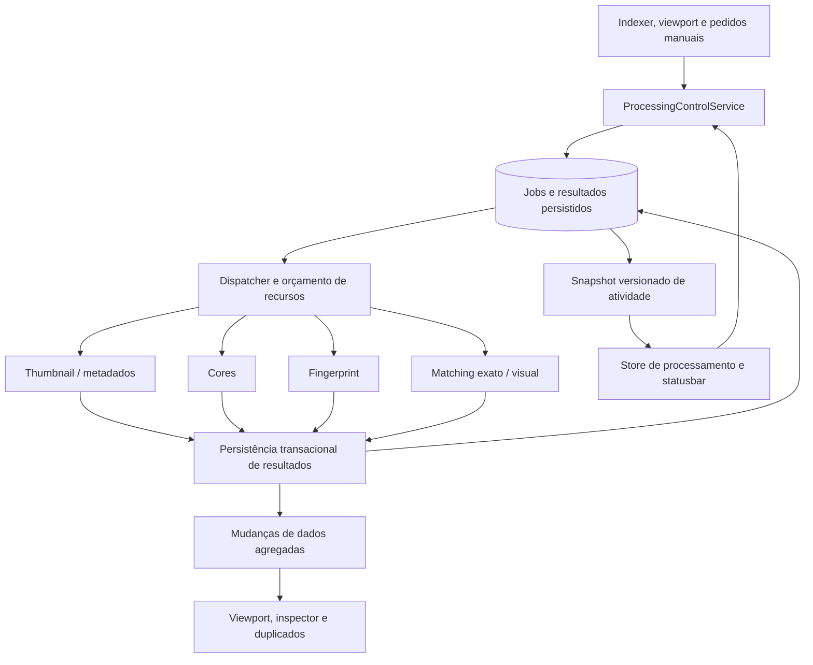

# Workers: diagnóstico e proposta de controle do processamento

**Data:** 30 de outubro de 2026.  
**Estado:** diagnóstico inicial e acompanhamento da implementação. As seções 2–4 registram a situação anterior à primeira entrega; a seção 10 descreve o código implementado e os limites atuais.  
**Escopo:** thumbnails/metadados, cores, fingerprints e comparação de duplicados, lifecycle e integração com a interface.

O documento histórico `docs/report/backend-architeture/definition/modules/05-job-scheduler-workers.md` foi consultado como contexto e permanece inalterado. Esta análise usa a implementação atual como fonte de verdade.

## 1. Conclusão

Há necessidade de padronização, mas o primeiro passo deve corrigir recuperação, elegibilidade e concorrência. Adicionar botões de pausa sobre os loops atuais produziria controles com comportamentos diferentes e, em alguns casos, estados incorretos na interface.

A recomendação é compartilhar **contratos de jobs, controle, progresso, persistência e orçamento de recursos**, mantendo executores especializados. Não transformar todos os processamentos em um único loop nem ampliar o Ledger com algoritmos de imagem ou hashing.

O indexer oferece uma referência para exibição de progresso, não uma implementação completa de controle: a statusbar atual não oferece pausa/retomada, e `stopIndexing` está comentado em [`services.ts`](../../src/core/tauri/services.ts). O scan é iniciado em uma tarefa separada por [`start_indexing`](../../src-tauri/src/delivery/tauri/commands/mutations.rs), sem um token de execução exposto ao usuário.

## 2. Situação encontrada na análise inicial

| Aspecto | Thumbnails e metadados | Cores | Duplicados |
| --- | --- | --- | --- |
| Entrada | Prioridades do viewport + consulta periódica ao banco | `ThumbnailGenerated` | `AssetCreated` + polling de fingerprints + scan manual separado |
| Concorrência | Semáforo local, `thumbnail_threads`, conjunto `in_flight` | Uma extração aguardada por vez no consumidor de eventos | Caminhos de evento, polling e scan manual podem trabalhar simultaneamente |
| Recuperação | Banco mantém thumbnails pendentes, com limitações de elegibilidade | Sem consulta de recuperação de pendências no worker | Polling de lotes de dez recupera fingerprints ausentes/desatualizados |
| CPU | Parte das conversões em `spawn_blocking`; execução dos providers varia | K-means em `spawn_blocking` | Hashing em `spawn_blocking`; comparação via repository |
| Persistência | Ledger para metadados e thumbnail | Ledger para paleta | Repository especializado para fingerprints e grupos |
| Estado consultável | Não há snapshot do worker | Não há snapshot do worker | Snapshot do scan manual; não representa todo o trabalho automático |
| Controle existente | Prioridade do viewport; configuração de concorrência lida ao iniciar | Token de encerramento da aplicação | Preferência de detecção automática; cancelamento do scan manual; tokens de lifecycle |

Fontes principais: [`bootstrap/workers.rs`](../../src-tauri/src/bootstrap/workers.rs), [`ThumbnailWorker`](../../src-tauri/src/processing/workers/thumbnail_worker.rs), [`ColorWorker`](../../src-tauri/src/processing/workers/color_worker.rs), [`DuplicateWorker`](../../src-tauri/src/feature/duplicates/events.rs) e [`DuplicateCommandService`](../../src-tauri/src/feature/duplicates/commands.rs).

Há bases úteis a preservar: prioridade do viewport com limite de 200 IDs, deduplicação de thumbnails em execução, uso do Ledger nos resultados de assets, isolamento de várias operações pesadas, registro dos serviços no lifecycle, recuperação de fingerprints pelo banco e status consultável do scan manual.

## 3. Achados prioritários da análise inicial

As evidências abaixo são de inspeção estática, exceto a reprodução SQL descrita na seção 4. Consequências de concorrência e volume são riscos inferidos do fluxo; não foram medidas em um benchmark nesta análise.

### P1 — Correção e confiabilidade

**A01. Reextração de cores não tem consumidor correspondente.**

[`handle_reextract_colors`](../../src-tauri/src/infra/database/handlers/metadata_handler.rs) apaga as cores existentes; o Ledger publica `ReextractAssetColors`. O [`ColorWorker`](../../src-tauri/src/processing/workers/color_worker.rs) trata apenas `ThumbnailGenerated`. Não há consumidor de `ReextractAssetColors` no código inspecionado. A intenção é registrada, mas esse worker não realiza a reextração solicitada.

**Recomendação:** transformar a solicitação em trabalho recuperável, preservar a paleta anterior até substituir o resultado com sucesso e usar o mesmo executor para pedido manual e processamento automático.

**A02. Regeneração de thumbnail fica fora da fila consultada no banco.**

[`handle_regenerate_thumbnail`](../../src-tauri/src/infra/database/handlers/thumbnail_handler.rs) limpa `thumbnail_path`, mas preserva `state = 'Thumbnailed'`. A [consulta de pendências](../../src-tauri/src/infra/database/query_handlers/asset_queries.rs) exige `state != 'Thumbnailed'`. Portanto, essa regeneração não é recuperada pelo polling. A prioridade do viewport pode oferecer outro caminho de execução, mas não substitui uma fila consistente. `ThumbnailInvalidated` também não é consumido pelos workers inspecionados.

**Recomendação:** uma regra única de elegibilidade e um estado próprio do job; regeneração deve criar uma nova tentativa/versão, independentemente do estado agregado do asset.

**A03. Falha de thumbnail pode ser gravada como processamento concluído.**

[`process_single`](../../src-tauri/src/processing/workers/thumbnail_worker.rs) começa com `final_thumb_path = ""`. Erros, bytes inválidos, resultado vazio e ausência de capacidade podem chegar a `UpdateThumbnail` com esse valor. O [handler](../../src-tauri/src/infra/database/handlers/thumbnail_handler.rs) grava `Thumbnailed` mesmo sem arquivo. Falha de commit também é apenas registrada em log nesse trecho, sem representar um resultado estruturado de job.

**Recomendação:** distinguir `succeeded`, `unsupported`, `failed`, `retry_wait` e `canceled`. Não representar todos por caminho vazio. Mudar somente para `Err` é insuficiente: sem uma política de retry, o polling pode tentar o mesmo erro indefinidamente.

**A04. Cores depende de entrega transitória de eventos.**

O consumidor executa a extração inteira antes de receber o próximo evento. Em [`Lagged`](../../src-tauri/src/processing/workers/color_worker.rs), apenas registra o problema; não reconcilia pendências. Também não faz recuperação no início. Uma thumbnail já persistida sem cores pode permanecer nessa condição se o evento for perdido ou a aplicação encerrar entre as etapas.

**Recomendação:** eventos acordam o processamento; o banco conserva a intenção e o estado. A retomada deve funcionar sem reproduzir eventos antigos.

**A05. Duplicados possui várias entradas sem coordenação comum.**

O [`start`](../../src-tauri/src/feature/duplicates/events.rs) ativa evento e polling em paralelo. Ambos podem selecionar/calcular o mesmo fingerprint antes da persistência. O [scan manual](../../src-tauri/src/feature/duplicates/commands.rs) usa outra coordenação. Sua leitura de `is_running` e a escrita seguinte ocorrem em locks separados; o cancelamento marca `is_running = false` antes de a execução confirmar sua saída. Isso permite sobreposição e atualizações tardias de status por uma execução anterior.

**Recomendação:** reserva única por `(asset_id, job_kind, source_revision)` e admissão atômica de scans. Todos os caminhos devem usar a mesma coordenação, com `run_id` e proteção contra resultados de execuções antigas.

**A06. Falhas permanentes de fingerprints não têm backoff.**

O [polling](../../src-tauri/src/feature/duplicates/events.rs) consulta dez itens e, após processar um lote não vazio, volta ao início sem atraso obrigatório. A [consulta](../../src-tauri/src/infra/database/handlers/duplicates_handler.rs) não possui ordenação explícita nem controle de tentativas. Arquivos que sempre falham podem ser selecionados repetidamente, gerar logs e ocupar o início dos lotes, prejudicando outros itens.

**Recomendação:** tentativas limitadas, erro persistido, `next_attempt_at`, backoff e ordenação estável. Separar erro transitório, arquivo indisponível, formato sem suporte e falha definitiva.

**A07. Encerramento dos serviços não equivale a cancelamento dos jobs.**

Thumbnails aguarda um [permit](../../src-tauri/src/processing/workers/thumbnail_worker.rs) sem selecionar simultaneamente o token de cancelamento e cria [tarefas filhas](../../src-tauri/src/processing/workers/thumbnail_worker.rs) sem guardá-las em um `JoinSet`. O lifecycle acompanha o orquestrador, não cada tarefa filha. O cleanup manual de `in_flight` também não cobre um panic antes da remoção do ID.

Cores e o consumidor de duplicados aguardam operações dentro de um ramo do `select!`; seus tokens não são verificados dentro dessas operações. O hashing de arquivo de [`generate_fingerprint`](../../src-tauri/src/feature/duplicates/events.rs) não recebe token. Existe ainda um [`run_exact_match_scan(None)`](../../src-tauri/src/feature/duplicates/events.rs) no caminho por evento.

**Recomendação:** acompanhar tarefas filhas, cleanup por RAII, cancelamento cooperativo e drenagem explícita. Não prometer interrupção imediata de uma operação nativa que não oferece esse recurso.

**A08. Elegibilidade de thumbnails não exclui lixeira e offline.**

A consulta usa apenas caminho nulo e estado diferente de `Thumbnailed`, sem `deleted_at IS NULL` ou restrição de disponibilidade. O carregamento do asset pelo worker também não faz essa validação. Já fingerprints aplica exclusão por `deleted_at` em seu polling. Os workers não compartilham uma regra consistente para decidir se o asset ainda deve ser processado.

**Recomendação:** validar na seleção, antes do trabalho e antes da persistência. Asset removido deve gerar cancelamento/obsolescência do job, sem novas notificações de erro por arquivo.

### P2 — Observabilidade, desempenho e manutenção

**A09. A statusbar não observa a atividade real dos três workers.**

[`systemStore`](../../src/core/store/systemStore.ts) escuta `thumbnail:queue-status`, mas não foi encontrado emissor desse evento no backend. [`StatusSystem`](../../src/components/features/statusbar/StatusSystem.tsx) considera apenas progresso do indexer e esse sinal de thumbnails. Cores e duplicados automáticos não participam da decisão. [`StatusMessages`](../../src/components/features/statusbar/StatusMessages.tsx) mostra `Ready` estaticamente. O estado verde atual não comprova que todos os serviços estejam ociosos ou saudáveis.

**A10. Configurações e orçamento de recursos não são uniformes.**

`thumbnail_threads` é lido [uma vez no início](../../src-tauri/src/processing/workers/thumbnail_worker.rs), embora o frontend permita alterá-lo. `worker_threads` aparece no modelo/configuração, mas não é consumido pelos três executores analisados. Não há orçamento comum entre thumbnails, cores, fingerprints e matching; limites específicos de providers precisam ser inventariados antes de definir limites globais.

`auto_detect_duplicates` também não significa uma pausa uniforme: desliga o polling, enquanto o caminho `AssetCreated` calcula o hash antes de consultar a preferência para executar matching. A própria interface descreve a preferência como detecção exata na importação; é necessário separar essa política da geração de fingerprints e da pausa do serviço.

**A11. Progresso e invalidação de dados precisam ser separados.**

O worker pode iniciar matching exato por asset recebido e por lote de dez; matching visual ocorre ao atingir ociosidade. Alguns resumos são publicados como `DuplicateGroupCreated` com [`group_id` vazio e valores fixos](../../src-tauri/src/feature/duplicates/events.rs). O frontend interpreta esses eventos como criação e [recarrega grupos e estatísticas](../../src/components/features/duplicates/hooks/useDuplicateGroups.ts).

Metadados também geram `metadata:ready`; o [listener](../../src/core/store/systemStore.ts) chama [`refreshItem`](../../src/core/store/library/itemActions.ts), que consulta o asset mesmo quando ele não está entre os itens carregados. Repetir esse padrão para telemetria de jobs recriaria o excesso de IPC e recargas observado na remoção de pastas.

**Recomendação:** um evento de progresso não deve invalidar biblioteca, árvore, badges ou grupos. Mudanças de resultados devem ser agregadas e direcionadas aos dados efetivamente afetados.

**A12. Há duplicação de processamento e contratos históricos imprecisos.**

Hashing/decodificação existe em [`DuplicateWorker`](../../src-tauri/src/feature/duplicates/events.rs) e em [`rehash_pending_fingerprints`](../../src-tauri/src/infra/database/handlers/duplicates_handler.rs), dentro do adaptador de banco. O trabalho automático e o manual devem reutilizar o mesmo serviço de fingerprint, deixando SQL no adaptador.

O documento histórico descreve um scheduler central, `BinaryHeap` e circuit breaker que não correspondem aos workers atuais. A prioridade real de thumbnails é uma janela substituível do viewport, atendida na ordem recebida, não uma pilha LIFO. Uma [lista vazia é ignorada](../../src-tauri/src/core/workflows/thumbnails/priority.rs), assim como no [frontend](../../src/core/store/library/itemActions.ts), impedindo limpar explicitamente prioridades antigas. O `FormatRegistry` de cores é clonado para uma variável não utilizada; convém remover dependências sem função real.

## 4. Reprodução isolada da seleção de thumbnails

Na análise inicial foi executada em SQLite em memória a consulta **extraída da implementação anterior**, sem acessar o banco pessoal da aplicação:

```sql
SELECT id FROM assets
WHERE thumbnail_path IS NULL AND state != 'Thumbnailed'
LIMIT ?;
```

| Registro sintético | Estado | Caminho | `deleted_at` | Selecionado |
| --- | --- | --- | --- | --- |
| Regeneração solicitada | `Thumbnailed` | `NULL` | `NULL` | Não |
| Item na lixeira | `trashed` | `NULL` | Preenchido | Sim |
| Item offline | `Offline` | `NULL` | `NULL` | Sim |
| Resultado vazio marcado como concluído | `Thumbnailed` | `""` | `NULL` | Não |

Isso confirma a incompatibilidade de seleção; não é uma medição de execução dos providers. Não foram feitos benchmarks nem testes de interação da statusbar nesta análise.

## 5. Arquitetura recomendada



O diagrama é uma proposta. O dispatcher compartilha políticas; cada executor conserva dependências, capacidade e limites específicos. O indexer pode integrar o mesmo painel de atividade mantendo seu pipeline de descoberta e seu orçamento próprio de I/O.

### Contratos e persistência

Criar contratos no `core/` para `ProcessingJob`, `JobKind`, `JobState`, `WorkerSnapshot`, controle e portas de persistência. Orquestração em `feature/`; SQL/claims em `infra/`; comandos Tauri apenas encaminham para o serviço. Usar o Ledger para mutações dos assets e portas transacionais explícitas para índices/jobs, com eventos de resultado somente após commit.

Uma tabela de jobs deve poder registrar:

- Identidade do job, tipo, asset/escopo, origem e prioridade.
- Revisão da origem e versão do algoritmo; chave única que evite trabalho duplicado da mesma versão.
- Estado, tentativas, próximo retry, timestamps e erro categorizado.
- Claim/lease da execução; recuperação após encerramento inesperado.
- Dependências: cores aguarda uma thumbnail válida da versão esperada; matching aguarda fingerprints confirmados.

São **estados do trabalho**, não uma nova flag genérica no asset. `AssetState` sozinho não representa etapas independentes executadas ao mesmo tempo.

Estados de job sugeridos: `pending`, `running`, `retry_wait`, `succeeded`, `skipped`, `failed`, `canceled` e `superseded`. `unsupported` pode ser um motivo de `skipped`. Resultado sem paleta e extração ainda não tentada precisam ser distinguíveis.

Não confiar apenas na presença de arquivo ou linha de resultado. Antes de persistir, verificar existência do asset, validade do claim e revisão da origem. Resultados de uma versão antiga não podem sobrescrever a nova. Preservar os testes de remoção de assets e limpeza de arquivos gerados após a remoção.

### Agendamento, falhas e recursos

- Reservar jobs antes de executar; evento, polling e scan manual concorrem pela mesma reserva.
- Eventos funcionam como sinal de trabalho disponível; recuperação vem do banco.
- Separar os budgets de CPU, leitura de arquivos e processos externos. `indexer_concurrency_limit = 200` não é um limite apropriado para 200 decodificações pesadas simultâneas.
- Aplicar configurações na próxima admissão de trabalho, sem interromper arbitrariamente os jobs ativos ao reduzir concorrência. Documentar valores automáticos e limites seguros.
- Dar preferência ao viewport com uma política que também garanta avanço do backlog.
- Reagendar falhas transitórias com backoff e tentativas limitadas; indisponibilidade de ferramenta pode bloquear uma capacidade temporariamente, com motivo visível.
- Acompanhar filhos e limpar reservas por RAII. Pausa, cancelamento de execução e encerramento da aplicação são operações diferentes.
- Reutilizar o serviço de fingerprint em todas as entradas e coalescer pedidos de matching, evitando uma varredura global por asset.

## 6. Controle pelo usuário

### Painel de atividade na statusbar

Evoluir `StatusSystem` para um componente apoiado em um store próprio de processamento. Não embutir o controlador inteiro no componente nem manter signals independentes para cada protocolo legado.

| Linha | Informação útil | Ações propostas |
| --- | --- | --- |
| Indexação | Raiz, descoberta, classificação, persistência e pendências | Pausar/retomar quando houver suporte real por execução |
| Thumbnails/metadados | Ativos, pendentes, falhas e item/fase atual | Pausar fundo, retomar, repetir falhas, ajustar concorrência |
| Cores | Pendentes e ativos; bloqueio aguardando thumbnail | Pausar/retomar, repetir falhas, reextrair seleção |
| Duplicados: fingerprints | Ativos, pendentes, bytes/arquivo quando disponíveis | Pausar/retomar processamento automático, repetir falhas |
| Duplicados: comparação | Exata/visual, fase e execução atual | Executar, solicitar cancelamento e consultar resultado |

Separar preferência persistida de automação e pausa temporária. Definir explicitamente se “pausar fundo” mantém thumbnails visíveis habilitadas; “pausar tudo” deve ter outra semântica. Não apresentar os dois comportamentos sob o mesmo rótulo.

Pausar deixa de admitir novos jobs. Durante a drenagem, mostrar `pausing`; só mostrar `paused` quando não houver trabalho ativo nessa política. Um pedido de cancelamento permanece `cancel_requested` até o executor confirmar saída. Retomar não reutiliza um token já cancelado.

Ociosidade, pausa, desabilitação, espera de dependência e falha são estados diferentes. O indicador verde exige snapshot válido e condições conhecidas, não apenas ausência de um signal. Enquanto o snapshot não chegar, mostrar atividade desconhecida/carregando.

Falhas individuais ficam no painel, agrupadas por causa e com retry adequado. Toasters devem confirmar ações explícitas ou resumir uma execução, não anunciar cada asset processado.

### Snapshot, eventos e comandos propostos

API ilustrativa, ainda não implementada:

```text
get_processing_snapshot()
pause_processing(scope, policy)
resume_processing(scope)
cancel_processing_run(run_id)
retry_processing_failures(scope)
update_processing_limits(limits)
```

O snapshot deve incluir identidade do worker, `run_id` quando aplicável, revisão/sequence, estado, fase, contagens de fila/ativos/resultados, capacidade efetiva e ações suportadas. Contadores de tentativas não devem ser confundidos com contadores de jobs concluídos.

Registrar o listener antes de buscar o snapshot inicial; aplicar somente revisões mais novas. Na perda de eventos, ao reabrir o painel ou após reconectar, consultar o snapshot novamente. Não reconstruir a verdade apenas por incrementos no frontend.

Publicar progresso coalescido, inicialmente com janela proposta de 250–500 ms por worker, a validar por medição. Mudanças de controle e estados terminais podem ser imediatas. O tamanho do payload não deve crescer com todo o backlog.

Separar dois canais conceituais:

1. **Atividade:** snapshot/contadores; atualiza apenas o painel e indicadores.
2. **Resultados:** assets/grupos efetivamente alterados; atualiza seletivamente viewport, inspector e duplicados, com batching e invalidação consolidada.

Para filas contínuas, mostrar “ativos / pendentes / falhas” em vez de um percentual artificial. Para execuções finitas, usar total conhecido e fases identificadas. Conclusão com falhas não deve parecer sucesso integral. Aplicar a mesma identidade de execução ao indexer para evitar que scans de raízes diferentes sobrescrevam um único progresso global.

## 7. Ordem de implementação sugerida

| Etapa | Entrega | Critério de conclusão |
| --- | --- | --- |
| 1 — Correção dos contratos atuais | Tratar reextração de cores; corrigir regeneração/elegibilidade; distinguir erro de sucesso vazio; limitar retries; coordenar entradas de duplicados | Testes dos casos A01–A08; nenhuma tarefa perdida tratada como concluída |
| 2 — Estado e lifecycle comuns | Estados por job, reserva compartilhada, recuperação persistente, filhos acompanhados e proteção por revisão/run | Reinício, concorrência e cancelamento não produzem trabalho duplicado nem resultado obsoleto |
| 3 — Observabilidade | Snapshot consultável e eventos coalescidos; separar telemetria de invalidação | Frontend reconstrói estado após perda de eventos; progresso não recarrega listas/badges |
| 4 — Controles na interface | Painel por worker, pausa/retomada, cancelamento suportado, retry e limites efetivos | UI reflete confirmação do backend; uma ação gera feedback consolidado |
| 5 — Otimização medida | Matching incremental/coalescido, budgets ajustados, bloqueio temporário de capacidades e testes de carga | Comparar CPU, memória, I/O, tempo de fila e IPC com uma linha de base |

A etapa 1 não deve criar mais três implementações incompatíveis de fila. Correções imediatas podem ser locais, mas garantias de recuperação e controle dependem da etapa 2. O contrato do snapshot deve ser definido antes de expandir a statusbar.

## 8. Testes e critérios de aceite

- Reextração manual de cores executa e substitui a paleta somente após sucesso.
- Regeneração de thumbnail funciona sem depender de o asset estar visível.
- Assets removidos, em lixeira ou indisponíveis não recebem processamento indevido; restauração segue uma regra explícita.
- Erro transitório pode ser repetido; erro permanente não ocupa o loop continuamente nem bloqueia os demais itens.
- Evento perdido, `Lagged` e reinício recuperam pendências de cores e fingerprints.
- Evento e polling para o mesmo asset executam uma única tentativa da mesma revisão.
- Scan manual e automático não sobrepõem matching; progresso antigo não altera a execução nova.
- Pausa deixa de admitir trabalho; cancelamento durante permit, leitura e provider tem semântica verificável; shutdown drena ou registra trabalho recuperável.
- Alterar limites tem efeito documentado e observável sem exigir reinício silenciosamente.
- Nenhuma telemetria dispara consulta de biblioteca, árvore, contagens ou grupos; resultados em massa usam invalidação limitada.
- Milhares de jobs não geram milhares de toasts nem excedem buffers por progresso desnecessário.
- Estado inicial e após uma lacuna de sequence são reconstruídos por snapshot, inclusive quando o painel foi aberto depois do início do trabalho.
- Testar caminhos locais e de rede, arquivos inacessíveis, mídia grande, formatos sem ferramenta disponível e providers nativos em Windows e macOS; incluir Linux quando a plataforma for validada.

Medir antes/depois: tempo até thumbnail visível, throughput de fundo, pico de memória, CPU, bytes lidos, consultas SQLite por job, quantidade/tamanho de IPC e recargas das views. Os limites de aceitação devem ser definidos a partir dessa linha de base, não de números presumidos nesta análise.

## 9. Limites desta revisão

Foram inspecionados workers, bootstrap/lifecycle, consultas e handlers relacionados, configuração, bridge de eventos, stores e componentes de status/duplicados. Foi reproduzida a consulta de thumbnails em SQLite em memória. Não houve alteração dos workers ou da interface, execução de processamento real, benchmark ou validação prática de cancelamento e consumo de recursos.

O histórico de arquitetura indicado não foi alterado. Alterações preexistentes em `GlobalStatusbar.tsx` não fazem parte desta análise.

## 10. Primeira entrega: confiabilidade dos executores

Implementação iniciada em 30 de outubro de 2026. Esta entrega prepara os executores para controle e observabilidade posteriores; não adiciona botões de pausa/retomada à statusbar.

### Base compartilhada

- `core/processing.rs` define tipos de etapa, ticket de geração, resultados e porta de persistência.
- A migration `20261030010000_processing_attempts.sql` cria `processing_tasks`, com FK para o asset, geração da solicitação, identificação da origem, resultado, tentativas e próximo retry.
- `infra/processing.rs` concentra elegibilidade, pendências, pedidos explícitos e bookkeeping de resultados. A seleção exclui `deleted_at` preenchido e estados de lixeira/offline.
- Falhas têm até três tentativas: primeiro reagendamento em cinco segundos, segundo em trinta segundos e terceira falha terminal. Alterar a origem ou solicitar reprocessamento explicitamente permite nova tentativa. Não há toast por falha individual.
- Pedidos explícitos são persistidos na transação do Ledger. Uma tentativa antiga não pode sobrescrever o registro de uma solicitação mais recente. Remover um asset apaga suas pendências por cascade.

### Thumbnails e cores

- Regenerar thumbnail limpa o resultado, altera o estado para `Indexed` e registra uma nova solicitação, sem depender do viewport.
- O handler rejeita sucesso com caminho vazio. Falta de provider/capacidade vira `skipped`; geração vazia, inválida, falha de escrita ou falha de commit segue a política de erro.
- A codificação é executada fora do executor assíncrono, e a escrita dos arquivos usa I/O assíncrono. Tarefas filhas são acompanhadas por `JoinSet`; reservas de assets são liberadas por RAII; espera por permit pode ser cancelada.
- A solicitação de reextração de cores preserva a paleta anterior. A substituição ocorre somente no commit do novo resultado.
- O commit de uma thumbnail solicita cores na mesma transação. O worker de cores reconcilia pendências no início, periodicamente e quando recebe `ThumbnailGenerated` ou `ReextractAssetColors`; `Lagged` não é mais a única fonte de verdade.
- Ambas as etapas verificam elegibilidade antes de persistir. O controle por geração protege o registro das tentativas; fencing transacional completo dos resultados e publicação dos arquivos ainda pertence à próxima etapa.
- Um viewport vazio agora limpa a prioridade no backend. Prioridade não ultrapassa os bloqueios de retry ou de elegibilidade.

### Duplicados

- Há um único executor automático de fingerprints. Eventos acordam a consulta de pendências, sem um segundo caminho que também calcula hashes.
- Fingerprints automáticos usam o mesmo bookkeeping persistido e limite de retries. A preferência de detecção automática desativa a execução automática completa; scans manuais continuam explícitos.
- O coordenador compartilhado serializa cada tentativa automática e as comparações com o scan manual. A exclusão mútua é da instância da aplicação, não um lease entre processos.
- Comparação exata é consolidada após cem fingerprints processados ou ao atingir ociosidade; comparação visual ocorre ao atingir ociosidade. Isso substitui a varredura por cada `AssetCreated`.
- `DuplicateGroupsChanged` invalida grupos/estatísticas após a comparação, sem fingir criação de um grupo com ID vazio e sem incrementar o contador de novos grupos por esse resumo.
- A admissão do scan manual é atômica. Status tem `run_id`, progresso antigo não pode alterar outra execução e o canal de progresso é drenado antes de mudar a fase.
- Cancelar mantém a execução como `cancel_requested` até a saída efetiva. `DuplicateScanStopped` encerra o estado visual em cancelamento/erro, inclusive em outro consumidor da interface. Leitura automática de hashes observa cancelamento entre blocos; operações nativas já iniciadas não ganham interrupção forçada.

### Limites que permanecem

`processing_tasks` ainda não é um scheduler completo. Não há claim/lease persistido de execução, heartbeat, orçamento global, snapshot de atividade ou API de pausa/retomada. A concorrência usa os executores locais e o coordenador de duplicados. A comparação antes do commit reduz resultados obsoletos, mas não substitui uma precondição transacional de versão para todos os resultados/arquivos.

A configuração de concorrência de thumbnails ainda é lida na inicialização. O algoritmo de fingerprint do scan manual ainda precisa ser extraído para o mesmo serviço usado pelo automático. O canal de progresso manual continua não limitado, embora sua tarefa agora seja aguardada antes da próxima fase. As consultas legadas de matching/rehash manual precisam ser incorporadas à regra compartilhada de elegibilidade ao migrar essa execução para jobs.

A identificação da origem usa caminho, tamanho e `modified_at` do catálogo, não uma revisão física atômica do arquivo. A intenção de comparação automática após fingerprints ainda é mantida em memória; a retomada dessa comparação após crash exige jobs persistidos de matching na próxima etapa. Desempenho das consultas com catálogos grandes e ajustes de concorrência ainda precisam de medição.

A recuperação de tentativas usa o banco. Estados visuais globais, controle da pausa de fundo versus prioridade do viewport e recuperação de snapshot após perda de eventos permanecem nas etapas 2–4 do plano. A integração com resultados de duplicados foi atualizada, mas a statusbar ainda não deve ser considerada uma representação completa desses workers.

### Validação executada para a entrega

Testes usam migrations e adaptadores reais para regeneração sem viewport, recuperação de cores sem evento, preservação da paleta em falhas, limite de retries e avanço de outros assets, geração mais recente, alteração de origem e cascade de pendências. Testes dos executores cobrem resultado inválido/sem suporte, liberação de reserva após panic e cancelamento de scan enquanto aguarda admissão. A camada de frontend testa a limpeza da prioridade com viewport vazio.

Validação automática no Windows:

- `cargo +stable-x86_64-pc-windows-msvc test --locked --lib processing_`: 14 testes aprovados.
- `cargo +stable-x86_64-pc-windows-msvc test --locked --lib folder_`: 16 regressões aprovadas.
- `cargo +stable-x86_64-pc-windows-msvc test --locked --lib priority::tests`: quatro testes aprovados.
- Vitest com `--configLoader native --pool threads --maxWorkers 1 --environment node`: seis testes aprovados em `itemActions.processing.spec.ts`, `libraryEvents.spec.ts` e `useMetadataNotifications.spec.ts`.
- `npm run typecheck`, ESLint dos arquivos frontend alterados e `git diff --check`: sem erros.

Uma execução exploratória com o filtro mais amplo `processing` foi interrompida durante testes antigos de RAW que não foram alterados; ela não representa uma execução completa da suíte. Os comandos focados acima concluíram integralmente. A primeira tentativa de Vitest durante a carga de RAW atingiu timeout de inicialização; a execução final dos três arquivos concluiu sem erros.

Não houve validação visual na aplicação nem execução dos workers no macOS nesta entrega. O documento histórico de arquitetura e as alterações preexistentes em `GlobalStatusbar.tsx` foram preservados.

## 11. Thumbnail do viewport: resultados de erro e ausência de extrator

`Thumbnail.tsx` deixou de inferir o término do processamento a partir de `AssetState`. Um asset pode permanecer `Indexed` após um resultado `skipped` ou `failed`; isso não significa que deva manter um spinner.

O componente agora usa [`useThumbnail`](../../src/components/features/viewport/assets/useThumbnail.ts) para separar o estado visual de sua apresentação:

| Resultado | Sem thumbnail utilizável |
| --- | --- |
| `pending` | Indicador de espera; a etapa atual ainda não distingue fila e execução ativa |
| `retry_wait` | Mantém o indicador de espera, com explicação de retry agendado |
| `failed` | Ícone do arquivo, com explicação de esgotamento das tentativas |
| `skipped` | Ícone do arquivo, com explicação de ausência de capacidade/extrator |
| `unavailable` | Ícone quando a origem não está disponível; cache existente ainda pode ser exibido |
| `unknown` no frontend | Mantém a espera enquanto o resultado é desconhecido; falha de consulta não confirma falha de extração |
| `succeeded` | Imagem gerada, com identidade de cache que inclui sua geração |

O read model `get_thumbnail_processing_status` recebe até 200 IDs únicos. A camada de delivery delega para `feature/processing.rs`; o repository lê apenas identidade, estado, geração e caminho da thumbnail, sem retornar erro bruto ou caminho original como diagnóstico.

[`thumbnailProcessing.ts`](../../src/core/store/thumbnailProcessing.ts) compartilha inscrições entre componentes e agrupa consultas em uma janela de 30 ms, com limite de 200 IDs por chamada. Trabalho pendente, retry e indisponibilidade de transporte são reconsultados a cada dois segundos; estados terminais não mantêm polling. Desmontar ou reciclar o card libera sua inscrição. Respostas anteriores à invalidação de uma geração são ignoradas. Essas consultas não recarregam biblioteca, árvores, contagens ou grupos, nem publicam eventos por asset.

Um resultado consultado pode recuperar a imagem mesmo quando `thumbnail:ready` foi perdido. Invalidação e falhas de transporte preservam o último snapshot conhecido, incluindo sua geração e caminho de saída. Uma falha de transporte mantém a reconsulta mesmo se o estado preservado for terminal. URLs preservam a geração durante a atualização do snapshot e mudam quando uma regeneração produz nova imagem. O hook troca as inscrições quando o ID muda, evitando que uma conclusão antiga apareça em um card reciclado.

Erro de carregamento de uma imagem que o backend declarou disponível permite um pedido automático de reparo de cache. Esse pedido é limitado por asset em um cache de sessão limitado a mil identidades, compartilhado entre montagens. Falta de extrator e falhas de processamento não disparam esse mecanismo. Rejeição do pedido e resultados terminais encerram a espera de regeneração. Fila, retry agendado e falha transitória na consulta não substituem o carregamento por ícone de erro, nem desmontam seu indicador a cada reconsulta. Erros de transporte não emitem toasts repetidos.

O componente mantém as propriedades existentes, portanto o comportamento também se aplica aos usos em home e duplicados. O painel global de atividade, leases e pausa/retomada continuam sendo a próxima etapa; este read model não substitui o snapshot global planejado.

### Validação desta etapa

- Testes Rust com o filtro `processing_`: 16 aprovados, incluindo consulta de estados persistidos, origem indisponível, deduplicação e limite do lote.
- Vitest: 15 aprovados, cobrindo apresentação, reciclagem de cards, recuperação sem evento, reparo rejeitado, agrupamento de consultas e falhas de transporte. A regressão verifica que o mesmo indicador permanece montado durante fila, retries e falhas de consulta, até um resultado definitivo.
- A validação visual na aplicação e no macOS permanece pendente.

## 12. Retries vencidos não ficam atrás de toda a biblioteca

A seleção anterior ordenava `COALESCE(next_attempt_at, 0)` em ordem crescente. Isso colocava toda pendência sem tentativa antes de qualquer retry com data positiva, mesmo após o vencimento do backoff. Em bibliotecas grandes, um asset podia permanecer em `retry_wait` enquanto centenas de extrações novas eram atendidas. O loader refletia esse estado persistido e não recebia um resultado terminal.

`ProcessingRepository::pending` agora seleciona retries elegíveis antes do backlog sem tentativa, preservando uma ordem estável dentro de cada categoria. A elegibilidade continua excluindo retries cujo prazo ainda não venceu, assets inativos e falhas terminais. O limite permanece em três tentativas por origem e geração, com backoff de cinco e trinta segundos entre elas. A política compartilhada se aplica a thumbnails, cores e fingerprints; a prioridade explícita do viewport continua precedendo a fila de fundo do worker de thumbnails.

Uma falha do extrator, incluindo erro do FFmpeg ao ler HEIC, continua sendo registrada como falha de processamento. Esgotadas as tentativas, o read model retorna `failed` e o viewport exibe o fallback. `AssetState` pode continuar `Indexed`: o resultado de processamento é a informação usada pela thumbnail. Esta correção não altera o comando do FFmpeg nem tenta tornar um arquivo corrompido decodificável.

A regressão de seleção cobre as três etapas. A regressão do worker usa um provider que retorna erro de transcoding, percorre a seleção real com backlog concorrente até o resultado terminal e verifica três tentativas, liberação da fila para outro asset e preservação dos bytes originais.

Validação no Windows: `cargo +stable-x86_64-pc-windows-msvc test --locked --lib processing_` concluiu com 18 testes aprovados. O novo teste de seleção reproduziu a falha com a ordenação anterior e passou com a correção. A consulta corrigida também foi executada em leitura sobre o catálogo observado, passando a selecionar o retry vencido antes das pendências sem tentativa. Não houve execução do extrator no HEIC real nesta validação.

## 13. Autorização IPC da consulta de thumbnails

O comando `get_thumbnail_processing_status` precisa estar registrado no invoke handler, declarado em `permissions/main.toml` e concedido em `capabilities/default.json`. O registro isolado não permite acesso quando a aplicação define um manifesto ACL. A ausência da permissão impedia a janela de consultar resultados terminais já persistidos, mantendo o último estado de espera ou `unknown` no frontend.

Foi adicionada a permissão específica `allow-get-thumbnail-processing-status` às janelas já cobertas pela capability padrão (`main` e `design-system`). A splashscreen continua sem acesso a essa consulta. A mudança exige recompilar o backend Tauri, pois capabilities são incorporadas à aplicação.

A regressão em `delivery/tauri/thumbnail_ipc_tests.rs` usa a configuração real de capabilities com o runtime de testes do Tauri. Ela envia a mesma chamada IPC do frontend (`assetIds`), verifica os resultados `failed` e `pending` nas janelas da biblioteca e rejeição na splashscreen. Esse teste cobre a autorização ausente nas verificações anteriores de repository e nos testes frontend com `invoke` simulado.

No Windows, testes que instanciam o runtime desktop exigem o manifesto de Common Controls v6, ausente no executável de testes gerado inicialmente. Esse problema de carregamento é documentado pelo [projeto Tauri](https://github.com/tauri-apps/tauri/issues/11028). O executor `scripts/test-backend-windows.ps1` compila a biblioteca com `--no-run`, identifica o executável pelo JSON de artifacts do Cargo, incorpora `scripts/windows-tests.manifest.xml` usando `mt.exe` do Windows SDK e executa o filtro solicitado. Ele modifica apenas o artefato de teste e não o executável da aplicação.

```powershell
./scripts/test-backend-windows.ps1 processing_
```

Validação no Windows: `./scripts/test-backend-windows.ps1 processing_` concluiu com 19 testes aprovados, incluindo a chamada IPC autorizada com as capabilities reais. Não houve validação visual na janela da aplicação nesta etapa.
