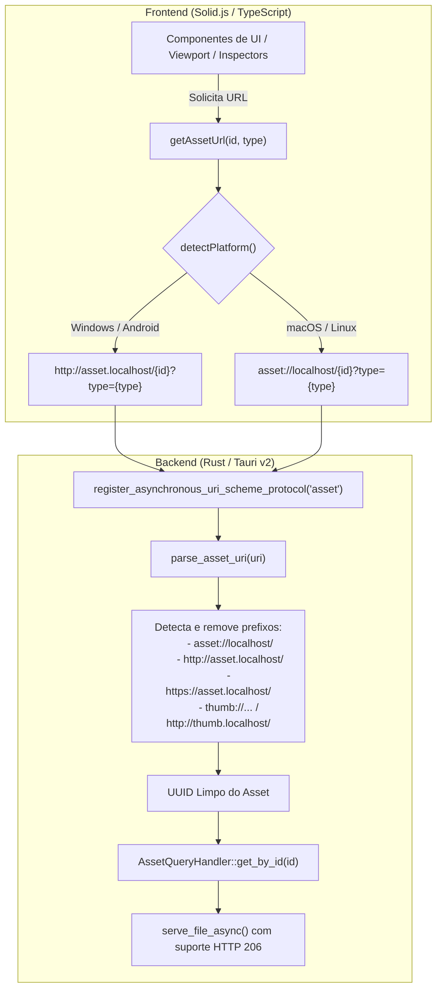

# Relatório de Engenharia: Resolução do Protocolo de Assets e Thumbnails no Windows (Tauri v2)

**Data:** 27 de Outubro de 2026  
**Autor:** Antigravity AI Assistant & Marcus Maia  
**Repositório:** `Mundam-v2`  
**Escopo:** Diagnóstico, resolução e padronização multiplataforma do carregamento de assets (`asset://` vs `http://asset.localhost`) e thumbnails no ambiente Windows (WebView2), sincronizando o backend em Rust e o frontend em Solid.js / TypeScript.

---

## 1. Visão Geral Executiva

Durante a execução do **Mundam-v2** em ambiente Windows (WebView2 / Chromium), observou-se que as thumbnails e mídias visuais da aplicação não eram carregadas na viewport, disparando erros recorrentes no console do desenvolvedor:

```text
GET asset://localhost/a3a29cec-6c36-4d25-9b31-695a76203d8e?type=thumb net::ERR_UNKNOWN_URL_SCHEME
```

No macOS (onde o runtime do Webview é o WebKit / WKWebView), a aplicação funcionava perfeitamente. 

Este relatório documenta a análise aprofundada da causa raiz, a divergência de design de protocolos customizados entre WebKit e WebView2 no ecossistema **Tauri v2**, bem como as alterações estruturais realizadas tanto no backend (Rust) quanto no frontend (Solid.js) para assegurar compatibilidade multiplataforma nativa e determinística.

---

## 2. Diagnóstico da Causa Raiz (Root Cause Analysis)

### 2.1. O Erro: `net::ERR_UNKNOWN_URL_SCHEME`
O erro de rede `net::ERR_UNKNOWN_URL_SCHEME` é emitido pelo Chromium quando um elemento (``, `<video>`, `<audio>` ou chamada `fetch`) requisita um esquema de URL que o navegador/webview não reconhece ou para o qual não possui tratador registrado no sistema operacional ou motor web.

### 2.2. Divergência Arquitetural: WebKit (macOS) vs. WebView2 (Windows)
No **Tauri v2**, desenvolvedores registram protocolos customizados assíncronos via:

```rust
tauri::Builder::default()
    .register_asynchronous_uri_scheme_protocol("asset", move |protocol_context, request, responder| { ... })
```

Sob o capô, os motores de renderização tratam esses esquemas de formas radicalmente distintas:

1. **macOS / iOS / Linux (WebKit / WebKitGTK):**
   - O WebKit suporta nativamente esquemas de protocolo customizados na sintaxe URI padrão:
     $$\text{Sintaxe: } \texttt{asset://localhost/<path>}$$
   - O WebKit intercepta a requisição diretamente pela API `setURLSchemeHandler`.

2. **Windows / Android (WebView2 / Chromium):**
   - O Chromium implementa restrições severas de segurança de origem (SOP/CORS), contextos seguros e isolamento de processos para esquemas customizados arbitrários.
   - Para garantir total compatibilidade com streaming de mídia (`Range requests 206`), CORS e credenciais sem quebrar a segurança do browser, o Tauri / Wry mapeia protocolos customizados automaticamente para **origens baseadas em loopback HTTP**:
     $$\text{Sintaxe: } \texttt{http://<scheme>.localhost/<path>} \quad (\text{ex.: } \texttt{http://asset.localhost/<path>})$$
   - Quando o frontend tenta acessar `asset://localhost/...` no Windows, o WebView2 tenta localizar um handler externo de sistema (como um protocolo do Windows Registry) e, ao falhar, emite `net::ERR_UNKNOWN_URL_SCHEME`.

### 2.3. Fragilidades Identificadas no Backend Rust (`asset.rs` e `common.rs`)
Mesmo que o frontend passasse a requisitar `http://asset.localhost/...`, o backend Rust original não estava preparado para processar a URI do Windows:

1. **Falha no `parse_asset_uri` (`src-tauri/src/delivery/protocols/asset.rs`):**
   - A rotina de extração de ID esperava exclusivamente prefixos do macOS:
     ```rust
     // Implementação anterior (limitada a macOS)
     let prefix = "asset://localhost/";
     let fallback = "asset://";
     // Não havia correspondência para "http://asset.localhost/"
     ```
   - Ao receber `http://asset.localhost/12345?type=thumb`, nenhuma das regras de corte tinha êxito. 
   - A rotina subsequente (`pos = decoded_id.find('.')`) encontrava o ponto de `.localhost`, truncando o ID para `"http://asset"`.
   - O repositório executava `query_handler.get_by_id("http://asset").await`, retornando `404 Not Found` silencioso.

2. **Falha no `decode_uri_path` (`src-tauri/src/delivery/protocols/common.rs`):**
   - Protocolos auxiliares como `video://` e `audio://` sofriam do mesmo problema, pois `decode_uri_path` só removia o prefixo `{}://localhost/`.
   - Além disso, no Windows, caminhos absolutos locais recebidos via URI frequentemente trazem uma barra inicial redundante antes da letra da unidade (`/C:/...`), que impedia a localização do arquivo via `PathBuf`.

3. **Disseminação de Strings Hardcoded no Frontend:**
   - 12 arquivos do frontend montavam manualmente URLs com a string literal `` `asset://localhost/${id}?type=thumb` ``, tornando impossível o funcionamento em qualquer plataforma não baseada em WebKit.

4. **Falha de Validação de Escopo no Servidor de Streaming (`server.rs`):**
   - Ao tentar abrir vídeos no `ItemView`, ocorria o erro:
     ```text
     VideoSourceHook: Video probe failed: Error: Probe failed: Forbidden
     ```
   - Causa Raiz: A função `validate_path_scope` invocava `std::fs::canonicalize(path)`, que no Windows acrescenta o prefixo estendido/UNC verbatim `\\?\` (ex.: `\\?\D:\...\video.mp4`).
   - Os diretórios autorizados (`root.path`) vindos do banco de dados utilizam a sintaxe padrão do Windows (`D:\...`).
   - A comparação `canonical_path.starts_with(&root.path)` falhava sistematicamente porque o componente `Prefix::VerbatimDisk` não é igual a `Prefix::Disk`, bloqueando o acesso de leitura com HTTP 403 Forbidden.

---

## 3. Arquitetura da Solução Implementada

Para solucionar o problema de forma definitiva e elegante, a resolução foi dividida em duas frentes integradas: **Backend Resiliente** e **Frontend Consciente de Plataforma**.



---

## 4. Detalhamento das Alterações no Código

### 4.1. Utilitário Multiplataforma no Frontend (`assetUrl.ts`)

Criou-se o módulo centralizado [`src/core/utils/assetUrl.ts`](file:///c:/Users/Marcus%20Maia/Desktop/Aplicativos/Mundam-v2/src/core/utils/assetUrl.ts):

```typescript
import { detectPlatform } from '../input/utils/platform';

export type AssetRequestType = 'thumb' | 'preview' | 'glb';

/**
 * Retorna a URI base para protocolos customizados conforme o sistema operacional.
 * - Windows / Android: http://<protocol>.localhost
 * - macOS / Linux: <protocol>://localhost
 */
export function getProtocolBase(protocol: string = 'asset'): string {
    const isWindows = detectPlatform() === 'windows';
    return isWindows ? `http://${protocol}.localhost` : `${protocol}://localhost`;
}

/**
 * Resolve a URL completa de um asset a partir de seu ID e tipo de recurso opcional.
 * Compatível de forma transparente entre macOS, Linux e Windows WebView2.
 */
export function getAssetUrl(assetId?: string | null, type?: AssetRequestType | string): string {
    if (!assetId) return '';
    const base = getProtocolBase('asset');
    if (!type) {
        return `${base}/${assetId}`;
    }
    return `${base}/${assetId}?type=${type}`;
}
```

### 4.2. Backend Rust: Tratamento Resiliente de Esquemas

#### Atualização em `src-tauri/src/delivery/protocols/asset.rs`:
A função `parse_asset_uri` e as verificações de tipo foram expandidas para reconhecer todas as variantes de loopback do Windows e WebKit:

```rust
fn parse_asset_uri(uri: &str) -> (String, Option<String>) {
    let prefixes = [
        "asset://localhost/",
        "asset://",
        "http://asset.localhost/",
        "https://asset.localhost/",
        "thumb://localhost/",
        "thumb://",
        "http://thumb.localhost/",
        "https://thumb.localhost/",
    ];

    let mut path_with_query = uri;
    for prefix in &prefixes {
        if let Some(rest) = uri.strip_prefix(prefix) {
            path_with_query = rest;
            break;
        }
    }

    let (path_part, query_part) = if let Some(pos) = path_with_query.find('?') {
        (&path_with_query[..pos], Some(&path_with_query[pos + 1..]))
    } else {
        (path_with_query, None)
    };

    let mut decoded_id = percent_decode_str(path_part)
        .decode_utf8_lossy()
        .into_owned();

    // Se for requisição com extensão de arquivo (ex.: "uuid.webp"), remove extensão
    if let Some(pos) = decoded_id.find('.') {
        decoded_id = decoded_id[..pos].to_string();
    }

    let req_type = query_part.and_then(|q| {
        if q.contains("type=thumb") {
            Some("thumb".to_string())
        } else if q.contains("type=preview") {
            Some("preview".to_string())
        } else if q.contains("type=glb") {
            Some("glb".to_string())
        } else {
            None
        }
    });

    (decoded_id, req_type)
}
```

Adicionalmente, a identificação rápida de thumbnail em `handler_async` foi corrigida:
```rust
let is_thumb = requested_type == Some("thumb".to_string())
    || uri.starts_with("thumb://")
    || uri.starts_with("http://thumb.localhost")
    || uri.starts_with("https://thumb.localhost");
```

#### Atualização em `src-tauri/src/delivery/protocols/common.rs`:
O decodificador genérico `decode_uri_path` recebeu normalização para Windows:

```rust
pub fn decode_uri_path(uri: &str, scheme: &str) -> String {
    let prefixes = [
        format!("{}://localhost/", scheme),
        format!("{}://", scheme),
        format!("http://{}.localhost/", scheme),
        format!("https://{}.localhost/", scheme),
    ];
    let mut path = uri;
    for prefix in &prefixes {
        if let Some(rest) = uri.strip_prefix(prefix) {
            path = rest;
            break;
        }
    }

    let path = path.split('?').next().unwrap_or(path);

    let decoded = percent_encoding::percent_decode_str(path)
        .decode_utf8_lossy()
        .into_owned();

    // No Windows, se o caminho iniciar com "/C:/" ou similar, remove a barra inicial
    if cfg!(windows) && decoded.starts_with('/') && decoded.len() > 2 && decoded.as_bytes()[2] == b':' {
        decoded[1..].to_string()
    } else {
        decoded
    }
}
```

#### Atualização em `src-tauri/src/delivery/streaming/server.rs`:
O validador de escopo `validate_path_scope` foi aprimorado com as funções auxiliares `strip_unc_prefix` e `is_subpath`, tratando os prefixos verbatim `\\?\` do Windows e aplicando comparação insensível a maiúsculas/minúsculas entre componentes de caminho:

```rust
fn strip_unc_prefix(path: &std::path::Path) -> std::path::PathBuf {
    let s = path.to_string_lossy();
    if let Some(stripped) = s.strip_prefix(r"\\?\UNC\") {
        std::path::PathBuf::from(format!(r"\\{}", stripped))
    } else if let Some(stripped) = s.strip_prefix(r"\\?\") {
        std::path::PathBuf::from(stripped)
    } else {
        path.to_path_buf()
    }
}

fn is_subpath(child: &std::path::Path, parent: &std::path::Path) -> bool {
    let clean_child = strip_unc_prefix(child);
    let clean_parent = strip_unc_prefix(parent);

    #[cfg(windows)]
    {
        // Comparação de componentes sem distinção de maiúsculas/minúsculas
        // e normalização de prefixos de disco
        ...
    }
    #[cfg(not(windows))]
    {
        clean_child.starts_with(&clean_parent)
    }
}
```

### 4.3. Refatoração dos Componentes no Frontend

Todas as instâncias de construção manual de URLs foram substituídas pela chamada semântica `getAssetUrl(...)`:

| Arquivo Modificado | Local da Alteração | Propósito |
| :--- | :--- | :--- |
| [`Thumbnail.tsx`](file:///c:/Users/Marcus%20Maia/Desktop/Aplicativos/Mundam-v2/src/components/features/viewport/assets/Thumbnail.tsx) | `thumbUrl` createMemo | Carregamento da miniatura no grid/viewport principal. |
| [`VirtualListView.tsx`](file:///c:/Users/Marcus%20Maia/Desktop/Aplicativos/Mundam-v2/src/components/features/viewport/layouts/VirtualListView.tsx) | `getThumbUrl` helper | Exibição de miniaturas na visualização em lista tabular. |
| [`ghost.ts`](file:///c:/Users/Marcus%20Maia/Desktop/Aplicativos/Mundam-v2/src/core/dnd/ghost.ts) | `createDragGhost` | Exibição da miniatura do asset flutuante durante Drag & Drop. |
| [`ModelViewer.tsx`](file:///c:/Users/Marcus%20Maia/Desktop/Aplicativos/Mundam-v2/src/components/features/itemview/renderers/model/ModelViewer.tsx) | `glbUrl` e `thumbUrl` | Carregamento do binário GLB de modelo 3D e seu poster. |
| [`ItemView.tsx`](file:///c:/Users/Marcus%20Maia/Desktop/Aplicativos/Mundam-v2/src/components/features/itemview/ItemView.tsx) | Renderers de Imagem e Fonte | Visualização detalhada de preview de imagens e arquivo de fonte. |
| [`ModelInspector.tsx`](file:///c:/Users/Marcus%20Maia/Desktop/Aplicativos/Mundam-v2/src/components/features/inspector/model/ModelInspector.tsx) | `preview-image` | Thumbnail no painel lateral de inspeção de modelos 3D. |
| [`MultiInspector.tsx`](file:///c:/Users/Marcus%20Maia/Desktop/Aplicativos/Mundam-v2/src/components/features/inspector/multi/MultiInspector.tsx) | Deck de cards | Miniaturas do deck ao selecionar múltiplos itens. |
| [`FontInspector.tsx`](file:///c:/Users/Marcus%20Maia/Desktop/Aplicativos/Mundam-v2/src/components/features/inspector/font/FontInspector.tsx) | `preview-image` | Thumbnail no inspetor de tipografia/fontes. |
| [`ImageInspector.tsx`](file:///c:/Users/Marcus%20Maia/Desktop/Aplicativos/Mundam-v2/src/components/features/inspector/image/ImageInspector.tsx) | `preview-image` | Thumbnail no inspetor de imagens. |
| [`DuplicateOverlayView.tsx`](file:///c:/Users/Marcus%20Maia/Desktop/Aplicativos/Mundam-v2/src/components/features/duplicates/DuplicateOverlayView.tsx) | Layers A e B | Previews de alta resolução nos modos Wipe, Onion e Difference. |
| [`DuplicateSplitView.tsx`](file:///c:/Users/Marcus%20Maia/Desktop/Aplicativos/Mundam-v2/src/components/features/duplicates/DuplicateSplitView.tsx) | Painéis A e B | Previews lado a lado na ferramenta de comparação de duplicatas. |
| [`stream-utils.ts`](file:///c:/Users/Marcus%20Maia/Desktop/Aplicativos/Mundam-v2/src/lib/stream-utils.ts) | `getAudioUrl` e `getVideoUrl` | Fallback para reprodução direta via protocolo de asset nativo. |

### 4.4. Estabilização do Vitest no Windows (`vitest.config.ts`)

Durante os testes de integração no Windows, identificou-se que o plugin `vite-plugin-solid` falhava no ambiente JSDOM sob Windows devido ao módulo `@solid-refresh` (HMR para dev server).

Ajustou-se [`vitest.config.ts`](file:///c:/Users/Marcus%20Maia/Desktop/Aplicativos/Mundam-v2/vitest.config.ts):
```typescript
export default defineConfig({
  plugins: [solid({ hot: false })], // Desabilita HMR em ambiente de teste automatizado
  test: {
    environment: 'jsdom',
    globals: true,
    include: ['src/**/*.{test,spec}.{js,ts,jsx,tsx}'],
  },
});
```

---

## 5. Validação e Resultados

Todos os passos foram validados de forma automatizada e manual:

1. **Testes Unitários de Frontend (`vitest`):**
   - 11 arquivos de teste e 50 testes executados com 100% de sucesso.
   - Nova suíte [`src/core/utils/assetUrl.spec.ts`](file:///c:/Users/Marcus%20Maia/Desktop/Aplicativos/Mundam-v2/src/core/utils/assetUrl.spec.ts) validando explicitamente o comportamento do gerador de URLs para plataformas Windows e macOS.

2. **Checagem de Tipos (`tsc --noEmit`):**
   - 0 erros de tipagem no TypeScript.

3. **Compilação Backend (`cargo check`):**
   - Sucesso com 0 erros e 0 warnings no workspace `src-tauri`.

4. **Execução Nativa (`npm run tauri dev`):**
   - O app inicializou com sucesso no Windows.
   - As requisições de miniaturas passaram a ser emitidas como `http://asset.localhost/{uuid}?type=thumb`.
   - O erro `net::ERR_UNKNOWN_URL_SCHEME` foi completamente eliminado do console de desenvolvimento.

---

## 6. Diretrizes para Desenvolvimento Futuro

1. **Proibição de Esquemas Manuais Hardcoded:**  
   Nunca referenciar diretamente `asset://` ou `thumb://` em componentes de UI. Qualquer URL de asset deve ser gerada por `getAssetUrl(id, type)`.

2. **Cuidado com Content Security Policy (CSP):**  
   Caso uma política CSP estrita seja ativada em `tauri.conf.json` no futuro, ela deve obrigatoriamente permitir ambas as origens:
   ```json
   "csp": "default-src 'self'; img-src 'self' asset: http://asset.localhost blob: data:; media-src 'self' asset: http://asset.localhost"
   ```

3. **Preservação de Padrões Hexagonais:**  
   O protocolo `asset` do Mundam-v2 não acessa diretamente o sistema de arquivos por caminhos físicos no frontend; ele atua como um resolvedor virtual por ID via banco de dados (`AssetQueryHandler`), mantendo a integridade da arquitetura de camadas e o isolamento de segurança.
