# 💎 Relatório de Auditoria, Design de Usabilidade, Acessibilidade e Planejamento Arquitetural: Reformulação do Sistema de Configurações (Settings)

**Data:** 08 de Novembro de 2026  
**Autor:** Especialista em Usabilidade, Acessibilidade & Design System  
**Arquivos Alvo:** 
- [`SettingsModal.tsx`](file:///Users/marcusmaia/Documents/Desenvolvimento/Mundam/src/components/features/settings/SettingsModal.tsx)
- [`GeneralPanel.tsx`](file:///Users/marcusmaia/Documents/Desenvolvimento/Mundam/src/components/features/settings/GeneralPanel.tsx)
- [`PerformanceSettings.tsx`](file:///Users/marcusmaia/Documents/Desenvolvimento/Mundam/src/components/features/settings/PerformanceSettings.tsx)
- [`AppearancePanel.tsx`](file:///Users/marcusmaia/Documents/Desenvolvimento/Mundam/src/components/features/settings/AppearancePanel.tsx)
- [`CustomThemeEditor.tsx`](file:///Users/marcusmaia/Documents/Desenvolvimento/Mundam/src/components/features/settings/CustomThemeEditor.tsx)
- [`CustomThemeColorFields.tsx`](file:///Users/marcusmaia/Documents/Desenvolvimento/Mundam/src/components/features/settings/CustomThemeColorFields.tsx)
- [`KeyboardShortcutsPanel.tsx`](file:///Users/marcusmaia/Documents/Desenvolvimento/Mundam/src/components/features/settings/KeyboardShortcutsPanel.tsx)
- [`DuplicatesPanel.tsx`](file:///Users/marcusmaia/Documents/Desenvolvimento/Mundam/src/components/features/settings/DuplicatesPanel.tsx)
- [`useNavigationShortcuts.ts`](file:///Users/marcusmaia/Documents/Desenvolvimento/Mundam/src/core/input/primitives/useNavigationShortcuts.ts)
- [`shortcutStore.ts`](file:///Users/marcusmaia/Documents/Desenvolvimento/Mundam/src/core/input/store/shortcutStore.ts)
- [`color.ts`](file:///Users/marcusmaia/Documents/Desenvolvimento/Mundam/src/utils/color.ts)

**Evidências Visuais Analisadas:**
- Painel Geral: [media_1794164720508_33ec48ee.png](file:///Users/marcusmaia/.gemini/antigravity/brain/a56bf71e-31af-4957-8f5f-06b7de2a2fb7/.user_uploaded/media_1794164720508_33ec48ee.png)
- Painel de Aparência (Modo Padrão): [media_1794164774549_d4264bac.png](file:///Users/marcusmaia/.gemini/antigravity/brain/a56bf71e-31af-4957-8f5f-06b7de2a2fb7/.user_uploaded/media_1794164774549_d4264bac.png)
- Painel de Aparência (Custom Theme & Bug `#000000`): [media_1794164806849_853f44fe.png](file:///Users/marcusmaia/.gemini/antigravity/brain/a56bf71e-31af-4957-8f5f-06b7de2a2fb7/.user_uploaded/media_1794164806849_853f44fe.png)
- Atalhos de Teclado (Entradas Duplicadas): [media_1794164822940_8a1cc727.png](file:///Users/marcusmaia/.gemini/antigravity/brain/a56bf71e-31af-4957-8f5f-06b7de2a2fb7/.user_uploaded/media_1794164822940_8a1cc727.png)
- Painel de Duplicados (Sliders Sem Rótulo e Botões Conflitantes): [media_1794164861797_c5a0d952.png](file:///Users/marcusmaia/.gemini/antigravity/brain/a56bf71e-31af-4957-8f5f-06b7de2a2fb7/.user_uploaded/media_1794164861797_c5a0d952.png)

---

## 1. Sumário Executivo

O modal de **Configurações** (`SettingsModal`) é o centro de controle operacional, estético e de desempenho do **Mundam**. Ele reúne parâmetros que vão desde o comportamento do motor de indexação e processamento assíncrono em segundo plano (Tokio/Rust) até a personalização de cores de tema, atalhos de teclado, regras de detecção de duplicados e retenção de cache.

### Diagnóstico Global do Estado Atual
Embora todas as funcionalidades subjacentes existam e estejam operacionais no backend e no estado reativo (Solid.js stores), a interface atual sofre de **cinco problemas críticos de usabilidade, consistência estética e comportamento de plataforma**:

1. **Bug Crítico de Plataforma no macOS (Tokens Pretos `#000000`):** Ao ativar a personalização de cores em temas customizados (`CustomThemeColorFields`), todos os campos exibem caixas pretas e o valor `#000000`. Isso decorre de uma limitação do motor WebKit no Safari/Tauri ao tentar rasterizar referências indiretas a variáveis CSS (`var(--p-neutral-900)`) diretamente no contexto Canvas 2D `fillStyle`, sem resolvê-las previamente na árvore DOM. No Windows (Chromium WebView2), o comportamento difere sutilmente devido a pipelines internos distintos de renderização de propriedades registradas.
2. **Duplicação Visual e Funcional de Atalhos de Teclado:** O painel de atalhos exibe itens duplicados na seção `GLOBAL` (duas instâncias de "Go to Asset Gallery", duas de "Go to Duplicate Finder" e duas de "Go to Home"). Isso decorre da montagem concorrente de instâncias do `<TitleBar />` na árvore de rotas (`App.tsx` avaliando o `fallback` do `<Switch>` concomitantemente com o ramo ativo) combinada com a geração volátil de IDs não-determinísticos (`sc_1`, `sc_2`) em `useNavigationShortcuts.ts`.
3. **Sobrecarga Cognitiva e Falta de Agrupamento Hierárquico no Painel Geral:** O painel `General` tornou-se um depósito desestruturado de configurações desconexas. Parâmetros de concorrência Tokio, cache de transcodificação de vídeos, profundidade de histórico de busca, ciclo de vida da lixeira, modo desenvolvedor e manutenção física do banco de dados SQLite (`VACUUM`) concorrem visualmente em uma rolagem contínua sem cartões temáticos de contenção.
4. **Copywriting Áspero, Hermético e Pseudo-Corporativo:** Frases como *"Maximize intermediate creative focus by customizing the look of Mundam"* (em Aparência) ou *"Indexer concurrency requires an app restart"* e *"VACUUM + ANALYZE"* (em Geral) transmitem frieza, jargão de baixo nível e desconexão com o público criativo (fotógrafos, videomakers, designers).
5. **Layouts de Controle Quebrados e Conflitos Visuais (Painel de Duplicados):** Sliders de limiar de similaridade exibem trilhas flutuantes com rótulos cortados ou ausentes, e a seção de manutenção alinha lado a lado um botão primário ciano (`Scan Now`) e um botão vermelho destrutivo puro (`Rebuild Index`) sem hierarquia, ícones ou diálogo prévio de confirmação.

### O Padrão S-Tier Almejado
Este plano estabelece a reformulação completa do sistema de configurações para alinhá-lo a referências globais de excelência desktop (como as preferências do macOS Sequoia, Raycast, Linear e Figma Desktop), combinando:
- **Hierarquia Visual Baseada em Cartões Segmentados:** Cada agrupamento lógico reside em um cartão coeso com fundo semântico (`--bg-surface-1`), bordas sutis (`--border-subtle`) e padding equilibrado.
- **Resolução Confiável e Universal de Tokens CSS:** Garantia absoluta de extração de cores em qualquer engine (WebKit/macOS e Chromium/Windows) usando sondas DOM acopladas.
- **Idempotência no Registro de Atalhos:** Eliminação cirúrgica de duplicatas na store e agrupamento coeso na UI.
- **Microcopy Humanizada e Reafirmadora:** Textos claros, acolhedores e autoexplicativos com indicadores visuais de estado (badges recomendados, avisos não-intrusivos).
- **Acessibilidade e Usabilidade Plena (WCAG 2.1 AA):** Navegação fluida por teclado, foco visível, rótulos semânticos e conformidade com regras estritas do projeto.

---

## 2. Auditoria Crítica Visual, UX e Acessibilidade (Análise por Captura de Tela)

### 2.1 Painel Geral (`GeneralPanel.tsx` — `media_1794164720508_33ec48ee.png`)

```
┌────────────────────────────────────────────────────────────────────────┐
│ [X] Settings                                                           │
├───────────────────┬────────────────────────────────────────────────────┤
│ [⚙️ General      ]│ General                                            │
│   Appearance      │ ┌────────────────────────────────────────────────┐ │
│   Keyboard Shortc.│ │ PERFORMANCE                                    │ │
│   Duplicates      │ │ Thumbnails, colors and duplicate analysis...   │ │
│   About           │ │ Shared limit:    [Automatic (Recommended)    v]│ │
│                   │ │ Thumbnail limit: [2 operations               v]│ │
│                   │ │ (Parágrafo longo cinza com explicação densa...)│ │
│                   │ │ Indexer conc.:   [200 (SSD)                  v]│ │
│                   │ │ Indexer concurrency requires an app restart.   │ │
│                   │ └────────────────────────────────────────────────┘ │
│                   │ ┌────────────────────────────────────────────────┐ │
│                   │ │ TRANSCODING CACHE                              │ │
│                   │ │ FILES: 306    SIZE: 2.62 MB (texto cru mono)   │ │
│                   │ │ ... (restante rolando na tela)                 │ │
│                   │ └────────────────────────────────────────────────┘ │
└───────────────────┴────────────────────────────────────────────────────┘
```

#### Falhas Identificadas no Painel Geral:
1. **Ausência de Agrupamentos Visuais de Segundo Nível:**
   - O usuário precisa rolar por seis tópicos gigantescos: Desempenho do Sistema, Cache de Transcodificação, Histórico de Navegação, Lixeira, Modo Desenvolvedor e Manutenção do Banco de Dados.
   - Não há distinção entre preferências de uso diário (ex: Lixeira e Navegação) e configurações avançadas de infraestrutura (ex: Concorrência de SSD e SQLite VACUUM).
2. **Larguras Fixas Rígidas e Desalinhadas:**
   - No código (`GeneralPanel.tsx`), vários selects e inputs utilizam `style={{ width: '140px' }}`, `style={{ width: '200px' }}`, `style={{ width: '240px' }}` diretamente na árvore JSX. Isso quebra o alinhamento visual da coluna direita de controles, criando um visual irregular em formato de "escada".
3. **Apresentação de Métricas de Cache em Texto Cru:**
   - A informação `FILES: 306    SIZE: 2.62 MB` aparece como um texto estático cinza em caixa alta, sem parecer um indicador moderno. Poderia estar disposto em mini-cartões com contadores e unidades de medida claras.
4. **Alerta de Reinício Fraco e Desconectado:**
   - A frase `"Indexer concurrency requires an app restart"` fica flutuando como uma legenda isolada abaixo do dropdown. O usuário não percebe prontamente que alterou uma configuração que não entrará em vigor imediatamente sem uma notificação ou badge visual informativo.

---

### 2.2 Painel de Aparência — Modo Padrão (`AppearancePanel.tsx` — `media_1794164774549_d4264bac.png`)

```
┌────────────────────────────────────────────────────────────────────────┐
│ Appearance                                                             │
│ Maximize intermediate creative focus by customizing the look of Mundam.│ <- Copywriting bizarro
│ ┌────────────────────────────────────────────────────────────────────┐ │
│ │ THEME & MODE                                                       │ │
│ │ Interface Mode:    ( ) Light   ( ) Dark   (o) System   ( ) Custom  │ │ <- Radios circulares simples
│ │ Accent Theme:      [Neutral (Default)                            v]│ │ <- Select sem amostras de cores
│ └────────────────────────────────────────────────────────────────────┘ │
│ ┌────────────────────────────────────────────────────────────────────┐ │
│ │ TYPOGRAPHY                                                         │ │
│ │ Base Font Size:    ( ) Small   (o) Medium   ( ) Large              │ │
│ └────────────────────────────────────────────────────────────────────┘ │
│ ┌────────────────────────────────────────────────────────────────────┐ │
│ │ GEOMETRY                                                           │ │
│ │ Corner Radius:                                                     │ │
│ │ Sharp (0px) ────────────── Default (6px) ────────────── Soft (16px) │ │ <- Sem preview ao vivo
│ └────────────────────────────────────────────────────────────────────┘ │
```

#### Falhas Identificadas no Painel de Aparência:
1. **Copywriting Inadequado no Cabeçalho:**
   - *"Maximize intermediate creative focus by customizing the look of Mundam."* Essa redação soa traduzida literalmente ou gerada de forma desconexa. O objetivo de um painel de aparência é permitir que o usuário adapte o aplicativo à iluminação do seu ambiente de trabalho e expresse sua identidade visual.
2. **Seleção de Modo e Tipografia via Radio Buttons Genéricos:**
   - Opções como `Light`, `Dark`, `System` e `Custom` ficam empurradas horizontalmente como simples círculos de rádio com texto. Em aplicações de categoria S-Tier, essa seleção deve ser feita via **Segmented Control** (pastilhas interativas com ícones `Sun`, `Moon`, `Monitor`, `Sliders`) ou cartões visuais ilustrativos com miniaturas de interface.
3. **Dropdown Cego de Temas de Destaque (*Accent Theme*):**
   - O usuário é forçado a abrir um menu suspenso contendo nomes de cores abstratos (`Neutral`, `Zinc`, `Slate`, `Stone`, `Blue`, `Indigo`, `Violet`, etc.) sem nenhuma visualização prévia da cor. É impossível saber a diferença real entre `Slate` e `Zinc` sem clicar e fechar o menu repetidamente. Uma paleta de círculos ou chips cromáticos com o código e tom real da cor é indispensável.
4. **Controle de Geometria Sem Feedback Imediato:**
   - O controle deslizante de raio de curvatura (`Corner Radius`) mostra marcas de 0px a 16px, mas não oferece uma caixa de pré-visualização ao lado para demonstrar instantaneamente o efeito em botões e cartões antes de aplicar globalmente.

---

### 2.3 Painel de Aparência — Custom Theme & Bug `#000000` (`media_1794164806849_853f44fe.png`)

```
┌────────────────────────────────────────────────────────────────────────┐
│ ┌────────────────────────────────────────────────────────────────────┐ │
│ │ Interface Mode:    ( ) Light   ( ) Dark   ( ) System   (o) Custom  │ │
│ │ Custom Theme:      [Custom theme 1  v]  [Duplicate] [Import] [Export]│
│ │                                                             Delete │ │ <- Botão Delete em vermelho solto
│ │ Name:              [Custom theme 1                                 ]│
│ │ Base:              (o) Dark   ( ) Light                            │ │
│ │ Backgrounds                                                        │ │
│ │ Page:      [■ #000000            ]  Sidebar:   [■ #000000          ]│ <- BUG: Todos os tokens pretos!
│ │ Header:    [■ #000000            ]  Surface 1: [■ #000000          ]│
│ │ Surface 2: [■ #000000            ]  Surface 3: [■ #000000          ]│
│ └────────────────────────────────────────────────────────────────────┘ │
```

#### Falhas Identificadas no Editor de Temas Customizados:
1. **Bug Crítico de Tokens Resolvidos como `#000000` no macOS:**
   - Todas as caixas de seleção de cor inicializam com o valor hexadecimal `#000000` (preto absoluto), mesmo quando o tema base selecionado é `Dark` ou `Light`. O usuário vê um painel completamente escurecido, tornando impossível ajustar gradualmente uma cor existente sem ter que redigitar ou chutar valores hexadecimais do zero.
2. **Disposição Espacial da Barra de Ferramentas de Temas:**
   - Os botões `[Duplicate]`, `[Import]` e `[Export]` estão agrupados em linha ao lado do seletor de tema, mas a ação `Delete` foi jogada para a linha de baixo alinhada à direita em texto vermelho puro sem borda ou botão estruturado. Isso quebra o alinhamento visual e cria perigo de clique acidental.
3. **Falta de Indicador de Herança de Cor:**
   - Em temas customizados, quando uma cor não é explicitamente sobrescrita pelo usuário, ela herda o valor do tema base (`Dark` ou `Light`). Não há indicação visual na interface diferenciando um valor explicitamente modificado pelo usuário de um valor herdado do padrão.

---

### 2.4 Atalhos de Teclado — Entradas Duplicadas (`media_1794164822940_8a1cc727.png`)

```
┌────────────────────────────────────────────────────────────────────────┐
│ Keyboard Shortcuts                                         [Reset All] │
│ Customize keyboard shortcuts for various actions.                      │
│ ┌────────────────────────────────────────────────────────────────────┐ │
│ │ GLOBAL                                                             │ │
│ │ Focus Search                  Focus the search input            [⌘K]│ │
│ │ Go to Asset Gallery           Switch to the Asset Gallery view  [⌘2]│ │ <- ITEM 1
│ │ Go to Asset Gallery           Switch to the Asset Gallery view  [⌘2]│ │ <- ITEM 1 DUPLICADO!
│ │ Go to Duplicate Finder        Switch to the Duplicate Finder... [⌘3]│ │ <- ITEM 2
│ │ Go to Duplicate Finder        Switch to the Duplicate Finder... [⌘3]│ │ <- ITEM 2 DUPLICADO!
│ │ Go to Home                    Switch to the Home view           [⌘1]│ │ <- ITEM 3
│ │ Go to Home                    Switch to the Home view           [⌘1]│ │ <- ITEM 3 DUPLICADO!
│ └────────────────────────────────────────────────────────────────────┘ │
```

#### Falhas Identificadas no Painel de Atalhos:
1. **Entradas Duplicadas na Interface:**
   - Como evidenciado na imagem, três comandos essenciais de navegação aparecem listados exatamente duas vezes consecutivas, com os mesmos títulos, descrições e teclas associadas (`⌘1`, `⌘2`, `⌘3`).
   - Se o usuário editar um deles, o outro permanece com o atalho anterior ou gera uma colisão fantasma de conflito de teclas.
2. **Causa Raiz Arquitetural:**
   - Em [`App.tsx`](file:///Users/marcusmaia/Documents/Desenvolvimento/Mundam/src/App.tsx), o roteador `<Switch>` possui a propriedade `fallback={<GalleryView header={renderTitleBar()} />}` e dentro dele `<Match when={activeApplicationView() === 'home'}><HomeView header={renderTitleBar()} ... />`.
   - Na renderização do Solid.js, expressões JSX passadas como propriedades de componentes de alto nível (como `fallback`) são instanciadas na criação do elemento. Isso instancia duas árvores contendo `<TitleBar />`.
   - Ambas as instâncias invocam `useNavigationShortcuts(...)`.
   - Em [`useNavigationShortcuts.ts`](file:///Users/marcusmaia/Documents/Desenvolvimento/Mundam/src/core/input/primitives/useNavigationShortcuts.ts), a chamada `shortcutStore.register(...)` não envia um `id` explícito, fazendo com que o `shortcutStore` gere novos identificadores voláteis (`sc_1`, `sc_2`, etc.) para comandos idênticos (`navigate:gallery`, `navigate:duplicates`, `navigate:home`).
   - O `shortcutStore` armazena todos em um `Map` indexado pelo ID numérico gerado, e a listagem em [`KeyboardShortcutsPanel.tsx`](file:///Users/marcusmaia/Documents/Desenvolvimento/Mundam/src/components/features/settings/KeyboardShortcutsPanel.tsx) lê cegamente todas as entradas do mapa sem deduplicação por comando ou escopo.

---

### 2.5 Painel de Duplicados — Sliders e Botões Conflitantes (`media_1794164861797_c5a0d952.png`)

```
┌────────────────────────────────────────────────────────────────────────┐
│ ══════════════════════════════════════════════════════ [●] ═══════════ │ <- Trilha e handle flutuando sem label!
│                                                                        │
│ Visual Match Threshold (90%)                                           │
│ Minimum perceptual similarity required for visual matches...           │
│ ══════════════════════════════════════════════════════ [●] ═══════════ │
│ ┌────────────────────────────────────────────────────────────────────┐ │
│ │ (i) Applying new rules sets the active policy for duplicate...     │ │
│ └────────────────────────────────────────────────────────────────────┘ │
│ • Rules active                                  [Save Detection Rules] │
│ ┌────────────────────────────────────────────────────────────────────┐ │
│ │ SCAN AND MAINTENANCE                                               │ │
│ │ Manual scans analyze eligible files and compare existing...        │ │
│ │ ┌────────────┐ ┌────────────────┐                                  │ │
│ │ │  Scan Now  │ │ Rebuild Index  │                                  │ │ <- Conflito ciano vs vermelho sólido
│ │ └────────────┘ └────────────────┘                                  │ │
│ │ File analysis respects scheduled retries and exhausted attempts... │ │ <- Texto escuro de difícil leitura
│ └────────────────────────────────────────────────────────────────────┘ │
```

#### Falhas Identificadas no Painel de Duplicados:
1. **Controle Deslizante Superior Sem Cabeçalho:**
   - Na imagem é visível uma trilha azul inteira com seu círculo de controle flutuando solta, cujo texto de descrição ficou cortado pelo scroll ou desacoplado da estrutura da linha. Falta uma moldura coesa por campo de slider que mantenha o título, percentual dinâmico (ex: `90%`) e barra visual indissociáveis.
2. **Polaridade e Contraste Conflitantes de Botões:**
   - O botão `[Scan Now]` (ação primária segura de iniciar varredura) está ao lado de `[Rebuild Index]` (ação destrutiva que limpa fingerprints e reseta o índice de duplicados). Ambos utilizam cores sólidas saturadas (`--p-teal-500` e `--action-destructive-bg`), criando tensão visual desnecessária e risco acidental de disparar uma reindexação pesada.
3. **Microcopy Complexa e Jargões de Engenharia:**
   - Termos como *"exhausted attempts"*, *"pre-computed fingerprints"*, *"perceptual gradient visual matching"*, e *"spatial block hash"* transmitem complexidade algorítmica para o usuário comum em vez de clareza prática.

---

## 3. Investigação Aprofundada e Resolução dos Bugs Críticos

### 3.1 Bug 1: A Falha de Resolução de Cores CSS no Canvas 2D do WebKit (macOS)

#### O Mecanismo da Falha
Em [`CustomThemeColorFields.tsx`](file:///Users/marcusmaia/Documents/Desenvolvimento/Mundam/src/components/features/settings/CustomThemeColorFields.tsx#L47-L53):
```typescript
const getEffectiveHexadecimalColor = (token: string): string => {
    appliedVersion();
    const cssColor =
        theme()?.colors[token] ??
        getComputedStyle(document.documentElement).getPropertyValue(token).trim();
    return (cssColor && convertCssColorToHexadecimal(cssColor)) || FALLBACK_HEXADECIMAL_COLOR;
};
```
No arquivo [`src/styles/tokens.css`](file:///Users/marcusmaia/Documents/Desenvolvimento/Mundam/src/styles/tokens.css#L125), as propriedades semânticas são declaradas como pontes indiretas para variáveis primitivas:
```css
:root {
    --bg-page: var(--p-neutral-900);
}
```
Conforme a especificação W3C CSS Custom Properties:
- A chamada `getComputedStyle(document.documentElement).getPropertyValue('--bg-page')` **NÃO computa o valor final resolvido da variável indireta**; ela retorna a string textual exata declarada na folha de estilos: `"var(--p-neutral-900)"`.
- Em seguida, essa string `"var(--p-neutral-900)"` é enviada para `convertCssColorToHexadecimal` em [`src/utils/color.ts`](file:///Users/marcusmaia/Documents/Desenvolvimento/Mundam/src/utils/color.ts#L374-L390):
```typescript
export function convertCssColorToHexadecimal(cssColor: string): string | null {
    const canvas = document.createElement('canvas');
    canvas.width = 1;
    canvas.height = 1;
    const context = canvas.getContext('2d', { willReadFrequently: true });
    if (!context) return null;

    context.clearRect(0, 0, 1, 1);
    context.fillStyle = '#000';
    context.fillStyle = cssColor; // <- Falha silenciosa no WebKit!
    context.fillRect(0, 0, 1, 1);
    ...
```
No motor WebKit (Safari e macOS Tauri WKWebView), atribuir uma string contendo `var(...)` à propriedade `fillStyle` do contexto 2D é estritamente tratado como uma sintaxe inválida de cor CSS. O motor descarta a atribuição sem disparar erro, mantendo o valor previamente configurado (`context.fillStyle = '#000'`).
Ao ler os dados do pixel em `context.getImageData(0, 0, 1, 1).data`, o retorno é `[0, 0, 0, 255]`. A função então formata e retorna `#000000`.

#### A Solução Arquitetural Definitiva
Para resolver qualquer propriedade CSS (incluindo variáveis aninhadas `var(--a, var(--b))` e nomes de propriedades primitivas ou semânticas) de forma 100% interoperável entre macOS WebKit, Windows Chromium e Linux:
1. Criar um elemento sonda no DOM (*DOM probe element*), temporariamente anexado ao `document.body` com estilos neutros invisíveis (`position: fixed; opacity: 0; pointer-events: none;`).
2. Atribuir a cor ou variável à propriedade `probeElement.style.color = token.startsWith('--') ? \`var(${token})\` : token`.
3. Consultar `getComputedStyle(probeElement).color`. Por fazer parte da árvore ativa do documento, o motor de renderização executa a cascata completa de resolução de variáveis CSS e entrega a cor canônica no formato computado universal `rgb(r, g, b)` ou `rgba(r, g, b, a)`.
4. Converter a string `rgb(...)` resultante para hexadecimal através de conversão numérica direta ou via canvas seguro.

---

### 3.2 Bug 2: Duplicação de Atalhos de Navegação em `KeyboardShortcutsPanel`

#### O Mecanismo da Falha
1. **Instanciação Concorrente no Roteamento:**
   Em [`App.tsx`](file:///Users/marcusmaia/Documents/Desenvolvimento/Mundam/src/App.tsx#L70-L90), a função `renderTitleBar()` é chamada em múltiplos pontos de ramificação condicional do JSX:
   ```tsx
   <Show when={system.rootPath()} fallback={<WelcomeView header={renderTitleBar()} />}>
       <Switch fallback={<GalleryView header={renderTitleBar()} />}>
           <Match when={activeApplicationView() === 'home'}>
               <HomeView header={renderTitleBar()} onNavigate={setActiveApplicationView} />
           </Match>
   ```
   No Solid.js, os nós JSX passados como propriedades em branches de `fallback` são avaliados na instanciação da árvore de contexto. Isso faz com que mais de um `<TitleBar />` seja criado durante os ciclos de renderização inicial.
2. **Falta de Identificador Determinístico no Registro:**
   Em [`TitleBar.tsx`](file:///Users/marcusmaia/Documents/Desenvolvimento/Mundam/src/components/layout/TitleBar/TitleBar.tsx#L63-L66), é chamado:
   ```tsx
   useNavigationShortcuts(
       () => navigationItems.map(item => ({ id: item.view, label: item.label })),
       view => properties.onViewChange(view)
   );
   ```
   E em [`useNavigationShortcuts.ts`](file:///Users/marcusmaia/Documents/Desenvolvimento/Mundam/src/core/input/primitives/useNavigationShortcuts.ts#L47-L57):
   ```typescript
   registeredIds.push(
       shortcutStore.register({
           name: `Go to ${item.label}`,
           description: `Switch to the ${item.label} view`,
           keys: `Mod+Digit${index + 1}`,
           scope: 'global',
           command,
           category: 'Navigation',
           ignoreInputs: false
       })
   );
   ```
   O objeto passado para `shortcutStore.register` **não fornece um `id`**. O método `generateShortcutId()` gera `sc_1`, `sc_2`, etc.
   Como cada instância do `<TitleBar />` invoca esse registro, dois IDs distintos são criados para o mesmo comando (`navigate:gallery`).
3. **Listagem Cega na UI:**
   Em [`KeyboardShortcutsPanel.tsx`](file:///Users/marcusmaia/Documents/Desenvolvimento/Mundam/src/components/features/settings/KeyboardShortcutsPanel.tsx#L33), a listagem simplesmente itera sobre `shortcutStore.list()`, agrupando por escopo sem verificar se existem múltiplos registros para o mesmo comando de ação.

#### A Solução Arquitetural Definitiva
1. **Identificadores Determinísticos:** Em `useNavigationShortcuts.ts`, fornecer um identificador estável baseado no comando: `id: \`nav_${item.id}\``.
2. **Idempotência em `shortcutStore.register`:** Ao registrar um atalho que contenha um `command` específico dentro de um mesmo `scope`, a store deve verificar se já existe um registro ativo com aquele mesmo comando e escopo. Se existir, deve atualizar o manipulador (*handler*) e as propriedades em vez de alocar uma nova entrada duplicada no mapa de atalhos.
3. **Deduplicação Protetiva na Apresentação:** Em `KeyboardShortcutsPanel.tsx` e `groupShortcutsByScope`, filtrar atalhos por unicidade de chave (`command || \`${name}::${scope}\``), garantindo visualização limpa mesmo em cenários extremos.

---

## 4. Nova Arquitetura de Informação e Hierarquia das Configurações

O modal de configurações atualmente abrigava 5 abas ativas (`General`, `Appearance`, `Keyboard Shortcuts`, `Duplicates`, `About`), mas o painel `General` havia se transformado em um depósito heterogêneo de 6 responsabilidades distintas.

Para resolver a sobrecarga cognitiva e alinhar o Mundam aos melhores padrões de aplicações desktop profissionais (como macOS System Settings, Adobe Lightroom, DaVinci Resolve e VS Code), **a hierarquia do modal é reorganizada em 7 abas de primeiro nível, agrupadas visualmente por contexto na barra lateral**:

```
┌────────────────────────────────────────────────────────────────────────┐
│ [X] Settings                                                           │
├───────────────────┬────────────────────────────────────────────────────┤
│ PREFERENCES       │                                                    │
│   ⚙️ General      │                                                    │
│   🎨 Appearance   │                                                    │
│   ⌨️ Shortcuts    │                                                    │
│                   │                                                    │
│ SYSTEM & DATA     │                  [CONTEÚDO DO PAINEL]              │
│   ⚡ Performance  │                                                    │
│   💾 Storage      │                                                    │
│   📑 Duplicates   │                                                    │
│                   │                                                    │
│ APPLICATION       │                                                    │
│   ℹ️ About        │                                                    │
└───────────────────┴────────────────────────────────────────────────────┘
```

### 4.1 Mapeamento e Distribuição das Responsabilidades

```mermaid
graph TD
    SM[Settings Modal] --> PrefGroup["PREFERENCES"]
    SM --> SystemGroup["SYSTEM & DATA"]
    SM --> AppGroup["APPLICATION"]

    PrefGroup --> TabGeneral["⚙️ General"]
    PrefGroup --> TabAppearance["🎨 Appearance"]
    PrefGroup --> TabShortcuts["⌨️ Keyboard Shortcuts"]

    SystemGroup --> TabPerformance["⚡ Performance (Nova Aba)"]
    SystemGroup --> TabStorage["💾 Storage & Maintenance (Nova Aba)"]
    SystemGroup --> TabDuplicates["📑 Duplicates"]

    AppGroup --> TabAbout["ℹ️ About"]

    TabGeneral --> G_Nav["Navegação e Limite de Histórico"]
    TabGeneral --> G_Dev["Modo Desenvolvedor & Telemetria"]

    TabAppearance --> A_Mode["Modo da Interface (Segmented Control)"]
    TabAppearance --> A_Accent["Cor de Destaque (Amostras Cromáticas)"]
    TabAppearance --> A_Type["Escala Tipográfica"]
    TabAppearance --> A_Radius["Curvatura de Bordas com Pré-visualização"]
    TabAppearance --> A_Custom["Editor Completo de Temas Customizados"]

    TabPerformance --> P_Shared["Limite de Operações Compartilhadas"]
    TabPerformance --> P_Thumbs["Capacidade de Geração de Miniaturas"]
    TabPerformance --> P_Indexer["Concorrência do Indexador (HDD / SSD / NVMe)"]
    TabPerformance --> P_Info["Guia de Impacto de CPU e Statusbar"]

    TabStorage --> S_Transcode["Cache de Transcodificação (Métricas & Limpeza)"]
    TabStorage --> S_Trash["Lixeira da Biblioteca & Auto-esvaziamento"]
    TabStorage --> S_Recovery["Orçamento & Histórico de Recuperação de Pastas"]
    TabStorage --> S_Vacuum["Otimização de Banco de Dados (VACUUM + ANALYZE)"]

    TabShortcuts --> K_Scopes["Atalhos por Escopo (Global, Viewport, etc.)"]
    TabDuplicates --> D_Rules["Regras, Algoritmos, Sliders e Varredura"]
    TabAbout --> Ab_Info["Versão, Compilação e Licenças"]
```



---

### 4.2 Detalhamento de Cada Aba

#### 1. Aba `General` (Geral — Preferências de Uso e Sistema)
Desacoplada de infraestrutura e hardware, torna-se uma aba rápida, limpa e focada no comportamento da aplicação:
- **Card 1: Navegação & Histórico:**
  - Configuração do limite de histórico de filtros e passos de navegação (com input numérico validado e limites seguros).
- **Card 2: Modo Desenvolvedor & Diagnósticos Avançados:**
  - Switch de ativação de telemetria bruta no statusbar (slots Tokio, status de extração FFmpeg/Assimp e filas de workers).
- **Card 3: Espaço reservado para futuras preferências do usuário:**
  - Confirmações ao excluir itens, comportamento ao abrir a aplicação.

#### 2. Aba `Appearance` (Aparência — Design & Personalização)
Totalmente reformulada para padrão visual S-Tier:
- **Segmented Control para Modo:** `[ ☀️ Claro ]` `[ 🌙 Escuro ]` `[ 🖥️ Sistema ]` `[ 🎨 Personalizado ]`.
- **Paleta Cromática de Destaque (*Accent Theme*):** Grade de amostras circulares com a cor real de cada tema (`Neutral`, `Zinc`, `Slate`, `Stone`, `Blue`, `Indigo`, `Violet`, `Fuchsia`, `Rose`, `Orange`, `Teal`, `Emerald`).
- **Escala Tipográfica:** Pastilhas táteis para `Pequena (13px)`, `Média (14px)`, `Grande (15px)`.
- **Geometria & Pré-visualização ao Vivo:** Slider com marcador dinâmico acompanhado de um mini-componente demonstrando a curvatura de botões e cartões em tempo real.
- **Editor de Temas Customizados:** Com o bug `#000000` eliminado, barra de ferramentas de arquivos estruturada (`Duplicar`, `Importar`, `Exportar`, `Excluir`), e campos de cores organizados por categoria.

#### 3. Aba `Performance` (Desempenho — Nova Aba Dedicada)
Agrupa tudo o que dita o consumo de CPU, concorrência e velocidade de leitura:
- **Card 1: Capacidade de Mídia em Segundo Plano:**
  - Limite compartilhado de processamento (Automático / 1 / 2 / 4 / 8 operações).
  - Limite de geração de miniaturas (Usa limite compartilhado / 1 / 2 / 4 / 8 operações).
  - Badge informativo explicando que limites de mídia entram em vigor imediatamente sem reiniciar.
- **Card 2: Velocidade do Motor de Indexação:**
  - Seletor de concorrência com perfis calibrados por tipo de disco: `50 (HDD / Cartão SD)`, `100 (Equilibrado)`, `200 (SSD Sata)`, `300 (Agressivo)`, `400 (SSD NVMe)`.
  - Badge visual de aviso: *"A alteração no indexador requer reinicialização da aplicação."*
- **Card 3: Guia de Recursos do Sistema:**
  - Explicação acessível sobre como as tarefas de extração utilizam threads nativas do sistema operacional e como pausar workers na barra de status.

#### 4. Aba `Storage & Maintenance` (Armazenamento — Nova Aba Dedicada)
Centraliza todo o gerenciamento de disco, arquivos temporários e saúde da biblioteca:
- **Card 1: Cache de Transcodificação:**
  - Dashboard de métricas em destaque: `[ 306 Arquivos em Cache ]` • `[ 2.62 MB Ocupados ]`.
  - Frequência de limpeza automática de cache (`7`, `14`, `30`, `60`, `90` dias).
  - Qualidade padrão de streaming de vídeo/áudio (`Visualização Rápida`, `Padrão`, `Alta Qualidade`).
  - Ações: `[Limpar Arquivos Antigos]` (secundário) e `[Esvaziar Cache Completo]` (destrutivo com confirmação).
- **Card 2: Lixeira & Recuperação de Arquivos:**
  - Esvaziamento automático programado da lixeira.
  - Orçamento de espaço para histórico de pastas recuperáveis (em GB).
  - Histórico de pastas excluídas com caminho original, data e botão `[Restaurar]`.
  - Ação `[Abrir Pasta de Recuperação]` no explorador de arquivos do sistema.
  - Ação `[Esvaziar Lixeira Agora]` com diálogo de confirmação seguro.
- **Card 3: Otimização do Banco de Dados:**
  - Explicação amigável sobre desfragmentação do arquivo SQLite e recuperação de espaço livre.
  - Botão `[Otimizar Biblioteca]` com estado de carregamento e feedback claro de sucesso.

#### 5. Aba `Keyboard Shortcuts` (Atalhos de Teclado)
- Deduplicação rigorosa das entradas ativas.
- Agrupamento refinado por escopo (`Global`, `Biblioteca`, `Visualizador de Imagem`, `Reprodutor`).
- Gravação de atalhos com detecção visual de conflitos e botão de restauração.

#### 6. Aba `Duplicates` (Detecção de Duplicados)
- Molduras estruturadas por controle deslizante com percentuais visíveis (`90%`) e marcadores de escala.
- Separação clara de prioridade: `[Escanear Agora]` (primário) e `[Recriar Índice]` (outline/aviso com diálogo de confirmação prévia).
- Microcopy revisada para simplificar termos de visão computacional.

#### 7. Aba `About` (Sobre)
- Identidade da versão, hash de compilação, plataforma do sistema e links de suporte.
    DuplicatesTab --> D_Maint[Scan & Library Re-index]
```

### 4.1 Reestruturação do Painel Geral (`GeneralPanel.tsx`)
O painel Geral é reestruturado em seções visuais contidas e bem definidas:

1. **Card 1: Processamento e Desempenho (*Performance & Workers*)**
   - Agrupa o limite de concorrência compartilhada, limite de processamento de miniaturas e concorrência do indexador.
   - Substitui o parágrafo longo de notas técnicas por um aviso discreto e estruturado com badge informativo:
     - *"Limites de mídia entram em vigor imediatamente; a alteração no indexador requer reinicialização da aplicação."*
2. **Card 2: Cache de Vídeo e Transcodificação (*Video Transcoding Cache*)**
   - Substitui a linha de texto cru `FILES: 306  SIZE: 2.62 MB` por um painel de métricas com dois blocos estilizados:
     - `[ 306 Arquivos ]` e `[ 2.62 MB Armazenados ]`
     - Seletor de retenção automática de cache (ex: 30 dias) e seletor de qualidade padrão.
     - Botões de ação bem sinalizados com ícones claros: `[Limpar Arquivos Antigos]` (outline/secundário) e `[Esvaziar Cache Completo]` (destrutivo suave com diálogo de confirmação).
3. **Card 3: Lixeira da Biblioteca (*Library Trash*)**
   - Controle de esvaziamento automático da lixeira da aplicação após X dias.
   - Contador de itens na lixeira e botão de limpeza imediata.
4. **Card 4: Navegação e Histórico (*Navigation Experience*)**
   - Limite de histórico de navegação e filtros recentes com validação amigável.
5. **Card 5: Manutenção do Banco de Dados (*Database Optimization*)**
   - Explicação em linguagem clara: *"Otimiza o arquivo de dados da biblioteca, reorganizando tabelas e recuperando espaço em disco (VACUUM + ANALYZE)."*
   - Botão de otimização com estado de carregamento e mensagem de conclusão.
6. **Card 6: Ferramentas do Desenvolvedor (*Developer Mode*)**
   - Switch isolado com descrição clara sobre a exibição de métricas brutas do Tokio, filas internas e diagnósticos de workers na barra de status.

---

### 4.2 Reestruturação do Painel de Aparência (`AppearancePanel.tsx`)

1. **Segmented Control para Tema de Interface:**
   - Em vez de botões circulares de rádio, substitui-se por um controle segmentado moderno com quatro opções visuais:
     - `[ ☀️ Light ]` `[ 🌙 Dark ]` `[ 🖥️ System ]` `[ 🎨 Custom ]`
2. **Paleta Visual de Amostras de Destaque (*Accent Theme*):**
   - Substitui o dropdown cego por uma grade de chips de cores visuais (Neutral, Slate, Blue, Violet, Rose, Emerald, Teal, etc.).
   - Cada botão exibe um círculo preenchido com a cor real do tema e anel de foco/seleção elegante.
3. **Controle de Tipografia com Visual Affordance:**
   - Opções `Small (13px)`, `Medium (14px - Padrão)`, `Large (15px)` em formato de botões segmentados com exemplos tipográficos ilustrativos.
4. **Pré-visualização Interativa de Curvatura (*Corner Radius Preview*):**
   - Ao mover o slider de 0px a 16px, uma pequena caixa de demonstração ao lado exibe um botão e um mini-card reagindo em tempo real à curvatura escolhida, com marcadores claros (`0px - Reto`, `6px - Padrão`, `16px - Suave`).

---

### 4.3 Reestruturação do Editor de Temas Customizados (`CustomThemeEditor.tsx` & `CustomThemeColorFields.tsx`)

1. **Resolução Universal de Cores:**
   - Implementação do algoritmo de sonda DOM via `resolveCssColorToken(token)`, garantindo valores hexadecimais autênticos no macOS.
2. **Barra de Ações do Tema Unificada:**
   - Agrupamento das ações de gerenciamento de tema em uma barra coesa:
     - `[Duplicar]` (ícone `Copy`)
     - `[Importar]` (ícone `Upload`)
     - `[Exportar]` (ícone `Download`)
     - `[Excluir]` (ícone `Trash2`, estilo outline destrutivo posicionado em segurança com modal de confirmação).
3. **Indicador de Herança de Cor:**
   - Cada campo de token exibe o valor hexadecimal e uma etiqueta sutil: `"Padrão"` (se herdado do tema base) ou `"Personalizado"` com botão `[Restaurar]` para voltar ao valor herdado.

---

### 4.4 Reestruturação do Painel de Duplicados (`DuplicatesPanel.tsx`)

1. **Molduras de Sliders Estruturadas:**
   - Cada slider é encapsulado em seu próprio cartão com cabeçalho contendo o nome do critério, valor numérico em destaque (ex: `90%`) e barra com marcadores visuais nas pontas (`50%` e `100%`).
2. **Separação de Hierarquia nas Ações de Manutenção:**
   - `[Escanear Agora]` recebe destaque de ação primária segura com ícone `Play` ou `Search`.
   - `[Recriar Índice de Duplicados]` recebe variante outline de alerta/atenção com ícone `RefreshCw`, e **dispara um modal de confirmação prévio**, prevenindo acidentes operacionais.

---

## 5. Diretrizes de Copywriting e Microcopy Humanizada

A tabela a seguir estabelece as alterações textuais obrigatórias para substituir jargões técnicos por uma linguagem natural, empática e profissional:

| Localização | Texto Atual (Áspero / Críptico) | Novo Texto S-Tier (Claro, Humano e Direto) | Motivo da Decisão |
| :--- | :--- | :--- | :--- |
| **Aparência (Subtítulo)** | *"Maximize intermediate creative focus by customizing the look of Mundam."* | *"Personalize o tema, as cores de destaque e a densidade visual do Mundam para se adequar ao seu espaço de trabalho."* | Elimina a frase sem sentido em inglês; adota tom convidativo e profissional. |
| **Aparência (Interface Mode)** | *"Interface Mode:"* com radios soltos | *"Modo da Interface"* com segmented control (`Claro`, `Escuro`, `Sistema`, `Personalizado`) | Clareza imediata e convenção padrão desktop moderna. |
| **Aparência (Accent Theme)** | *"Accent Theme:"* | *"Cor de Destaque"* acompanhada de paleta visual interativa | Torna a seleção cromática compreensível visualmente. |
| **Geral (Desempenho)** | *"Thumbnails, colors and duplicate analysis share processing capacity. Higher limits can increase CPU and disk usage."* | *"Gerencie a capacidade de processamento dedicada à geração de miniaturas, extração de cores e análise de duplicados."* | Transmite segurança e controle ao usuário sem soar alarmista. |
| **Geral (Indexer)** | *"Indexer concurrency requires an app restart."* | *"A alteração na concorrência de indexação entrará em vigor na próxima reinicialização do aplicativo."* | Explica com precisão o ciclo de aplicação da configuração. |
| **Geral (Cache)** | *"FILES: 306    SIZE: 2.62 MB"* | Cartões de métricas: `306 arquivos` • `2.62 MB ocupados` com rótulo amigável | Apresentação em formato de dashboard limpo em vez de saída de terminal. |
| **Geral (Manutenção)** | *"Optimize the database to improve performance and reduce file size (VACUUM + ANALYZE)."* | *"Otimizar Biblioteca: reorganiza a estrutura interna de dados e recupera espaço em disco livre."* | Foca no benefício perceptível ao usuário, omitindo comandos SQL técnicos. |
| **Atalhos (Cabeçalho)** | *"Customize keyboard shortcuts for various actions."* | *"Visualize e personalize os atalhos de teclado para agilizar seu fluxo de trabalho."* | Redação fluida e alinhada ao propósito de produtividade criativa. |
| **Duplicados (Manutenção)** | *"Scan Now"* ao lado de *"Rebuild Index"* em vermelho | *"Iniciar Varredura"* (Primário) e *"Recriar Índice..."* (Outline com confirmação) | Estabelece peso visual proporcional à gravidade de cada operação. |
| **Duplicados (Nota)** | *"File analysis respects scheduled retries and exhausted attempts."* | *"A análise respeita os limites de tentativas agendadas para arquivos corrompidos ou inacessíveis."* | Linguagem acessível sem jargões de backend. |

---

## 6. Acessibilidade (WCAG 2.1 AA/AAA) e Sistema de Design Tokens

### 6.1 Tokens Estritamente Padronizados
Nenhum estilo inline arbitrário ou cor em formato `style={{ width: '140px' }}` deve permanecer. Todos os componentes devem utilizar exclusivamente o sistema de tokens semânticos:
- **Cores de Fundo:** `var(--bg-page)`, `var(--bg-surface-1)`, `var(--bg-surface-2)`, `var(--bg-surface-active)`
- **Bordas:** `var(--border-subtle)`, `var(--border-default)`, `var(--border-strong)`
- **Tipografia:** `var(--text-primary)`, `var(--text-secondary)`, `var(--text-tertiary)`
- **Ações:** `var(--action-primary-bg)`, `var(--action-primary-text)`, `var(--action-destructive-bg)`
- **Espaçamento e Raio:** `var(--p-space-xs)`, `var(--p-space-sm)`, `var(--p-space-md)`, `var(--p-radius-md)`, `var(--p-radius-lg)`

### 6.2 Critérios de Acessibilidade
- **Navegação Completa por Teclado:** Todas as abas laterais, botões de ação, controles deslizantes e seletores de cor devem ser acessíveis via tecla `Tab`, com navegação direcional por setas (`ArrowUp`, `ArrowDown`, `ArrowLeft`, `ArrowRight`) dentro de grupos de rádio e controles segmentados.
- **Rótulos e Anúncios ARIA:** Cada controle possui `aria-label` descritivo ou associação formal via `aria-labelledby`. Mudanças de estado notificam o usuário de forma não intrusiva.
- **Relação de Contraste Certificada:** Todos os textos principais mantêm contraste superior a `4.5:1` em relação aos cartões de fundo, e os anéis de foco (`:focus-visible`) recebem contorno nítido de `2px solid var(--action-primary-bg)` com offset de `2px`.

---

## 7. Plano de Implementação Passo a Passo e Validação

### Fase 1: Correção dos Bugs Críticos de Infraestrutura
1. **Resolução Confiável de Cores em [`color.ts`](file:///Users/marcusmaia/Documents/Desenvolvimento/Mundam/src/utils/color.ts) e [`CustomThemeColorFields.tsx`](file:///Users/marcusmaia/Documents/Desenvolvimento/Mundam/src/components/features/settings/CustomThemeColorFields.tsx):**
   - Criar utilitário `resolveCssTokenHexadecimalColor(token: string): string` que avalia a propriedade através da cascata de estilo computada do DOM (`document.body`).
   - Validar a eliminação do problema `#000000` no macOS em temas claros e escuros.
2. **Idempotência e Eliminação de Duplicatas de Atalhos:**
   - Atualizar [`useNavigationShortcuts.ts`](file:///Users/marcusmaia/Documents/Desenvolvimento/Mundam/src/core/input/primitives/useNavigationShortcuts.ts) para fornecer IDs estáveis e determinísticos (`id: \`nav_${item.id}\``).
   - Atualizar [`shortcutStore.ts`](file:///Users/marcusmaia/Documents/Desenvolvimento/Mundam/src/core/input/store/shortcutStore.ts) para garantir que comandos idênticos no mesmo escopo não criem entradas duplicadas.
   - Refatorar a listagem em [`KeyboardShortcutsPanel.tsx`](file:///Users/marcusmaia/Documents/Desenvolvimento/Mundam/src/components/features/settings/KeyboardShortcutsPanel.tsx) para deduplicar atalhos na visão apresentada.
   - Otimizar [`App.tsx`](file:///Users/marcusmaia/Documents/Desenvolvimento/Mundam/src/App.tsx) para evitar instanciações desnecessárias concorrentes do `<TitleBar />`.

### Fase 2: Refatoração do Modal e Navegação Lateral (`SettingsModal.tsx`)
1. Expandir `SettingsTab` para suportar: `'general' | 'appearance' | 'performance' | 'storage' | 'keyboard-shortcuts' | 'duplicates' | 'about'`.
2. Organizar a barra lateral em 3 grupos temáticos (*PREFERENCES*, *SYSTEM & DATA*, *APPLICATION*) com cabeçalhos sutis e navegação fluida.
3. Garantir consistência nas dimensões do modal (`size="xl"`) com rolagem suave independente em cada painel.

### Fase 3: Criação dos Painéis Especializados e Refatoração do Painel Geral
1. **`GeneralPanel.tsx`:** Manter limpo e objetivo, contendo os cartões de *Navegação & Histórico*, *Modo Desenvolvedor* e preferências do sistema.
2. **`PerformancePanel.tsx` (Novo Painel):** Incorporar os controles de processamento de mídia (Tokio/workers), geração de miniaturas e concorrência do indexador por tipo de disco.
3. **`StoragePanel.tsx` (Novo Painel):** Centralizar em cartões temáticos:
   - Métricas e limpeza de Cache de Transcodificação.
   - Lixeira da biblioteca, auto-esvaziamento e histórico de recuperação de pastas (`TrashSettingsSection` e `FolderRecoverySettings`).
   - Otimização física do banco de dados SQLite (`VACUUM + ANALYZE`).

### Fase 4: Refatoração do Painel de Aparência (`AppearancePanel.tsx` & Temas)
1. Substituir os radios circulares por controles segmentados com ícones.
2. Adicionar seletor visual de paletas cromáticas com chips interativos para o *Accent Theme*.
3. Implementar widget de pré-visualização ao vivo para a curvatura de bordas (*Corner Radius*).
4. Refinar o editor de temas customizados com agrupamento de ações de arquivo (`Import`, `Export`, `Duplicate`, `Delete`).

### Fase 5: Refatoração do Painel de Duplicados (`DuplicatesPanel.tsx` & `DuplicateRulesForm.tsx`)
1. Estruturar os sliders de similaridade em cartões delimitados com valores em percentual visíveis e marcadores de escala.
2. Reorganizar as ações de manutenção separando `Scan Now` (primário) de `Rebuild Index` (outline com confirmação prévia).
3. Humanizar as descrições e títulos dos algoritmos de detecção.

### Fase 6: Validação de Qualidade e Conformidade
1. Executar a suíte de testes unitários (`npx vitest run`) garantindo 100% de aprovação.
2. Executar verificação de tipos estáticos (`npx tsc --noEmit`) para assegurar tipagem rigorosa sem regressões.
3. Executar o linter (`npm run lint`) garantindo conformidade com todas as regras do projeto:
   - Nomes de variáveis completos e descritivos (sem abreviações ou variáveis de uma/duas letras).
   - Componentes com menos de 300 linhas e complexidade ciclomática <= 10.
   - Reatividade Solid.js estritamente preservada (sem desestruturação de props).

---

## 8. Registro de Implementação, Resultados e Validação S-Tier

### 8.1 Arquivos Criados e Modificados
- **Criados:**
  - [`PerformancePanel.tsx`](file:///Users/marcusmaia/Documents/Desenvolvimento/Mundam/src/components/features/settings/PerformancePanel.tsx): Novo painel dedicado a hardware e workers (23 linhas).
  - [`StoragePanel.tsx`](file:///Users/marcusmaia/Documents/Desenvolvimento/Mundam/src/components/features/settings/StoragePanel.tsx): Novo painel dedicado a cache de transcodificação, lixeira, recuperação e otimização do SQLite (190 linhas).
  - [`storage-panel.css`](file:///Users/marcusmaia/Documents/Desenvolvimento/Mundam/src/components/features/settings/storage-panel.css): Estilos para métricas de cache e linhas de configuração de armazenamento.
  - [`DuplicateSimilaritySliders.tsx`](file:///Users/marcusmaia/Documents/Desenvolvimento/Mundam/src/components/features/duplicates/DuplicateSimilaritySliders.tsx): Subcomponente modular com cartões delimitados, badges de porcentagem e réguas de escala para os sliders de duplicados (121 linhas).
  - [`cssColorConverter.ts`](file:///Users/marcusmaia/Documents/Desenvolvimento/Mundam/src/utils/cssColorConverter.ts): Utilitário isolado para resolução computada de variáveis CSS em sondas DOM e rasterização segura de cores hexadecimais (175 linhas).
  - [`color.spec.ts`](file:///Users/marcusmaia/Documents/Desenvolvimento/Mundam/src/utils/color.spec.ts): Testes unitários para resolução de variáveis CSS e conversão hexadecimal.
  - [`shortcutScopeGroups.spec.ts`](file:///Users/marcusmaia/Documents/Desenvolvimento/Mundam/src/components/features/settings/data/shortcutScopeGroups.spec.ts): Testes unitários para agrupamento e deduplicação de atalhos.
- **Modificados:**
  - [`color.ts`](file:///Users/marcusmaia/Documents/Desenvolvimento/Mundam/src/utils/color.ts): Reexporta os conversores DOM mantendo total compatibilidade e reduzindo a complexidade do módulo.
  - [`CustomThemeColorFields.tsx`](file:///Users/marcusmaia/Documents/Desenvolvimento/Mundam/src/components/features/settings/CustomThemeColorFields.tsx): Resolução correta de tokens semânticos herdados.
  - [`useNavigationShortcuts.ts`](file:///Users/marcusmaia/Documents/Desenvolvimento/Mundam/src/core/input/primitives/useNavigationShortcuts.ts): Atribuição de identificadores determinísticos estáveis (`nav_${item.id}`).
  - [`shortcutStore.ts`](file:///Users/marcusmaia/Documents/Desenvolvimento/Mundam/src/core/input/store/shortcutStore.ts): Idempotência no método `register`, substituindo entradas preexistentes para o mesmo comando e escopo.
  - [`shortcutScopeGroups.ts`](file:///Users/marcusmaia/Documents/Desenvolvimento/Mundam/src/components/features/settings/data/shortcutScopeGroups.ts): Deduplicação defensiva na camada de visualização.
  - [`SettingsModal.tsx`](file:///Users/marcusmaia/Documents/Desenvolvimento/Mundam/src/components/features/settings/SettingsModal.tsx): Barra lateral reorganizada com 7 abas em 3 grupos temáticos (*Preferences*, *System & Data*, *Application*).
  - [`settings-modal.css`](file:///Users/marcusmaia/Documents/Desenvolvimento/Mundam/src/components/features/settings/settings-modal.css): Estilos para cabeçalhos de categoria na barra lateral.
  - [`GeneralPanel.tsx`](file:///Users/marcusmaia/Documents/Desenvolvimento/Mundam/src/components/features/settings/GeneralPanel.tsx): Painel enxuto e direto focado em navegação e ferramentas do desenvolvedor (78 linhas).
  - [`general-panel.css`](file:///Users/marcusmaia/Documents/Desenvolvimento/Mundam/src/components/features/settings/general-panel.css): Padronização de tokens de superfície `--bg-surface-1` e tipografia.
  - [`AppearancePanel.tsx`](file:///Users/marcusmaia/Documents/Desenvolvimento/Mundam/src/components/features/settings/AppearancePanel.tsx): Segmented control com ícones (`Sun`, `Moon`, `Monitor`, `Palette`), paleta interativa de amostras cromáticas para o *Accent Theme*, controle de tipografia e pré-visualização ao vivo de curvatura de bordas (200 linhas).
  - [`appearance-panel.css`](file:///Users/marcusmaia/Documents/Desenvolvimento/Mundam/src/components/features/settings/appearance-panel.css): Estilos para amostras circulares e cartões de pré-visualização.
  - [`DuplicateRulesForm.tsx`](file:///Users/marcusmaia/Documents/Desenvolvimento/Mundam/src/components/features/duplicates/DuplicateRulesForm.tsx): Modularizado para 212 linhas, integrando os novos cartões de slider.
  - [`types.ts`](file:///Users/marcusmaia/Documents/Desenvolvimento/Mundam/src/components/features/duplicates/types.ts): Centralização das propriedades do formulário de duplicados (`DuplicateRulesFormProperties`).
  - [`duplicate-rules-modal.css`](file:///Users/marcusmaia/Documents/Desenvolvimento/Mundam/src/components/features/duplicates/duplicate-rules-modal.css): Estilos dos cartões de slider, badges e marcadores de escala.
  - [`DuplicateScanControls.tsx`](file:///Users/marcusmaia/Documents/Desenvolvimento/Mundam/src/components/features/settings/DuplicateScanControls.tsx): Botão `Rebuild Index` suavizado para variante outline com diálogo de confirmação.

### 8.2 Resultados da Validação Automatizada
1. **TypeScript (`npx tsc --noEmit`):**
   - **Resultado:** Código de saída 0 (Zero erros de tipagem).
2. **ESLint (`npm run lint`):**
   - **Resultado:** Código de saída 0 (Zero erros, zero warnings com `--max-warnings 0`).
   - Nenhuma variável abreviada ou de uma/duas letras.
   - Todos os arquivos estritamente abaixo do teto de 300 linhas e complexidade ciclomática <= 10.
3. **Vitest (`npx vitest run`):**
   - **Resultado:** 100% dos testes aprovados (43 arquivos de teste, 189 testes passando), incluindo novos testes para resolução de tokens de cor e deduplicação de atalhos.

