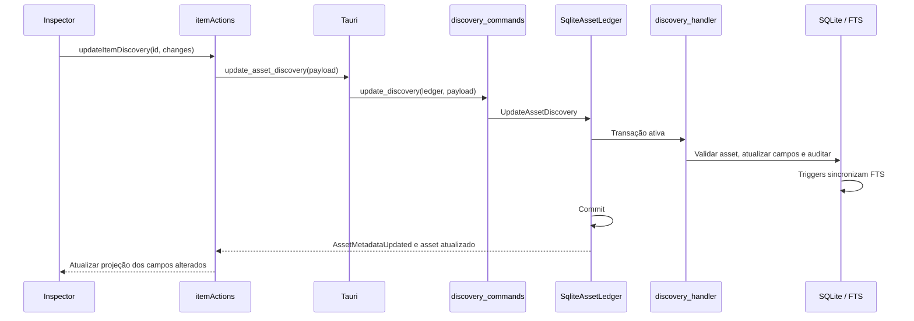

# Palavras-chave e URL de origem dos assets

Data da implementação: 24/11/2026. O nome deste relatório mantém a data solicitada, 23/11/2026.

## Objetivo e escopo

Adicionar metadados de autoria do usuário ao catálogo: palavras-chave pesquisáveis e a URL da página de origem. Os campos são comuns aos formatos de mídia e ficam em **General Info**, no inspector de um asset. A URL estabelece o contrato de persistência para futuras importações por extensão de navegador; esta entrega não implementa a extensão nem um protocolo de importação.

A implementação segue os guias [Backend Rust](../guidelines/backend-rust.md), [Frontend Solid](../guidelines/frontend-solid.md), [Documentação](../guidelines/documentation.md) e [Implementação de formatos](../backend/format-implementation-guide.md).

## Contrato de dados

| Campo        | Domínio/API de leitura | SQLite                             | Ausência |
| ------------ | ---------------------- | ---------------------------------- | -------- |
| `keywords`   | Lista de strings       | `TEXT NOT NULL`, array JSON válido | `[]`     |
| `source_url` | String opcional        | `TEXT NULL`                        | `NULL`   |

Palavras-chave são independentes das tags e de sua hierarquia. Uma palavra-chave pode conter espaços, como `concept art`. Vírgula é um delimitador; não há sintaxe de escape para incluí-la no próprio termo. A normalização remove espaços nas extremidades, descarta entradas vazias e elimina duplicatas comparando as versões em minúsculas. A primeira grafia e a ordem são preservadas. Isso não realiza stemming, remoção de acentos ou normalização linguística.

A URL aceita páginas HTTP/HTTPS com host, sem credenciais embutidas. O valor é aparado nas extremidades, preservando caminho, query e fragmento. Não há requisição de rede para validar sua existência. Outros esquemas, incluindo `javascript:`, `file:` e `data:`, são rejeitados. Limpar o campo remove a origem.

Os campos estão presentes em `Asset`, `AssetSummaryDto`, `AssetDb` e `AssetSummaryDb`. As projeções explícitas e dinâmicas de consultas, buscas e recuperação por IDs foram atualizadas. Os construtores de assets usados em outros handlers e testes inicializam os novos valores. O contrato TypeScript mantém os campos opcionais para aceitar projeções antigas e fixtures; a API atual entrega lista e origem opcional.

## Migração e índice

A migração [20261124000000_asset_keywords_source_url.sql](../../src-tauri/migrations/20261124000000_asset_keywords_source_url.sql):

1. Acrescenta `keywords` com valor padrão `[]` e restrição de array JSON válido.
2. Acrescenta `source_url` anulável, preservando os assets existentes.
3. Recria o FTS5 trigram incluindo palavras-chave, mantendo nome e notas.
4. Reconstrói o índice dos registros existentes e instala triggers para inserção, exclusão e alteração dos campos pesquisáveis.

A reconstrução tem custo proporcional ao texto existente e ocorre na aplicação da migração. Não há migração reversa automática. O banco de desenvolvimento versionado acompanha o esquema e o registro da migração para compilação das macros SQLx.

Os campos pertencem ao catálogo, e não ao envelope técnico dos provedores de formato. Extração de metadados, geração de thumbnails e reindexação de arquivos não precisam conhecer nem substituir os dados escritos pelo usuário.

## Caminho de escrita e arquitetura



A camada de entrega apenas encaminha ao handler de aplicação. O ledger continua responsável pela transação e publicação de eventos após commit. O adaptador especializado concentra persistência e auditoria, evitando ampliar o handler genérico de metadados. Se qualquer validação ou gravação falhar, a transação não altera campos nem índice, e não publica o evento de sucesso.

Arquivos centrais:

- [Payload e comando](../../src-tauri/src/core/ledger/command.rs): `UpdateAssetDiscoveryPayload` e `LedgerCommand::UpdateAssetDiscovery`.
- [Handler de aplicação](../../src-tauri/src/feature/assets/discovery_commands.rs): entrada de aplicação instrumentada com tracing, sem registrar o conteúdo dos metadados.
- [Políticas puras](../../src-tauri/src/core/ledger/discovery_metadata.rs): normalização de palavras-chave e validação de origem, sem acesso ao banco.
- [Adaptador SQLite](../../src-tauri/src/infra/database/handlers/discovery_handler.rs): aplicação das políticas puras, atualização e log `UPDATE_ASSET_DISCOVERY`.
- [Ledger](../../src-tauri/src/infra/database/ledger.rs): roteamento e evento `AssetMetadataUpdated`.
- [Entrega Tauri](../../src-tauri/src/delivery/tauri/commands/mutations.rs): comando `update_asset_discovery`, registrado em `lib.rs`.
- [Permissões](../../src-tauri/permissions/main.toml) e [capability](../../src-tauri/capabilities/default.json): autorização explícita do novo comando.
- [Ação frontend](../../src/core/store/library/itemActions.ts): persiste antes de reconciliar somente os campos envolvidos, sem sobrescrever uma edição concorrente do outro campo.

### Exemplos do contrato de escrita

```typescript
await invokeCommand('update_asset_discovery', {
    payload: {
        assetId: 'asset-id',
        keywords: ['nature', 'concept art'],
        sourceUrl: 'https://example.com/reference'
    }
});

// Altera apenas as palavras-chave, preservando a origem.
await invokeCommand('update_asset_discovery', {
    payload: { assetId: 'asset-id', keywords: ['lighting'] }
});

// Limpa explicitamente ambos os campos.
await invokeCommand('update_asset_discovery', {
    payload: { assetId: 'asset-id', keywords: [], sourceUrl: '' }
});
```

Campos omitidos ou `null` no payload Rust opcional preservam os valores atuais. Para remover a URL, envie string vazia; para remover palavras-chave, envie lista vazia. O comando retorna o asset atualizado. Identificador inexistente resulta em erro de domínio, sem criar um registro.

## Experiência do inspector

[CommonMetadata](../../src/components/features/inspector/base/CommonMetadata.tsx) compõe [DiscoveryMetadata](../../src/components/features/inspector/base/DiscoveryMetadata.tsx). O conteúdo é vinculado ao asset selecionado com `Show keyed`, isolando rascunhos entre seleções.

### Palavras-chave

O `TagInput` existente ganhou duas propriedades opcionais:

- `allowCustomValues`: ativa chips livres, confirmação por vírgula, Enter ou saída do campo.
- `ariaLabel`: fornece o nome acessível do campo.

O modo padrão de sugestões e criação de tags permanece opt-out. Colar `nature, concept art, lighting` confirma os dois primeiros termos e mantém o último como rascunho até Enter, vírgula ou blur. Entradas vazias e duplicatas são ignoradas; os chips podem ser removidos pelo botão existente ou Backspace no campo vazio. Enter durante composição IME não confirma o termo.

A seleção local responde imediatamente. As gravações são serializadas e edições durante uma requisição são agrupadas na próxima substituição completa da lista, evitando perda por respostas fora de ordem e mantendo o foco. Em falha, o rascunho permanece visível com mensagem e botão **Retry saving keywords**. Alterações externas do asset voltam a sincronizar a seleção quando não há gravação ou erro pendente.

### URL de origem

Com valor, o inspector mostra um link e o botão **Edit source URL**. Sem valor, mostra **No source link added yet.**, que apresenta a ausência como informação pendente, sem sugerir erro de importação.

Editar substitui a exibição por `Input` preenchido e botões de confirmar/cancelar, seguindo a interação de `CriterionRow`. Enter confirma; Escape cancela. Durante a gravação, os controles ficam indisponíveis para evitar duplicação. Em falha, o rascunho continua disponível e o editor permanece aberto. Cancelar preserva o valor persistido. O link utiliza `openUrl` do plugin opener para abrir no navegador do sistema; falhas de abertura são apresentadas no campo.

Os controles reutilizam `Button`, `Input` e `TagInput` de `src/components/ui`. O link é um elemento semântico nativo, pois não existe componente equivalente no catálogo. Estilos específicos usam tokens existentes, limites flexíveis e truncamento da URL longa. Mensagens de erro usam `role="alert"`; campos e botões têm nomes acessíveis.

## Pesquisa

### Busca simples

[SearchToolbar](../../src/components/features/search/SearchToolbar.tsx) continua usando o fluxo de filtros existente; seu nome acessível informa que nome, notas e palavras-chave podem ser pesquisados. No backend, tanto a listagem quanto a contagem passam a considerar palavras-chave:

- Texto normal e consultas curtas: `EXISTS` sobre `json_each(keywords)`, sem pesquisar a pontuação estrutural do JSON.
- Modo fuzzy, a partir de três caracteres: índice FTS5 trigram com palavras-chave incluídas, preservando o algoritmo e o limite já existentes.

Alterar palavras-chave com busca simples ou avançada ativa solicita também a atualização dos resultados e da contagem. Falhas nessa atualização não revertem uma gravação já confirmada.

A URL de origem não participa da busca simples nesta entrega.

### Busca avançada

O registro [SEARCH_FIELDS](../../src/core/store/filter/constants.ts) acrescenta **Keywords** como campo textual. `AdvancedSearchModal`, o compositor e `CriterionRow` reutilizam os renderizadores, validadores e operadores de texto existentes. Não há uma segunda implementação de editor de critérios.

[search_builder.rs](../../src-tauri/src/infra/database/search_builder.rs) traduz o critério em `EXISTS` por palavra-chave individual, com parâmetros SQL vinculados:

| Operador     | Exemplo   | Resultado                                                        |
| ------------ | --------- | ---------------------------------------------------------------- |
| Contains     | `concept` | Corresponde a `concept art`                                      |
| Not Contains | `nature`  | Exclui assets com algum termo correspondente; inclui lista vazia |
| Equals       | `nature`  | Corresponde à palavra inteira, não ao array serializado          |
| Starts With  | `con`     | Corresponde a `concept art`                                      |
| Ends With    | `art`     | Corresponde a `concept art`                                      |

O campo funciona dentro de grupos AND/OR e nas consultas salvas das smart folders, sem alterar o formato de serialização. A comparação segue `LIKE`/`NOCASE` do SQLite: a insensibilidade de caixa não equivale a uma collation Unicode completa. Os curingas `%` e `_` conservam a semântica dos demais critérios textuais existentes.

## Validação

Os resultados efetivamente executados são registrados ao final deste relatório. A cobertura acrescentada inclui:

- [DiscoveryMetadata.spec.tsx](../../src/components/features/inspector/base/DiscoveryMetadata.spec.tsx): vírgulas, duplicatas, Enter, edição/cancelamento, remoção e gravação da URL, validação de esquema e preservação de rascunho quando a gravação falha.
- [TagInput.spec.tsx](../../src/components/ui/TagInput/TagInput.spec.tsx): colagem com termo final pendente, confirmação por blur, remoção, compatibilidade do modo padrão e composição IME.
- [Políticas do domínio](../../src-tauri/src/core/ledger/discovery_metadata.rs): preservação da grafia dos termos, frases, rejeição de esquemas inseguros/credenciais e remoção da origem.
- [discovery_tests.rs](../../src-tauri/src/infra/database/handlers/discovery_tests.rs): banco criado pelas migrações reais, round-trip de dados, normalização, evento de metadados, listagem/contagem em ambos os modos de pesquisa, operadores avançados, rollback de payload inválido, limpeza dos campos e sincronização FTS.
- Suíte existente de `AdvancedSearchModal` como regressão do fluxo de composição.

### Roteiro manual para revisão

1. Selecionar um asset existente e verificar lista vazia e mensagem de origem ausente.
2. Digitar `nature, Nature, concept art,` e confirmar que há apenas dois chips; remover um e reabrir o asset.
3. Colar vários termos sem vírgula final e sair do campo; verificar que o último termo também foi salvo.
4. Pesquisar um termo presente apenas nas palavras-chave, com fuzzy ligado/desligado, comparando contagem e resultados.
5. Criar um critério **Keywords**, testar cada operador e salvar a consulta como smart folder.
6. Adicionar URL HTTPS, cancelar uma alteração, salvar outra, abrir o link e limpar o campo.
7. Tentar uma URL inválida e verificar a mensagem sem fechar o editor.
8. Trocar o asset durante a edição da origem e verificar que o rascunho não aparece no próximo asset.
9. Verificar o painel estreito, navegação por Tab, Enter/Escape e nomes acessíveis dos botões.

## Limites e continuidade

A edição é individual; não foi adicionado um fluxo de mesclagem em seleção múltipla. Palavras-chave não criam tags automaticamente. Não há autocomplete global de palavras-chave nem verificação online da origem. A futura extensão deve usar o contrato de aplicação/ledger e definir seu próprio transporte, autenticação e fluxo de importação. Alterações futuras no índice devem manter sincronizados triggers, rebuild, listagem e contagem.


### Resultados executados

- `npm run typecheck`: aprovado.
- `npm run lint`: aprovado no projeto completo, sem warnings.
- `npm run build`: aprovado; 2.759 módulos transformados.
- Vitest direcionado: 12 testes aprovados em 3 arquivos (inspector, TagInput e busca avançada).
- `cargo test --offline --lib discovery`: 3 testes aprovados, cobrindo normalização, validação da origem e integração com banco criado pelas migrações reais.
- `cargo fmt --check`: aprovado.
- `cargo sqlx prepare -- --lib`: aprovado; cinco entradas do cache substituídas pelas projeções com os novos campos.
- `git diff --check`: aprovado.
- Migração de uma cópia temporária do banco anterior: preservação de notas/tamanho, valores padrão e reconstrução/atualização/exclusão do índice FTS aprovadas.

A suíte frontend emite avisos de computations Solid criadas fora de uma raiz, também presentes na suíte preexistente de busca; os testes concluem com sucesso. A execução inicial do esbuild no sandbox encontrou restrição de leitura; testes e build foram executados com o acesso necessário. O roteiro manual acima é uma lista para revisão do aplicativo, não um registro de verificação visual executada.
