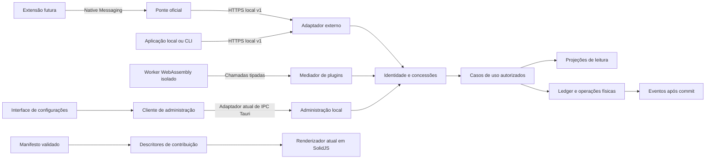

# API de importação e plataforma de plugins do Mundam

**Plano de 24 de novembro de 2026 · Implementação iniciada em 25 de novembro de 2026 · Base do levantamento `backend-refactor`, revisão `e277e49`.**

Para revisar a proposta, comece pelas decisões da seção 1 e pelas condições de aprovação da seção 10. As seções 2–5 fundamentam a API e a consistência da importação. As seções 6–9 cobrem os contratos dos plugins, a segurança e a distribuição. As duas últimas seções ficam disponíveis para acompanhar a execução.

## 1. Decisão proposta

Entregar primeiro uma importação local que funcione de ponta a ponta para um cliente de referência. O usuário escolhe uma pasta indexada, seleciona tags e recebe um comprovante por arquivo. A extensão de navegador poderá usar esse contrato no futuro. Em paralelo, projetar o primeiro plugin como uma contribuição declarativa ao inspector. Isso permite validar instalação, permissões, apresentação e remoção antes de assumir o custo de executar código de terceiros.

| Decisão para aprovação | Motivo | Condição para avançar |
| --- | --- | --- |
| API local versionada, desativada por padrão, com serviço próprio e autorização por cliente | Aplicações externas precisam de um contrato pequeno, independente das mudanças do IPC de desktop | Um cliente fora do Tauri importa dois arquivos e recupera o resultado após perder a conexão |
| O cliente entrega bytes. O Mundam guarda a URL opcional da página de origem | Funciona com conteúdo selecionado em uma sessão autenticada e mantém cookies e acesso à página no navegador | Origem, tags e arquivo aparecem juntos no catálogo. Um erro de rede permite retomar |
| Pasta padrão configurada no desktop, por catálogo, referenciada por ID | O nome e o caminho podem mudar. Uma preferência pessoal também precisa respeitar os destinos concedidos ao cliente | Renomear preserva a preferência. Desvincular ou perder acesso exige nova escolha |
| Interface de plugins descrita por dados versionados, com renderizador substituível | Autores declaram campos, ações e superfícies. SolidJS, no desktop atual, traduz essas declarações para componentes acessíveis | O mesmo manifesto é interpretado por SolidJS e por um consumidor de teste independente. O pacote pode ser removido durante o uso da galeria |
| Lógica de terceiros em WebAssembly, em processo auxiliar supervisionado, após prova de viabilidade | Workers precisam de computação programável, cancelamento e isolamento de falhas | O protótipo respeita cotas e encerramento nos três sistemas suportados pelo plano |
| Pacote local verificável primeiro. Catálogo pesquisável em uma entrega posterior | Instalação offline viabiliza o SDK e o piloto. Operar um diretório público exige responsáveis por publicação, revisão e revogação | Instalar, atualizar, recuperar a versão anterior e remover funcionam com dados reais de teste |

O primeiro lançamento da API atende aplicações locais. Pareamento pela rede, sincronização em nuvem, instalação da extensão nas lojas e suporte a plugins nativos de terceiros seriam decisões de produto independentes. O critério de sucesso desta proposta é preservar a identidade e os metadados de cada asset e manter o Mundam utilizável quando um cliente ou plugin falhar.

## 2. Levantamento da arquitetura atual

| Área | O que existe na revisão examinada | Consequência para a implementação |
| --- | --- | --- |
| Entrega e aplicação | O desktop registra comandos de consulta e mutação no Tauri. `feature` coordena os casos de uso, o core define portas e a infraestrutura implementa persistência e eventos. [Registro IPC](../../src-tauri/src/lib.rs) · [Visão geral](../backend/overview.md) | Criar um adaptador externo estreito. Os dois transportes podem usar a mesma política de negócio. O cliente público não precisa conhecer nomes de comandos Tauri |
| Pastas e tags | `list_folders(None)` lista raízes e `Some(parent)` lista filhos. O DTO interno inclui caminho absoluto. `list_tags` carrega a taxonomia inteira ordenada por posição e nome. [Pastas](../../src-tauri/src/infra/database/query_handlers/folder_queries.rs) · [Tags](../../src-tauri/src/infra/database/query_handlers/tags_queries.rs) · [Modelos](../../src-tauri/src/core/models/asset.rs) | Projetar consultas públicas paginadas no banco, com IDs, hierarquia e nomes autorizados. Uma coleção virtual ou smart folder não designa diretório de escrita |
| Entrada de arquivos | O scan emite `BatchCreate`. O consumidor de observações usa `CreateAsset`. O adaptador de criação reconcilia caminho e identidade nativa. A classificação do scan admite a categoria `unknown`. [Indexer](../../src-tauri/src/feature/library/indexer.rs) · [Classificador](../../src-tauri/src/feature/library/classifier.rs) · [Observações](../../src-tauri/src/feature/library/event_handler.rs) · [Escrita de assets](../../src-tauri/src/infra/database/handlers/asset_handler.rs) | O scan descobre arquivos já presentes. Importar exige admitir bytes, escolher nome, coordenar o efeito físico e obter um recibo. O formato aceito na fronteira externa precisa de política explícita |
| Operações físicas | `execute_library`, gate de escrita, movimentos exclusivos, journal durável, recibos e recuperação antecedem a observação da biblioteca. O journal conhece movimentos e algumas criações. [Operações](../backend/library-operations.md) · [Adaptador](../../src-tauri/src/infra/database/library_operations.rs) · [Journal](../../src-tauri/src/infra/database/library_operations/journal.rs) · [Boot](../../src-tauri/src/bootstrap/database.rs) | Estender essas garantias para publicação de arquivos importados. O journal atual exige evolução e testes para itens de upload, inclusive entre volumes |
| Metadados editoriais | `source_url` já representa a página HTTP(S), aceita query e fragmento e recusa credenciais embutidas. Keywords têm política própria. As tags são entidades associadas por `asset_tags`. [Política](../../src-tauri/src/core/ledger/discovery_metadata.rs) · [Entrega de origem e keywords](2026-11-24-assets-keywords-and-source-url.md) | Usar a mesma validação de origem. Associar IDs de tags reais. Um conjunto de chamadas independentes de criação, edição e tagging deixaria estados intermediários observáveis |
| Preferências | `AppSettings` fica fora do SQLite. `SettingsService` serializa mutações na instância e aceita chaves extras. O frontend valida payloads e já dispõe de árvore para escolher destinos. [Modelo](../../src-tauri/src/core/settings/model.rs) · [Serviço](../../src-tauri/src/feature/settings/service.rs) · [Seletor](../../src/components/features/library/FolderDestinationPicker.tsx) | Usar campo tipado, valor inicial ausente e validação de catálogo. Evitar dois escritores da preferência ou gravar credenciais no JSON de configuração |
| Mídia e segurança do desktop | O servidor Axum de streaming inicializa na porta 9876, usa token de sessão e rotas de mídia. A capability padrão atende `main` e `design-system` com operações locais. A configuração base contém `csp: null`. [Inicialização](../../src-tauri/src/bootstrap/streaming.rs) · [Servidor](../../src-tauri/src/delivery/streaming/server.rs) · [Capability](../../src-tauri/capabilities/default.json) · [Configuração](../../src-tauri/tauri.conf.json) | Reaproveitar experiência com Axum e drenagem. Criar listener, credenciais, roteamento e política de origem próprios. Carregar JavaScript comunitário na janela principal daria a esse código acesso ao contexto privilegiado |
| Providers de formatos | `FormatRegistry` indexa implementações de `FormatProvider` em Rust. No conflito por extensão o último registro prevalece e gera aviso. [Guia de formatos](../backend/format-implementation-guide.md) · [Registry](../../src-tauri/src/core/formats/registry.rs) | Reaproveitar o padrão de declarar capacidades, registrar e testar. Distribuir traits Rust ou bibliotecas dinâmicas como ABI pública acoplaria o SDK ao compilador e ao processo principal |
| Processamento | O bootstrap monta consumidores conhecidos. Há orçamento compartilhado, controles de pausa, tickets com geração, identidade da origem e lease. Tanto `ProcessingKind` quanto a restrição SQL conhecem etapas específicas. [Bootstrap](../../src-tauri/src/bootstrap/workers.rs) · [Contratos](../../src-tauri/src/core/processing/mod.rs) · [Fila SQL](../../src-tauri/migrations/20261030010000_processing_attempts.sql) | Expor uma classe controlada de execução para plugins. Acrescentar strings ao enum seria insuficiente para persistência, diagnóstico, retomada, justiça na fila e desligamento |
| Interface | `ApplicationView` contém três valores e `App` seleciona telas estaticamente. O inspector despacha por seleção/tipo. A sidebar persiste quatro tamanhos por posição. Atalhos de navegação já acompanham uma lista reativa, limitada aos nove primeiros. [App](../../src/App.tsx) · [Tipos de navegação](../../src/components/layout/TitleBar/types.ts) · [Inspector](../../src/components/layout/FileInspector.tsx) · [Sidebar](../../src/components/layout/LibrarySidebar.tsx) · [Atalhos](../../src/core/input/primitives/useNavigationShortcuts.ts) | Introduzir registros pequenos por superfície e persistir o novo layout por IDs estáveis dos painéis. Contribuições além do nono item precisam continuar acessíveis pelo menu e teclado |

Aplicar os guias do projeto em todos os incrementos. Entregas convertem DTOs e erros, regras e portas ficam no core, mutações de catálogo passam pelo Ledger e consultas usam projeções. Em Solid, agrupar por feature, usar actions tipadas, validar a fronteira com Zod e liberar listeners em `onCleanup`. Documentar interfaces exportadas com TSDoc em inglês e contratos Rust com Rustdoc, erros e exemplos verificáveis. Atualizar guias, contratos e inventário de dependências no PR que alterar o comportamento. [Backend Rust](../guidelines/backend-rust.md) · [Frontend Solid](../guidelines/frontend-solid.md) · [Arquitetura do core](../guidelines/core-architecture.md) · [Documentação](../guidelines/documentation.md) · [Dependências](../backend/dependences.md)

## 3. Fronteiras e transporte



### Independência entre backend, interface e shell desktop

A API e o SDK atravessam a fronteira por descritores, comandos, resultados e eventos versionados. O backend decide se uma operação é permitida e confirma o efeito. O frontend controla seleção visual, navegação, foco e apresentação de erros. O shell desktop fornece IPC, janelas e integração com o sistema operacional. Substituir o shell pode exigir um novo adaptador privilegiado e uma nova política de permissões do shell. A semântica dos casos de uso e os pacotes publicados devem continuar utilizáveis.

| Fronteira | Aplicação ao Mundam | Como demonstrar a independência |
| --- | --- | --- |
| Backend de aplicação | Os novos casos de uso recebem portas Rust para persistência, permissões, notificação e ciclo de vida. Construir serviços por injeção. O bootstrap atual pode obtê-los via Tauri e delegar a execução. Confinar `AppHandle`, `State`, macros IPC e emissão para webview ao adaptador | Executar importação e validação de manifesto em um processo de teste sem iniciar o runtime Tauri ou abrir janela. Comparar os resultados de negócio obtidos pelos adaptadores para a mesma identidade e concessões |
| Cliente da interface | Definir interfaces TypeScript por funcionalidade, com métodos como `listImportFolders`, `setImportDefault` e `observeImport`. DTOs serializáveis, erros tipados e cancelamento fazem parte do contrato. O adaptador traduz para `invoke` e `listen`. A apresentação decide o texto e quando mostrar um toast | Exercitar a nova interface de configurações com um cliente em memória e eventos de teste. Nenhum componente novo de integrações/plugins precisa importar `@tauri-apps/*` |
| SDK e pontos de contribuição | O manifesto descreve intenção, rótulos, ações e dados. `inspectorSections` identifica uma superfície, e `checkbox` identifica a interação esperada. O SDK público independe de componentes JSX, signals, stores, DOM e nomes de comandos Tauri | Interpretar o mesmo pacote em um consumidor de teste sem SolidJS e no renderizador SolidJS. Ambos devem produzir a mesma intenção de escrita ao marcar “Referência revisada” |

Já existem pontos concretos para essa separação. O wrapper de IPC combina invocação com apresentação de toasts, um hook de notificações importa diretamente os eventos Tauri e o bootstrap da biblioteca recebe `AppHandle`. Nas novas funcionalidades, manter essas dependências nos adaptadores e conectar os componentes existentes onde necessário. As operações administrativas continuam em canal privilegiado exclusivo do desktop. A substituição futura do shell não exige expô-las na API de terceiros. [Wrapper IPC](../../src/lib/api.ts) · [Notificações](../../src/core/hooks/useMetadataNotifications.ts) · [Bootstrap da biblioteca](../../src-tauri/src/bootstrap/library.rs)

### Transporte e autorização

**API para aplicações.** Propor HTTPS em loopback IPv4 literal, porta efêmera, versão no caminho. Descoberta por descritor local do usuário contendo versão, endpoint e identificação da instância, com escrita atômica e permissões do SO. Disponibilizar a mesma informação em Configurações para integração manual. O pareamento vincula a chave pública do servidor por canal confiável do desktop. O SDK valida essa identidade antes de transmitir segredos, inclusive após mudança de porta. Não instalar uma autoridade certificadora global. Validar a pilha TLS, proteção da chave, mudança de instância e empacotamento nos três sistemas no primeiro protótipo. Socket Unix/named pipe é a alternativa se o custo de TLS local ou distribuição de confiança for incompatível com os clientes-alvo. Exige transporte e SDK específicos por plataforma.

**Navegador.** A futura extensão pede acesso à página no gesto de captura, mostra a seleção e lê os bytes dentro das permissões do navegador. O contexto de background conversa com uma ponte oficial registrada pelo instalador. O manifesto do host restringe os IDs oficiais em `allowed_origins` no Chromium e `allowed_extensions` no Firefox. A ponte traduz mensagens delimitadas em uploads e guarda o vínculo com o desktop. Tratar content script, página, nome sugerido e metadados como entrada externa. Uma página não pode acionar o pareamento ou uma importação por mensagem arbitrária. Validar Chromium e Firefox separadamente, inclusive registro/desregistro do host por usuário, reinício do background, arquivos grandes e limites de mensagem por direção. A extensão pode informar “Abra o Mundam” quando o processo estiver fechado. [Chrome Native Messaging](https://developer.chrome.com/docs/extensions/develop/concepts/native-messaging) · [Mozilla Native Messaging](https://developer.mozilla.org/en-US/docs/Mozilla/Add-ons/WebExtensions/Native_messaging)

**Escolha de transporte para o navegador.** Acesso HTTP direto pela extensão economizaria a ponte, mas exigiria resolver descoberta, confiança TLS e permissões de rede em cada navegador. Native Messaging tem custo de instalação e serialização. Compensa ao manter a identidade da integração e a comunicação com o desktop fora da página. Usar frames pequenos com confirmação e janela limitada. O base64 fica restrito ao trecho JSON do navegador. O upload HTTP e a escrita em disco operam em binário. Se a página não conceder leitura da mídia, apresentar indisponibilidade por item. Fazer download a partir da URL no servidor abriria outra superfície de rede e mudaria as credenciais necessárias.

**Identidade e consentimento.** Ao habilitar a API, o Mundam oferece “Conectar aplicação”. O desktop gera uma autorização aleatória de uso único, com validade curta, e apresenta os dados de confiança do servidor. O cliente envia o pedido, o usuário confere nome declarado, permissões, catálogo e raízes permitidas, e confirma dentro do Mundam. Só então o cliente recebe credencial opaca de alta entropia, específica da instalação/perfil. Nome declarado não comprova autoria. Usar armazenamento protegido do sistema no cliente ou na ponte e verificador de segredo no servidor. Aplicar expiração, rotação, limite de tentativas e revogação. Rejeitar o pareamento antigo após troca da chave do servidor. A tela lista último uso e concede remoção individual ou desligamento global.

**Limite de confiança.** O serviço admite apenas loopback enquanto a biblioteca estiver pronta. Validar endereço de escuta, autoridade HTTP e origem, recusar origens de páginas e dispensar CORS na ponte nativa. Usar `Authorization: Bearer` sobre o canal autenticado, sem cookies nem tokens em URLs. O backend aplica identidade, escopo e objeto em cada leitura, envio e publicação. O fato de uma chamada ser local não comprova autorização. Um processo que já controla a conta do usuário permanece um risco residual. A interface administrativa de concessões existe exclusivamente no desktop. Plugins também não recebem acesso a essa interface. As capabilities Tauri se aplicam a janelas/webviews e precisam ser consideradas separadamente das concessões de um pacote. [Capabilities do Tauri](https://v2.tauri.app/security/capabilities/)

## 4. Contrato proposto da API v1

Cada credencial pertence a um catálogo. Tratar IDs como strings opacas. JSON usa `camelCase`, erros têm códigos estáveis e cada requisição tem identificador de correlação. A resposta de negociação informa versão, recursos e limites efetivos. Clientes ignoram novos campos opcionais. Remover campo, mudar seu significado ou tornar uma permissão mais ampla exige nova versão ou novo consentimento. Publicar OpenAPI, exemplos completos e testes de compatibilidade do SDK.

| Operação proposta | Permissão e contrato |
| --- | --- |
| `GET /v1/capabilities` | Cliente pareado. Versão, limites e recursos efetivamente concedidos |
| `GET /v1/folders?parentId=…&cursor=…&limit=…` | `folders.read`. Sem pai, retorna raízes concedidas. Filhos apenas dentro do escopo. `id`, `parentId`, `name`, `hasChildren`, disponibilidade conhecida. Não expor caminhos absolutos |
| `GET /v1/import-default` | `folders.read`. Expõe apenas preferência utilizável por esse cliente ou `folderId: null`. Um cliente sem acesso não descobre o nome do destino |
| `GET /v1/tags?query=…&cursor=…&limit=…` | `tags.read` concede leitura da taxonomia da biblioteca, explicitada no consentimento. `id`, `parentId`, nome, cor e ordem. Incluir rótulo hierárquico para desambiguar homônimos |
| `POST /v1/imports` | `assets.import`, mais `tags.assignOnImport` ao especificar tags. Recebe manifesto, identificadores de item estáveis e cabeçalho `Idempotency-Key`. Retorna `201` com lote e instruções de envio. Ainda não há asset publicado |
| `PUT /v1/imports/{batchId}/items/{itemId}/parts/{partNumber}` | Dono do lote com escopo de importação. Corpo binário, tamanho e digest. Receber parte repetida idêntica é sucesso. Mesmo número com bytes diferentes resulta em conflito |
| `POST /v1/imports/{batchId}/commit` | Dono do lote. Verifica partes completas e agenda publicação. Retorna `202` e endereço de consulta. Repetição devolve o estado do mesmo lote |
| `GET /v1/imports/{batchId}` | Dono do lote. Progresso por item, partes confirmadas, estado, `assetId` e nome efetivo quando concluído, ou código de erro acionável. Retomar consulta após desconexão |
| `DELETE /v1/imports/{batchId}` | Dono do lote. Cancela itens pendentes e libera staging. Uma publicação em andamento chega a um estado consistente. O recibo distingue concluídos e cancelados |

O backend resolve a interseção entre biblioteca, escopos e raízes por cliente em toda operação. No seletor de pastas, a disponibilidade é indicativa até a publicação. Ordenar por chave estável com ID como desempate, impor limite no SQL e devolver `nextCursor`. Vincular o cursor a cliente, filtro, catálogo e revisão da lista. Se a árvore mudar, retornar `CURSOR_EXPIRED` e permitir refazer a página preservando seleções por ID. Atribuir tags durante a importação autoriza apenas vincular tags existentes ao novo item. Criar tags ou editar assets existentes exigiria outro contrato.

**Regras de envio para o SDK.** A resposta à criação inclui `batchId`, `partSizeBytes`, `expiresAt` e endereço do recibo. Partes são numeradas a partir de zero. Cada uma tem o tamanho negociado, exceto a última, e leva o digest SHA-256 dos bytes enviados. Registrar o algoritmo e a codificação no OpenAPI. Estado parcial informa os números de parte já duráveis, paginados para arquivos grandes. Permitir reenvio fora de ordem dentro da janela admitida. O servidor recalcula os hashes e verifica que os intervalos cobrem exatamente o comprimento declarado. O digest serve à integridade e retomada. A autorização vem do cliente autenticado e do dono do lote. Um arquivo vazio deve receber erro por item quando o formato exigir conteúdo.

### Exemplo de lote

O usuário seleciona duas imagens da mesma página, escolhe uma subpasta e marca uma tag comum. As strings de identificação são ilustrativas.

```json
{
  "folderId": "folder-referencias",
  "tagIds": ["tag-pesquisa"],
  "items": [
    {"itemId": "capa", "fileName": "capa.webp", "byteLength": 18032, "sourceUrl": "https://example.org/colecao"},
    {"itemId": "mapa", "fileName": "mapa.png", "byteLength": 78041, "sourceUrl": "https://example.org/colecao", "tagIds": ["tag-mapas"]}
  ]
}
```

Omitir `folderId` solicita a preferência do usuário. Resolver o destino na admissão e gravar seu ID no lote. Mudanças posteriores de preferência só afetam novos lotes. As tags finais são a união, sem repetição, das tags do lote e do item. A origem é opcional por item. Mostrar ao usuário qual URL será guardada e permitir omitir ou remover parâmetros de rastreamento antes do envio. A validação de `source_url` já preserva query e fragmento, que podem conter informações privadas.

Com as duas partes recebidas, o cliente pede commit. Um resultado final possível é:

```json
{
  "batchId": "import-42",
  "state": "partial",
  "items": [
    {"itemId": "capa", "state": "committed", "assetId": "asset-91", "fileName": "capa.webp"},
    {"itemId": "mapa", "state": "failed", "error": {"code": "TAG_UNAVAILABLE", "retryable": false}}
  ]
}
```

Aqui uma tag exclusiva de `mapa` deixou de existir entre a pré-validação e a publicação. A UI mantém o sucesso de `capa` e permite corrigir a seleção e enviar só `mapa` em um novo lote. Falhas de transporte antes da conclusão admitem retomada no mesmo lote. Validar todo o manifesto antes de admitir bytes. Após a admissão, a unidade de commit é um item. O resumo distingue “adicionados”, “precisam de atenção” e “cancelados”.

| Situação | Resposta e comportamento do cliente |
| --- | --- |
| Credencial expirada/revogada ou permissão ausente | `401` solicita reconexão, `403` orienta revisar concessão no desktop. Para lote de outro cliente e objeto invisível, `404` sem revelar existência |
| Preferência ausente, destino removido/offline, colisão de chave ou parte faltante | `409` com código específico e escolha ou retomada. Não trocar silenciosamente de pasta |
| Manifesto, tag, nome ou formato inválido | `422` com campo/item e mensagem apresentável. Aplicar validação de conteúdo novamente após receber os bytes |
| Limite de tamanho, saturação ou espaço insuficiente | `413` para tamanho, `429` para cota temporária com `Retry-After`, `507` para falta de espaço. Interromper leitura e liberar reserva conforme estado |
| Encerramento, recibo expirado ou erro interno | `503` durante drenagem, `410` para recibo expirado dentro da janela documentada, `500` com `requestId`. Erros posteriores ao `202` ficam no recibo por item |

### Configurações e experiência da captura

Em **Configurações → Pastas**, oferecer “Pasta padrão para importações”, árvore de destinos indexados, breadcrumb, ações para escolher e limpar, além de estado vazio com acesso à vinculação de pastas. Persistir referência tipada opcional com identidade do catálogo e ID da pasta. Definir a identidade persistente do catálogo no esquema inicial, aproveitando um identificador existente se for adequado. Em uma instalação nova, iniciar a preferência como “sem padrão”. Uma pasta renomeada ou movida dentro da concessão continua válida pelo ID. Uma raiz temporariamente offline conserva a preferência e pede escolha explícita. Uma pasta removida perde a seleção efetiva. Trocar de catálogo invalida concessões e preferências daquele contexto até nova resolução.

Em **Configurações → Integrações**, reunir estado do serviço, pareamento, clientes, destinos concedidos, revogação e histórico resumido. Na captura futura, exibir miniaturas locais quando disponíveis, nome, tamanho, origem, pasta efetiva, tags comuns e exceções por item. Oferecer busca de tags e navegação por teclado. Indicar preparação, transmissão e confirmação separadamente. Só “Importado” abre o asset confirmado. Manter a seleção quando a biblioteca estiver indisponível e pedir nova autorização para reler a página se a sessão expirar. Os controles de administração devem continuar acessíveis mesmo se todos os plugins estiverem desativados.

## 5. Importação consistente de bytes, catálogo e tags

**Invariante de aceite.** Para cada `(clientId, batchId, itemId)` confirmado existe um único recibo apontando para o asset criado com os bytes validados, a pasta resolvida, a origem e todas as tags acordadas. A perda da resposta não repete o efeito. O término de thumbnails, análise de cores ou detecção de duplicatas pode ocorrer depois.

1. **Admitir.** Validar schema, escopos, quantidade de itens/tags, tamanho declarado, nomes, destino e tags. Reservar capacidade por cliente e global. Criar lote, itens e chave de idempotência em armazenamento durável. Unicidade por catálogo, cliente e chave, com digest do manifesto normalizado. Reenvio idêntico retorna o lote original. Uma chave com intenção diferente recebe `IDEMPOTENCY_CONFLICT`. A preferência já resolvida fica no recibo mesmo que o cliente reenvie o manifesto sem pasta.
2. **Receber.** Gravar em staging privado controlado pelo host, fora das áreas indexadas ou explicitamente excluído pelo scan **e** pelo watcher. Nomes físicos temporários são gerados pelo host. Validar comprimento real, digest por parte e soma por arquivo, inclusive em fluxo sem tamanho confiável. Só confirmar uma parte depois de torná-la recuperável. Limitar memória pela janela de partes em voo e aplicar contrapressão. Um arquivo integral nunca precisa caber em RAM.
3. **Preparar.** Selar o item contra novas partes, verificar sequência, tamanho total e digest calculado. Aplicar política de formatos importáveis, consistência entre nome e conteúdo e limites de processamento. Propor no piloto uma lista de formatos de mídia verificados, publicada em `capabilities`, com erro claro para um tipo fora da lista. Aumentar cobertura usando fixtures dos providers. O fallback `unknown` do indexer não deve decidir essa política. Descartar informações de caminho no protocolo, exigir nome simples válido no SO e apresentar a correção quando for necessária.
4. **Escolher o destino físico.** Resolver a pasta pelo ID sob raiz concedida, conferir identidade da pasta e permissões atuais. Usar operações relativas a diretório verificado, recusando links, junctions, reparse points e redirecionamentos incompatíveis com a política. Revalidar imediatamente no ponto de uso. Se o staging estiver em outro volume, copiar com limite para uma área privada no volume de destino, sincronizar e verificar o resultado antes da publicação exclusiva. Reservar espaço para a cópia adicional. Se não for possível garantir essas propriedades no volume, falhar de forma explícita e manter a retomada possível.
5. **Publicar sob coordenação do Ledger.** Preparar intenção durável com identificador do item, destino e identidade do temporário. Revalidar autorização, destino, tags e propriedade do arquivo. Usar a mesma disciplina de exclusão da biblioteca para serializar com observações e operações de pasta. Publicar sem substituição. Para colisão de nome, propor sufixo previsível como `capa (1).webp`, com tentativas limitadas e exclusão garantida pelo SO. Persistir o nome escolhido. Hash igual ao de outro asset não autoriza mesclar registros, ignorar tags ou alterar o original.
6. **Confirmar e notificar.** Em uma transação curta, registrar asset, identidade física, vínculos de tags, `source_url`, recibo e trabalho durável necessário para processamento. Reusar primitivas de escrita e a política de origem dentro da transação, evitando encadear handlers públicos que abririam commits independentes. Liberar o gate antes de trabalho pesado. Emitir mudanças após commit e consolidar notificações para a galeria. Se o processo cair antes da emissão, o recibo e a leitura do catálogo continuam autoritativos. O boot deve readmitir os trabalhos pendentes.
7. **Recuperar e limpar.** Antes de ligar sensores e aceitar clientes, comparar journal, recibo e identidade nativa. Sem publicação física, reabrir o item selado ou limpar staging expirado. Arquivo publicado sem recibo exige concluir a intenção ainda válida ou compensar somente a criação comprovadamente própria. Recibo confirmado exige reconciliar notificações/limpeza sem criar outro asset. Identidade ambígua preserva o arquivo e gera diagnóstico para intervenção. Um evento tardio de criação ou rename deve convergir para o mesmo ID e preservar tags e origem. O scan e o watcher devem ignorar apenas temporários próprios, inclusive temporários no volume alvo.

### Persistência e limites operacionais propostos

| Registro lógico | Chaves, duração e motivo |
| --- | --- |
| Identidade do catálogo e concessões de clientes | Vínculo estável entre catálogo, instalação do cliente, scopes, raízes, expiração e versão da concessão. Guardar só o verificador do segredo. Revogar invalida sessões e verificações de commit em curso antes do ponto de publicação |
| `import_batches` e `import_items` | Unicidade de idempotência e do item no lote, manifesto normalizado, proprietário, destino, tags, estado, nome final, digest e recibo. Guardar recibo mínimo após remover staging. Não usar caminho como chave do asset |
| Partes e journal físico | Metadados das partes confirmadas com número, tamanho e digest. Journal versionado correlacionado ao item e à confirmação SQLite. Reconciliar os dois após queda. Uma expiração não apaga arquivo final da biblioteca |
| Dados do plugin e tarefas | Namespace por identidade verificada do pacote. Dados por catálogo/asset e fila por worker, com versão de schema e política de remoção próprias. O pacote é instalado por perfil do Mundam e recebe concessões por catálogo |

Fixar números no contrato antes do beta. Para o protótipo, testar 100 itens/lote, 256 KiB de bytes por frame da ponte, duas transferências simultâneas por cliente, staging abandonado por 24 horas e recibo consultável por 30 dias. São valores de ensaio. Dimensionar limites por arquivo/lote com vídeos grandes, memória, disco livre e pressão dos workers em HDD/SSD. Publicar no handshake os valores aprovados e a janela de garantia de idempotência. Após a expiração das chaves o SDK exige ação explícita para criar outro lote. O cliente pode retomar pelo recibo mesmo se o processo auxiliar do navegador reiniciar.

O serviço deve responder “ocupado” antes de esgotar o disco ou o pool SQLite. Transferência, cálculo de digest e cópia entre volumes ocorrem fora de transações longas. No encerramento, bloquear novas admissões, cancelar uploads, assegurar o checkpoint dos itens em publicação, drenar handles registrados no ciclo de vida e só então fechar o pool. Portas ocupadas, volume ausente e staging órfão precisam de diagnóstico próprio sem impedir o uso normal da biblioteca. [Ciclo de vida](../../src-tauri/src/lifecycle.rs) · [Encerramento](../../src-tauri/src/bootstrap/shutdown.rs)

## 6. Modelo de plugins e padrão de desenvolvimento

O plugin é um pacote versionado com autor, permissões e contribuições declaradas. Um plugin declarativo pode acrescentar uma seção, formulário ou ação suportada pelo host sem runtime adicional. Um pacote computacional pode, em uma fase posterior, incluir um componente WebAssembly que implementa interfaces públicas versionadas. Em ambos os casos o autor descreve o conteúdo por dados e ações do SDK. O renderizador atual do Mundam apresenta a contribuição em SolidJS. Isso dá ao usuário o mesmo foco, tokens de tema, contraste, tradução e comportamento de seleção das funções nativas.

| Abordagem considerada | Ganho | Custo e decisão proposta |
| --- | --- | --- |
| JavaScript/Solid importado diretamente pela janela principal | Acesso imediato ao ecossistema frontend | Compartilharia DOM e contexto IPC. Manter componentes compilados do aplicativo sob controle dos mantenedores |
| Bibliotecas nativas carregadas em Rust | Acesso a codecs e desempenho nativo | Falha atinge o processo principal, com empacotamento e ABI por plataforma. Reservar para providers internos revisados e entregues com o aplicativo |
| Manifesto + componentes nativos | Menor custo de execução e contrato visual previsível | O SDK precisa de uma linguagem limitada de campos, tabelas, listas e comandos. Adotar para as primeiras superfícies |
| Componente Wasm em processo auxiliar | Computação portátil e chamadas ao host explícitas | Introduz runtime, IPC, cópias e manutenção de segurança. Provar orçamento, interrupção e restrições de SO antes de aceitar workers comunitários. Wasmtime é candidato à avaliação. [Segurança do Wasmtime](https://docs.wasmtime.dev/security.html) |

### Primeiro pacote de referência

Um revisor quer marcar um asset como “revisado” sem alterar suas notas. O exemplo abaixo registra um campo próprio e uma seção que um renderizador pode montar a partir do contrato v1. [Exemplo de referência no SDK](../../sdk/plugins/v1/examples/reference-review/manifest.json)

```json
{
  "manifestVersion": 1,
  "id": "org.exemplo.revisao",
  "name": "Revisão de referências",
  "description": "Marca referências visuais revisadas e mostra o estado no inspector.",
  "keywords": ["revisão", "referências", "inspector"],
  "icon": "assets/revisao.png",
  "targets": [{"platform": "all", "architecture": "all"}],
  "version": "1.0.0",
  "publisher": "org.exemplo",
  "license": "MIT",
  "engines": {"mundamApi": ">=1.0.0 <2.0.0"},
  "permissions": ["selection.read", "assetData.own.read", "assetData.own.write"],
  "contributes": {
    "assetFields": [{"id": "reviewed", "type": "boolean", "schemaVersion": 1, "default": false}],
    "inspectorSections": [{
      "id": "review",
      "title": "Revisão",
      "when": {"selectionCount": 1},
      "fields": [{"field": "reviewed", "label": "Referência revisada", "control": "checkbox"}]
    }]
  }
}
```

O host qualifica os identificadores locais com o ID verificado do pacote, carrega a projeção para a seleção autorizada, guarda o valor pelo Ledger e anuncia o resultado ao leitor de tela. A propriedade `publisher` é uma declaração que precisa corresponder à identidade de assinatura verificada. O manifesto de distribuição acrescenta localização de recursos, traduções e integridade verificável. Um worker declararia também `entrypoint`, versão da interface de computação, tipos de entrada, gatilho e limite de recursos solicitado. O host pode conceder um limite menor.

### Compatibilidade, busca e identificação no manifesto

| Campo obrigatório | Contrato da v1 proposta | Uso no produto |
| --- | --- | --- |
| `targets` | Lista não vazia de pares `{platform, architecture}`. Dentro de cada par as duas condições devem coincidir. Basta um par compatível para admitir o pacote | O catálogo filtra com a mesma regra que o gerenciador aplica ao instalar, atualizar e habilitar |
| `platform` em cada alvo | Valores canônicos `all`, `windows`, `mac` e `linux`. O adaptador do host converte o identificador local para esse vocabulário | Mostrar nomes legíveis, como macOS, e a combinação exigida quando faltar suporte |
| `architecture` em cada alvo | Valores iniciais propostos `all`, `x64`, `arm64` e `arm`. `arm` significa ARM de 32 bits. Usar a arquitetura efetiva do processo executor, inclusive sob emulação. Novos valores entram em revisão versionada do vocabulário | Distinguir pacotes portáveis e pacotes para uma arquitetura específica. Declarar um alvo não concede acesso nativo nem habilita worker indisponível |
| `description` e `keywords` | Descrição curta em texto simples e lista de termos não vazios. Validar limites publicados pelo schema, normalizar para busca e deduplicar preservando a grafia de exibição | Pesquisar também por finalidade, por exemplo “revisão”, e apresentar a descrição antes de conceder acesso |
| `icon` | Caminho relativo para imagem PNG incluída no pacote e coberta pela assinatura. Validar caminho, conteúdo real, tamanho e dimensões antes de exibir | Usar a mesma imagem na ficha e na lista de instalados. A identificação acessível inclui o nome textual do plugin |

O pacote de revisão declara `all/all` porque sua interface e seus campos são portáveis. Um autor que tenha validado apenas Windows x64 e macOS ARM64 pode escrever:

```json
{
  "targets": [
    {"platform": "windows", "architecture": "x64"},
    {"platform": "mac", "architecture": "arm64"}
  ]
}
```

Esse trecho do manifesto admite exatamente os dois pares declarados. macOS x64 e Windows ARM64 nativos ficam fora. Para qualquer arquitetura Linux, usar um alvo `{"platform":"linux","architecture":"all"}`. O curinga vale apenas no eixo em que aparece e se limita aos ambientes reconhecidos pelo host. Avaliar também a versão de API, as capacidades de execução e as permissões. A CLI aponta campos ausentes, valores desconhecidos, pares repetidos e ícones inválidos. O backend repete a validação usando o ambiente determinado localmente. Um pacote incompatível fica identificado com o motivo na ficha, sem executar código.

### Guia para quem desenvolve

1. **Escolher a superfície e declarar o mínimo.** Especificar ID estável de pacote, SemVer, versão do manifesto, intervalo do SDK, licença, descrição, palavras-chave, ícone, alvos suportados, permissões obrigatórias/opcionais, schema de dados e contribuições. Distribuir um JSON Schema e exemplos mínimos. Validar IDs únicos, referências a campos e comandos, strings localizadas, tamanhos e versão. Rejeitar permissão desconhecida ou requisito obrigatório incompatível antes de habilitar.
2. **Estruturar o pacote.** Propor `manifest.json`, `locales/`, `schemas/`, recursos visuais locais com formatos e dimensões permitidos e, quando necessário, `worker.wasm`. O envelope assinado cobre manifesto e digest de todos os arquivos. Sem scripts de instalação, dependências obtidas em runtime ou HTML executável. Versões iniciais usam pacotes autocontidos. Isso simplifica resolução, rollback e remoção.
3. **Usar o SDK.** Tipos e exemplos gerados do schema para contribuições declarativas. Para Wasm, definir uma interface WIT pequena para chamadas autorizadas, erros, cancelamento e resultados. Prover bindings e fixtures para pelo menos uma linguagem no piloto. Recursos como `readPreview`, `readAssetRange`, `putOwnData` e `reportProgress` recebem handles opacos com escopo e duração. O protocolo nunca aceita `pluginId` informado pelo guest como prova de identidade. Exemplos e documentação pertencem à versão do contrato.
4. **Declarar o ciclo de vida.** Descobrir manifesto sem executar código, validar compatibilidade e concessões, registrar contribuições em conjunto, ativar sob demanda, cancelar operações ao desativar e liberar inscrições, rotas e handles. Se uma etapa falhar, desfazer os registros daquele pacote. Uma ativação repetida converge para uma única instância lógica. Proteger componentes nativos e IDs reservados de sobrescrita.
5. **Entregar uma experiência consistente.** Definir visibilidade por predicados de dados enumerados, como tipo de mídia e quantidade selecionada. Restringir profundidade e tamanho das expressões. Campos e ações incluem rótulo, estado vazio, carregamento e erro. Suportar teclado, retorno do foco, temas e traduções com fallback. O autor pode testar ausência de permissões, seleção múltipla e asset offline no ambiente de ensaio do SDK.
6. **Testar e distribuir.** Planejar CLI com comandos de criação de template, validação, empacotamento e teste em catálogo descartável. Exemplos progressivos de inspector declarativo, tela com ação e worker que lê uma miniatura. O modo de desenvolvimento deve informar origem local, isolar dados de ensaio e aplicar o mesmo mediador de permissões. Não habilitar pacotes sem assinatura apenas porque o usuário ativou uma preferência genérica de desenvolvedor.

### Inventário de pontos de extensão

A prioridade A forma o primeiro plugin utilizável. B amplia a composição da interface. C depende de execução ou acesso mais sensível. Cada contribuição deve ter proprietário, identificador, política de ordem, remoção e fallback definidos pelo host.

| Superfície | Contrato que o desenvolvedor poderá usar | Integração, restrição e prioridade |
| --- | --- | --- |
| Inspector | Seções, campos próprios, leitura/edição e ações contextuais. Seleção única ou múltipla explícita | Inserir área adicional no compositor do inspector. Revalidar a seleção na escrita e descartar resposta atrasada. A |
| Viewport da galeria | Ações de toolbar e menu de contexto com escopo explícito de asset ou seleção | A barra foi entregue no piloto. O menu contextual ainda requer contrato de destino, disponibilidade e seleção múltipla. Customização dos cards fica fora desta fase. [Viewport](../../src/components/layout/Viewport.tsx) · [Menu](../../src/components/features/viewport/components/AssetContextMenu.tsx) |
| Visualização de um item | Painéis auxiliares, ações de preview e representação derivada declarada | Possibilidades a priorizar após a prova do histograma. O visualizador nativo permanece como fallback por formato. Um visualizador alternativo requer contrato de mídia e validação próprios. [ItemView](../../src/components/features/itemview/ItemView.tsx) |
| Sidebar | Seção recolhível, árvore/lista paginada, navegação para seleção ou tela | Adotar uma nova chave de layout indexado por ID e iniciar com os quatro painéis do produto e prever overflow e tamanhos mínimos em janela pequena. B |
| Titlebar | Ação nomeada ou entrada de navegação, com ícone aprovado e prioridade limitada | Reservar área de arraste e controles nativos. Oferecer menu de excesso e acesso por teclado em todas as plataformas. B. [TitleBar](../../src/components/layout/TitleBar/TitleBar.tsx) |
| Telas | ID qualificado, título e composição de lista, tabela, formulário e comandos | Evoluir `ApplicationView` e o seletor de `App`. Manter navegação de retorno e foco. Ao desativar a tela ativa, voltar à galeria ou ao estado inicial da biblioteca. B |
| Comandos, menus e atalhos | ID, contexto permitido, rótulo traduzível e atalho sugerido | Integrar dispatcher, escopos e preferências de teclado. Preferências do usuário têm precedência, colisões são apresentadas, descarte remove handlers. B. [Guia de input](../guidelines/input-and-shortcuts.md) |
| Configurações e statusbar | Formulário tipado por plugin, progresso, pausa, erro recuperável e diagnóstico por worker | Host monta e persiste o formulário no namespace. Status agrega tarefas, restringe frequência de atualização e mantém controles essenciais acessíveis. B/C. [Configurações](../../src/components/features/settings/SettingsModal.tsx) · [Statusbar](../../src/components/layout/GlobalStatusbar.tsx) |
| Dados, seleção e eventos | Projeção mínima de metadados, dados próprios por asset, mudança de seleção e eventos filtrados | Incorporação do plugin no evento é feita pelo host conforme concessão. Agrupar/deduplicar alterações, limitar fila e fornecer nova leitura quando eventos se perderem. A para campos próprios, B para eventos |
| Pesquisa, filtros e ordenação | Filtro sobre campo tipado próprio ou coleção derivada | Após medir, permitir índices gerenciados pelo host, com paginação e limites. Evitar SQL ou expressões arbitrárias. B/C |
| Workers | Gatilho manual ou após evento confirmado, entradas declaradas e resultados próprios | Executor com identidade de plugin, orçamento compartilhado e diagnóstico. C |
| Derivados e exportação | Ler thumbnail/intervalo autorizado, gravar artefato derivado, propor criação de asset por fluxo de importação | Exportar original exige ação e destino aprovados. Providers distribuíveis pertencem a uma iniciativa futura independente. C |

### Escopo após o piloto de interface

- **Providers de formatos.** O futuro sistema de providers distribuíveis terá instalação, registro e compatibilidade próprios. Depois que esse sistema existir, o manifesto de plugins poderá declarar um provider não nativo como dependência, identificada por ID estável e faixa de versões. A habilitação deve informar se a dependência está ausente, incompatível ou indisponível na plataforma. A instalação de um plugin preserva a decisão explícita do usuário sobre instalar o provider. A relação entre os dois contratos será especificada nessa iniciativa. [Guia atual de providers internos](../backend/format-implementation-guide.md)
- **Cards e simulador.** A customização da apresentação de `AssetCard.tsx` fica fora da fase atual, incluindo a injeção de componentes e badges no card. O simulador de circuitos fica como referência futura para avaliar visualização interativa e dependência de provider. A prova desta fase usa uma imagem em formato nativo. [AssetCard](../../src/components/features/viewport/assets/AssetCard.tsx)
- **Outros pontos de interface.** Permanecem no inventário a ação no menu de contexto por asset ou seleção, a contribuição contextual à statusbar, as ferramentas adicionais no ItemView e a abertura direta de uma tela pelo botão da titlebar. Cada proposta ainda requer priorização e contrato de contribuição. O histograma será exercitado no Inspector e não depende dessas extensões.

### Histograma de imagem como prova final

Entregar um pacote de referência que, após habilitação, permite calcular e inspecionar o histograma de uma imagem selecionada em formato nativo. O plugin declara a ação e a visualização. Um worker isolado calcula as séries a partir de pixels concedidos pelo host por acesso temporário ao preview. O host monta um gráfico tipado no Inspector com rótulos e leitura acessível dos valores. Registrar a origem e a revisão dos pixels para que o resultado identifique o preview usado.

A E11 deve prever resultados estruturados vinculados ao asset e à revisão de origem. Para esta prova, um resultado calculado pode ser regenerado ou reutilizado como cache sob uma política explícita de validade. A E12 entrega a computação, as concessões de leitura, os limites e o cancelamento. A qualificação final verifica o pacote instalado, o gráfico e os controles na interface real depois do refinamento dos fluxos de Plugins e Integrações. [Permissões e dados](#7-segurança-dados-e-execução-de-workers) · [Critérios de aprovação](#10-sequência-de-entrega-e-critérios-de-aprovação)

O aceite usa uma imagem com distribuição de pixels conhecida e verifica a contagem esperada de cada série. Cobre ausência de seleção, formato incompatível, troca de seleção durante o cálculo, alteração do asset, falha e cancelamento do job, revogação e desabilitação durante o cálculo. O gráfico deve acompanhar a seleção e o cancelamento ou a revogação devem impedir a publicação de resultados tardios. Verificar responsividade da galeria e o acesso ao gráfico por teclado e leitor de tela.

## 7. Segurança, dados e execução de workers

### Concessões aplicadas pelo host

| Operação | Escopo inicial | Controle no backend |
| --- | --- | --- |
| Observar seleção e ler resumo | Seleção atual ou conjunto explicitamente delegado. Nome, tipo e ID só quando necessários | Snapshot com revisão e projeção permitida. Resolver cada ID no catálogo autorizado |
| Ler preview ou original | Concessões separadas. Começar pelo preview. Leitura de conteúdo original aparece com destaque no consentimento | Handle de leitura temporário, por asset e geração, bytes por faixa, cotas e revogação. Sem caminho físico nem token de streaming |
| Adicionar dados relacionados | Escrita no namespace do próprio plugin e em assets concedidos | Validar schema, tamanho e revisão esperada. Conflito concorrente pede releitura. Auditar alteração e emitir evento após commit |
| Criar um derivado | Escrita em espaço privado com limite ou criação de novo asset por intenção explícita | Host escolhe destino, valida bytes e mantém relação de origem. Edição destrutiva do original fica fora da primeira API |
| Rodar em segundo plano | Concessão de worker, gatilhos e conjunto de assets autorizados | Aprovação específica para varrer biblioteca inteira. Revalidar concessão no início e na conclusão |
| Rede, shell, arquivos livres, clipboard, variáveis de ambiente | Sem concessão na primeira versão pública de plugins | Nenhuma importação de host entrega essas operações. Avaliar cada necessidade futura, com consentimento e modelo de dados próprios |

Guardar dados estruturados com chave lógica `(catalogId, pluginId, assetId, fieldId)`, versão de schema e revisão para concorrência. Objetos grandes ficam em armazenamento privado identificado por digest, com referência transacional e coleta de órfãos. Definir política por categoria: anotações do usuário são exportáveis e persistentes, caches são regeneráveis. Na lixeira lógica, ocultar os dados e restabelecê-los no restore. Na exclusão recuperável de pastas, incluir dados duráveis no snapshot/Undo ou em retenção vinculada à recuperação. Exclusão definitiva elimina registros e agenda limpeza de blobs comprovadamente sem referências. Testar também desvinculação, relink e merge de duplicatas. Um merge com anotações conflitantes exige política explícita antes de habilitar essa combinação. [Recuperação da biblioteca](../backend/library-operations.md)

**Admissão de workers.** Criar executor genérico de plugins com fila própria e adaptador ao orçamento comum. Preservar restrições das etapas nativas. A chave de trabalho inclui plugin, worker, versão, asset, revisão da origem e geração. O host faz claim com lease, renova somente enquanto supervisionado e aceita resultado apenas se lease, concessões, versão do plugin e origem continuarem válidos. Escrita de resultados e conclusão da tentativa compartilham uma transação. Uma reentrega pode repetir computação e deve produzir um único efeito confirmado. Restringir gatilhos para que uma gravação do próprio worker não realimente o job indefinidamente. [Tickets e resultados](../../src-tauri/src/core/processing/mod.rs) · [Orçamento](../../src-tauri/src/core/processing/budget.rs) · [Leases](../backend/workers/2026-11-03-23-32-processing-leases.md)

**Execução.** Iniciar o processo auxiliar sob supervisão, com credencial efêmera exclusiva do canal com o host, sem herdar segredos, handles privilegiados, diretórios pré-abertos ou rede. Carregar somente módulo verificado, com imports enumerados. Definir limites de memória, tabela, pilha, chamadas ao host, bytes lidos/produzidos e tempo de CPU/parede. Medir interrupção de loops e de chamadas bloqueadas. Limites do runtime e restrições de SO são camadas complementares. A prova de viabilidade deve especificar e testar as restrições realmente obtidas em Windows, macOS e Linux, o comportamento do compilador Wasm no pacote assinado e o custo de inicialização. Se o alvo não atingir o isolamento mínimo, disponibilizar nele apenas plugins declarativos até resolver a lacuna.

**Operação diária.** Reservar capacidade para interação e workers nativos, limitar paralelismo por plugin e impor pausa e cancelamento. Diferenciar falha temporária com backoff limitado, entrada incompatível, falta de concessão e falha permanente. Após falhas repetidas, suspender aquele worker e exibir diagnóstico e ação de retomada. Durante atualização, revogação ou desligamento, interromper admissão, invalidar handles/leases, drenar ou terminar o processo no prazo e descartar resultados atrasados. O usuário pode abrir o Mundam em modo seguro antes de qualquer ativação.

### Riscos a verificar na revisão de segurança

| Fronteira e risco | Controle e evidência de aceite |
| --- | --- |
| Página ou cliente induz importação, enumera pastas ou lê recibos alheios | Gesto no navegador, pareamento no desktop, escopos, dono em cada consulta e auditoria redigida. Teste com dois clientes de raízes diferentes |
| Nome, link ou troca concorrente de pasta redireciona a publicação | Resolução pelo ID, verificação do diretório no ponto de escrita, tratamento nativo de links e movimento exclusivo. Teste de concorrência com rename, unlink e destino ocupado |
| Arquivo importado é privado, enorme ou interpretado como conteúdo ativo | Limites de entrada e decodificação, validação de conteúdo e previews inertes. Revisar política do SO para proveniência/quarentena de downloads e preservá-la na publicação onde aplicável. Exercitar imagens vetoriais, HTML disfarçado e formatos desconhecidos como entradas recusadas ou sanitizadas |
| Pacote é adulterado, malformado ou substitui outro autor | Verificar assinatura, identidade de publicação e inventário completo antes de extrair/ativar. Recusar caminhos externos, links, duplicatas ambíguas, excesso de arquivos e expansão excessiva |
| Plugin tenta alcançar IPC, DOM ou outro namespace | UI renderizada a partir de valores escapados, broker com validação por objeto, processo isolado e capabilities mínimas. Revisar CSP de produção para os recursos efetivamente renderizados. Testar uma contribuição removida e uma chamada após revogação |
| Worker paralisa UI, esgota disco ou envenena resultados após update | Cotas, fila justa, lease e geração, rejeição de resultado obsoleto, modo seguro. Medir sessão com galeria e workers nativos ativos |
| Histórico expõe a página visitada, caminhos ou segredos | Logs contêm IDs de correlação, plugin/cliente, duração, bytes, resultado e código. Omitir conteúdo, tokens, query strings, nomes sensíveis e caminhos. Informar retenção e permitir limpar o histórico apresentado |

Assinatura identifica o distribuidor e protege integridade. Um pacote assinado ainda pode pedir dados em excesso ou conter falhas. O usuário deve poder inspecionar permissões em linguagem concreta, revogar acesso imediatamente e encontrar um canal para reportar problemas. A revisão continua necessária também para o próprio broker, o runtime e os decodificadores nativos que recebem mídia externa.

## 8. Instalar, atualizar, recuperar e remover

O fluxo do Obsidian separa instalar de habilitar e oferece um modo restrito. Sua documentação também explicita que os plugins herdam o acesso do aplicativo. No VS Code, o manifesto organiza pontos de contribuição e o gerenciador permite distribuir pacotes e administrar extensões instaladas. Para o Mundam, aproveitar a familiaridade desses fluxos e tornar as concessões verificáveis no backend. [Plugins da comunidade do Obsidian](https://help.obsidian.md/community-plugins) · [Segurança do Obsidian](https://help.obsidian.md/plugin-security) · [Contribution Points do VS Code](https://code.visualstudio.com/api/references/contribution-points) · [Gerenciamento de extensões do VS Code](https://code.visualstudio.com/docs/configure/extensions/extension-marketplace)

| Ação da pessoa | Comportamento proposto e recuperação |
| --- | --- |
| Instalar de arquivo | **Configurações → Plugins → Instalar de arquivo** abre pacote local `.mundam-plugin`. Verificar tamanho, envelope, assinatura, conteúdo, licença, versão e compatibilidade antes de preparar a instalação em área privada. Conferir os alvos declarados com o ambiente local. Exibir ícone, descrição, autor, proveniência, compatibilidade, recursos e permissões explicadas. O usuário pode cancelar antes da ativação |
| Habilitar | Mostrar, por exemplo, “Pode ler as miniaturas dos assets que você selecionar” e “Pode salvar o campo Revisado nesta biblioteca”. Gravar concessões e versão ativa, montar contribuições e confirmar funcionamento. Se a ativação falhar, desfazer registros e oferecer diagnóstico. Sem reinício para contribuições declarativas |
| Encontrar e instalar do catálogo | Em fase posterior, indexar nome, descrição e keywords do manifesto verificado. Oferecer filtros por autor, plataforma, arquitetura, superfície e permissões, usando a mesma regra de compatibilidade da instalação local. Página com exemplos, compatibilidade, licença, histórico, data, política de dados e canal de suporte. Download para o mesmo instalador e verificador usados offline. Diferenciar identidade do autor, revisão da versão e disponibilidade de atualização |
| Atualizar | Preparar nova versão ao lado da ativa. Revalidar os alvos antes da troca. Se a nova versão deixou de atender à máquina, explicar o motivo e conservar a versão ativa elegível. Mostrar changelog, diferença de permissões e versão do schema. Solicitar novo consentimento para ampliação de acesso. Validar recursos. Para futuras versões que mudarem dados publicados, planejar transformação do namespace sobre uma cópia com checkpoint. Trocar ponteiro de versão ativa de forma atômica e reter uma versão anterior elegível |
| Recuperar após falha | No próximo boot, completar ou reverter a troca journalizada. Em falha de ativação, reativar a versão elegível e seu estado consistente. Em futura transformação de schema, o checkpoint também deve permitir recuperar os dados. Preservar edições novas se já houve uso da versão atual, oferecendo exportação antes de rollback incompatível. Recusar reativar versão revogada. O modo seguro pode desabilitar um pacote antes que ele volte a falhar |
| Desabilitar | Revogar execução de imediato, liberar UI, invalidação de handles e jobs, manter preferências e dados. É reversível. Se a pessoa estiver em uma tela do plugin, devolver foco a uma tela nativa e informar o que ocorreu |
| Desinstalar | Informar quantidade/tamanho dos dados e apresentar “Manter minhas anotações” como padrão e “Exportar e apagar dados” como opção explícita. Finalizar jobs, revogar concessões, remover registros, cache e versões de pacote. Falha de exclusão por arquivo em uso mantém limpeza pendente e repetível. Manter mídia original e assets derivados já importados pelo usuário |

Instalar em área de dados do usuário separada das bibliotecas observadas. Tornar versões verificadas imutáveis pelo gerenciador e serializar operações por pacote. Guardar identidade do assinante junto ao namespace retido. Reinstalação por um autor com o mesmo texto de ID não concede acesso aos dados antigos. Definir raízes de confiança do catálogo, comprovação e rotação de chave do autor, lista assinada de revogações, canal de aviso e procedimento de retirada. Para distribuição independente/offline, permitir importação explícita de uma chave de editor conferida fora do pacote e mostrar seu fingerprint. Documentar que a verificação offline usa a última informação de revogação disponível e exibir sua data. Uma atualização do índice não pode rebaixar silenciosamente a versão confiável.

O catálogo público precisa de proprietário operacional, política de publicação, análise automatizada de cada versão, revisão dos privilégios, tratamento de denúncias e retirada de versões. O usuário conserva a opção de instalar um pacote verificável de arquivo e desativar atualizações automáticas. Antes de oferecer o catálogo, validar recuperação após chave comprometida e definir quem pode assinar uma revogação, inclusive para instalações temporariamente offline.

### Refinamento final de Plugins e Integrações

Os aceites do piloto demonstraram a segurança e o funcionamento das operações com roteiros guiados. A avaliação de produto do usuário apontou atrito alto para pessoas sem familiaridade técnica. Em **Plugins**, a pessoa precisa alternar entre obter e conferir o namespace e o fingerprint, cadastrar o editor, selecionar o pacote, revisar a instalação e habilitar por catálogo. Em **Integrações**, ativar a API, gerar e transferir um convite, atualizar solicitações, interpretar escopos e conceder destinos exige conhecer o modelo interno. O uso de CLI, PowerShell e registro manual da ponte nos ensaios reforça que esses roteiros são adequados para desenvolvimento. A usabilidade do fluxo de instalação da versão distribuível ainda precisa ser provada. [Plugins do piloto](../../src/components/features/settings/plugins/PluginsPanel.tsx) · [Pareamento no piloto](../../src/components/features/settings/ImportPairingPanel.tsx)

| Área | Refinamento proposto e critério de aceite |
| --- | --- |
| Plugins | Começar pela tarefa **Instalar plugin**, reunir identidade do editor, compatibilidade e permissões na revisão guiada e mostrar a próxima ação após instalar. Tornar claros os estados instalado, desabilitado, bloqueado, atualizado e revogado. Deixar fingerprints e detalhes de diagnóstico disponíveis sob demanda. Para um editor desconhecido de um pacote local, guiar a conferência por fonte independente antes de aprovar confiança. Exercitar instalação, habilitação, atualização com permissões novas e revogação. |
| Integrações | Começar pela tarefa **Conectar aplicativo**, acompanhar o estado do convite e da solicitação e mostrar em linguagem comum o que será compartilhado, com quais pastas e como revogar. Avaliar atualização automática das solicitações pelo cliente de apresentação e instalação da ponte pelo fluxo distribuível onde houver suporte. Manter caminhos de recuperação para convite expirado, ponte ausente, Mundam offline e pasta indisponível. Exercitar conexão, importação, reconexão e revogação. |

O refinamento reaproveita os clientes, os contratos e os fluxos verificados. Simplificar navegação, linguagem e apresentação dos estados preserva validação de assinatura e identidade, confirmação independente de editor desconhecido, instalação desabilitada, habilitação explícita por catálogo, concessão por escopo e raiz, expiração, revogação e modo seguro. Evidências de confiança e permissões aparecem antes da ação correspondente. Detalhes administrativos e diagnóstico ficam acessíveis sem sobrecarregar o fluxo inicial.

Programar essa etapa após a implementação dos contratos e do runtime necessários à prova, antes da distribuição pública. O aceite usa um perfil limpo e pessoas que ainda não conhecem o Mundam. Medir conclusão sem roteiro técnico, tempo, pontos de abandono e compreensão do que foi concedido e de como revogar. Repetir com teclado e tecnologia assistiva. Reexecutar as regressões de segurança e compatibilidade do piloto e registrar as diferenças entre a avaliação inicial e a versão refinada.

## 9. Organização da implementação e compatibilidade

As localizações novas abaixo são candidatas para revisão. Introduzir cada módulo junto com o primeiro consumidor e manter pequenos os contratos públicos.

| Camada | Responsabilidade e artefato esperado |
| --- | --- |
| `core/integrations` e `core/plugins` propostos | Identidades, concessões, limites, manifestos, handles e erros de domínio. Portas de staging, cofre de credenciais, verificação de pacote e supervisor. Sem dependência de Tauri, SQLx, HTTP ou runtime Wasm |
| `feature/imports` e `feature/plugins` propostos | Orquestração de admissão/consulta/finalização e instalação/ativação/remoção. Injetar portas, propagar cancelamento e delegar mutações de catálogo ao Ledger. Usar projeções distintas para extensão, guest e interface administrativa |
| `infra/database`, filesystem e configuração | Esquema inicial versionado, consultas paginadas e índices, comandos transacionais, evolução versionada do journal e do snapshot, armazenamento privado e reconciliação. Segredos acessados por adaptador específico de plataforma |
| `delivery/external_api` e `delivery/tauri` | Adaptar HTTP para DTO público com códigos estáveis. Tauri expõe somente as operações administrativas que o desktop necessita. Registrar cada novo comando, permissão e capability de janela junto do código |
| `processing/workers` e `bootstrap` | Executor de jobs de plugin, integração com orçamento e lifecycle. Abrir serviço e admitir plugins só após banco inicializado, journal recuperado e concessões carregadas. Erro em componente opcional deve deixar a biblioteca acessível |
| Frontend Solid | Feature de integrações/plugins, actions, schemas e componentes de configuração. Compositores por superfície consomem descritores autorizados e renderizam componentes Mundam. Estado de contribuição pertence ao plugin e é descartável. Evitar singleton de componentes com referência persistente a um asset |
| SDK, ponte e especificações | Schema de manifesto, OpenAPI, WIT quando houver computação, exemplos e suíte de conformidade versionados. Ponte distribuída com identidade verificável nos instaladores por plataforma. A extensão de navegador pode evoluir em repositório próprio |

**Esquema inicial e evolução futura.** Durante o desenvolvimento, definir a primeira versão de catálogo, preferências, journal e dados próprios do plugin e validar a criação a partir de uma instalação limpa. A API inicia desativada, a pasta padrão vazia e o layout da sidebar com os painéis nativos identificados por ID. A conversão de bancos, configurações e layouts de builds de desenvolvimento fica fora desta entrega.

Para as versões futuras, versionar separadamente o schema SQLite, as preferências, o manifesto/SDK e os dados de cada plugin. A primeira versão publicada fornece a linha de base. Quando surgir uma mudança incompatível, documentar origem e destino, transformação, ordem e responsável, estratégia transacional ou de checkpoint, comportamento após interrupção e política de restauração. Nessa ocasião, acrescentar fixture da versão publicada anterior e ensaiar a atualização em cópia. No ciclo atual, testar criação limpa e recuperação de operações interrompidas na mesma versão, inclusive upload, ativação e troca de pacote.

**Dependências e distribuição.** Axum, Tokio, Serde, SQLx e ZIP já constam do backend. A versão de Rust declarada, os lockfiles, bibliotecas nativas e instaladores condicionam novas escolhas. Avaliar TLS e armazenamento de chaves no SO, assinatura de pacotes e runtime Wasm em provas distintas. Para cada candidato registrar versão fixada, MSRV, tamanho do binário por plataforma, tempo de boot, licença, dependências transitivas, manutenção e procedimento de atualização de segurança. Incluir assinatura/notarização da ponte e do processo auxiliar e, no Linux, restrições de confinamento e localização do host de navegador. Adiar o runtime no pacote inicial permite medir separadamente o custo da API e da execução de plugins. [Manifesto Rust](../../src-tauri/Cargo.toml) · [Inventário](../backend/dependences.md)

**Documentação prevista.** Publicar guia de integração externa com pareamento, descoberta, upload e recuperação, guia de implementação de plugins no padrão do guia de providers, catálogo dos pontos de contribuição e permissões, referência do manifesto/SDK e guia do usuário para instalação e remoção. Documentar suporte por sistema/navegador, casos de erro, compatibilidade e depreciação. Mudança incompatível ganha nova versão principal e exemplo de migração. Guardar fixtures de referência da primeira versão publicada de manifesto, mensagens e resultados para testar as mudanças futuras. Expor uma capacidade opcional apenas quando a implementação estiver pronta naquela plataforma.

## 10. Sequência de entrega e critérios de aprovação

| Fase | Dependência | Resultado que permite encerrar a fase |
| --- | --- | --- |
| 0 · Contratos e provas | Aprovação deste relatório | Esquema inicial e política para migrações futuras documentados. Casos de uso executáveis sem inicializar Tauri, descritores consumíveis sem SolidJS e contrato de alvos do manifesto revisado. Provas de canal local autenticado, upload e recuperação após queda com medições iniciais |
| 1 · Ingestão nativa | 0 | Caso de uso testado com staging, colisões, reindexação e recibo. Pasta padrão por catálogo e seletor acessível no desktop |
| 2 · API local utilizável | 1 | CLI/aplicação de referência pareia, lista pastas/tags, importa lote com e sem padrão, retoma e cancela. Testar ponte mínima com extensão de ensaio. Uma extensão para usuários finais é projeto subsequente |
| 3 · Plugin declarativo | Contratos de 0. Pode avançar em paralelo com 1 e 2 | O pacote de revisão universal grava um campo por asset. Um segundo manifesto restrito demonstra seleção de alvos, descoberta por keyword e recusa de ativação em máquina incompatível. Desligar, exportar, remover e reinstalar têm resultados previsíveis |
| 4 · Superfícies de UI | 3 | Pacote de exemplo contribui para viewport, inspector, sidebar, titlebar e uma tela. Layout/atalhos existentes sobrevivem à instalação e ao desligamento durante o uso |
| 5 · Computação isolada | 3, E11, prova de isolamento e orçamento | Worker de exemplo usa preview concedido, grava dado próprio e respeita pausa, cancelamento, falha, update e desligamento. A galeria e os jobs nativos permanecem responsivos |
| 6 · Refinamento e prova final | 2, 4 e 5 | Refinar os fluxos de Plugins e Integrações e validar a segurança e a usabilidade em perfil limpo. Usar o plugin de histograma na janela real como prova final entre dados, runtime e interface |
| 7 · Distribuição e lançamento | 6 | Matriz de compatibilidade e segurança publicada, SDK utilizável por um desenvolvedor externo, atualização/rollback ensaiados. Ativar diretório público só com operação e revogação definidas |

### Plano de verificação

| Cenário de aceite | O que medir ou observar |
| --- | --- |
| Independência das camadas | Testar novos casos de uso e contratos em modo headless sem runtime Tauri, a tela com cliente em memória e o manifesto em um consumidor sem SolidJS. Verificar que as interfaces públicas de plugins não importam tipos desses frameworks |
| Manifesto e compatibilidade da máquina | Ensaiar pacote universal, Linux com arquitetura livre e os dois pares específicos do exemplo. Rejeitar combinações cruzadas, alvo desconhecido e ícone inválido. Verificar busca por descrição/keyword e atualização que perde suporte à máquina |
| Captura com vários assets | Testar pasta explícita, padrão, padrão fora da concessão, pasta offline e tags homônimas. Conferir arquivo final, ID, origem, tags, evento, exibição na galeria e thumbnail posterior |
| Concorrência e interrupção | Queda após parte confirmada, após rename físico, antes/depois do commit e antes de notificar. Duplo commit, repetição de parte, dois clientes com o mesmo nome, watcher/scan em paralelo e destino alterado. Conferir identidade, recibo, ausência de registro fantasma e preservação de arquivos alheios |
| Segurança e privacidade | Duas identidades com escopos diferentes, pareamento expirado, revogação durante upload/job, pacote adulterado, permissão nova em update e dados de outro plugin. Conferir rejeições no backend e logs redigidos |
| Ciclo do plugin | Instalar offline, simular falha de ativação, voltar de versão, interromper atualização, remover com arquivo ocupado, restaurar pasta excluída e reinstalar com namespace retido. Conferir originais, dados, navegação e limpeza de jobs/handles |
| Histograma de referência | Conferir distribuição conhecida, seleção e origem do preview, reuso ou regeneração do resultado, cancelamento e revogação durante cálculo e apresentação acessível no Inspector |
| Usabilidade de Plugins e Integrações | Em perfil limpo, instalar e habilitar um plugin, conectar um aplicativo, importar e revogar sem instruções técnicas. Medir conclusão, tempo, abandono e compreensão das concessões |
| Sistemas e navegadores | Windows com volumes distintos, nomes reservados, reparse points e locks. macOS com volumes sensíveis/insensíveis a caixa, normalização Unicode e pacote assinado. Linux com permissões, links, XDG e restrições de instalação. Exercitar Chromium e Firefox pelo menos em cada plataforma anunciada e publicar exceções |
| Acessibilidade | Percorrer captura, preferências e gerenciador por teclado, confirmar ordem/retorno de foco, feedback por leitor de tela, contraste, zoom, janela estreita, traduções e erro por item. UI permanece operável em modo seguro |
| Custo operacional | Comparar build base e build com recurso desligado, depois com 1 e vários plugins. Medir boot frio, RSS de pico, p95 de listagem e frames na galeria, contenção de escrita, atraso de thumbnails, taxa de upload, cota de disco e tempo de drenagem |

Registrar hardware, sistema, tamanho da biblioteca, corpus e método para cada benchmark. Incluir biblioteca grande, árvore profunda, milhares de tags, vídeo maior que a memória reservada ao upload e disco quase cheio. Antes do beta, fixar os limites aprovados para p95, memória, tempo de parada e regressão aceitável em relação ao baseline. Aumentar o tamanho do arquivo sem aumentar a janela de envio deve manter a memória de transferência limitada. Um cancelamento precisa liberar o permit e permitir que o próximo trabalho avance.

Usar testes unitários de política no core, integração com SQLite real e filesystem temporário, testes de queda com recuperação real do journal, contratos entre clientes e backend e testes Solid para as superfícies alteradas. Acrescentar testes de parser de manifesto/envelopes com entradas inválidas e fixtures públicas da v1 como referência para o desenvolvimento das próximas versões. Exercitar os instaladores e o encerramento em builds distribuíveis. Registrar resultados de `cargo test`, `cargo clippy`, testes de documentação, `npm test`, `npm run lint`, checagem TypeScript e build de produção conforme o incremento. Registrar os resultados de cada incremento na seção 12.

### Diretrizes para o início e decisões posteriores

1. Ensaiar a entrega de bytes pela API local, com TLS vinculado à identidade do desktop e Native Messaging na ponte do navegador. Reavaliar socket/pipe após a prova de integração por plataforma.
2. Adotar commit por item, nomes exclusivos por padrão e janela documentada de idempotência. Confirmar formatos, cotas e prazo de retenção com o corpus real antes da versão pública.
3. Usar as permissões iniciais, vincular a preferência ao catálogo e colher consentimento por raiz. Confirmar na pesquisa de usabilidade que as pessoas distinguem acesso à taxonomia e acesso aos arquivos.
4. Começar com UI declarativa como primeiro SDK e condicionar workers à prova em processo isolado. Definir prioridade das contribuições B com um segundo autor de plugin.
5. Planejar pacote assinado local e retenção de anotações como padrão. Designar responsáveis pelas chaves, incidentes, publicação do SDK e futuro catálogo.

## 11. Entregas para acompanhamento

Marcar somente após anexar evidência de aceite no registro de implementação. As caixas começam abertas.

- [ ] **E01 · Contratos.** ADR de transporte, isolamento e fronteiras independentes de SolidJS/Tauri, esquema inicial e política de migração futura aprovados, junto com modelo de ameaças, escopos e matriz de compatibilidade.
- [ ] **E02 · API v1.** OpenAPI, negociação de versão/limites, DTOs, erros e exemplos de retomada validados por teste de contrato.
- [ ] **E03 · Identidade.** Descoberta, pareamento, armazenamento, rotação, revogação, painel de clientes e logs redigidos testados.
- [ ] **E04 · Destinos e tags.** Consultas paginadas por escopo, hierarquia e preferência por catálogo com seletor e estados de indisponibilidade.
- [ ] **E05 · Upload.** Recepção binária limitada, staging, hashes, idempotência, cancelamento e limpeza com quotas verificadas.
- [x] **E06 · Publicação no piloto Windows/PNG.** Comando do Ledger com origem e tags, recibo por item, colisões, recuperação e integração com o indexador e o processamento demonstrados. A ampliação de formatos e plataformas segue na qualificação do produto.
- [x] **E07 · Clientes externos no piloto Windows/PNG.** CLI de referência e ponte de ensaio completam um lote e recuperam o resultado após desconexão no Chrome, no Edge e no Firefox.
  - [x] CLI de referência no Windows. Pareamento persistido, listagem de raiz, importação de PNG e retomada pelo recibo validados no perfil real.
  - [x] Ponte de Native Messaging no Windows. Publicação e retomada validadas no Chrome, no Edge e no Firefox. Todos os PNGs importados foram indexados e receberam miniaturas e dados extraídos.
- [x] **E08 · SDK declarativo.** Schema, CLI e exemplos universal/específico com plataforma, arquitetura, descrição, keywords e ícone validados. As duas fixtures v1 foram consumidas sem SolidJS ou Tauri.
- [x] **E09 · Gerenciador no piloto Windows.** Instalação de arquivo assinado, consentimento, habilitação, modo seguro, atualização, rollback e remoção verificados.
  - [x] Envelope declarativo v1, empacotamento pela CLI e verificação com chave confiável vinculada ao namespace do editor.
  - [x] Registro de confiança por perfil e instalação desabilitada pelo backend. Recusa de bytes diferentes dos revisados e de chave revogada confirmada em SQLite real.
  - [x] Tela de Plugins nas Configurações. Seletor nativo, revisão, instalação desabilitada e controles de confiança verificados no Windows.
  - [x] Consentimento, habilitação e desabilitação por catálogo, com suspensão e revogação no modo seguro. Aceite concluído no Windows.
  - [x] Atualização local, rollback da versão anterior e remoção do perfil. Aceite na janela real do Windows concluído.
- [x] **E10 · Interface extensível no piloto Windows.** Viewport, inspector, sidebar, titlebar, telas informativas, comandos declarativos e atalhos verificados com ativação/desativação dinâmica, cliente de apresentação substituível e DTOs independentes do IPC Tauri.
  - [x] Inspector declarativo para uma seleção individual, com projeção autorizada e atualização na sessão. Aceite na janela real do Windows concluído.
  - [x] Ação declarativa na barra do viewport para abrir e focar uma seção do Inspector. Aceite na janela real do Windows concluído em grade, lista e alvenaria.
  - [x] Seções recolhíveis de plugins na sidebar, navegação para o Inspector e persistência dos painéis nativos por ID. Aceite na janela real do Windows concluído.
  - [x] Menu de ações de plugins na titlebar da galeria com navegação por teclado. Aceite na janela real do Windows concluído.
  - [x] Telas informativas declarativas de plugins, catálogo de telas na navegação e retorno à galeria. Aceite na janela real do Windows concluído.
  - [x] Comandos declarativos e atalhos de plugins, com resolução de conflitos e preferências por ID. Aceite na janela real do Windows concluído.
- [ ] **E11 · Dados relacionados.** Namespace com versão de schema, concorrência, exportação, Undo, retenção e expurgo com testes de integridade. Contrato de resultados estruturados e validade pela revisão de origem preparado para o histograma de referência.
  - [x] Persistência inicial de booleanos no catálogo, controle de revisão no Ledger e conservação na lixeira e no Undo de pastas.
  - [x] Serviço de dados com autorização por catálogo e pacote ativo, projeção e edição no Inspector. Aceite manual no Windows concluído.
  - [ ] Contrato de resultados estruturados e revisão de origem, exportação, retenção e expurgo, com políticas de recuperação, desvinculação e mesclagem.
- [ ] **E12 · Runtime e workers.** Prova de isolamento aprovada, broker com handles, leases, orçamento, cancelamento, diagnósticos e drenagem validados.
- [ ] **E13 · Qualificação.** Ensaios de segurança, acessibilidade, desempenho, falhas e instalação por plataforma registrados com limites de lançamento.
  - [ ] Refinamento final de Plugins e Integrações, com teste de usabilidade em perfil limpo e regressões das garantias de autorização.
  - [ ] Plugin de histograma como prova final na janela real, com dataset de distribuição conhecida, leitura autorizada, execução isolada, gráfico acessível e cancelamento ou revogação durante cálculo.
- [ ] **E14 · Documentação e distribuição.** Guias de autor/usuário e integração, SDK, exemplos, licenças, inventário e processo de correções publicados.
- [ ] **E15 · Catálogo comunitário, fase posterior.** Busca em nome, descrição e keywords, filtros por alvo e identificação por ícone verificados. Verificação de editor, revisão, retirada, revogação e responsável operacional definidos e ensaiados.

## 12. Registro dos detalhes da implementação

Os registros abaixo distinguem o comportamento já executável das provas que ainda precisam ser concluídas.

| Data | Entrega | Responsável / PR | Decisão tomada e motivação | Contratos, migrações e arquivos alterados | Testes, medições e plataformas | Pendências / rollback |
| --- | --- | --- | --- | --- | --- | --- |
| 25/11/2026 | E02 · Primeiro incremento | Workspace | Fixar a forma das nove operações e validar o manifesto antes de reservar disco. As cotas entram como parâmetros do host | [OpenAPI v1 em rascunho](../api/v1/openapi.yaml), [manifesto de exemplo](../api/v1/examples/import.json), [política de pré-validação](../../src-tauri/src/core/imports.rs) | [Casos de contrato em Rust](../../src-tauri/src/core/imports/tests.rs) e [exemplo de execução offline](../../src-tauri/examples/check_import_manifest.rs) | Pendentes a prova do transporte autenticado, consultas por concessão, staging durável e confirmação pelo Ledger |

O exemplo recebe o JSON pela entrada padrão e devolve a intenção normalizada. Preserva a pasta omitida para a resolução posterior, ordena e deduplica tags por item e aplica as políticas existentes de nomes e origem. Os IDs de item usados nos endereços aceitam até 128 caracteres ASCII alfanuméricos, hífen e sublinhado. No contrato de upload, `X-Part-SHA256` identifica o digest hexadecimal minúsculo de cada parte. O exemplo usa cotas de demonstração e não lê nem grava os arquivos declarados.

| Versão entregue | Compatibilidade confirmada | Limites operacionais aprovados | Problemas conhecidos | Evidência de aceite |
| --- | --- | --- | --- | --- |
| `1.0.0-draft.1` · contrato e pré-validação | Windows x64. As nove operações e suas 58 referências locais foram verificadas. O schema do pedido aceitou o exemplo publicado e rejeitou quatro pedidos inválidos | Cotas de produção pendentes dos ensaios | Pareamento, transporte e gravação de arquivos ainda em planejamento | Três testes de pré-validação e dois testes existentes de metadados passaram. O executável recebeu o exemplo de dois arquivos pela entrada padrão e devolveu as tags esperadas para ambos. E02 segue em andamento até validar o contrato com o serviço e o cliente |

### Prova de transporte e retomada · E01, E02, E03 e E05

O [servidor de ensaio](../../src-tauri/examples/import_transport/main.rs) abre uma porta efêmera em 127.0.0.1 e atende por TLS 1.3. O [cliente de teste](../../scripts/import-transport.test.mjs) recebe o certificado e o identificador da chave pública por um canal local controlado pelo ensaio. O cliente verifica a identidade ao conectar. O servidor recebe pelo stdin duas credenciais temporárias e associa cada requisição ao respectivo titular. O ensaio exercita três operações do contrato, a admissão do lote, o envio de parte e a leitura do recibo. O processo usa a pré-validação Rust do incremento anterior com uma pasta de ensaio concedida.

Para estudar a janela entre receber bytes e responder ao cliente, o [staging experimental](../../src-tauri/examples/import_transport/staging.rs) grava conteúdo e digest da parte na mesma linha SQLite, com unicidade por lote, item e número da parte. O recibo consulta essas linhas. O servidor responde após o commit em WAL com sincronização FULL. A chave de idempotência do lote é única por titular nesta instância de catálogo descartável. Essa escolha permite confrontar o recibo após reinício com os bytes efetivamente persistidos. Para adotar BLOBs no produto ainda é necessário medir espaço, concorrência, limpeza e custo com arquivos grandes em relação ao staging por arquivos.

**Resultado em 25/11/2026.** Três execuções consecutivas passaram em Windows x64/MSVC com Node 24.12 e OpenSSL 3.6. Cada execução criou um certificado, duas credenciais, um banco e um conteúdo binário aleatórios. O cliente enviou um arquivo de 524.385 bytes dividido em duas partes de 256 KiB e uma de 97 bytes. Os arquivos e processos do ensaio foram limpos ao final.

| Verificação | Resultado observado | Interpretação |
| --- | --- | --- |
| Identidade e concessão | O cliente rejeitou uma chave pública diferente da esperada. No servidor, credencial ausente ou inválida recebeu 401. Origem de página, autoridade HTTP incorreta ou pasta fora da concessão receberam 403. Dois clientes puderam usar a mesma chave de idempotência com lotes distintos. A leitura de lote alheio e a de lote inexistente retornaram o mesmo erro 404 | A identidade do servidor e a autorização do cliente foram verificadas em camadas distintas. O recibo respeitou o titular |
| Entrada de partes | Digest incorreto, comprimento incompatível e número de parte fora do arquivo receberam 422. Corpo acima do limite recebeu 413. A consulta posterior mostrou zero partes confirmadas | Entradas recusadas não produziram recibos de sucesso |
| Queda e retomada | A parte 1 recebeu 204. Durante a transmissão incompleta da parte 0, o controlador encerrou o processo. Após reiniciar, o replay do manifesto retornou o mesmo lote e prazo. O cliente encontrou apenas a parte 1 no recibo e calculou que faltavam 0 e 2 | O cliente pôde retomar consultando o serviço mesmo após perder a conexão e o processo servidor |
| Repetição e integridade | Reutilizar a chave com manifesto alterado e reenviar a parte 1 com outros bytes receberam 409. Envios concorrentes idênticos da parte 0 receberam 204. O banco terminou com três partes e o SHA-256 dos bytes reconstruídos coincidiu com o da origem nas três execuções | O estado final foi `ready` para o item. A etapa de publicação física e commit no Ledger continua pendente |

A primeira confirmação levou **47,8 a 65,2 ms**. Reiniciar o processo, repetir a admissão, verificar um conflito de idempotência e consultar o recibo levou **54,8 a 97,9 ms**. São observações locais de um build de desenvolvimento com conexões TLS novas. A amostra sustenta a viabilidade funcional no Windows. Ensaios com mídia grande, concorrência prolongada e outros sistemas ainda são necessários para dimensionar o serviço.

Na preparação, o controlador inicialmente herdou o toolchain GNU do checkout e o executável falhou no carregamento de DLL antes da abertura do listener. O controlador passou a selecionar por padrão o MSVC no Windows, seguindo o fluxo de desenvolvimento do projeto. O teste da autoridade HTTP passou a usar o mesmo IP do certificado e uma autoridade sem a porta esperada, permitindo exercitar essa recusa no servidor depois de validar o TLS.

**Pendências para a integração.** A identidade foi fornecida diretamente pelo controlador. Permanecem abertos a descoberta confiável, o consentimento no desktop, a guarda e revogação das credenciais, a consulta às concessões reais do catálogo e a prova em macOS e Linux. O encerramento forçado verificou a recuperação após perda do processo. Falha de energia, interrupção durante a publicação pelo Ledger e ensaio com o watcher exigem cenários próprios. E01, E02, E03 e E05 seguem em andamento.

### Pasta padrão e resolução por concessão · E04

O painel **Configurações → Pastas** usa a árvore de pastas indexadas e permite escolher ou limpar o padrão. O catálogo inicializa com um identificador persistente e nenhuma pasta selecionada. A gravação confirma que o catálogo recebido ainda é o ativo para aquela operação e que a pasta continua indexada. O padrão é referenciado pelo ID, acompanha renomes e é limpo quando a pasta é removida. O painel usa um cliente substituível, ligado aos comandos Tauri na composição das configurações. [Migração](../../src-tauri/migrations/20261125000000_import_preferences.sql) · [Painel](../../src/components/features/settings/FoldersPanel.tsx)

O adaptador SQLite resolve uma escolha explícita ou o padrão e verifica a raiz atual na concessão fornecida pelo host. A consulta combina identidade do catálogo, pasta e hierarquia. Em seguida, a verificação local exige que a pasta exista e permaneça sob o caminho resolvido da raiz. Se o volume ficar indisponível, a resolução deixa de oferecer o ID, preservando a preferência. O resultado serve à admissão. A publicação ainda precisa repetir a verificação com identidade física e as garantias de escrita previstas no plano. [Contrato de destinos](../../src-tauri/src/core/imports/destinations.rs) · [Adaptador SQLite](../../src-tauri/src/infra/database/import_destinations.rs)

**Resultado em 25/11/2026.** O teste Rust passou no Windows x64/MSVC com as migrações completas em um catálogo temporário e pastas reais. Confirmou a rejeição de destino ausente, catálogo diferente e caminho fora da raiz autorizada. O renome preservou a seleção. Quando a pasta ficou offline, o cliente perdeu o destino efetivo e a preferência permaneceu gravada. Mover a pasta para outra raiz retirou o acesso. A exclusão limpou a referência e o comando de limpar funcionou separadamente. Os três testes anteriores de pré-validação também passaram.

O teste Solid passou com um cliente em memória. Exercitou uma falha de carregamento seguida de nova tentativa, seleção e limpeza da pasta padrão. O TypeScript e o lint dos arquivos alterados passaram. O teste de interface cobre o fluxo do painel e a troca do cliente. O ensaio do IPC em uma sessão visual pode ser combinado com o futuro teste integrado do importador.

E04 continua em andamento até o vínculo entre credenciais e concessões, a listagem paginada de pastas e tags e a integração com o serviço HTTP. A validação em macOS e Linux fica para a etapa em que os instaladores, a ponte de navegador ou o isolamento de workers dependerem dela.

### Correção da tela de Pastas e do IPC · E04

A validação do desktop revelou que a aba **Folders** precisava de uma entrada na navegação de Configurações. A entrada adicionada pelo usuário em **System & Data** foi preservada e recebeu cobertura de regressão. Ao abrir a aba, o comando de leitura pedia `DbManager`, enquanto o bootstrap gerencia `Arc<DbManager>`. Os comandos de leitura e gravação agora usam o tipo gerenciado pelo bootstrap.

O painel passou a usar `SectionGroup`, os tokens de espaçamento, tipografia e superfície do tema e os botões compactos das outras configurações. O seletor traz seu próprio CSS, de modo que o limite de altura e a rolagem da árvore estejam disponíveis em Configurações e no diálogo de operações de pasta.

Os dois testes Solid de Configurações confirmaram a navegação pela barra lateral, a estrutura da seção e os fluxos de carregar, retentar, selecionar e limpar. Os três testes do diálogo de pastas, TypeScript e lint também passaram. No Windows x64/MSVC, a regressão de IPC chamou os comandos por uma janela Tauri simulada com as permissões de produção e um catálogo temporário. Confirmou leitura inicial, gravação, releitura e limpeza usando a mesma forma de estado registrada no bootstrap. [Testes de Configurações](../../src/components/features/settings/FoldersPanel.spec.tsx) · [Teste de IPC](../../src-tauri/src/delivery/tauri/admission_tests.rs)

O usuário confirmou no aplicativo que a configuração da pasta padrão funciona e que a apresentação acompanha o padrão visual das Configurações.

### Consultas paginadas de pastas e tags · E04

O catálogo expõe projeções próprias para o importador. A listagem de pastas inclui as raízes concedidas ou os filhos diretos de um pai visível, com ordenação por nome e ID. A resposta não carrega caminho físico. O estado de disponibilidade fica como `unknown` na listagem e é verificado ao resolver o destino. A taxonomia exige permissão própria, ordena por posição, nome e ID e inclui os nomes ancestrais. A primeira busca é literal e diferencia maiúsculas e minúsculas fora de ASCII.

A paginação usa 50 registros por padrão e aceita de 1 a 100. Um token autenticado por uma chave do serviço associa a posição ao cliente, à versão da concessão, ao catálogo, ao filtro e à revisão. O SQLite lê a revisão e a página na mesma transação. Alterações na projeção de pastas ou tags invalidam os respectivos tokens, e uma falha de validação retorna `CURSOR_EXPIRED` para o cliente retomar a partir da primeira página. O adaptador recebe a concessão do host. E04 permanece em andamento até o pareamento fornecer essa concessão e os endpoints usarem o adaptador. [Contrato de leitura](../../src-tauri/src/core/imports/catalog.rs) · [Adaptador SQLite](../../src-tauri/src/infra/database/import_catalog.rs) · [OpenAPI](../api/v1/openapi.yaml)

**Resultado em 25/11/2026.** No Windows x64/MSVC, o teste com as migrações completas confirmou paginação determinística de pastas homônimas, proteção de raízes alheias, omissão de caminhos, consulta às tags com permissão própria e composição dos rótulos hierárquicos. Confirmou também que cursores alterados, de outro cliente, de outra concessão ou anteriores a mudanças no catálogo são recusados. Os três testes de pré-validação, o teste da resolução de pastas e a regressão de IPC também passaram. As referências do OpenAPI foram verificadas. [Teste de integração](../../src-tauri/src/infra/database/import_catalog/tests.rs)

### Pareamento e credenciais no catálogo · E03

O backend oferece convite de uso único, solicitação com nome declarado e escopos, consulta de pendências, aprovação ou rejeição pelo desktop e resgate pelo cliente. A aprovação só aceita um subconjunto dos escopos solicitados e raízes atuais explicitamente selecionadas no catálogo aberto. Uma credencial autenticada produz diretamente a concessão usada pelas consultas paginadas. Rotação substitui o verificador e incrementa a versão da concessão, invalidando o bearer anterior e os cursores correspondentes. A revogação remove o verificador.

O adaptador recebe do host o digest da identidade TLS e aplica esse vínculo a convites, solicitações e credenciais. O SQLite guarda apenas verificadores derivados dos segredos. O resgate consome a solicitação e grava a credencial na mesma transação. Se a resposta de resgate for perdida, o cliente precisa iniciar outro convite. As validades iniciais são cinco minutos para a janela completa de pareamento e 30 dias para a credencial, com até 32 convites ou solicitações simultaneamente abertos. Os números são parâmetros iniciais do incremento. A limitação de tentativas na fronteira HTTP pertence à integração com o serviço.

Nesta etapa o adaptador é exercitado diretamente em um catálogo temporário. A descoberta confiável, os endpoints autenticados, a guarda da credencial pelo cliente e a interface de consentimento ainda precisam ser ligados ao fluxo. [Contrato Rust](../../src-tauri/src/core/imports/pairing.rs) · [Persistência](../../src-tauri/src/infra/database/import_pairing.rs) · [Migração](../../src-tauri/migrations/20261125020000_import_pairing.sql)

**Resultado em 25/11/2026.** Os dois testes de pareamento passaram com as migrações completas no Windows x64/MSVC. Entre dois resgates concorrentes, apenas um emitiu uma credencial. A credencial abriu somente a raiz aprovada e a leitura de tags foi recusada quando o usuário concedeu apenas pastas. Os testes também confirmaram recusa antes da aprovação, após rejeição ou expiração e sob outra identidade de servidor. O bearer anterior foi recusado após rotação e o novo foi recusado após revogação. O conjunto de regressões de importação selecionado totalizou 11 testes aprovados. [Testes de integração](../../src-tauri/src/infra/database/import_pairing/tests.rs)

### Adaptador HTTP para pareamento e leitura · E02, E03 e E04

O adaptador Axum liga solicitação e resgate de pareamento, rotação de credencial, capacidades, pastas, tags e pasta padrão às operações que usam o catálogo SQLite. As rotas de leitura resolvem uma concessão atual a partir da credencial em cada requisição. A aprovação e a revogação continuam no contrato administrativo que será conectado ao desktop. A resposta de capacidades informa que o upload está indisponível neste incremento.

O adaptador exige autoridade HTTP compatível com o endereço IPv4 de loopback designado pelo host, recusa requisições com `Origin` e envia `Cache-Control: no-store`. As duas rotas de pareamento compartilham um limite inicial de 32 tentativas por minuto por instância, com `429` e `Retry-After` ao atingir o limite. Erros expostos usam códigos próprios e identificadores de requisição, sem retornar detalhes do SQLite. A ativação deste roteador depende de um listener HTTPS ligado à mesma identidade pública fornecida para validar as credenciais. O listener do aplicativo, a descoberta e o painel de consentimento continuam pendentes. [Adaptador](../../src-tauri/src/delivery/external_api.rs) · [OpenAPI](../api/v1/openapi.yaml)

**Resultado em 25/11/2026.** Os dois testes HTTP passaram no Windows x64/MSVC. O teste de fluxo invocou as rotas em processo com o SQLite real e fez a aprovação pelo contrato administrativo. Verificou rejeição de origem e autoridade inválidas, resgate somente após aprovação, permissões de pastas e tags separadas, pasta padrão, paginação, rotação, invalidação do cursor e revogação. O segundo teste confirmou o orçamento compartilhado de solicitações e resgates, além do cabeçalho de nova tentativa. Também passaram as regressões selecionadas de importação e foram conferidas as 71 referências locais do OpenAPI. A prova do listener TLS anterior e estes testes exercitam camadas separadas. O ensaio conjunto sobre HTTPS fica para a ativação do serviço. [Testes das rotas](../../src-tauri/src/delivery/external_api/tests.rs)

### Listener HTTPS integrado ao catálogo · E01, E02 e E03

O listener abre uma porta efêmera exclusivamente em 127.0.0.1 e serve o roteador de pareamento e catálogo sobre TLS 1.3. A identidade usada pelo pareamento é o SHA-256 do SubjectPublicKeyInfo do certificado servido. Uma chave de cursor é gerada a cada abertura com o gerador criptográfico do provedor TLS. O listener supervisiona até 16 conexões, limita a leitura de cabeçalhos e o handshake e permite até três segundos de drenagem depois que a admissão é encerrada.

O ensaio usa um catálogo SQLite temporário e um cliente externo. O processo que hospeda o listener recebe o certificado de teste e as decisões administrativas pela entrada padrão, separada do HTTP. O ensaio prepara a ligação ao desktop. A ativação da API nas Configurações, a persistência protegida da identidade de produção e a descoberta pelos clientes permanecem em andamento. [Listener](../../src-tauri/src/delivery/external_api/listener.rs) · [Ensaio integrado](../../scripts/import-https.test.mjs)

**Resultado em 25/11/2026.** O ensaio ponta a ponta passou no Windows x64/MSVC. O cliente conferiu a identidade pública, recusou uma chave diferente da esperada e obteve a credencial somente após a aprovação administrativa. Conferiu a raiz concedida, a ausência de caminhos físicos e a consulta a tags. O encerramento cooperativo fechou uma conexão TCP que aguardava o handshake TLS. A credencial permaneceu válida após reiniciar com a mesma chave e foi recusada com uma nova identidade, mesmo quando o cliente validou essa nova chave. O listener ainda precisa ser ligado ao ciclo de vida do aplicativo antes de validar o fluxo por Configurações.

A regressão do ensaio de staging voltou a confirmar, no mesmo ambiente, que o cliente pode retomar pelo recibo após perda do processo e reconstruir o arquivo com o digest original. Esse teste usa o servidor experimental de staging. A publicação no catálogo continua pendente. [Regressão de retomada](../../scripts/import-transport.test.mjs)

### Ativação no desktop e proteção da identidade · E01 e E03

Em **Settings → System & Data → Integrations**, a pessoa pode habilitar ou desabilitar a API local para a sessão. A API inicia desativada a cada abertura do Mundam. Quando ativa, a tela mostra o endereço e o fingerprint da chave pública. Os comandos de controle têm uma capability separada para a janela principal. O listener é supervisionado pelo ciclo de vida do Mundam e encerra a admissão quando a pessoa desabilita o serviço ou fecha o aplicativo. [Painel](../../src/components/features/settings/IntegrationsPanel.tsx) · [Controle do listener](../../src-tauri/src/delivery/external_api/desktop.rs) · [Capability](../../src-tauri/capabilities/external-import.json)

No Windows, o primeiro uso cria o certificado de loopback e publica atomicamente a identidade cifrada no diretório local do aplicativo. O DPAPI protege o conteúdo para o perfil atual. Se o arquivo ficar ilegível, a ativação falha preservando a identidade existente para diagnóstico. O endereço pode mudar após reativação. A chave pública e o certificado são reutilizados para preservar as credenciais associadas. A proteção equivalente em macOS e Linux, o consentimento no desktop e a transferência confiável do certificado ao cliente continuam pendentes. [Armazenamento da identidade](../../src-tauri/src/infra/import_identity.rs) · [Windows DPAPI](https://learn.microsoft.com/en-us/windows/win32/api/dpapi/nf-dpapi-cryptprotectdata)

**Resultado em 25/11/2026.** Passaram o teste de ativação, reativação e encerramento supervisionado, o teste de persistência e corrupção da identidade e as duas regressões HTTP. O sandbox recusou o acesso ao DPAPI. Os testes de DPAPI foram confirmados em diretório temporário usando o perfil normal do Windows, sem tocar na identidade do aplicativo. A reativação preservou certificado e fingerprint, e o arquivo de identidade corrompido permaneceu intacto. Os três testes Solid de Configurações passaram, assim como TypeScript e lint. A primeira execução do Vitest atingiu o limite de inicialização dos workers. As reexecuções com um único worker confirmaram os fluxos do painel e a navegação de Pastas.

Na verificação manual do usuário, habilitar e desabilitar a API funcionou na janela do Mundam. A porta mudou em algumas reativações e o fingerprint permaneceu estável.

### Consentimento e gerenciamento de clientes no desktop · E03

Com a API ativa, a seção **Connect an application** copia um convite de uso único com validade, endereço, certificado e fingerprint. A ação de atualizar consulta os pedidos pendentes e os clientes com credenciais vigentes. A aprovação começa sem permissões ou pastas selecionadas. Para conceder leitura de pastas ou importação, a pessoa escolhe as raízes indexadas. As permissões de tags são explícitas. Teclas e controles usam os componentes do design system. É possível recusar uma solicitação ou revogar uma credencial já emitida. [Painel de consentimento](../../src/components/features/settings/ImportPairingPanel.tsx) · [Comandos administrativos](../../src-tauri/src/delivery/tauri/commands/external_import_pairing.rs)

A transferência do convite neste incremento é manual, pela área de transferência e mediante ação explícita. O cliente de verificação recebe o convite pela entrada padrão, valida o endereço de loopback, o certificado e seu fingerprint, solicita acesso e aguarda a aprovação. Ele confirma as permissões e consulta os catálogos autorizados, com a credencial apenas em memória. Descobrir automaticamente a porta após reinicialização, armazenar a credencial no cliente externo e publicar arquivos seguem em andamento. [Cliente de verificação](../../scripts/check-mundam-pairing.mjs)

No Windows, o cliente de verificação completou o fluxo sobre HTTPS com um catálogo temporário e aprovação pelo canal administrativo do ensaio. O cliente validou a chave antes de solicitar acesso, aguardou a aprovação e consultou pastas e tags com a credencial emitida. Esse ensaio cobre o cliente e o protocolo. A validação na janela do Mundam cobre o clipboard e os novos comandos IPC administrativos.

As duas regressões Rust de pareamento, as duas de HTTP e os quatro testes Solid de Configurações passaram. O teste do formulário confirmou que escolher apenas o escopo de leitura de pastas mantém a aprovação indisponível até a seleção de uma raiz. Também confirmou que a revogação é enviada para o cliente e o catálogo corretos. TypeScript e lint passaram.

Na verificação manual do usuário no Windows, o fluxo na janela do Mundam funcionou da habilitação da API à revogação. O cliente aguardou a aprovação, recebeu somente `folders.read` e encontrou exatamente uma raiz visível. A invalidação da credencial após a revogação foi verificada separadamente pela regressão HTTP.

### Descoberta local do endpoint · E03

Ao habilitar a API no Windows, o Mundam publica `import-endpoint.json` em `%LOCALAPPDATA%/com.marcusmaia.mundam` depois de reservar a porta. O JSON v1 contém URL, identificador aleatório da instância, fingerprint público e versão. A publicação usa um arquivo temporário no mesmo diretório e substituição atômica. Um handle exclusivo do Windows serializa publicações concorrentes do mesmo perfil. Desativar a API ou encerrar de forma cooperativa remove o descritor. Uma queda abrupta pode deixar o endereço anterior até a próxima ativação, que substitui o arquivo.

O cliente usa o descritor para localizar a porta. O certificado e o fingerprint que ele verificou durante o pareamento continuam sendo a referência TLS antes de enviar qualquer credencial. A opção de reconexão do cliente de verificação acompanha o identificador de instância e comprova o reaproveitamento da credencial mantida em memória mesmo com outra porta. A persistência da credencial no cliente externo e a descoberta em outros sistemas seguem em andamento. [Publicação no Windows](../../src-tauri/src/delivery/external_api/discovery.rs) · [Leitura no cliente](../../scripts/lib/import-discovery.mjs)

**Resultado em 25/11/2026.** Os testes Windows confirmaram a substituição de um arquivo antigo, a recusa de um segundo publicador e a remoção do descritor ao desligar o listener e encerrar o ciclo de vida. As duas regressões HTTP passaram. O teste Node rejeitou conteúdo inválido, documentos grandes, endpoints externos e fingerprints diferentes. O ensaio com HTTPS real usou um descritor temporário para reencontrar outra porta após reiniciar o listener e reaproveitar a credencial com o certificado original. A verificação na janela do Mundam confirma o local do descritor no perfil real. [Teste do cliente](../../scripts/import-discovery.test.mjs)

Na verificação manual no perfil real do Windows, o cliente recebeu apenas `folders.read` e encontrou uma raiz visível. Após desabilitar e reabilitar a API na janela do Mundam, o cliente reencontrou o endpoint pelo descritor e confirmou a reconexão HTTPS com a identidade original e a mesma credencial.

### Recebimento de arquivos e retomada · E05

O listener do Mundam admite lotes, recebe partes, informa o progresso e aceita o cancelamento. A admissão requer `assets.import`, verifica a raiz concedida e exige `tags.assignOnImport` para associar tags existentes. A resolução da pasta padrão é gravada uma vez na reserva, de modo que repetir a mesma chave de idempotência preserva o destino mesmo se a preferência mudar. Antes de cada gravação, o servidor confirma a identidade do cliente após a leitura do corpo e revalida o destino.

Partes de até 256 KiB e seus digests SHA-256 são gravados no mesmo commit em um banco de staging separado, com WAL e sincronização FULL. A resposta de sucesso é enviada depois do commit. O cliente pode consultar o recibo paginado e enviar somente as partes ausentes, inclusive fora de ordem. Arquivos de até 16 MiB, lotes de até 32 MiB, cotas de 64 MiB por cliente e 128 MiB no total são limites iniciais do piloto. O banco mantém até 128 registros de admissão para limitar também lotes vazios e cancelados. As reservas vencem em 24 horas, e a expiração é identificável no recibo por mais sete dias. A abertura do serviço e as tentativas de admissão de novos lotes removem o conteúdo vencido. Cancelar um lote libera sua reserva e remove as partes em uma transação.

O estado `ready` indica que todas as partes declaradas foram confirmadas. Neste incremento, a integração com o Ledger ainda estava pendente. A API anunciava `publicationAvailable: false` e respondia `501 PUBLICATION_UNAVAILABLE` à tentativa de publicação. [Política de staging](../../src-tauri/src/core/imports/staging.rs) · [Persistência](../../src-tauri/src/infra/database/import_staging.rs) · [Rotas](../../src-tauri/src/delivery/external_api/uploads.rs)

**Resultado em 25/11/2026.** Os três testes HTTP passaram no Windows x64/MSVC, assim como a regressão de ciclo de vida do listener com abertura do staging. O teste de upload confirmou isolamento entre clientes, permissão de tags, idempotência após alteração da pasta padrão, digest incorreto, repetição de parte, conflito por bytes diferentes, limite do corpo e retomada após reabrir o banco. Também confirmou paginação do recibo, ausência de registros ou arquivos publicados, cancelamento e liberação de capacidade após esgotar a cota por cliente. O cliente de verificação tem um modo para testar o staging do aplicativo com dois blocos sintéticos e cancelar o lote ao final. [Teste HTTP](../../src-tauri/src/delivery/external_api/tests/upload_tests.rs) · [Cliente de verificação](../../scripts/check-mundam-pairing.mjs)

Na verificação manual no perfil real do Windows, o pareamento concedeu `folders.read` e `assets.import` com uma raiz visível. O cliente confirmou a primeira parte no recibo parcial, recebeu o estado `ready` após a segunda e confirmou o cancelamento com o staging limpo.

### Publicação interna no Ledger · E06

O Ledger ganhou uma operação interna para publicar um PNG preparado no diretório privado do aplicativo, no mesmo volume do destino. O contrato usa um UUID do temporário gerado pelo host e recebe o destino por ID de catálogo. O adaptador compara tamanho e SHA-256 com a entrada selada e decodifica o PNG antes da transação. Os limites iniciais são os 16 MiB do staging, dimensões de até 4.096 pixels por eixo e orçamento de alocação de 128 MiB no decodificador. A verificação roda fora do executor assíncrono e do bloqueio de escrita da biblioteca. PNG foi escolhido para validar a publicação com um decodificador que já integra o aplicativo. [Porta do Ledger](../../src-tauri/src/core/ledger/port.rs) · [Inspeção de conteúdo](../../src-tauri/src/infra/database/library_operations/imports/content.rs)

A publicação confere a identidade nativa da pasta, escolhe um nome livre com até cem sufixos e reutiliza o journal e o movimento exclusivo do sistema operacional. Asset, origem, dimensões, tags, identidade física e recibo são gravados na mesma transação. A notificação para processamento sai depois do commit. O recibo guarda o ID e o nome original de publicação e permite repetir o pedido mesmo depois que o usuário move, renomeia ou remove o asset. Um pedido alterado com o mesmo lote e item é recusado. [Publicação no Ledger](../../src-tauri/src/infra/database/library_operations/imports.rs) · [Recibos](../../src-tauri/migrations/20261125030000_import_publication_receipts.sql)

A verificação nativa atual compara a identidade do destino antes do movimento. A proteção contra troca concorrente de diretórios ancestrais, a preparação em outro volume e a política para os demais formatos continuam pendentes.

O catálogo usa SQLite em WAL com sincronização NORMAL. Os ensaios do journal cobrem a interrupção do processo. A publicação externa deve sincronizar explicitamente os bytes preparados e confirmar o commit do catálogo com sincronização FULL para sustentar a garantia de recuperação após perda de energia. [Configuração do catálogo](../../src-tauri/src/infra/database/manager.rs)

O primeiro ensaio identificou que as dimensões do asset pertencem a `asset_metadata_envelope`. A gravação foi ajustada para inserir o envelope na mesma transação. A aplicação de todas as migrações em um catálogo SQLite temporário confirmou a gravação da origem, das dimensões e da tag, bem como a preservação do recibo após a remoção do asset.

**Resultado em 25/11/2026.** Após a correção, 26 testes das operações da biblioteca passaram no Windows x64/MSVC. O teste de interrupção executou o processo auxiliar nas fases de journal preparado, arquivo movido e transação confirmada. As três regressões de publicação verificaram colisão com preservação dos bytes originais, repetição concorrente com o mesmo recibo, recusa de pedido alterado, estabilidade do ID e metadados após observação pelo Ledger, repetição após exclusão, recusa de PNG inválido, digest incorreto, tag ausente e pasta substituída. Os três testes de HTTP e os três testes do contrato de importação também passaram. [Testes de publicação](../../src-tauri/src/infra/database/library_operations/import_tests.rs) · [Teste de recuperação](../../src-tauri/src/infra/database/library_operations/crash_tests.rs)

### Reconstrução dos itens selados · E06

O adaptador de staging verifica titular, estado, validade, destino originalmente resolvido e completude de todos os itens em uma leitura consistente. Para preparar um item, lê um bloco por vez em ordem de manifesto, confere a posição, o tamanho e o SHA-256 armazenado e calcula o digest do item completo. O chamador fornece o destino temporário privado, descarta saídas parciais e sincroniza o arquivo antes de entregá-lo ao Ledger. A reconstrução preserva os bytes originais no staging, o que permite repetir a preparação depois de uma falha. [Materialização de staging](../../src-tauri/src/infra/database/import_staging/materialization.rs)

A leitura usa uma transação de leitura WAL por item. Um cancelamento ou uma revogação pode ocorrer depois que ela abriu o snapshot. A autorização e o estado precisam, portanto, ser verificados de novo com exclusão no ponto de publicação. [Rotas de importação](../../src-tauri/src/delivery/external_api/uploads.rs)

No Windows x64/MSVC, os dois novos testes passaram. O teste de staging recriou a ordem de blocos enviados fora de ordem após reabrir o banco, recusou um lote incompleto mesmo com o primeiro item pronto, manteve o isolamento entre catálogos e recusou bytes alterados e lote cancelado. O teste de integração preparou e sincronizou um PNG vindo do staging, simulou a interrupção após o movimento físico e antes do commit e verificou a recuperação do journal. O Ledger publicou os bytes esperados e devolveu o mesmo recibo na repetição. O fluxo de ciclo de vida da API local e a identidade DPAPI também passaram em execuções isoladas com acesso ao perfil do Windows. [Teste de staging](../../src-tauri/src/infra/database/import_staging/materialization/tests.rs) · [Teste de publicação](../../src-tauri/src/infra/database/library_operations/import_tests.rs)

A suíte ampla registrou 383 testes aprovados e duas falhas. A de DPAPI ocorreu na sandbox e passou com acesso ao perfil do Windows. A outra revelou que o teste de admissão IPC omitia os módulos da API externa e de pareamento. Ambos os módulos foram incluídos na auditoria dos comandos registrados, que já recebiam a proteção de admissão, e o teste passou na execução isolada. As suítes direcionadas da biblioteca e do HTTP passaram com 27 e 3 testes, respectivamente. [Teste de admissão](../../src-tauri/src/delivery/tauri/admission_tests.rs)

### Revalidação da concessão no Ledger · E06

A autenticação do cliente pareado fornece ao Ledger a identidade do cliente, o catálogo, a versão da concessão e a identidade pública do servidor. Esse contexto dispensa transportar o bearer para o Ledger. Para autorizar uma publicação, o Ledger consulta a concessão vigente no mesmo banco que grava o asset. Confere a versão, a validade, a ausência de revogação, o escopo `assets.import` e, quando o item recebe tags, o escopo `tags.assignOnImport`. A consulta de pastas reaproveita a mesma resolução de raiz usada na admissão e avalia a hierarquia atual do catálogo. [Contrato de publicação](../../src-tauri/src/core/imports/publication.rs) · [Validação no Ledger](../../src-tauri/src/infra/database/library_operations/imports/authorization.rs)

O Ledger verifica a autorização ao consultar um recibo e repete a verificação dentro de `BEGIN IMMEDIATE`, antes de mover o arquivo. A rotação da credencial e a revogação também escrevem no catálogo. Uma alteração confirmada antes do início do escritor invalida a concessão anterior. Uma alteração concorrente que espera pelo escritor vale para as publicações seguintes. O identificador de propriedade do recibo inclui catálogo, cliente e identidade do servidor, sem a versão da concessão. O mesmo cliente pode retomar depois de autenticar com uma credencial rotacionada, desde que permaneça autorizado.

A transação do catálogo protege a concessão contra alterações concorrentes no mesmo banco. A coordenação com cancelamento e coleta de partes no staging é tratada no incremento seguinte.

No Windows x64/MSVC, passaram 29 testes de operações da biblioteca, incluindo seis de publicação. Os casos de cliente pareado confirmaram a recusa do pedido antigo após rotação, a retomada com a nova credencial, o isolamento do recibo entre clientes e a recusa de publicação ou repetição após revogação. Também confirmaram a recusa de um destino fora da raiz concedida, de tags sem o escopo correspondente e de uma credencial expirada. Os dois testes de pareamento, o teste de resolução de destinos e os três testes HTTP passaram. A consulta de concessão também foi verificada em um SQLite temporário com todas as migrações aplicadas. [Testes do Ledger](../../src-tauri/src/infra/database/library_operations/import_tests.rs)

### Coordenação de cancelamento e recibos · E06

O staging grava uma tentativa de publicação por lote antes de chamar o Ledger. O UUID da tentativa acompanha o recibo gravado na mesma transação do asset. A tentativa protege os blocos de coleta por expiração e mantém a reserva contabilizada. O coordenador adquire o escritor do staging para um item preparado e mantém a operação sob a mesma tarefa até o Ledger responder. Cancelar antes da tentativa impede a publicação. Cancelar com uma tentativa persistida e pendente pede primeiro a resolução do estado. Depois da publicação, o cancelamento remove os blocos e marca os itens restantes, preservando os IDs e nomes dos itens confirmados. [Coordenação no staging](../../src-tauri/src/infra/database/import_staging/publication.rs) · [Recibo no catálogo](../../src-tauri/migrations/20261125040000_import_publication_attempt.sql)

Na reconciliação interna, o Ledger verifica que o catálogo ativo corresponde ao lote e recupera o journal antes de buscar a prova exata da tentativa. Com prova, o staging guarda o recibo e encerra a tentativa na mesma transação. Sem prova e com a recuperação concluída, libera a tentativa para retomada. Se o catálogo estiver indisponível ou a recuperação for ambígua, a tentativa permanece registrada. Quando todos os itens estão confirmados, o staging limpa as partes e libera a reserva mantendo os recibos. Falhas sem commit permitem nova tentativa. A política para falhas definitivas por item fica para a integração com a API.

Nesse incremento, o chamador ainda preparava o arquivo antes de entrar no escritor do staging. Durante a publicação de um item, inclusive durante a inspeção final pelo Ledger, outras gravações do staging aguardavam esse escritor.

No Windows x64/MSVC, a seleção de importação passou com 26 testes após a repetição com acesso ao perfil Windows, incluindo os dois testes que dependem de DPAPI. Também passaram 30 testes de biblioteca e três de HTTP em execuções direcionadas, com sobreposição entre as seleções. Antes do commit, a regressão reabriu o staging com o arquivo já movido, verificou que o cancelamento aguardava a resolução, restaurou o temporário e confirmou que apenas a nova tentativa pôde publicar. Após o commit, outra regressão reabriu o banco sem o recibo no staging, recusou a reconciliação com cliente ou catálogo incorreto e recuperou o recibo no catálogo correto. Cancelar o restante preservou o item publicado. A verificação do esquema confirmou unicidade da tentativa e retenção da cota durante a expiração. [Testes do Ledger](../../src-tauri/src/infra/database/library_operations/import_tests.rs)

### Temporários e sincronização do catálogo · E06

O coordenador cria o temporário exclusivo em `import-prepared` com o UUID da tentativa, confere os blocos enquanto escreve e sincroniza o arquivo antes de entregá-lo ao Ledger. Nos sistemas Unix, sincroniza também os diretórios que registram a criação do temporário. A inicialização reabre o staging existente e percorre as tentativas do catálogo ativo após recuperar o journal. A limpeza usa somente o caminho do UUID registrado e acontece depois de consultar o resultado no Ledger. Assim, um movimento sem commit pode ser revertido antes de a limpeza descartar a cópia restaurada. Uma falha de recuperação preserva a tentativa e aparece no log. [Temporários](../../src-tauri/src/infra/filesystem/prepared_imports.rs) · [Recuperação na inicialização](../../src-tauri/src/bootstrap/database.rs)

No catálogo, o escritor da publicação usa pelo menos `synchronous=FULL` e devolve a conexão ao pool com a configuração anterior. A resolução de um commit com resultado incerto libera a conexão primeiro e reaproveita a prova do journal. O stage mantém o escritor durante a preparação verificada e a confirmação de um item neste piloto, para impedir que cancelamento ou reconciliação removam um temporário em uso. Essa duração deve ser medida antes da ativação externa. [Publicação no Ledger](../../src-tauri/src/infra/database/library_operations/imports.rs)

O teste de retomada com reutilização imediata do nome revelou que o NTFS pode preservar a data de criação de uma entrada anterior quando o arquivo movido pela nova tentativa ocupa o mesmo nome. A publicação e a recuperação aceitam essa divergência no Windows somente quando o volume e o identificador nativo continuam iguais e o tamanho e o SHA-256 conferem com os valores gravados no journal antes do movimento. O catálogo registra a identidade observada no destino. Os movimentos comuns continuam exigindo a identidade completa. [Journal](../../src-tauri/src/infra/database/library_operations/journal.rs)

Neste incremento, o `commit` externo ainda estava desativado. A proteção do caminho do destino e a preparação em outro volume foram tratadas nos incrementos seguintes. A sincronização foi adicionada no software. A recuperação após perda física de energia e as garantias do armazenamento subjacente ainda precisam de validação.

No Windows x64/MSVC, 345 testes passaram na seleção de backend, com dois ignorados e 45 filtrados, incluindo a exclusão dos testes de mídia e dos casos que exigem acesso a DPAPI. O teste do listener passou separadamente com acesso ao perfil do Windows. A regressão de publicação simulou um movimento sem commit, reabriu o staging e confirmou que a recuperação removeu apenas o temporário conhecido. A nova tentativa reutilizou o nome, registrou a identidade física final e publicou o PNG íntegro. Uma verificação no SQLite confirmou o uso de `FULL` na gravação do recibo e o retorno a `NORMAL` ao reutilizar a conexão. [Regressão de publicação](../../src-tauri/src/infra/database/library_operations/import_tests.rs)

### Proteção nativa do destino no Windows · E06

Em volumes NTFS locais, a publicação abre cada componente dos caminhos a partir do handle de seu diretório pai e rejeita reparse points, incluindo junctions e pontos de montagem. Os handles dos ancestrais permanecem abertos durante o movimento e o commit sem compartilhamento de exclusão. O Ledger compara a identidade do diretório aberto com a registrada no catálogo. Depois, abre o arquivo de origem pelo handle do diretório, verifica a identidade do arquivo no próprio handle e o move de forma exclusiva para um nome simples relativo ao handle de destino. A abertura solicita gravação direta e o arquivo é sincronizado após o movimento. [Adaptador Windows](../../src-tauri/src/infra/filesystem/import_move/windows.rs) · [Documentação de abertura de arquivos](https://learn.microsoft.com/en-us/windows/win32/api/fileapi/nf-fileapi-createfilew) · [Documentação de rename nativo](https://learn.microsoft.com/windows-hardware/drivers/ddi/ntifs/ns-ntifs-_file_rename_information)

O journal agora guarda as duas identidades de diretório junto com a identidade e o digest do arquivo. Se uma das pastas tiver sido substituída após a interrupção, a recuperação preserva o journal e o conteúdo das duas pastas. A operação pode ser tentada novamente quando a pasta original voltar ao caminho registrado. A verificação de identidade após o movimento continua aplicando a regra do NTFS para mudanças de data de criação. [Journal](../../src-tauri/src/infra/database/library_operations/journal.rs)

Neste incremento, a preparação ainda exigia o mesmo volume e a rota HTTP de commit estava desativada. Caminhos UNC, volumes Windows não NTFS e diretórios redirecionados são recusados pela publicação protegida. No macOS e no Linux, o fluxo interno verifica as identidades dos diretórios antes do movimento existente. A abertura relativa por handles nessas plataformas ainda precisa ser implementada e verificada antes de liberar o commit externo nelas.

No Windows x64, 349 testes de backend passaram com acesso ao perfil Windows. Dois foram ignorados pela suíte e 43 testes de mídia ficaram fora da seleção. Na sandbox, a abertura de um ancestral do perfil retornou acesso negado. O ensaio nativo confirmou que um junction real é recusado e que é possível mover e reverter pelo handle. As regressões verificaram que um ancestral não pode ser renomeado durante a publicação, que um arquivo existente mantém seus bytes e que a recuperação preserva as duas pastas quando o destino foi substituído. Recolocar a pasta original permitiu concluir a compensação. [Testes do adaptador](../../src-tauri/src/infra/filesystem/import_move.rs) · [Testes do journal de importação](../../src-tauri/src/infra/database/library_operations/import_tests.rs)

### Preparação no volume de destino · E06

O coordenador resolve a pasta pela concessão vigente e compara sua identidade de volume com a dos dados do aplicativo. Se os volumes forem diferentes no Windows, materializa os blocos diretamente em um temporário criado com exclusividade pelo handle da pasta autorizada. A preparação mantém o arquivo sem compartilhamento enquanto escreve e mantém os handles dos diretórios abertos. O Ledger verifica novamente a concessão, a pasta, a identidade do temporário e o digest. A publicação final continua sendo um único movimento exclusivo no volume de destino, com os mesmos recibos e journal. [Preparação de volume](../../src-tauri/src/infra/database/import_staging/volume_preparation.rs) · [Validação na publicação](../../src-tauri/src/infra/database/library_operations/imports.rs)

O staging registra a pasta antes da criação e a identidade do arquivo antes de copiar os bytes. Na recuperação, a limpeza só remove o nome exato de uma tentativa quando a pasta e o arquivo correspondem a essas identidades. Uma interrupção entre criação e registro de identidade pode deixar um arquivo vazio com propriedade inconclusiva. Nesse caso a tentativa e o arquivo são preservados para diagnóstico. A reserva do staging também limita a quantidade de dados que podem precisar de cópia adicional. A leitura das partes continua limitada a um bloco por vez.

No piloto Windows, o scanner e as observações de arquivos reservam o nome `.mundam-import-<UUID>.part` para temporários. Nomes semelhantes fora do padrão continuam elegíveis às regras normais de indexação. O temporário usa as permissões do sistema de arquivos da pasta de destino. A cópia entre volumes exige volumes NTFS locais. O caminho protegido para outros sistemas, a validação após perda física de energia e a conexão da publicação ao ciclo de vida da rota externa continuam pendentes. [Política de nomes](../../src-tauri/src/core/imports/publication.rs) · [Observação de arquivos](../../src-tauri/src/feature/library/event_handler.rs)

No Windows x64/MSVC, a regressão dedicada usou staging em `C:` e uma pasta descartável em `D:`, confirmando identidades de volume distintas. Publicou um PNG com os bytes originais e o recibo confirmado. Uma segunda tentativa com conteúdo inválido preservou o lote pronto para retomada e removeu o temporário do destino. O teste nativo também confirmou a recusa de sobrescrita e de limpeza sem a identidade correta. Na seleção de backend, 350 testes passaram, três ficaram ignorados pela seleção padrão e 43 testes de mídia ficaram fora. O teste entre volumes foi executado separadamente. [Regressões do Ledger](../../src-tauri/src/infra/database/library_operations/import_tests.rs) · [Testes de temporários](../../src-tauri/src/infra/filesystem/prepared_imports.rs)

### Publicação pela API local no Windows · E06

O listener HTTPS ativado pelo desktop anuncia `publicationAvailable` e `image/png`. O `POST /v1/imports/{batchId}/commit` admite um lote completo do cliente autenticado e devolve `202` com o recibo. Há um único lote em publicação por instância. Repetir o pedido do lote ativo compartilha o mesmo trabalho, repetir um lote finalizado devolve o recibo existente e outro lote recebe `503 PUBLICATION_BUSY` com indicação para retentar. A implementação inicial atende ao piloto de PNG em volumes NTFS locais. A publicação pelo listener de exemplo continua disponível apenas quando há um executor configurado. [OpenAPI v1](../api/v1/openapi.yaml) · [Admissão e executor](../../src-tauri/src/delivery/external_api/publication.rs)

Os resultados ficam visíveis por item. Um PNG inválido registra `INVALID_MEDIA` como falha definitiva e o executor continua com os outros itens. O staging libera os bytes quando todos os itens terminam. Uma falha transitória informa que a publicação pode ser repetida com o mesmo lote. A reautorização acontece dentro do Ledger e os erros públicos usam códigos estáveis sem caminhos, detalhes de banco ou credenciais.

Ao desligar a API, o listener fecha a admissão e espera o item em curso. Os demais itens ficam disponíveis para retomada no mesmo lote. Se o aplicativo encerrar antes de executar um pedido aceito, o cliente pode consultar o recibo e repetir o commit. Uma gravação interrompida passa pela reconciliação do journal antes de nova tentativa. O encerramento global mantém o orçamento da aplicação e preserva as tentativas para recuperação se esse limite for excedido. [Listener HTTPS](../../src-tauri/src/delivery/external_api/listener.rs) · [Recibos do staging](../../src-tauri/src/infra/database/import_staging/parts.rs)

No perfil real do Windows, o usuário aprovou `folders.read` e `assets.import` para uma única raiz descartável. O cliente de diagnóstico publicou um PNG pelo listener HTTPS e a repetição do commit devolveu o mesmo ID. A pasta continha um único PNG de diagnóstico e o SHA-256 do arquivo publicado coincidiu com o informado pelo cliente. O Mundam indexou a imagem, gerou miniatura e preview e extraiu metadados e cores. O ensaio confirma o fluxo da aprovação até o processamento do asset no desktop. [Cliente de verificação](../../scripts/lib/check-import-publication.mjs)

No Windows x64/MSVC, passaram 352 testes de backend, com três ignorados e 43 testes de mídia fora da seleção. A regressão entre os volumes `C:` e `D:` passou separadamente. O teste HTTP com o Ledger real verificou recusa de lote incompleto, publicação de um PNG com origem e tag, falha permanente de um segundo item inválido, repetição com o mesmo recibo, recusa de partes adicionais após liberar a cota e recusa de credencial revogada. Um teste do executor verificou a admissão de um único lote, a reunião de pedidos repetidos e a espera pelo item ativo ao fechar a admissão. O cliente de diagnóstico completou um ensaio separado de HTTPS local com respostas de teste, verificando envio, digest, consulta e repetição. [Testes HTTP](../../src-tauri/src/delivery/external_api/tests/upload_tests.rs) · [Teste de admissão](../../src-tauri/src/delivery/external_api/publication.rs)

### CLI externo de referência · E07

O CLI para Windows oferece pareamento, consultas paginadas de pastas e tags, importação de arquivos PNG locais e retomada. A importação aceita IDs de destino e tags, além de uma URL de origem opcional. Sem pasta explícita, a API resolve a preferência na primeira admissão e preserva essa decisão nas próximas chamadas do mesmo lote. O pareamento pede aprovação no desktop. O CLI guarda o perfil com DPAPI no escopo do usuário Windows e usa o certificado do convite como âncora de confiança. O arquivo de descoberta informa a porta, e o TLS verifica o certificado e a chave antes de enviar o bearer. [CLI](../../scripts/mundam-import.mjs) · [Sessão e confiança](../../scripts/lib/import-session.mjs) · [Armazenamento](../../scripts/lib/import-client-storage.mjs)

Antes de admitir um lote, o cliente grava e sincroniza o manifesto, a chave de idempotência, os caminhos de origem e os hashes em um arquivo de trabalho local. Esse arquivo contém metadados de importação. A credencial fica no perfil protegido. Na retomada, o cliente verifica a identidade do perfil, reapresenta a mesma admissão, pagina as partes confirmadas e envia somente as ausentes. Cada arquivo a reenviar é conferido contra o SHA-256 original. Um recibo final é devolvido sem republicar. O lote pode ser retomado pelo CLI dentro de 24 horas contadas da criação do arquivo de trabalho, sujeito ao prazo registrado pelo servidor. [Admissão e retomada](../../scripts/lib/import-job.mjs)

O ensaio automatizado por HTTPS interrompeu a conexão após o primeiro bloco, reabriu o trabalho salvo em outra sessão e reencontrou o servidor em outra porta. Confirmou que o cliente rejeitou um arquivo alterado, enviou apenas o bloco ausente depois de restaurar a origem, consultou uma página adicional do recibo e obteve o mesmo asset sem segundo commit. Também recusou uma identidade TLS diferente mesmo com o mesmo fingerprint anunciado na descoberta. Um ensaio separado verificou a proteção e a abertura do arquivo DPAPI com dados sintéticos no perfil real do Windows. [Regressão do cliente](../../scripts/import-client.test.mjs)

No aceite com o Mundam em execução no Windows, o CLI salvou o pareamento no perfil Windows, listou a única raiz concedida e importou `32x32.png`. O recibo de importação confirmou o estado `committed`. Em outra execução, a retomada devolveu o mesmo ID de lote, o mesmo ID de asset e o mesmo nome de arquivo. O Mundam indexou a imagem, gerou a miniatura e extraiu os dados do asset. O aceite confirma o reaproveitamento do perfil e do trabalho salvo entre execuções do CLI.

### Ponte Native Messaging e extensão de ensaio · E07

O Windows ganhou um host de desenvolvimento registrado no perfil do usuário. O instalador gera um manifesto por navegador e autoriza um único ID explícito. Chrome, Edge e Chromium usam a origem da extensão. Firefox usa o ID Gecko fixado no manifesto da extensão de ensaio. Um launcher Windows chama o Node pelo caminho absoluto e preserva os canais binários de entrada e saída. A remoção verifica o registro e remove somente os arquivos da instalação de desenvolvimento correspondente. [Registro no Windows](../../scripts/register-mundam-native-import.ps1) · [Chrome](https://developer.chrome.com/docs/extensions/develop/concepts/native-messaging) · [Edge](https://learn.microsoft.com/en-us/microsoft-edge/extensions-chromium/developer-guide/native-messaging) · [Firefox](https://developer.mozilla.org/en-US/docs/Mozilla/Add-ons/WebExtensions/Native_messaging)

O pareamento do host ocorre pelo CLI em um perfil DPAPI dedicado ao navegador. O host lê o perfil e usa a descoberta apenas para localizar a porta. O certificado e a chave verificados no pareamento continuam sendo a referência da conexão. O protocolo v1 aceita somente consultas públicas do catálogo, admissão, bloco, recibo, commit e cancelamento. Limita os frames JSON a 384 KiB e os blocos binários a 256 KiB. A ponte valida o base64 e calcula o digest antes de enviar os bytes binários ao Mundam. O protocolo não aceita caminhos locais, URLs de transporte, cabeçalhos, convites, operações administrativas ou bearers. [Host](../../scripts/mundam-native-import.mjs) · [Protocolo](../../scripts/lib/native-import-bridge.mjs)

A extensão de ensaio pede apenas `nativeMessaging` e armazenamento local. Ela lista as raízes autorizadas e permite importar um PNG selecionado explicitamente. Guarda o manifesto, a chave de idempotência e o hash do último arquivo para retomar o lote após fechar o formulário. Se faltarem blocos, exige a seleção do mesmo arquivo e compara o SHA-256 antes de enviá-los. Se o recibo já estiver finalizado, exibe o asset confirmado. A extensão de captura de conteúdo de páginas e a distribuição oficial do host permanecem etapas posteriores. [Extensão de ensaio](../../scripts/browser-import-fixture/manifest.json)

Os quatro testes Node de cliente, descoberta e ponte passaram. A ponte recebeu frames fragmentados e concatenados, traduziu um bloco no limite de 256 KiB em uma requisição binária com digest, emitiu a consulta paginada do recibo e rejeitou entradas inválidas antes do transporte. No Windows, um ensaio compilou o launcher e confirmou que o executável e o host Node preservam o framing de entrada e saída. A geração dos manifestos Chrome e Firefox foi conferida em modo de prévia. [Testes da ponte](../../scripts/native-import-bridge.test.mjs)

No aceite manual no Windows, o perfil do navegador foi pareado e o host foi registrado para Chrome, Edge e Firefox. O Chrome publicou `64x64.png` e o Edge publicou `64x64 (1).png`, com o sufixo de colisão. A retomada devolveu o mesmo nome e o mesmo ID de asset de cada publicação. No Firefox, o popup fechou durante a seleção do arquivo, descartou o estado do formulário e impediu o teste de publicação.

O formulário passou para uma aba da própria extensão. O popup oferece a ação **Abrir importação**, e a aba mantém o formulário aberto enquanto o seletor de arquivos recebe o foco. A mudança usa as permissões e o registro do host já existentes. [Abertura da aba](../../scripts/browser-import-fixture/popup.js) · [Referência da API de abas](https://developer.mozilla.org/en-US/docs/Mozilla/Add-ons/WebExtensions/API/tabs/create)

Após a correção, os cinco testes Node selecionados passaram. O novo teste exercitou a abertura da aba com APIs de navegador simuladas para Firefox e Chromium. Verificou que uma falha mantém o popup aberto e permite tentar novamente, e que a abertura bem-sucedida fecha o popup. A execução também confirmou os testes de descoberta, retomada e protocolo da ponte. [Teste do popup](../../scripts/browser-import-fixture.test.mjs)

No reteste manual após a correção, o Firefox publicou `128x128.png` e a retomada devolveu o mesmo nome e o mesmo ID de asset, `dd558b44-e851-402d-adc6-349efbcc6ecb`. O usuário confirmou que o Mundam indexou os três PNGs importados pelas extensões, gerou suas miniaturas e extraiu os dados dos assets. O aceite encerra E07 para Windows e PNG.

### SDK declarativo e contrato do manifesto · E08

O SDK está em um pacote Rust independente do aplicativo. A biblioteca valida bytes e avalia a compatibilidade sem acessar o filesystem. A CLI fornece os bytes do manifesto e do ícone, imprime o schema para outras ferramentas e devolve o manifesto normalizado em JSON. Uma declaração válida para outro alvo produz `compatible: false`, mantendo o resultado de autoria válido. O identificador declarado do editor é comparado ao namespace do plugin durante a validação. A verificação da identidade do editor pertence à admissão do pacote assinado em E09. [Guia de autoria](../../sdk/plugins/README.md) · [Schema v1](../../sdk/plugins/v1/manifest.schema.json) · [Biblioteca](../../sdk/plugins/src/lib.rs)

O contrato inicial declara campos booleanos do plugin e liga cada controle do inspector a um campo local. O inspector usa seleção única e exige permissões de leitura declaradas. Um controle editável exige também a declaração de escrita. O exemplo portátil marca uma referência como revisada. O exemplo Windows x64 apresenta um indicador somente leitura. Cada pacote possui descrição, palavras-chave, licença e ícone PNG próprio. A validação rejeita propriedades desconhecidas, versões sem suporte, intervalos inválidos, referências ausentes e ícones que excedam os limites ou cuja decodificação falhe. `manifestVersion` identifica o contrato de autoria e `schemaVersion` identifica o esquema de um campo de dados, permitindo planejar futuras mudanças de forma independente. [Exemplo portátil](../../sdk/plugins/v1/examples/reference-review/manifest.json) · [Exemplo Windows x64](../../sdk/plugins/v1/examples/windows-verification/manifest.json)

**Resultado em 25/11/2026.** Cinco testes passaram no Windows x64/MSVC. O consumidor de ensaio leu o JSON da CLI e resolveu o campo booleano e o modo de edição das duas fixtures sem depender dos tipos Rust do manifesto ou de uma janela do Mundam. Os demais testes verificaram pares de alvos, intervalos de API, normalização de palavras-chave, permissões, campos, entradas inválidas e limites de PNG. Um validador independente compilou o schema Draft 2020-12 em modo estrito, aceitou os dois exemplos e rejeitou dez variações estruturais inválidas. Também passaram Clippy, formatação Rust e formatação dos arquivos novos de documentação e JSON. macOS e Linux foram representados por alvos simulados no teste de política. O gerenciador e a integração visual ficam nas entregas E09 e E10. [Testes do SDK](../../sdk/plugins/tests/contract.rs) · [JSON Schema Draft 2020-12](https://json-schema.org/draft/2020-12)

### Pacote declarativo assinado · Primeiro incremento de E09

O `.mundam-plugin` v1 carrega o manifesto e o PNG em duas posições fixas de um envelope binário versionado. O verificador consegue impor o limite de 327.799 bytes e ler os recursos em memória, sem descompressão, caminhos de arquivo no envelope ou extração. Esse formato reduz a superfície de admissão para os dois recursos que o SDK já aceita. Um futuro formato para recursos adicionais precisa de uma revisão do envelope e de seus limites. [Especificação do pacote](../../sdk/plugins/v1/package-format.md)

A CLI empacota com chave Ed25519 em PKCS#8 DER e verifica a assinatura contra um fingerprint SHA-256 obtido de uma fonte independente do pacote. O verificador confirma o comprimento exato e o vínculo com a chave esperada antes de validar o conteúdo. Em seguida, exige que o `publisher` coincida com o namespace associado à chave e valida o PNG. O SHA-256 do próprio pacote identifica os bytes aceitos para vincular a futura aprovação da instalação. A biblioteca usa `ring` 0.17.14, presente também no lockfile do aplicativo, com licença Apache-2.0 AND ISC e Rust mínimo declarado de 1.66 para essa dependência. O SDK continua independente de Tauri e SolidJS. [Implementação do envelope](../../sdk/plugins/src/package.rs) · [CLI de autoria](../../sdk/plugins/README.md) · [Assinaturas no ring](https://docs.rs/ring/0.17.14/ring/signature/)

**Resultado em 25/11/2026.** Passaram oito testes do SDK no Windows x64/MSVC. Os três testes novos confirmaram o vínculo entre chave, namespace e conteúdo, a recusa de todos os prefixos truncados do pacote de teste, bytes extras, tamanhos inválidos e adulterações no manifesto, no ícone e na assinatura. A CLI verificou um arquivo real e preservou o pacote existente diante de nova tentativa de gravação. Um ensaio independente em Node/OpenSSL produziu o mesmo envelope byte a byte, conferiu a assinatura nos dois sentidos e demonstrou que uma assinatura válida não torna aceitável um ícone inválido. Clippy e formatação passaram. A confiança persistida e o ciclo de vida de instalação dentro do Mundam seguem abertos em E09. [Testes do pacote](../../sdk/plugins/tests/package.rs)

### Registro de editores e instalação desabilitada · E09

O backend oferece uma porta de persistência por perfil e um serviço administrativo independente do IPC. A aplicação registra cada editor por namespace e fingerprint SHA-256, confirmado por uma fonte independente. O fingerprint extraído de um pacote serve para localizar a chave já registrada. A revisão devolve metadados e permissões após verificar assinatura, identidade e conteúdo. Ela informa a compatibilidade com a versão da API e o alvo efetivo. [Contrato do registro](../../src-tauri/src/core/plugins.rs) · [Serviço](../../src-tauri/src/feature/plugins.rs)

Na instalação, o backend verifica novamente os bytes, exige o digest aprovado e recusa pacotes incompatíveis. O SQLite verifica a confiança vigente dentro da mesma transação que grava o pacote. A primeira instalação fica desabilitada e sem concessões. O reenvio do mesmo arquivo devolve a instalação existente. Outro pacote com o mesmo ID exige o fluxo de atualização. A revogação retém o registro da chave e desabilita os pacotes associados na mesma transação. A primeira política associa uma chave a um único namespace e impede reativar uma chave revogada. A rotação exige um fluxo próprio de confiança, separado da atualização de pacotes. [Adaptador SQLite](../../src-tauri/src/infra/database/plugins.rs)

O banco do perfil recebe migrações próprias. Guarda o pacote assinado como BLOB junto aos metadados para que os dois sejam recuperados pelo mesmo commit. O piloto admite até 128 pacotes e a consulta de inventário lê apenas metadados. A interface de configurações e as operações de ativação, modo seguro, atualização, rollback e remoção seguem abertas. [Migração do perfil](../../src-tauri/plugin-migrations/20261125000000_initial_plugin_registry.sql)

**Resultado em 25/11/2026.** Os dois testes dirigidos do backend passaram no Windows x64/MSVC, com bancos de perfil temporários. O ensaio confirmou que instalações concorrentes do mesmo pacote produzem um único registro desabilitado, que bytes diferentes dos aprovados e uma versão incompatível são recusados e que a reabertura preserva os bytes exatos e a confiança cadastrada. O segundo teste confirmou a recusa de reaproveitar uma chave ou um namespace sob outra identidade, o bloqueio de uma revisão anterior após revogação e a persistência da revogação. Também passaram os oito testes do SDK, a verificação independente das restrições da migração no SQLite e a checagem de formatação dos arquivos Rust alterados. [Testes do registro](../../src-tauri/src/infra/database/plugins/tests.rs)

### Tela de Plugins e revisão no desktop · E09

**Settings → System & Data → Plugins** usa a estrutura, os controles e os tokens de tema das demais telas de Configurações. A tela administra a confiança pelo namespace e fingerprint obtidos em uma fonte independente, mostra revogações persistidas e lista plugins instalados com seus estados. A aprovação de confiança e a confirmação de revogação são gestos separados. A interface consome um cliente substituível e o aplicativo injeta o adaptador IPC na composição. [Painel](../../src/components/features/settings/plugins/PluginsPanel.tsx) · [Cliente de Configurações](../../src/lib/plugins.ts)

O seletor nativo fica no adaptador Tauri e o backend limita a leitura do arquivo ao tamanho do envelope. A revisão apresenta identificação, ícone, licença, alvos e permissões em linguagem de interface. Para um pacote compatível, o adaptador mantém uma única cópia dos bytes verificados e emite um identificador que expira em cinco minutos. A interface envia apenas esse identificador. Cancelar, confirmar ou selecionar outro pacote invalida a revisão anterior. O backend instala a cópia verificada e a transação do registro confirma a confiança vigente. O registro abre sob demanda no perfil. A janela principal tem a capability de gerenciamento e o adaptador confirma a janela de origem antes de admitir o comando. [Comandos de desktop](../../src-tauri/src/delivery/tauri/commands/plugins.rs) · [Estado da revisão](../../src-tauri/src/delivery/tauri/plugin_admin.rs) · [Capability](../../src-tauri/capabilities/plugin-settings.json)

Os quatro testes dirigidos do backend passaram no Windows x64/MSVC. O ensaio de IPC inicializou o registro através da janela principal simulada, cadastrou e revogou uma chave, normalizou o fingerprint e confirmou a recusa do comando na janela auxiliar. O teste da revisão comprovou expiração, cancelamento, uso único, limite de leitura e instalação da cópia verificada mesmo após a substituição do arquivo selecionado. Os testes anteriores de persistência e revogação também passaram. A primeira compilação atingiu o limite de espaço do disco e foi repetida sem compilação incremental e com menos símbolos de depuração para o crate do aplicativo. [Testes do adaptador](../../src-tauri/src/delivery/tauri/plugin_admin/tests.rs)

Passaram três testes do painel e dois testes de Configurações existentes, além da checagem de tipos e do lint dos arquivos alterados. Os testes do painel exercitaram a confirmação explícita de confiança e revogação, a exibição das permissões antes da instalação, a rejeição de incompatibilidade e o descarte da revisão. O seletor do sistema e a apresentação na janela real ficam para o aceite manual no Windows. [Testes do painel](../../src/components/features/settings/plugins/PluginsPanel.spec.tsx) · [Navegação das Configurações](../../src/components/features/settings/FoldersPanel.spec.tsx)

Na preparação do aceite manual, a passagem de JavaScript como argumento da CLI do Node pelo PowerShell removeu aspas e interrompeu a criação da chave descartável. A compilação do SDK terminou e o empacotamento falhou por ausência da chave. A preparação foi repetida com o código enviado pela entrada padrão do Node em um diretório temporário cujo caminho continha espaços. O ensaio gerou a chave, obteve um fingerprint de 64 caracteres e confirmou a assinatura e a compatibilidade do pacote pela CLI.

**Aceite em 26/11/2026 no Windows.** O usuário confirmou a recusa antes de registrar a chave e mostrou a ficha do editor como **Trusted**, a revisão de **Reference review** com ícone e permissões e o plugin instalado como **Disabled**. Após revogar, uma nova tentativa de revisar foi recusada. A captura revelou duas mensagens para a mesma recusa, incluindo um toast de falha de sistema. A interface passou a tratar os erros de Plugins diretamente no painel e a exibir a recusa ao lado do seletor. As regressões simulam uma recusa no IPC e confirmam que ela chega ao painel, onde aparece um único aviso. [Testes do painel](../../src/components/features/settings/plugins/PluginsPanel.spec.tsx) · [Teste do adaptador](../../src/core/tauri/plugins.spec.ts)

O log de desenvolvimento registrou, durante a saída do aplicativo, que o `duplicate_worker` excedeu o prazo de encerramento enquanto havia extração de fingerprint em andamento. O aplicativo registrou a saída como incompleta e pulou o fechamento explícito do pool do catálogo. Esse registro é posterior ao fluxo de instalação e fica como observação de encerramento.

No reteste de 26/11/2026, o pacote do editor revogado foi recusado com um único aviso ao lado de **Choose plugin package**. A captura mostra **Reference review** ainda como **Disabled**. Na mesma execução, o encerramento começou sem comandos IPC ativos. O `duplicate_worker` concluiu o trabalho em andamento e parou normalmente. O pool do catálogo fechou e o Mundam registrou `clean=true`. A mensagem do WebView sobre o registro da classe da janela apareceu depois da conclusão do encerramento.

### Consentimento por catálogo e modo seguro · E09

O cadastro de plugins continua por perfil. Uma aprovação associa o catálogo, o ID do plugin, o hash do pacote instalado e as permissões escolhidas. O backend verifica novamente o pacote instalado antes de exibir a revisão. O adaptador desktop vincula a confirmação a um identificador de uso único com prazo de cinco minutos. A confirmação exige que o catálogo ativo continue sendo o mesmo e que o pacote ainda corresponda ao hash revisado. As permissões obrigatórias são obtidas do manifesto verificado. A interface envia somente as opcionais selecionadas e o backend valida cada uma. A gravação verifica a confiança do editor e o pacote atual na mesma instrução SQLite. Desabilitar apaga a aprovação no catálogo atual. Revogar a confiança elimina as aprovações daquele editor em todos os catálogos. [Serviço](../../src-tauri/src/feature/plugins.rs) · [Registro SQLite](../../src-tauri/src/infra/database/plugins.rs) · [IPC](../../src-tauri/src/delivery/tauri/commands/plugins.rs)

A migração preserva os pacotes instalados que já existiam e cria o registro de aprovações vazio. O modo seguro é selecionado no início do processo pela configuração `MUNDAM_PLUGIN_SAFE_MODE`. Ele bloqueia novas habilitações e apresenta aprovações existentes como suspensas durante a sessão. A pessoa pode revogar uma aprovação enquanto estiver em modo seguro. A instalação, a revisão de permissões e a gestão de editores continuam na tela de Plugins com o mesmo cliente substituível. A integração que renderiza as contribuições pertence à E10. [Migração](../../src-tauri/plugin-migrations/20261126000000_catalog_plugin_activations.sql) · [Tela de consentimento](../../src/components/features/settings/plugins/PluginActivationConsent.tsx)

**Verificação em 26/11/2026.** Passaram cinco testes Rust no Windows x64/MSVC. Os testes exercitaram o caminho pelo IPC da janela principal, a recusa de um identificador usado em outro catálogo, o uso único da aprovação, a escolha de permissões opcionais, a revogação do editor e a suspensão e revogação de aprovações em modo seguro. Um ensaio independente da migração no SQLite confirmou a preservação de um pacote existente, o registro inicialmente vazio de aprovações e a exclusão em cascata das aprovações de um pacote. [Testes do registro](../../src-tauri/src/infra/database/plugins/tests.rs) · [Testes do adaptador](../../src-tauri/src/delivery/tauri/plugin_admin/tests.rs)

Passaram nove testes de interface e do adaptador TypeScript, além do lint e da checagem de tipos. Os novos cenários confirmaram a revisão antes de habilitar, a seleção explícita de permissões opcionais, a suspensão da habilitação e a disponibilidade da revogação em modo seguro. A CLI gerou e verificou um pacote assinado descartável para o aceite. [Testes da interface](../../src/components/features/settings/plugins/PluginsPanel.spec.tsx)

**Aceite manual em 26/11/2026 no Windows.** O usuário confirmou que **Consent check** apresentou as permissões antes da aprovação e passou para **Enabled** no catálogo atual. Ao reiniciar em modo seguro, o plugin apareceu como **Paused in safe mode**. A ação **Disable in this catalog** revogou a aprovação, e o estado **Disabled** persistiu após a reinicialização em modo normal. A E09 segue aberta para atualização, rollback e remoção.

### Atualização, rollback e remoção de pacotes · E09

A seleção do arquivo identifica uma atualização quando o ID já está instalado, a identidade do editor coincide e a versão candidata é estritamente superior pela precedência SemVer. A revisão mostra as duas versões, as permissões do pacote e as diferenças detectadas. Um pacote incompatível com o host deixa a versão instalada disponível. A confirmação usa o mesmo identificador opaco do fluxo de instalação e está vinculada à revisão do pacote corrente. [Serviço de versões](../../src-tauri/src/feature/plugins/package_changes.rs) · [Revisão de pacote](../../src/components/features/settings/plugins/PluginPackageReview.tsx)

O registro guarda uma versão anterior por plugin. A atualização preserva o pacote corrente no histórico, troca a versão instalada e apaga as aprovações de todos os catálogos em uma transação. O rollback verifica a assinatura, a compatibilidade e a confiança vigente da versão anterior. Ao restaurar, consome a versão guardada e mantém o plugin desabilitado até outra aprovação. Cada troca cria uma nova revisão da instalação, inclusive ao restaurar os mesmos bytes. Assim, confirmações antigas de habilitação, troca ou remoção perdem validade. A migração atribui revisões aos pacotes existentes e preserva as aprovações que já estavam registradas. [Transações do registro](../../src-tauri/src/infra/database/plugins/package_changes.rs) · [Migração](../../src-tauri/plugin-migrations/20261126000001_plugin_rollback_packages.sql)

A ação **Remove plugin** pede confirmação na lista de instalados e informa o alcance sobre o perfil. A remoção exige a revisão exibida e exclui o pacote, a versão retida e as aprovações de todos os catálogos. A confiança cadastrada para o editor continua no perfil. O piloto gerencia dados de pacote e autorização. A gestão das anotações e de outros dados de plugins pertence à E11. [Lista de instalados](../../src/components/features/settings/plugins/InstalledPluginList.tsx) · [Comandos desktop](../../src-tauri/src/delivery/tauri/commands/plugins.rs)

**Verificação em 26/11/2026.** Passaram seis testes Rust no Windows x64/MSVC. O cenário de versões cobriu duas confirmações concorrentes para a mesma revisão, preservação da instalação diante de um pacote incompatível, progressão SemVer, revogação de aprovações em dois catálogos, restauração dos bytes anteriores, recusa de uma aprovação antiga após restaurar a mesma versão e bloqueio de rollback após revogar o editor. O teste da janela principal simulada percorreu a revisão de rollback, a troca e a remoção pelo IPC. O ensaio independente da migração preservou um pacote e uma aprovação existentes e confirmou a limpeza em cascata, com preservação do cadastro do editor. [Testes SQLite](../../src-tauri/src/infra/database/plugins/tests.rs) · [Testes de IPC](../../src-tauri/src/delivery/tauri/plugin_admin/tests.rs)

Passaram onze testes TypeScript, a checagem de tipos e o lint. Os testes da tela confirmaram o seletor como entrada para atualizar, a revisão das versões e permissões, o envio da confirmação separada para rollback e a remoção vinculada à revisão exibida. A CLI também verificou uma variante assinada de teste criada com a mesma identidade e uma versão superior. A revisão atual cobre versões do pacote e permissões. A revisão de mudanças dos esquemas de dados acompanha a E11, e um changelog publicável requer extensão do manifesto. [Testes da interface](../../src/components/features/settings/plugins/PluginsPanel.spec.tsx)

**Aceite manual no Windows.** O usuário confirmou o roteiro completo na janela real. O plugin **Consent check** foi habilitado na versão **1.0.0**. A versão assinada **1.1.0** substituiu a anterior e ficou **Disabled**, com a opção de rollback disponível. O rollback restaurou **1.0.0** em estado **Disabled**. A remoção confirmada tirou o plugin da lista de instalados e preservou o editor em **Trusted publishers**. O resultado encerra a E09 para o piloto Windows.

### Inspector declarativo · Primeiro incremento de E10

O registro do perfil fornece os pacotes aprovados para o catálogo ativo, com a autorização, o digest instalado e a identidade confiável do editor obtidos na mesma consulta. O serviço revalida assinatura, digest, versão da API, alvo do executor e permissões requeridas. Uma falha em um pacote exclui suas seções da resposta. O modo seguro devolve uma projeção vazia. O DTO tem identidade do plugin e da seção, rótulos e valores padrão declarados. Essa consulta recebe apenas o contexto do catálogo e a resposta contém definições de apresentação. [Contrato de apresentação](../../src-tauri/src/core/plugins/inspector.rs) · [Serviço de projeção](../../src-tauri/src/feature/plugins/inspector.rs)

O Inspector da galeria monta as seções para uma única seleção ativa e compartilha a rolagem com os detalhes nativos. O adaptador valida o DTO, e o renderizador usa Accordion e Checkbox do sistema visual do Mundam. Os checkboxes são de leitura e mostram os valores padrão. A leitura e a gravação de valores por asset pertencem à E11. O cliente de apresentação injeta leitura e inscrição em mudanças, de forma independente do IPC. Alterações confirmadas por Configurações na mesma sessão invalidam a projeção, retiram os controles anteriores durante a releitura e descartam respostas que chegaram depois de outra invalidação. [Cliente e schema de apresentação](../../src/lib/pluginInspector.ts) · [Composição do Inspector](../../src/components/layout/FileInspector.tsx) · [Renderizador](../../src/components/features/inspector/plugins/PluginInspectorSections.tsx)

**Verificação em 26/11/2026.** Passaram sete testes Rust no Windows x64/MSVC. O novo ensaio SQLite confirmou a projeção para o catálogo aprovado, a exclusão em modo seguro e após desabilitar, a filtragem de concessões insuficientes e o isolamento de um pacote corrompido. O IPC simulou a janela principal recebendo a definição e confirmou a recusa na janela auxiliar. Passaram treze testes TypeScript, a checagem de tipos, o lint e a checagem de formatação. Os testes de interface cobriram a composição com os detalhes nativos, o reaproveitamento das definições entre duas seleções individuais, a ocultação na seleção múltipla ou com o painel fechado, a atualização após mudar as aprovações e o descarte de respostas atrasadas. [Testes do registro](../../src-tauri/src/infra/database/plugins/tests.rs) · [Testes do Inspector](../../src/components/layout/FileInspector.spec.tsx)

**Aceite manual no Windows.** O usuário confirmou o roteiro completo na janela real. Com **Consent check** desabilitado, o Inspector mostrou apenas as seções nativas. Depois da aprovação no catálogo, a seção **Review** apareceu para um único asset com **Reference reviewed** desmarcado e em modo somente leitura. A seção saiu na seleção múltipla, reapareceu ao voltar para um único asset e saiu novamente após desabilitar o plugin na mesma sessão. O aceite encerra o incremento do Inspector. A E10 segue aberta para os demais pontos de contribuição.

### Ações na barra do viewport · Segundo incremento de E10

`viewportActionLabel` é um campo opcional de cada seção do Inspector no manifesto v1. A seção determina o destino e a condição de seleção da ação. O SDK valida o rótulo como texto de uma linha de até 80 caracteres. A projeção existente só inclui a ação quando o pacote e sua autorização passam pelas mesmas verificações do Inspector. Pacotes anteriores continuam válidos e suas seções aparecem sem ação no viewport. [Contrato de autoria](../../sdk/plugins/README.md) · [Manifesto de exemplo](../../sdk/plugins/v1/examples/reference-review/manifest.json)

A galeria compartilha uma única leitura entre a barra e o Inspector. O botão nativo **Plugin actions** aparece com uma seleção elegível se houver pelo menos uma ação aprovada. A mesma barra atende grade, lista e alvenaria. A ação abre o painel, expande a seção daquele plugin e transfere o foco ao cabeçalho. Os IDs são qualificados pelo ID do pacote, de modo que duas seções com o mesmo ID local continuam independentes. O comando de navegação é implementado pelo host e seu único argumento é a chave da seção. Em caso de mudança na autorização, a galeria retira a projeção anterior de ambos os pontos enquanto consulta o catálogo novamente. [Carregamento compartilhado](../../src/core/hooks/createPluginPresentation.ts) · [Menu de ações do viewport](../../src/components/features/inspector/plugins/PluginSectionActionMenu.tsx)

**Verificação em 26/11/2026.** No Windows x64/MSVC, passaram oito testes do SDK e sete testes Rust do aplicativo. Os ensaios cobriram rótulo inválido, assinatura, projeção autorizada, mudança de catálogo, modo seguro e pacote corrompido. O roteiro de empacotamento gerou um pacote de teste assinado e a CLI confirmou a assinatura e o rótulo da ação. Seis testes TypeScript, a checagem de tipos e o lint passaram. Os ensaios de interface confirmaram uma única consulta para a barra e o Inspector, abertura e expansão da seção com transferência de foco, resolução correta entre dois plugins com o mesmo ID local de seção e ocultação após mudar a seleção ou a autorização. [Contrato do SDK](../../sdk/plugins/tests/contract.rs) · [Ensaios da interface](../../src/components/layout/FileInspector.spec.tsx)

**Aceite manual no Windows.** O usuário confirmou o roteiro na janela real com o pacote **Viewport check**. O botão **Plugin actions** apareceu na barra do viewport e a ação funcionou em grade, lista e alvenaria. O roteiro verificou a abertura do Inspector fechado, o foco e a rolagem até **Review**, a reexpansão da seção recolhida e a retirada da contribuição na seleção múltipla e após desabilitar o plugin na mesma sessão. O incremento do viewport está concluído. A E10 segue aberta para os demais pontos de contribuição.

### Seções recolhíveis na sidebar · Terceiro incremento de E10

`sidebarLinkLabel` é um campo opcional da seção do Inspector no manifesto v1. Sua presença publica uma ação sob o nome do plugin na área **Plugins** da sidebar. Os grupos são recolhíveis e ficam disponíveis mesmo sem seleção. Cada link se habilita para uma seleção individual ativa e abre a seção do próprio plugin no Inspector. O host qualifica o destino pelo ID do pacote e valida que a contribuição continua autorizada na superfície que a acionou. Sidebar, viewport e Inspector compartilham a consulta por catálogo. O manifesto, a assinatura, o digest, o modo seguro e as permissões usam a mesma cadeia de decisão dos incrementos anteriores. [SDK do plugin](../../sdk/plugins/README.md) · [Renderizador da sidebar](../../src/components/features/library/plugins/PluginSidebarSections.tsx)

Os quatro painéis nativos continuam em seu grupo redimensionável. Seus tamanhos são persistidos por ID na chave `sidebar-layout-v3`. A primeira execução desta versão usa as proporções padrão. A área de plugins usa rolagem própria e ocupa até 35% da sidebar, limitada a 16 rem. A separação preserva a composição do grupo nativo enquanto os plugins entram ou saem. Árvores paginadas e navegação para telas exigem contratos próprios. [Layout da sidebar](../../src/components/layout/LibrarySidebar.tsx)

**Verificação em 26/11/2026.** No Windows x64/MSVC, passaram oito testes do SDK e sete testes Rust do aplicativo. Os ensaios verificaram o limite do rótulo e sua presença na projeção autorizada. A CLI também confirmou a assinatura e o rótulo no pacote de teste. Passaram sete testes TypeScript, a checagem de tipos e o lint. O ensaio da sidebar confirmou a leitura de tamanhos por ID, a permanência dos painéis e separadores nativos, a disponibilidade do link conforme a seleção, o destino qualificado pelo plugin e a retirada do grupo após desabilitar suas contribuições. Os ensaios anteriores da barra e do Inspector passaram no mesmo conjunto. [Testes da sidebar](../../src/components/layout/LibrarySidebar.spec.tsx) · [Testes do registro](../../src-tauri/src/infra/database/plugins/tests.rs)

**Aceite manual no Windows.** O usuário confirmou o roteiro completo com o pacote **Sidebar check** na janela real. O grupo permaneceu visível sem seleção e com seleção múltipla, com o link desabilitado nesses contextos. Com um único asset ativo, o link abriu o Inspector fechado, rolou até **Review** e moveu o foco ao cabeçalho. O link continuou acessível com a sidebar estreita. O grupo saiu ao desabilitar o plugin na mesma sessão, e os tamanhos ajustados dos painéis nativos foram restaurados após reiniciar. O incremento da sidebar está concluído.

### Ações na titlebar · Quarto incremento de E10

`titleBarActionLabel` é opcional por seção no manifesto v1. O SDK valida um rótulo de uma linha de até 80 caracteres. A ação aparece na galeria quando há uma única seleção ativa e o plugin mantém aprovação no catálogo. A projeção de permissões é compartilhada com as demais superfícies. O despachante da galeria confere se a seção continua autorizada e se declarou uma ação especificamente para a titlebar antes de abrir e focar o Inspector. [Contrato do SDK](../../sdk/plugins/README.md) · [Navegação da galeria](../../src/views/GalleryView.tsx)

As ações ocupam um único botão ao lado da área de controles da janela. O ícone e o menu são componentes do Mundam, e cada entrada inclui o nome do plugin. A lista tem limites de largura e altura com rolagem. O foco visual acompanha o item selecionado pelas setas e o botão informa o estado expandido a tecnologias assistivas. Os controles da janela e a área de arraste continuam no layout da titlebar. A janela de boas-vindas, Home e Duplicate Finder usam os seus cabeçalhos existentes. [Titlebar](../../src/components/layout/TitleBar/TitleBar.tsx) · [Menu de ações](../../src/components/features/inspector/plugins/PluginSectionActionMenu.tsx)

**Verificação em 26/11/2026.** No Windows x64/MSVC, passaram oito testes do SDK, sete testes Rust do aplicativo, oito testes de interface, a checagem de tipos e o lint. A CLI verificou o pacote assinado com o novo rótulo. O ensaio da titlebar identificou dois problemas no menu compartilhado. Enter e Espaço estavam registrados como uma sequência e o despachante entregava a tecla de ativação ao botão focado. Os atalhos passaram a ser registrados separadamente no escopo do menu e a receber essas teclas quando o botão está focado. O ensaio isolado confirmou as duas teclas. O ensaio integrado verificou a seleção pela seta, a ativação por Enter e a transferência de foco ao cabeçalho correto do Inspector. Os ensaios da sidebar, do viewport e do adaptador de desktop passaram na mesma rodada. [Ensaios de interface](../../src/components/layout/FileInspector.spec.tsx) · [Navegação do menu](../../src/components/ui/DropdownMenu/useMenuNavigation.ts)

**Aceite manual no Windows.** O usuário confirmou o roteiro com o pacote **Title bar check** na janela real. A ação abriu a seção do Inspector pelo teclado, o botão saiu quando a seleção deixou de ser elegível ou o plugin foi desabilitado e os controles e a área de arraste da janela continuaram disponíveis. O incremento da titlebar está concluído.

### Telas informativas de plugins · Quinto incremento de E10

`contributes.screens` acrescenta ao manifesto v1 telas com ID local estável, título e blocos de texto literal. O SDK admite até quatro telas por pacote e valida os limites dos blocos e dos itens. Uma tela usa parágrafos e listas simples, podendo ser oferecida por um pacote sem permissões de assets. A habilitação ainda depende de consentimento por catálogo. Listas de assets, tabelas relacionadas, formulários e ações próprias dependem de seus respectivos contratos. [Guia do SDK](../../sdk/plugins/README.md) · [Schema](../../sdk/plugins/v1/manifest.schema.json)

O aplicativo consulta seções e telas juntas em uma única projeção autorizada por catálogo, independente do transporte Tauri. A consulta reutiliza a aprovação em SQLite, a verificação da assinatura, o digest instalado, a compatibilidade e as permissões declaradas. O menu **Plugin screens** lista as telas das extensões aprovadas em um único botão da titlebar, mesmo sem seleção de assets. Ele mantém o mesmo limite de espaço com várias contribuições. A seleção roteia pelo ID qualificado do plugin e da tela. O host move o foco para o título ao abrir e devolve o foco à galeria ao voltar. Durante a revalidação, o conteúdo anterior sai da tela e a navegação aguarda a nova resposta. Se a autorização ou o catálogo deixarem de fornecer a tela, a rota retorna à galeria. [Projeção do catálogo](../../src-tauri/src/core/plugins/presentation.rs) · [Navegação](../../src/views/createApplicationNavigation.ts) · [Tela do plugin](../../src/views/PluginScreenView.tsx)

**Verificação em 26/11/2026.** No Windows x64/MSVC, passaram nove testes do SDK e sete testes Rust do aplicativo. Os ensaios cobriram manifesto de tela sem permissões, IDs locais duplicados, recusa de blocos desconhecidos, projeção por catálogo e retirada da tela em modo seguro ou após desabilitar. A CLI validou a assinatura, a tela e as permissões vazias do pacote **Screen check**. Passaram 17 testes de interface, a checagem de tipos e o lint. O novo ensaio montou duas telas com o mesmo ID local de plugins distintos e verificou o destino qualificado, a renderização de marcação como texto, o foco no título, a volta à galeria e a retirada do conteúdo após revalidação ou troca de catálogo. [Testes do SDK](../../sdk/plugins/tests/contract.rs) · [Ensaios de tela](../../src/views/PluginScreenView.spec.tsx)

**Aceite manual no Windows.** O usuário confirmou o roteiro completo na janela real com o pacote **Screen check**, que declara apenas uma tela e solicita zero permissões. O menu **Plugin screens** ficou disponível sem seleção de assets. A abertura por teclado exibiu o parágrafo e a lista e moveu o foco para o título. **Back to gallery** voltou à galeria. Ao desabilitar o plugin com a tela ativa, o Mundam voltou automaticamente à galeria e retirou a entrada do menu. O incremento de telas informativas está concluído.

### Comandos e atalhos de plugins · Sexto incremento de E10

`contributes.commands` aceita até oito comandos com ID local estável e rótulo. O primeiro tipo de ação do host, `openScreen`, referencia uma tela do próprio manifesto. O SDK rejeita IDs duplicados, alvos inexistentes e recomendações fora do formato permitido. A consulta de apresentação projeta apenas comandos dos pacotes ativos e autorizados no catálogo. O host qualifica o ID pelo plugin, confirma a presença do alvo na projeção e usa o mesmo caminho de execução para o menu **Plugin commands** e o despachante de teclado. A retirada da aprovação remove a entrada do menu, a inscrição no despachante e a entrada de configuração. [Contrato do SDK](../../sdk/plugins/README.md) · [Projeção](../../src-tauri/src/core/plugins/presentation.rs) · [Registro de comandos](../../src/core/input/primitives/createPluginCommands.ts)

Os atalhos começam sem atribuição. A sugestão de uma combinação de letras com `Mod` e Shift opcional fica disponível em **Keyboard Shortcuts → Plugin commands** e requer escolha explícita. A pessoa também pode gravar outra combinação. O Mundam mantém os atalhos nativos e as preferências existentes, apresenta colisões no editor e suspende o atalho do plugin se sua combinação gravada passar a disputar uma tecla no mesmo escopo. O despacho usa o escopo global com prioridade inferior aos atalhos nativos e respeita campos de texto, controles interativos e escopos modais. A preferência é persistida pelo ID qualificado do comando e restaurada após reativação ou troca de rótulo. [Configurações de teclado](../../src/components/features/settings/KeyboardShortcutsPanel.tsx) · [Persistência de atalhos](../../src/core/input/store/shortcutStore.ts)

**Verificação em 26/11/2026.** No Windows x64/MSVC, passaram dez testes do SDK, sete testes Rust do aplicativo e 16 testes de interface, entrada e adaptador, além da checagem de tipos e do lint. O SDK verificou sugestões válidas, alvos locais e a rejeição de teclas isoladas e sequências como sugestão. A suíte Rust confirmou o vínculo entre o comando e o pacote aprovado e sua exclusão no modo seguro e após desabilitar. A CLI validou a assinatura do pacote **Command check**, que tem dois comandos com a mesma sugestão. O ensaio de interface percorreu o menu e a configuração de teclas, confirmou que a sugestão requer adesão, exibiu conflitos antes e depois de atribuir a combinação e verificou o despacho de teclado, a retirada dos handlers e a recuperação do vínculo após reativar o comando com outro rótulo. [Testes do SDK](../../sdk/plugins/tests/contract.rs) · [Ensaio de comandos e atalhos](../../src/core/input/primitives/createPluginCommands.spec.tsx)

**Aceite manual no Windows.** O usuário confirmou o roteiro completo na janela real com **Command check**. O comando abriu a tela pelo menu antes de receber um atalho. A sugestão foi aplicada ao primeiro comando, e o Mundam apresentou o conflito ao tentar atribuí-la ao segundo. A combinação abriu a tela na galeria, as entradas saíram do menu e das configurações de teclado ao desabilitar o plugin, e a preferência voltou ao reabilitá-lo. O resultado conclui a E10 para o piloto Windows.

### Persistência de dados próprios por asset · Primeiro incremento de E11

A migração cria `plugin_asset_data` no banco de cada catálogo. A chave reúne o asset, o ID do plugin, o fingerprint da chave do editor e o ID do campo. A identidade do assinante faz parte da chave para que uma nova chave usando o mesmo nome não herde dados automaticamente. A migração valida a versão positiva do schema, a revisão positiva e o formato do fingerprint. O valor usa JSON com limite de 64 KiB por registro, e o primeiro contrato do Ledger admite booleanos declarados no SDK. [Migração](../../src-tauri/migrations/20261126000000_plugin_asset_data.sql) · [Porta de dados](../../src-tauri/src/core/plugins/asset_data.rs)

O Asset Ledger usa transação de escrita imediata para comparar a revisão esperada com o valor armazenado e salvar apenas se ambas coincidirem. A expectativa zero representa a criação de um campo ausente. Conflito de revisão e divergência de versão do schema são resultados distintos. Uma alteração futura de schema requer transformação explícita com validação, no namespace do editor, antes de habilitar a leitura ou gravação pela nova declaração. [Implementação SQLite](../../src-tauri/src/infra/database/plugin_asset_data.rs)

A lixeira lógica oculta os campos para leitura e gravação e conserva as linhas para restauração. A remoção física da linha do asset elimina os registros associados por chave estrangeira. Na exclusão recuperável de pastas, o snapshot do Undo inclui os campos com suas revisões e os restaura na mesma transação que os assets. A rotina reconhece snapshots anteriores com cinco ou sete tabelas e mantém os limites já aplicados à recuperação. Dados futuros classificados como cache vão ter política própria de regeneração e retenção. [Snapshot de recuperação](../../src-tauri/src/infra/database/handlers/library/snapshot.rs)

O acesso pelo Inspector entra com o serviço de autorização que resolve o pacote ativo, as concessões e os campos declarados. A chave é fornecida ao Ledger por esse serviço. Para os resultados estruturados do histograma, a revisão da escrita e a versão do schema continuam distintas da identidade do preview calculado. O pipeline existente mantém um carimbo interno de origem com caminho, tamanho e data de modificação. O contrato de plugins deve emitir uma identidade própria e opaca dos pixels efetivamente disponibilizados, com descarte de resultados que chegam após invalidação. [Admissão de processamento](../../src-tauri/src/infra/database/processing/selection.rs)

**Verificação no Windows x64/MSVC.** Passaram nove testes de plugins, incluindo o isolamento entre catálogos, pacotes e chaves de editor, a rejeição de versões divergentes, dois escritores concorrentes com a mesma revisão, a lixeira e o expurgo da linha. Um ensaio SQLite separado confirmou as restrições de chave estrangeira, fingerprint, revisão e tamanho do JSON. A suíte de operações da biblioteca teve 32 testes aprovados e dois ignorados pelas condições definidas na suíte. O ensaio de Undo verificou a restauração do valor e da revisão originais junto com a pasta. Sete testes de publicação de imports falharam na execução restrita e passaram ao repetir a mesma suíte no ambiente normal do Windows, usando dados temporários. [Testes de persistência](../../src-tauri/src/infra/database/plugin_asset_data/tests.rs) · [Teste de Undo](../../src-tauri/src/infra/database/library_operations/tests.rs)

### Leitura e edição no Inspector · Segundo incremento de E11

O cliente consulta cada seção do Inspector para o asset selecionado, com o ID do plugin, o ID da seção e a revisão do pacote projetado. O backend resolve a assinatura, o editor, a versão do schema e as permissões no pacote aprovado do catálogo atual. A edição depende de `assetData.own.write` e de um vínculo gravável na seção assinada. O modo seguro e a desabilitação retiram o acesso. O adaptador IPC admite apenas a janela principal. A interface depende de um cliente de dados substituível. [Serviço de dados](../../src-tauri/src/feature/plugins/asset_data.rs) · [Contrato de interface](../../src/lib/pluginInspector.ts)

A autorização mantém uma transação no registro de plugins durante a operação no catálogo. A aprovação continua válida até o término de uma leitura ou gravação já admitida, e novas operações são recusadas após a revogação. O registro usa a mesma ordenação para operações em conexões diferentes. O Ledger mantém o controle de revisão do campo. O transporte representa revisões como strings decimais para conservar a faixa inteira do SQLite. [Registro SQLite](../../src-tauri/src/infra/database/plugins.rs) · [Porta do Ledger](../../src-tauri/src/core/plugins/asset_data.rs)

O Inspector usa o valor padrão quando o campo está ausente e mostra o valor confirmado depois da gravação. Uma versão incompatível do schema deixa o campo indisponível para edição até uma transformação explícita. Uma gravação recusada por conflito recarrega a seção e apresenta uma mensagem local. Ao trocar a seleção ou invalidar a apresentação do pacote, respostas atrasadas deixam de afetar o painel. O piloto consulta dados por seção e serializa a autorização no registro. A qualificação deve medir a latência com vários plugins. [Controles do Inspector](../../src/components/features/inspector/plugins/PluginInspectorFields.tsx)

**Verificação no Windows x64/MSVC.** Passaram dez testes Rust de plugins e dez testes TypeScript, além da checagem de tipos e do lint. O teste do IPC usou um catálogo SQLite real e verificou leitura do padrão, gravação, conflito de revisão, rejeição de uma solicitação de pacote obsoleto e bloqueio após desabilitação ou quando a chamada vem de uma janela auxiliar. Um teste com duas conexões ao registro confirmou que desabilitar aguarda a autorização que protege uma operação já admitida. O ensaio de interface trocou o asset enquanto a gravação anterior estava pendente, descartou a resposta antiga e recarregou o valor do novo asset após um conflito. A CLI verificou a assinatura do pacote de aceite e seu vínculo somente leitura. [Teste IPC](../../src-tauri/src/delivery/tauri/plugin_admin/tests.rs) · [Teste de concorrência](../../src-tauri/src/infra/database/plugins/tests.rs) · [Teste da interface](../../src/components/layout/FileInspector.spec.tsx)

**Aceite manual no Windows.** O usuário confirmou o roteiro completo na janela real com o pacote **Inspector data check**. O campo editável gravou o valor no asset selecionado, e o controle somente leitura permaneceu marcado e desabilitado. O segundo asset manteve o valor padrão. O valor da primeira imagem foi preservado ao trocar de seleção, ao desabilitar e reabilitar o plugin e ao reiniciar o Mundam. A seção desapareceu enquanto o plugin estava desabilitado. O incremento de leitura e edição no Inspector está concluído.
