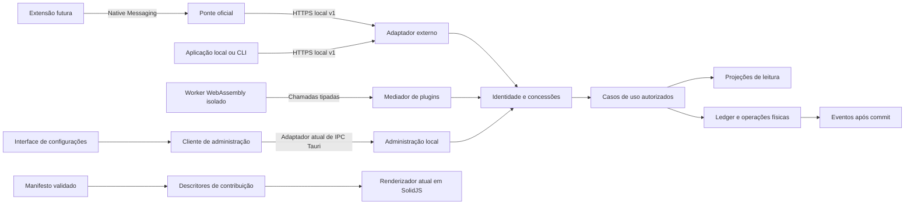

# API de importação e plataforma de plugins do Mundam

**Proposta de 24 de novembro de 2026 · Atualizada em 25 de novembro de 2026 · Base examinada `backend-refactor`, revisão `e277e49`.**

Para revisar a proposta, comece pelas decisões da seção 1 e pelas condições de aprovação da seção 10. As seções 2–5 fundamentam a API e a consistência da importação. As seções 6–9 cobrem os contratos dos plugins, a segurança e a distribuição. As duas últimas seções ficam disponíveis para acompanhar a execução.

## 1. Decisão proposta

Entregar primeiro uma importação local que funcione de ponta a ponta para um cliente de referência. O usuário escolhe uma pasta indexada, seleciona tags e recebe um comprovante por arquivo. A extensão de navegador poderá usar esse contrato no futuro. Em paralelo, projetar o primeiro plugin como uma contribuição declarativa ao inspector. Isso permite validar instalação, permissões, apresentação e remoção antes de assumir o custo de executar código de terceiros.

| Decisão para aprovação | Motivo | Condição para avançar |
| --- | --- | --- |
| API local versionada, desativada por padrão, com serviço próprio e autorização por cliente | Aplicações externas precisam de um contrato pequeno, independente das mudanças do IPC de desktop | Um cliente fora do Tauri importa dois arquivos e recupera o resultado após perder a conexão |
| O cliente entrega bytes. O Mundam guarda a URL opcional da página de origem | Funciona com conteúdo selecionado em uma sessão autenticada e mantém cookies e acesso à página no navegador | Origem, tags e arquivo aparecem juntos no catálogo. Um erro de rede permite retomar |
| Pasta padrão configurada no desktop, por catálogo, referenciada por ID | O nome e o caminho podem mudar. Uma preferência pessoal também precisa respeitar os destinos concedidos ao cliente | Renomear preserva a preferência. Desvincular ou perder acesso exige nova escolha |
| Interface de plugins descrita por dados versionados, com renderizador substituível | Autores declaram campos, ações e superfícies. SolidJS, no desktop atual, traduz essas declarações para componentes acessíveis | O mesmo manifesto é interpretado por SolidJS e por um consumidor de teste independente. O pacote pode ser removido durante o uso da galeria |
| Lógica de terceiros em WebAssembly, em processo auxiliar supervisionado, após prova de viabilidade | Workers precisam de computação programável, cancelamento e isolamento de falhas | O protótipo respeita cotas e encerramento nos três sistemas suportados pelo plano |
| Pacote local verificável primeiro. Catálogo pesquisável em uma entrega posterior | Instalação offline viabiliza o SDK e o piloto. Operar um diretório público exige responsáveis por publicação, revisão e revogação | Instalar, atualizar, recuperar a versão anterior e remover funcionam com dados reais de teste |

O primeiro lançamento da API atende aplicações locais. Pareamento pela rede, sincronização em nuvem, instalação da extensão nas lojas e suporte a plugins nativos de terceiros seriam decisões de produto independentes. O critério de sucesso desta proposta é preservar a identidade e os metadados de cada asset e manter o Mundam utilizável quando um cliente ou plugin falhar.

## 2. Levantamento da arquitetura atual

| Área | O que existe na revisão examinada | Consequência para a implementação |
| --- | --- | --- |
| Entrega e aplicação | O desktop registra comandos de consulta e mutação no Tauri. `feature` coordena os casos de uso, o core define portas e a infraestrutura implementa persistência e eventos. [Registro IPC](../../src-tauri/src/lib.rs) · [Visão geral](../backend/overview.md) | Criar um adaptador externo estreito. Os dois transportes podem usar a mesma política de negócio. O cliente público não precisa conhecer nomes de comandos Tauri |
| Pastas e tags | `list_folders(None)` lista raízes e `Some(parent)` lista filhos. O DTO interno inclui caminho absoluto. `list_tags` carrega a taxonomia inteira ordenada por posição e nome. [Pastas](../../src-tauri/src/infra/database/query_handlers/folder_queries.rs) · [Tags](../../src-tauri/src/infra/database/query_handlers/tags_queries.rs) · [Modelos](../../src-tauri/src/core/models/asset.rs) | Projetar consultas públicas paginadas no banco, com IDs, hierarquia e nomes autorizados. Uma coleção virtual ou smart folder não designa diretório de escrita |
| Entrada de arquivos | O scan emite `BatchCreate`. O consumidor de observações usa `CreateAsset`. O adaptador de criação reconcilia caminho e identidade nativa. A classificação do scan admite a categoria `unknown`. [Indexer](../../src-tauri/src/feature/library/indexer.rs) · [Classificador](../../src-tauri/src/feature/library/classifier.rs) · [Observações](../../src-tauri/src/feature/library/event_handler.rs) · [Escrita de assets](../../src-tauri/src/infra/database/handlers/asset_handler.rs) | O scan descobre arquivos já presentes. Importar exige admitir bytes, escolher nome, coordenar o efeito físico e obter um recibo. O formato aceito na fronteira externa precisa de política explícita |
| Operações físicas | `execute_library`, gate de escrita, movimentos exclusivos, journal durável, recibos e recuperação antecedem a observação da biblioteca. O journal conhece movimentos e algumas criações. [Operações](../backend/library-operations.md) · [Adaptador](../../src-tauri/src/infra/database/library_operations.rs) · [Journal](../../src-tauri/src/infra/database/library_operations/journal.rs) · [Boot](../../src-tauri/src/bootstrap/database.rs) | Estender essas garantias para publicação de arquivos importados. O journal atual exige evolução e testes para itens de upload, inclusive entre volumes |
| Metadados editoriais | `source_url` já representa a página HTTP(S), aceita query e fragmento e recusa credenciais embutidas. Keywords têm política própria. As tags são entidades associadas por `asset_tags`. [Política](../../src-tauri/src/core/ledger/discovery_metadata.rs) · [Entrega de origem e keywords](2026-11-24-assets-keywords-and-source-url.md) | Usar a mesma validação de origem. Associar IDs de tags reais. Um conjunto de chamadas independentes de criação, edição e tagging deixaria estados intermediários observáveis |
| Preferências | `AppSettings` fica fora do SQLite. `SettingsService` serializa mutações na instância e aceita chaves extras. O frontend valida payloads e já dispõe de árvore para escolher destinos. [Modelo](../../src-tauri/src/core/settings/model.rs) · [Serviço](../../src-tauri/src/feature/settings/service.rs) · [Seletor](../../src/components/features/library/FolderDestinationPicker.tsx) | Usar campo tipado, valor inicial ausente e validação de catálogo. Evitar dois escritores da preferência ou gravar credenciais no JSON de configuração |
| Mídia e segurança do desktop | O servidor Axum de streaming inicializa na porta 9876, usa token de sessão e rotas de mídia. A capability padrão atende `main` e `design-system` com operações locais. A configuração base contém `csp: null`. [Inicialização](../../src-tauri/src/bootstrap/streaming.rs) · [Servidor](../../src-tauri/src/delivery/streaming/server.rs) · [Capability](../../src-tauri/capabilities/default.json) · [Configuração](../../src-tauri/tauri.conf.json) | Reaproveitar experiência com Axum e drenagem. Criar listener, credenciais, roteamento e política de origem próprios. Carregar JavaScript comunitário na janela principal daria a esse código acesso ao contexto privilegiado |
| Providers de formatos | `FormatRegistry` indexa implementações de `FormatProvider` em Rust. No conflito por extensão o último registro prevalece e gera aviso. [Guia de formatos](../backend/format-implementation-guide.md) · [Registry](../../src-tauri/src/core/formats/registry.rs) | Reaproveitar o padrão de declarar capacidades, registrar e testar. Distribuir traits Rust ou bibliotecas dinâmicas como ABI pública acoplaria o SDK ao compilador e ao processo principal |
| Processamento | O bootstrap monta consumidores conhecidos. Há orçamento compartilhado, controles de pausa, tickets com geração, identidade da origem e lease. Tanto `ProcessingKind` quanto a restrição SQL conhecem etapas específicas. [Bootstrap](../../src-tauri/src/bootstrap/workers.rs) · [Contratos](../../src-tauri/src/core/processing/mod.rs) · [Fila SQL](../../src-tauri/migrations/20261030010000_processing_attempts.sql) | Expor uma classe controlada de execução para plugins. Acrescentar strings ao enum seria insuficiente para persistência, diagnóstico, retomada, justiça na fila e desligamento |
| Interface | `ApplicationView` contém três valores e `App` seleciona telas estaticamente. O inspector despacha por seleção/tipo. A sidebar persiste quatro tamanhos por posição. Atalhos de navegação já acompanham uma lista reativa, limitada aos nove primeiros. [App](../../src/App.tsx) · [Tipos de navegação](../../src/components/layout/TitleBar/types.ts) · [Inspector](../../src/components/layout/FileInspector.tsx) · [Sidebar](../../src/components/layout/LibrarySidebar.tsx) · [Atalhos](../../src/core/input/primitives/useNavigationShortcuts.ts) | Introduzir registros pequenos por superfície e persistir o novo layout por IDs estáveis dos painéis. Contribuições além do nono item precisam continuar acessíveis pelo menu e teclado |

Aplicar os guias do projeto em todos os incrementos. Entregas convertem DTOs e erros, regras e portas ficam no core, mutações de catálogo passam pelo Ledger e consultas usam projeções. Em Solid, agrupar por feature, usar actions tipadas, validar a fronteira com Zod e liberar listeners em `onCleanup`. Documentar interfaces exportadas com TSDoc em inglês e contratos Rust com Rustdoc, erros e exemplos verificáveis. Atualizar guias, contratos e inventário de dependências no PR que alterar o comportamento. [Backend Rust](../guidelines/backend-rust.md) · [Frontend Solid](../guidelines/frontend-solid.md) · [Arquitetura do core](../guidelines/core-architecture.md) · [Documentação](../guidelines/documentation.md) · [Dependências](../backend/dependences.md)

## 3. Fronteiras e transporte



### Independência entre backend, interface e shell desktop

A API e o SDK atravessam a fronteira por descritores, comandos, resultados e eventos versionados. O backend decide se uma operação é permitida e confirma o efeito. O frontend controla seleção visual, navegação, foco e apresentação de erros. O shell desktop fornece IPC, janelas e integração com o sistema operacional. Substituir o shell pode exigir um novo adaptador privilegiado e uma nova política de permissões do shell. A semântica dos casos de uso e os pacotes publicados devem continuar utilizáveis.

| Fronteira | Aplicação ao Mundam | Como demonstrar a independência |
| --- | --- | --- |
| Backend de aplicação | Os novos casos de uso recebem portas Rust para persistência, permissões, notificação e ciclo de vida. Construir serviços por injeção. O bootstrap atual pode obtê-los via Tauri e delegar a execução. Confinar `AppHandle`, `State`, macros IPC e emissão para webview ao adaptador | Executar importação e validação de manifesto em um processo de teste sem iniciar o runtime Tauri ou abrir janela. Comparar os resultados de negócio obtidos pelos adaptadores para a mesma identidade e concessões |
| Cliente da interface | Definir interfaces TypeScript por funcionalidade, com métodos como `listImportFolders`, `setImportDefault` e `observeImport`. DTOs serializáveis, erros tipados e cancelamento fazem parte do contrato. O adaptador traduz para `invoke` e `listen`. A apresentação decide o texto e quando mostrar um toast | Exercitar a nova interface de configurações com um cliente em memória e eventos de teste. Nenhum componente novo de integrações/plugins precisa importar `@tauri-apps/*` |
| SDK e pontos de contribuição | O manifesto descreve intenção, rótulos, ações e dados. `inspectorSections` identifica uma superfície, e `checkbox` identifica a interação esperada. O SDK público independe de componentes JSX, signals, stores, DOM e nomes de comandos Tauri | Interpretar o mesmo pacote em um consumidor de teste sem SolidJS e no renderizador SolidJS. Ambos devem produzir a mesma intenção de escrita ao marcar “Referência revisada” |

Já existem pontos concretos para essa separação. O wrapper de IPC combina invocação com apresentação de toasts, um hook de notificações importa diretamente os eventos Tauri e o bootstrap da biblioteca recebe `AppHandle`. Nas novas funcionalidades, manter essas dependências nos adaptadores e conectar os componentes existentes onde necessário. As operações administrativas continuam em canal privilegiado exclusivo do desktop. A substituição futura do shell não exige expô-las na API de terceiros. [Wrapper IPC](../../src/lib/api.ts) · [Notificações](../../src/core/hooks/useMetadataNotifications.ts) · [Bootstrap da biblioteca](../../src-tauri/src/bootstrap/library.rs)

### Transporte e autorização

**API para aplicações.** Propor HTTPS em loopback IPv4 literal, porta efêmera, versão no caminho. Descoberta por descritor local do usuário contendo versão, endpoint e identificação da instância, com escrita atômica e permissões do SO. Disponibilizar a mesma informação em Configurações para integração manual. O pareamento vincula a chave pública do servidor por canal confiável do desktop. O SDK valida essa identidade antes de transmitir segredos, inclusive após mudança de porta. Não instalar uma autoridade certificadora global. Validar a pilha TLS, proteção da chave, mudança de instância e empacotamento nos três sistemas no primeiro protótipo. Socket Unix/named pipe é a alternativa se o custo de TLS local ou distribuição de confiança for incompatível com os clientes-alvo. Exige transporte e SDK específicos por plataforma.

**Navegador.** A futura extensão pede acesso à página no gesto de captura, mostra a seleção e lê os bytes dentro das permissões do navegador. O contexto de background conversa com uma ponte oficial registrada pelo instalador. O manifesto do host restringe os IDs oficiais em `allowed_origins` no Chromium e `allowed_extensions` no Firefox. A ponte traduz mensagens delimitadas em uploads e guarda o vínculo com o desktop. Tratar content script, página, nome sugerido e metadados como entrada externa. Uma página não pode acionar o pareamento ou uma importação por mensagem arbitrária. Validar Chromium e Firefox separadamente, inclusive registro/desregistro do host por usuário, reinício do background, arquivos grandes e limites de mensagem por direção. A extensão pode informar “Abra o Mundam” quando o processo estiver fechado. [Chrome Native Messaging](https://developer.chrome.com/docs/extensions/develop/concepts/native-messaging) · [Mozilla Native Messaging](https://developer.mozilla.org/en-US/docs/Mozilla/Add-ons/WebExtensions/Native_messaging)

**Escolha de transporte para o navegador.** Acesso HTTP direto pela extensão economizaria a ponte, mas exigiria resolver descoberta, confiança TLS e permissões de rede em cada navegador. Native Messaging tem custo de instalação e serialização. Compensa ao manter a identidade da integração e a comunicação com o desktop fora da página. Usar frames pequenos com confirmação e janela limitada. O base64 fica restrito ao trecho JSON do navegador. O upload HTTP e a escrita em disco operam em binário. Se a página não conceder leitura da mídia, apresentar indisponibilidade por item. Fazer download a partir da URL no servidor abriria outra superfície de rede e mudaria as credenciais necessárias.

**Identidade e consentimento.** Ao habilitar a API, o Mundam oferece “Conectar aplicação”. O desktop gera uma autorização aleatória de uso único, com validade curta, e apresenta os dados de confiança do servidor. O cliente envia o pedido, o usuário confere nome declarado, permissões, catálogo e raízes permitidas, e confirma dentro do Mundam. Só então o cliente recebe credencial opaca de alta entropia, específica da instalação/perfil. Nome declarado não comprova autoria. Usar armazenamento protegido do sistema no cliente ou na ponte e verificador de segredo no servidor. Aplicar expiração, rotação, limite de tentativas e revogação. Rejeitar o pareamento antigo após troca da chave do servidor. A tela lista último uso e concede remoção individual ou desligamento global.

**Limite de confiança.** O serviço admite apenas loopback enquanto a biblioteca estiver pronta. Validar endereço de escuta, autoridade HTTP e origem, recusar origens de páginas e dispensar CORS na ponte nativa. Usar `Authorization: Bearer` sobre o canal autenticado, sem cookies nem tokens em URLs. O backend aplica identidade, escopo e objeto em cada leitura, envio e publicação. O fato de uma chamada ser local não comprova autorização. Um processo que já controla a conta do usuário permanece um risco residual. A interface administrativa de concessões existe exclusivamente no desktop. Plugins também não recebem acesso a essa interface. As capabilities Tauri se aplicam a janelas/webviews e precisam ser consideradas separadamente das concessões de um pacote. [Capabilities do Tauri](https://v2.tauri.app/security/capabilities/)

## 4. Contrato proposto da API v1

Cada credencial pertence a um catálogo. Tratar IDs como strings opacas. JSON usa `camelCase`, erros têm códigos estáveis e cada requisição tem identificador de correlação. A resposta de negociação informa versão, recursos e limites efetivos. Clientes ignoram novos campos opcionais. Remover campo, mudar seu significado ou tornar uma permissão mais ampla exige nova versão ou novo consentimento. Publicar OpenAPI, exemplos completos e testes de compatibilidade do SDK.

| Operação proposta | Permissão e contrato |
| --- | --- |
| `GET /v1/capabilities` | Cliente pareado. Versão, limites e recursos efetivamente concedidos |
| `GET /v1/folders?parentId=…&cursor=…&limit=…` | `folders.read`. Sem pai, retorna raízes concedidas. Filhos apenas dentro do escopo. `id`, `parentId`, `name`, `hasChildren`, disponibilidade conhecida. Não expor caminhos absolutos |
| `GET /v1/import-default` | `folders.read`. Expõe apenas preferência utilizável por esse cliente ou `folderId: null`. Um cliente sem acesso não descobre o nome do destino |
| `GET /v1/tags?query=…&cursor=…&limit=…` | `tags.read` concede leitura da taxonomia da biblioteca, explicitada no consentimento. `id`, `parentId`, nome, cor e ordem. Incluir rótulo hierárquico para desambiguar homônimos |
| `POST /v1/imports` | `assets.import`, mais `tags.assignOnImport` ao especificar tags. Recebe manifesto, identificadores de item estáveis e cabeçalho `Idempotency-Key`. Retorna `201` com lote e instruções de envio. Ainda não há asset publicado |
| `PUT /v1/imports/{batchId}/items/{itemId}/parts/{partNumber}` | Dono do lote com escopo de importação. Corpo binário, tamanho e digest. Receber parte repetida idêntica é sucesso. Mesmo número com bytes diferentes resulta em conflito |
| `POST /v1/imports/{batchId}/commit` | Dono do lote. Verifica partes completas e agenda publicação. Retorna `202` e endereço de consulta. Repetição devolve o estado do mesmo lote |
| `GET /v1/imports/{batchId}` | Dono do lote. Progresso por item, partes confirmadas, estado, `assetId` e nome efetivo quando concluído, ou código de erro acionável. Retomar consulta após desconexão |
| `DELETE /v1/imports/{batchId}` | Dono do lote. Cancela itens pendentes e libera staging. Uma publicação em andamento chega a um estado consistente. O recibo distingue concluídos e cancelados |

O backend resolve a interseção entre biblioteca, escopos e raízes por cliente em toda operação. No seletor de pastas, a disponibilidade é indicativa até a publicação. Ordenar por chave estável com ID como desempate, impor limite no SQL e devolver `nextCursor`. Vincular o cursor a cliente, filtro, catálogo e revisão da lista. Se a árvore mudar, retornar `CURSOR_EXPIRED` e permitir refazer a página preservando seleções por ID. Atribuir tags durante a importação autoriza apenas vincular tags existentes ao novo item. Criar tags ou editar assets existentes exigiria outro contrato.

**Regras de envio para o SDK.** A resposta à criação inclui `batchId`, `partSizeBytes`, `expiresAt` e endereço do recibo. Partes são numeradas a partir de zero. Cada uma tem o tamanho negociado, exceto a última, e leva o digest SHA-256 dos bytes enviados. Registrar o algoritmo e a codificação no OpenAPI. Estado parcial informa os números de parte já duráveis, paginados para arquivos grandes. Permitir reenvio fora de ordem dentro da janela admitida. O servidor recalcula os hashes e verifica que os intervalos cobrem exatamente o comprimento declarado. O digest serve à integridade e retomada. A autorização vem do cliente autenticado e do dono do lote. Um arquivo vazio deve receber erro por item quando o formato exigir conteúdo.

### Exemplo de lote

O usuário seleciona duas imagens da mesma página, escolhe uma subpasta e marca uma tag comum. As strings de identificação são ilustrativas.

```json
{
  "folderId": "folder-referencias",
  "tagIds": ["tag-pesquisa"],
  "items": [
    {"itemId": "capa", "fileName": "capa.webp", "byteLength": 18032, "sourceUrl": "https://example.org/colecao"},
    {"itemId": "mapa", "fileName": "mapa.png", "byteLength": 78041, "sourceUrl": "https://example.org/colecao", "tagIds": ["tag-mapas"]}
  ]
}
```

Omitir `folderId` solicita a preferência do usuário. Resolver o destino na admissão e gravar seu ID no lote. Mudanças posteriores de preferência só afetam novos lotes. As tags finais são a união, sem repetição, das tags do lote e do item. A origem é opcional por item. Mostrar ao usuário qual URL será guardada e permitir omitir ou remover parâmetros de rastreamento antes do envio. A validação de `source_url` já preserva query e fragmento, que podem conter informações privadas.

Com as duas partes recebidas, o cliente pede commit. Um resultado final possível é:

```json
{
  "batchId": "import-42",
  "state": "partial",
  "items": [
    {"itemId": "capa", "state": "committed", "assetId": "asset-91", "fileName": "capa.webp"},
    {"itemId": "mapa", "state": "failed", "error": {"code": "TAG_UNAVAILABLE", "retryable": false}}
  ]
}
```

Aqui uma tag exclusiva de `mapa` deixou de existir entre a pré-validação e a publicação. A UI mantém o sucesso de `capa` e permite corrigir a seleção e enviar só `mapa` em um novo lote. Falhas de transporte antes da conclusão admitem retomada no mesmo lote. Validar todo o manifesto antes de admitir bytes. Após a admissão, a unidade de commit é um item. O resumo distingue “adicionados”, “precisam de atenção” e “cancelados”.

| Situação | Resposta e comportamento do cliente |
| --- | --- |
| Credencial expirada/revogada ou permissão ausente | `401` solicita reconexão, `403` orienta revisar concessão no desktop. Para lote de outro cliente e objeto invisível, `404` sem revelar existência |
| Preferência ausente, destino removido/offline, colisão de chave ou parte faltante | `409` com código específico e escolha ou retomada. Não trocar silenciosamente de pasta |
| Manifesto, tag, nome ou formato inválido | `422` com campo/item e mensagem apresentável. Aplicar validação de conteúdo novamente após receber os bytes |
| Limite de tamanho, saturação ou espaço insuficiente | `413` para tamanho, `429` para cota temporária com `Retry-After`, `507` para falta de espaço. Interromper leitura e liberar reserva conforme estado |
| Encerramento, recibo expirado ou erro interno | `503` durante drenagem, `410` para recibo expirado dentro da janela documentada, `500` com `requestId`. Erros posteriores ao `202` ficam no recibo por item |

### Configurações e experiência da captura

Em **Configurações → Pastas**, oferecer “Pasta padrão para importações”, árvore de destinos indexados, breadcrumb, ações para escolher e limpar, além de estado vazio com acesso à vinculação de pastas. Persistir referência tipada opcional com identidade do catálogo e ID da pasta. Definir a identidade persistente do catálogo no esquema inicial, aproveitando um identificador existente se for adequado. Em uma instalação nova, iniciar a preferência como “sem padrão”. Uma pasta renomeada ou movida dentro da concessão continua válida pelo ID. Uma raiz temporariamente offline conserva a preferência e pede escolha explícita. Uma pasta removida perde a seleção efetiva. Trocar de catálogo invalida concessões e preferências daquele contexto até nova resolução.

Em **Configurações → Integrações**, reunir estado do serviço, pareamento, clientes, destinos concedidos, revogação e histórico resumido. Na captura futura, exibir miniaturas locais quando disponíveis, nome, tamanho, origem, pasta efetiva, tags comuns e exceções por item. Oferecer busca de tags e navegação por teclado. Indicar preparação, transmissão e confirmação separadamente. Só “Importado” abre o asset confirmado. Manter a seleção quando a biblioteca estiver indisponível e pedir nova autorização para reler a página se a sessão expirar. Os controles de administração devem continuar acessíveis mesmo se todos os plugins estiverem desativados.

## 5. Importação consistente de bytes, catálogo e tags

**Invariante de aceite.** Para cada `(clientId, batchId, itemId)` confirmado existe um único recibo apontando para o asset criado com os bytes validados, a pasta resolvida, a origem e todas as tags acordadas. A perda da resposta não repete o efeito. O término de thumbnails, análise de cores ou detecção de duplicatas pode ocorrer depois.

1. **Admitir.** Validar schema, escopos, quantidade de itens/tags, tamanho declarado, nomes, destino e tags. Reservar capacidade por cliente e global. Criar lote, itens e chave de idempotência em armazenamento durável. Unicidade por catálogo, cliente e chave, com digest do manifesto normalizado. Reenvio idêntico retorna o lote original. Uma chave com intenção diferente recebe `IDEMPOTENCY_CONFLICT`. A preferência já resolvida fica no recibo mesmo que o cliente reenvie o manifesto sem pasta.
2. **Receber.** Gravar em staging privado controlado pelo host, fora das áreas indexadas ou explicitamente excluído pelo scan **e** pelo watcher. Nomes físicos temporários são gerados pelo host. Validar comprimento real, digest por parte e soma por arquivo, inclusive em fluxo sem tamanho confiável. Só confirmar uma parte depois de torná-la recuperável. Limitar memória pela janela de partes em voo e aplicar contrapressão. Um arquivo integral nunca precisa caber em RAM.
3. **Preparar.** Selar o item contra novas partes, verificar sequência, tamanho total e digest calculado. Aplicar política de formatos importáveis, consistência entre nome e conteúdo e limites de processamento. Propor no piloto uma lista de formatos de mídia verificados, publicada em `capabilities`, com erro claro para um tipo fora da lista. Aumentar cobertura usando fixtures dos providers. O fallback `unknown` do indexer não deve decidir essa política. Descartar informações de caminho no protocolo, exigir nome simples válido no SO e apresentar a correção quando for necessária.
4. **Escolher o destino físico.** Resolver a pasta pelo ID sob raiz concedida, conferir identidade da pasta e permissões atuais. Usar operações relativas a diretório verificado, recusando links, junctions, reparse points e redirecionamentos incompatíveis com a política. Revalidar imediatamente no ponto de uso. Se o staging estiver em outro volume, copiar com limite para uma área privada no volume de destino, sincronizar e verificar o resultado antes da publicação exclusiva. Reservar espaço para a cópia adicional. Se não for possível garantir essas propriedades no volume, falhar de forma explícita e manter a retomada possível.
5. **Publicar sob coordenação do Ledger.** Preparar intenção durável com identificador do item, destino e identidade do temporário. Revalidar autorização, destino, tags e propriedade do arquivo. Usar a mesma disciplina de exclusão da biblioteca para serializar com observações e operações de pasta. Publicar sem substituição. Para colisão de nome, propor sufixo previsível como `capa (1).webp`, com tentativas limitadas e exclusão garantida pelo SO. Persistir o nome escolhido. Hash igual ao de outro asset não autoriza mesclar registros, ignorar tags ou alterar o original.
6. **Confirmar e notificar.** Em uma transação curta, registrar asset, identidade física, vínculos de tags, `source_url`, recibo e trabalho durável necessário para processamento. Reusar primitivas de escrita e a política de origem dentro da transação, evitando encadear handlers públicos que abririam commits independentes. Liberar o gate antes de trabalho pesado. Emitir mudanças após commit e consolidar notificações para a galeria. Se o processo cair antes da emissão, o recibo e a leitura do catálogo continuam autoritativos. O boot deve readmitir os trabalhos pendentes.
7. **Recuperar e limpar.** Antes de ligar sensores e aceitar clientes, comparar journal, recibo e identidade nativa. Sem publicação física, reabrir o item selado ou limpar staging expirado. Arquivo publicado sem recibo exige concluir a intenção ainda válida ou compensar somente a criação comprovadamente própria. Recibo confirmado exige reconciliar notificações/limpeza sem criar outro asset. Identidade ambígua preserva o arquivo e gera diagnóstico para intervenção. Um evento tardio de criação ou rename deve convergir para o mesmo ID e preservar tags e origem. O scan e o watcher devem ignorar apenas temporários próprios, inclusive temporários no volume alvo.

### Persistência e limites operacionais propostos

| Registro lógico | Chaves, duração e motivo |
| --- | --- |
| Identidade do catálogo e concessões de clientes | Vínculo estável entre catálogo, instalação do cliente, scopes, raízes, expiração e versão da concessão. Guardar só o verificador do segredo. Revogar invalida sessões e verificações de commit em curso antes do ponto de publicação |
| `import_batches` e `import_items` | Unicidade de idempotência e do item no lote, manifesto normalizado, proprietário, destino, tags, estado, nome final, digest e recibo. Guardar recibo mínimo após remover staging. Não usar caminho como chave do asset |
| Partes e journal físico | Metadados das partes confirmadas com número, tamanho e digest. Journal versionado correlacionado ao item e à confirmação SQLite. Reconciliar os dois após queda. Uma expiração não apaga arquivo final da biblioteca |
| Dados do plugin e tarefas | Namespace por identidade verificada do pacote. Dados por catálogo/asset e fila por worker, com versão de schema e política de remoção próprias. O pacote é instalado por perfil do Mundam e recebe concessões por catálogo |

Fixar números no contrato antes do beta. Para o protótipo, testar 100 itens/lote, 256 KiB de bytes por frame da ponte, duas transferências simultâneas por cliente, staging abandonado por 24 horas e recibo consultável por 30 dias. São valores de ensaio. Dimensionar limites por arquivo/lote com vídeos grandes, memória, disco livre e pressão dos workers em HDD/SSD. Publicar no handshake os valores aprovados e a janela de garantia de idempotência. Após a expiração das chaves o SDK exige ação explícita para criar outro lote. O cliente pode retomar pelo recibo mesmo se o processo auxiliar do navegador reiniciar.

O serviço deve responder “ocupado” antes de esgotar o disco ou o pool SQLite. Transferência, cálculo de digest e cópia entre volumes ocorrem fora de transações longas. No encerramento, bloquear novas admissões, cancelar uploads, assegurar o checkpoint dos itens em publicação, drenar handles registrados no ciclo de vida e só então fechar o pool. Portas ocupadas, volume ausente e staging órfão precisam de diagnóstico próprio sem impedir o uso normal da biblioteca. [Ciclo de vida](../../src-tauri/src/lifecycle.rs) · [Encerramento](../../src-tauri/src/bootstrap/shutdown.rs)

## 6. Modelo de plugins e padrão de desenvolvimento

O plugin é um pacote versionado com autor, permissões e contribuições declaradas. Um plugin declarativo pode acrescentar uma seção, formulário ou ação suportada pelo host sem runtime adicional. Um pacote computacional pode, em uma fase posterior, incluir um componente WebAssembly que implementa interfaces públicas versionadas. Em ambos os casos o autor descreve o conteúdo por dados e ações do SDK. O renderizador atual do Mundam apresenta a contribuição em SolidJS. Isso dá ao usuário o mesmo foco, tokens de tema, contraste, tradução e comportamento de seleção das funções nativas.

| Abordagem considerada | Ganho | Custo e decisão proposta |
| --- | --- | --- |
| JavaScript/Solid importado diretamente pela janela principal | Acesso imediato ao ecossistema frontend | Compartilharia DOM e contexto IPC. Manter componentes compilados do aplicativo sob controle dos mantenedores |
| Bibliotecas nativas carregadas em Rust | Acesso a codecs e desempenho nativo | Falha atinge o processo principal, com empacotamento e ABI por plataforma. Reservar para providers internos revisados e entregues com o aplicativo |
| Manifesto + componentes nativos | Menor custo de execução e contrato visual previsível | O SDK precisa de uma linguagem limitada de campos, tabelas, listas e comandos. Adotar para as primeiras superfícies |
| Componente Wasm em processo auxiliar | Computação portátil e chamadas ao host explícitas | Introduz runtime, IPC, cópias e manutenção de segurança. Provar orçamento, interrupção e restrições de SO antes de aceitar workers comunitários. Wasmtime é candidato à avaliação. [Segurança do Wasmtime](https://docs.wasmtime.dev/security.html) |

### Primeiro pacote de referência

Um revisor quer marcar um asset como “revisado” sem alterar suas notas. O exemplo abaixo registra um campo próprio e uma seção que o host consegue renderizar. Todos os nomes de contrato são propostos.

```json
{
  "manifestVersion": 1,
  "id": "org.exemplo.revisao",
  "name": "Revisão de referências",
  "description": "Marca referências visuais revisadas e mostra o estado no inspector.",
  "keywords": ["revisão", "referências", "inspector"],
  "icon": "assets/revisao.png",
  "targets": [{"platform": "all", "architecture": "all"}],
  "version": "1.0.0",
  "publisher": "org.exemplo",
  "license": "MIT",
  "engines": {"mundamApi": ">=1.0.0 <2.0.0"},
  "permissions": ["selection.read", "assetData.own.read", "assetData.own.write"],
  "contributes": {
    "assetFields": [{"id": "reviewed", "type": "boolean", "schemaVersion": 1, "default": false}],
    "inspectorSections": [{
      "id": "review",
      "title": "Revisão",
      "when": {"selectionCount": 1},
      "fields": [{"field": "reviewed", "label": "Referência revisada", "control": "checkbox"}]
    }]
  }
}
```

O host qualifica os identificadores locais com o ID verificado do pacote, carrega a projeção para a seleção autorizada, guarda o valor pelo Ledger e anuncia o resultado ao leitor de tela. A propriedade `publisher` é uma declaração que precisa corresponder à identidade de assinatura verificada. O manifesto de distribuição acrescenta localização de recursos, traduções e integridade verificável. Um worker declararia também `entrypoint`, versão da interface de computação, tipos de entrada, gatilho e limite de recursos solicitado. O host pode conceder um limite menor.

### Compatibilidade, busca e identificação no manifesto

| Campo obrigatório | Contrato da v1 proposta | Uso no produto |
| --- | --- | --- |
| `targets` | Lista não vazia de pares `{platform, architecture}`. Dentro de cada par as duas condições devem coincidir. Basta um par compatível para admitir o pacote | O catálogo filtra com a mesma regra que o gerenciador aplica ao instalar, atualizar e habilitar |
| `platform` em cada alvo | Valores canônicos `all`, `windows`, `mac` e `linux`. O adaptador do host converte o identificador local para esse vocabulário | Mostrar nomes legíveis, como macOS, e a combinação exigida quando faltar suporte |
| `architecture` em cada alvo | Valores iniciais propostos `all`, `x64`, `arm64` e `arm`. `arm` significa ARM de 32 bits. Usar a arquitetura efetiva do processo executor, inclusive sob emulação. Novos valores entram em revisão versionada do vocabulário | Distinguir pacotes portáveis e pacotes para uma arquitetura específica. Declarar um alvo não concede acesso nativo nem habilita worker indisponível |
| `description` e `keywords` | Descrição curta em texto simples e lista de termos não vazios. Validar limites publicados pelo schema, normalizar para busca e deduplicar preservando a grafia de exibição | Pesquisar também por finalidade, por exemplo “revisão”, e apresentar a descrição antes de conceder acesso |
| `icon` | Caminho relativo para imagem PNG incluída no pacote e coberta pela assinatura. Validar caminho, conteúdo real, tamanho e dimensões antes de exibir | Usar a mesma imagem na ficha e na lista de instalados. A identificação acessível inclui o nome textual do plugin |

O pacote de revisão declara `all/all` porque sua interface e seus campos são portáveis. Um autor que tenha validado apenas Windows x64 e macOS ARM64 pode escrever:

```json
{
  "targets": [
    {"platform": "windows", "architecture": "x64"},
    {"platform": "mac", "architecture": "arm64"}
  ]
}
```

Esse trecho do manifesto admite exatamente os dois pares declarados. macOS x64 e Windows ARM64 nativos ficam fora. Para qualquer arquitetura Linux, usar um alvo `{"platform":"linux","architecture":"all"}`. O curinga vale apenas no eixo em que aparece e se limita aos ambientes reconhecidos pelo host. Avaliar também a versão de API, as capacidades de execução e as permissões. A CLI aponta campos ausentes, valores desconhecidos, pares repetidos e ícones inválidos. O backend repete a validação usando o ambiente determinado localmente. Um pacote incompatível fica identificado com o motivo na ficha, sem executar código.

### Guia para quem desenvolve

1. **Escolher a superfície e declarar o mínimo.** Especificar ID estável de pacote, SemVer, versão do manifesto, intervalo do SDK, licença, descrição, palavras-chave, ícone, alvos suportados, permissões obrigatórias/opcionais, schema de dados e contribuições. Distribuir um JSON Schema e exemplos mínimos. Validar IDs únicos, referências a campos e comandos, strings localizadas, tamanhos e versão. Rejeitar permissão desconhecida ou requisito obrigatório incompatível antes de habilitar.
2. **Estruturar o pacote.** Propor `manifest.json`, `locales/`, `schemas/`, recursos visuais locais com formatos e dimensões permitidos e, quando necessário, `worker.wasm`. O envelope assinado cobre manifesto e digest de todos os arquivos. Sem scripts de instalação, dependências obtidas em runtime ou HTML executável. Versões iniciais usam pacotes autocontidos. Isso simplifica resolução, rollback e remoção.
3. **Usar o SDK.** Tipos e exemplos gerados do schema para contribuições declarativas. Para Wasm, definir uma interface WIT pequena para chamadas autorizadas, erros, cancelamento e resultados. Prover bindings e fixtures para pelo menos uma linguagem no piloto. Recursos como `readPreview`, `readAssetRange`, `putOwnData` e `reportProgress` recebem handles opacos com escopo e duração. O protocolo nunca aceita `pluginId` informado pelo guest como prova de identidade. Exemplos e documentação pertencem à versão do contrato.
4. **Declarar o ciclo de vida.** Descobrir manifesto sem executar código, validar compatibilidade e concessões, registrar contribuições em conjunto, ativar sob demanda, cancelar operações ao desativar e liberar inscrições, rotas e handles. Se uma etapa falhar, desfazer os registros daquele pacote. Uma ativação repetida converge para uma única instância lógica. Proteger componentes nativos e IDs reservados de sobrescrita.
5. **Entregar uma experiência consistente.** Definir visibilidade por predicados de dados enumerados, como tipo de mídia e quantidade selecionada. Restringir profundidade e tamanho das expressões. Campos e ações incluem rótulo, estado vazio, carregamento e erro. Suportar teclado, retorno do foco, temas e traduções com fallback. O autor pode testar ausência de permissões, seleção múltipla e asset offline com o simulador.
6. **Testar e distribuir.** Planejar CLI com comandos de criação de template, validação, empacotamento e teste em catálogo descartável. Exemplos progressivos de inspector declarativo, tela com ação e worker que lê uma miniatura. O modo de desenvolvimento deve informar origem local, isolar dados de ensaio e aplicar o mesmo mediador de permissões. Não habilitar pacotes sem assinatura apenas porque o usuário ativou uma preferência genérica de desenvolvedor.

### Inventário de pontos de extensão

A prioridade A forma o primeiro plugin utilizável. B amplia a composição da interface. C depende de execução ou acesso mais sensível. Cada contribuição deve ter proprietário, identificador, política de ordem, remoção e fallback definidos pelo host.

| Superfície | Contrato que o desenvolvedor poderá usar | Integração, restrição e prioridade |
| --- | --- | --- |
| Inspector | Seções, campos próprios, leitura/edição e ações contextuais. Seleção única ou múltipla explícita | Inserir área adicional no compositor do inspector. Revalidar a seleção na escrita e descartar resposta atrasada. A |
| Viewport da galeria | Ações de toolbar/menu, badges e colunas opcionais, com contexto de seleção limitado | Integrar toolbar, menu e projeção em lote apenas para itens visíveis. Evitar chamada por card/scroll ou bloqueio do layout virtual. B. [Viewport](../../src/components/layout/Viewport.tsx) · [Menu](../../src/components/features/viewport/components/AssetContextMenu.tsx) |
| Visualização de um item | Painéis auxiliares, ações de preview e representação derivada declarada | Preservar visualizador nativo e fallback por formato. Entregar thumbnail via handle temporário. Renderizador novo requer contrato de mídia e validação próprios. B/C. [ItemView](../../src/components/features/itemview/ItemView.tsx) |
| Sidebar | Seção recolhível, árvore/lista paginada, navegação para seleção ou tela | Adotar uma nova chave de layout indexado por ID e iniciar com os quatro painéis do produto e prever overflow e tamanhos mínimos em janela pequena. B |
| Titlebar | Ação nomeada ou entrada de navegação, com ícone aprovado e prioridade limitada | Reservar área de arraste e controles nativos. Oferecer menu de excesso e acesso por teclado em todas as plataformas. B. [TitleBar](../../src/components/layout/TitleBar/TitleBar.tsx) |
| Telas | ID qualificado, título e composição de lista, tabela, formulário e comandos | Evoluir `ApplicationView` e o seletor de `App`. Manter navegação de retorno e foco. Ao desativar a tela ativa, voltar à galeria ou ao estado inicial da biblioteca. B |
| Comandos, menus e atalhos | ID, contexto permitido, rótulo traduzível e atalho sugerido | Integrar dispatcher, escopos e preferências de teclado. Preferências do usuário têm precedência, colisões são apresentadas, descarte remove handlers. B. [Guia de input](../guidelines/input-and-shortcuts.md) |
| Configurações e statusbar | Formulário tipado por plugin, progresso, pausa, erro recuperável e diagnóstico por worker | Host monta e persiste o formulário no namespace. Status agrega tarefas, restringe frequência de atualização e mantém controles essenciais acessíveis. B/C. [Configurações](../../src/components/features/settings/SettingsModal.tsx) · [Statusbar](../../src/components/layout/GlobalStatusbar.tsx) |
| Dados, seleção e eventos | Projeção mínima de metadados, dados próprios por asset, mudança de seleção e eventos filtrados | Incorporação do plugin no evento é feita pelo host conforme concessão. Agrupar/deduplicar alterações, limitar fila e fornecer nova leitura quando eventos se perderem. A para campos próprios, B para eventos |
| Pesquisa, filtros e ordenação | Filtro sobre campo tipado próprio ou coleção derivada | Após medir, permitir índices gerenciados pelo host, com paginação e limites. Evitar SQL ou expressões arbitrárias. B/C |
| Workers | Gatilho manual ou após evento confirmado, entradas declaradas e resultados próprios | Executor com identidade de plugin, orçamento compartilhado e diagnóstico. C |
| Derivados, exportação e formatos | Ler thumbnail/intervalo autorizado, gravar artefato derivado, propor criação de asset por fluxo de importação | Exportar original exige ação e destino aprovados. Codecs e substituição de provider nativo merecem revisão e benchmarks próprios. C |

## 7. Segurança, dados e execução de workers

### Concessões aplicadas pelo host

| Operação | Escopo inicial | Controle no backend |
| --- | --- | --- |
| Observar seleção e ler resumo | Seleção atual ou conjunto explicitamente delegado. Nome, tipo e ID só quando necessários | Snapshot com revisão e projeção permitida. Resolver cada ID no catálogo autorizado |
| Ler preview ou original | Concessões separadas. Começar pelo preview. Leitura de conteúdo original aparece com destaque no consentimento | Handle de leitura temporário, por asset e geração, bytes por faixa, cotas e revogação. Sem caminho físico nem token de streaming |
| Adicionar dados relacionados | Escrita no namespace do próprio plugin e em assets concedidos | Validar schema, tamanho e revisão esperada. Conflito concorrente pede releitura. Auditar alteração e emitir evento após commit |
| Criar um derivado | Escrita em espaço privado com limite ou criação de novo asset por intenção explícita | Host escolhe destino, valida bytes e mantém relação de origem. Edição destrutiva do original fica fora da primeira API |
| Rodar em segundo plano | Concessão de worker, gatilhos e conjunto de assets autorizados | Aprovação específica para varrer biblioteca inteira. Revalidar concessão no início e na conclusão |
| Rede, shell, arquivos livres, clipboard, variáveis de ambiente | Sem concessão na primeira versão pública de plugins | Nenhuma importação de host entrega essas operações. Avaliar cada necessidade futura, com consentimento e modelo de dados próprios |

Guardar dados estruturados com chave lógica `(catalogId, pluginId, assetId, fieldId)`, versão de schema e revisão para concorrência. Objetos grandes ficam em armazenamento privado identificado por digest, com referência transacional e coleta de órfãos. Definir política por categoria: anotações do usuário são exportáveis e persistentes, caches são regeneráveis. Na lixeira lógica, ocultar os dados e restabelecê-los no restore. Na exclusão recuperável de pastas, incluir dados duráveis no snapshot/Undo ou em retenção vinculada à recuperação. Exclusão definitiva elimina registros e agenda limpeza de blobs comprovadamente sem referências. Testar também desvinculação, relink e merge de duplicatas. Um merge com anotações conflitantes exige política explícita antes de habilitar essa combinação. [Recuperação da biblioteca](../backend/library-operations.md)

**Admissão de workers.** Criar executor genérico de plugins com fila própria e adaptador ao orçamento comum. Preservar restrições das etapas nativas. A chave de trabalho inclui plugin, worker, versão, asset, revisão da origem e geração. O host faz claim com lease, renova somente enquanto supervisionado e aceita resultado apenas se lease, concessões, versão do plugin e origem continuarem válidos. Escrita de resultados e conclusão da tentativa compartilham uma transação. Uma reentrega pode repetir computação e deve produzir um único efeito confirmado. Restringir gatilhos para que uma gravação do próprio worker não realimente o job indefinidamente. [Tickets e resultados](../../src-tauri/src/core/processing/mod.rs) · [Orçamento](../../src-tauri/src/core/processing/budget.rs) · [Leases](../backend/workers/2026-11-03-23-32-processing-leases.md)

**Execução.** Iniciar o processo auxiliar sob supervisão, com credencial efêmera exclusiva do canal com o host, sem herdar segredos, handles privilegiados, diretórios pré-abertos ou rede. Carregar somente módulo verificado, com imports enumerados. Definir limites de memória, tabela, pilha, chamadas ao host, bytes lidos/produzidos e tempo de CPU/parede. Medir interrupção de loops e de chamadas bloqueadas. Limites do runtime e restrições de SO são camadas complementares. A prova de viabilidade deve especificar e testar as restrições realmente obtidas em Windows, macOS e Linux, o comportamento do compilador Wasm no pacote assinado e o custo de inicialização. Se o alvo não atingir o isolamento mínimo, disponibilizar nele apenas plugins declarativos até resolver a lacuna.

**Operação diária.** Reservar capacidade para interação e workers nativos, limitar paralelismo por plugin e impor pausa e cancelamento. Diferenciar falha temporária com backoff limitado, entrada incompatível, falta de concessão e falha permanente. Após falhas repetidas, suspender aquele worker e exibir diagnóstico e ação de retomada. Durante atualização, revogação ou desligamento, interromper admissão, invalidar handles/leases, drenar ou terminar o processo no prazo e descartar resultados atrasados. O usuário pode abrir o Mundam em modo seguro antes de qualquer ativação.

### Riscos a verificar na revisão de segurança

| Fronteira e risco | Controle e evidência de aceite |
| --- | --- |
| Página ou cliente induz importação, enumera pastas ou lê recibos alheios | Gesto no navegador, pareamento no desktop, escopos, dono em cada consulta e auditoria redigida. Teste com dois clientes de raízes diferentes |
| Nome, link ou troca concorrente de pasta redireciona a publicação | Resolução pelo ID, verificação do diretório no ponto de escrita, tratamento nativo de links e movimento exclusivo. Teste de concorrência com rename, unlink e destino ocupado |
| Arquivo importado é privado, enorme ou interpretado como conteúdo ativo | Limites de entrada e decodificação, validação de conteúdo e previews inertes. Revisar política do SO para proveniência/quarentena de downloads e preservá-la na publicação onde aplicável. Exercitar imagens vetoriais, HTML disfarçado e formatos desconhecidos como entradas recusadas ou sanitizadas |
| Pacote é adulterado, malformado ou substitui outro autor | Verificar assinatura, identidade de publicação e inventário completo antes de extrair/ativar. Recusar caminhos externos, links, duplicatas ambíguas, excesso de arquivos e expansão excessiva |
| Plugin tenta alcançar IPC, DOM ou outro namespace | UI renderizada a partir de valores escapados, broker com validação por objeto, processo isolado e capabilities mínimas. Revisar CSP de produção para os recursos efetivamente renderizados. Testar uma contribuição removida e uma chamada após revogação |
| Worker paralisa UI, esgota disco ou envenena resultados após update | Cotas, fila justa, lease e geração, rejeição de resultado obsoleto, modo seguro. Medir sessão com galeria e workers nativos ativos |
| Histórico expõe a página visitada, caminhos ou segredos | Logs contêm IDs de correlação, plugin/cliente, duração, bytes, resultado e código. Omitir conteúdo, tokens, query strings, nomes sensíveis e caminhos. Informar retenção e permitir limpar o histórico apresentado |

Assinatura identifica o distribuidor e protege integridade. Um pacote assinado ainda pode pedir dados em excesso ou conter falhas. O usuário deve poder inspecionar permissões em linguagem concreta, revogar acesso imediatamente e encontrar um canal para reportar problemas. A revisão continua necessária também para o próprio broker, o runtime e os decodificadores nativos que recebem mídia externa.

## 8. Instalar, atualizar, recuperar e remover

O fluxo do Obsidian separa instalar de habilitar e oferece um modo restrito. Sua documentação também explicita que os plugins herdam o acesso do aplicativo. No VS Code, o manifesto organiza pontos de contribuição e o gerenciador permite distribuir pacotes e administrar extensões instaladas. Para o Mundam, aproveitar a familiaridade desses fluxos e tornar as concessões verificáveis no backend. [Plugins da comunidade do Obsidian](https://help.obsidian.md/community-plugins) · [Segurança do Obsidian](https://help.obsidian.md/plugin-security) · [Contribution Points do VS Code](https://code.visualstudio.com/api/references/contribution-points) · [Gerenciamento de extensões do VS Code](https://code.visualstudio.com/docs/configure/extensions/extension-marketplace)

| Ação da pessoa | Comportamento proposto e recuperação |
| --- | --- |
| Instalar de arquivo | **Configurações → Plugins → Instalar de arquivo** abre pacote local proposto `.mundam-plugin`. Validar tamanho e envelope, extrair para staging privado com limites, verificar conteúdo, licença, versão, compatibilidade e assinatura. Conferir os alvos declarados com o ambiente local. Exibir ícone, descrição, autor, proveniência, compatibilidade, recursos e permissões explicadas. O usuário pode cancelar antes da ativação |
| Habilitar | Mostrar, por exemplo, “Pode ler as miniaturas dos assets que você selecionar” e “Pode salvar o campo Revisado nesta biblioteca”. Gravar concessões e versão ativa, montar contribuições e confirmar funcionamento. Se a ativação falhar, desfazer registros e oferecer diagnóstico. Sem reinício para contribuições declarativas |
| Encontrar e instalar do catálogo | Em fase posterior, indexar nome, descrição e keywords do manifesto verificado. Oferecer filtros por autor, plataforma, arquitetura, superfície e permissões, usando a mesma regra de compatibilidade da instalação local. Página com exemplos, compatibilidade, licença, histórico, data, política de dados e canal de suporte. Download para o mesmo instalador e verificador usados offline. Diferenciar identidade do autor, revisão da versão e disponibilidade de atualização |
| Atualizar | Preparar nova versão ao lado da ativa. Revalidar os alvos antes da troca. Se a nova versão deixou de atender à máquina, explicar o motivo e conservar a versão ativa elegível. Mostrar changelog, diferença de permissões e versão do schema. Solicitar novo consentimento para ampliação de acesso. Validar recursos. Para futuras versões que mudarem dados publicados, planejar transformação do namespace sobre uma cópia com checkpoint. Trocar ponteiro de versão ativa de forma atômica e reter uma versão anterior elegível |
| Recuperar após falha | No próximo boot, completar ou reverter a troca journalizada. Em falha de ativação, reativar a versão elegível e seu estado consistente. Em futura transformação de schema, o checkpoint também deve permitir recuperar os dados. Preservar edições novas se já houve uso da versão atual, oferecendo exportação antes de rollback incompatível. Recusar reativar versão revogada. O modo seguro pode desabilitar um pacote antes que ele volte a falhar |
| Desabilitar | Revogar execução de imediato, liberar UI, invalidação de handles e jobs, manter preferências e dados. É reversível. Se a pessoa estiver em uma tela do plugin, devolver foco a uma tela nativa e informar o que ocorreu |
| Desinstalar | Informar quantidade/tamanho dos dados e apresentar “Manter minhas anotações” como padrão e “Exportar e apagar dados” como opção explícita. Finalizar jobs, revogar concessões, remover registros, cache e versões de pacote. Falha de exclusão por arquivo em uso mantém limpeza pendente e repetível. Manter mídia original e assets derivados já importados pelo usuário |

Instalar em área de dados do usuário separada das bibliotecas observadas. Tornar versões verificadas imutáveis pelo gerenciador e serializar operações por pacote. Guardar identidade do assinante junto ao namespace retido. Reinstalação por um autor com o mesmo texto de ID não concede acesso aos dados antigos. Definir raízes de confiança do catálogo, comprovação e rotação de chave do autor, lista assinada de revogações, canal de aviso e procedimento de retirada. Para distribuição independente/offline, permitir importação explícita de uma chave de editor conferida fora do pacote e mostrar seu fingerprint. Documentar que a verificação offline usa a última informação de revogação disponível e exibir sua data. Uma atualização do índice não pode rebaixar silenciosamente a versão confiável.

O catálogo público precisa de proprietário operacional, política de publicação, análise automatizada de cada versão, revisão dos privilégios, tratamento de denúncias e retirada de versões. O usuário conserva a opção de instalar um pacote verificável de arquivo e desativar atualizações automáticas. Antes de oferecer o catálogo, validar recuperação após chave comprometida e definir quem pode assinar uma revogação, inclusive para instalações temporariamente offline.

## 9. Organização da implementação e compatibilidade

As localizações novas abaixo são candidatas para revisão. Introduzir cada módulo junto com o primeiro consumidor e manter pequenos os contratos públicos.

| Camada | Responsabilidade e artefato esperado |
| --- | --- |
| `core/integrations` e `core/plugins` propostos | Identidades, concessões, limites, manifestos, handles e erros de domínio. Portas de staging, cofre de credenciais, verificação de pacote e supervisor. Sem dependência de Tauri, SQLx, HTTP ou runtime Wasm |
| `feature/imports` e `feature/plugins` propostos | Orquestração de admissão/consulta/finalização e instalação/ativação/remoção. Injetar portas, propagar cancelamento e delegar mutações de catálogo ao Ledger. Usar projeções distintas para extensão, guest e interface administrativa |
| `infra/database`, filesystem e configuração | Esquema inicial versionado, consultas paginadas e índices, comandos transacionais, evolução versionada do journal e do snapshot, armazenamento privado e reconciliação. Segredos acessados por adaptador específico de plataforma |
| `delivery/external_api` e `delivery/tauri` | Adaptar HTTP para DTO público com códigos estáveis. Tauri expõe somente as operações administrativas que o desktop necessita. Registrar cada novo comando, permissão e capability de janela junto do código |
| `processing/workers` e `bootstrap` | Executor de jobs de plugin, integração com orçamento e lifecycle. Abrir serviço e admitir plugins só após banco inicializado, journal recuperado e concessões carregadas. Erro em componente opcional deve deixar a biblioteca acessível |
| Frontend Solid | Feature de integrações/plugins, actions, schemas e componentes de configuração. Compositores por superfície consomem descritores autorizados e renderizam componentes Mundam. Estado de contribuição pertence ao plugin e é descartável. Evitar singleton de componentes com referência persistente a um asset |
| SDK, ponte e especificações | Schema de manifesto, OpenAPI, WIT quando houver computação, exemplos e suíte de conformidade versionados. Ponte distribuída com identidade verificável nos instaladores por plataforma. A extensão de navegador pode evoluir em repositório próprio |

**Esquema inicial e evolução futura.** Durante o desenvolvimento, definir a primeira versão de catálogo, preferências, journal e dados próprios do plugin e validar a criação a partir de uma instalação limpa. A API inicia desativada, a pasta padrão vazia e o layout da sidebar com os painéis nativos identificados por ID. A conversão de bancos, configurações e layouts de builds de desenvolvimento fica fora desta entrega.

Para as versões futuras, versionar separadamente o schema SQLite, as preferências, o manifesto/SDK e os dados de cada plugin. A primeira versão publicada fornece a linha de base. Quando surgir uma mudança incompatível, documentar origem e destino, transformação, ordem e responsável, estratégia transacional ou de checkpoint, comportamento após interrupção e política de restauração. Nessa ocasião, acrescentar fixture da versão publicada anterior e ensaiar a atualização em cópia. No ciclo atual, testar criação limpa e recuperação de operações interrompidas na mesma versão, inclusive upload, ativação e troca de pacote.

**Dependências e distribuição.** Axum, Tokio, Serde, SQLx e ZIP já constam do backend. A versão de Rust declarada, os lockfiles, bibliotecas nativas e instaladores condicionam novas escolhas. Avaliar TLS e armazenamento de chaves no SO, assinatura de pacotes e runtime Wasm em provas distintas. Para cada candidato registrar versão fixada, MSRV, tamanho do binário por plataforma, tempo de boot, licença, dependências transitivas, manutenção e procedimento de atualização de segurança. Incluir assinatura/notarização da ponte e do processo auxiliar e, no Linux, restrições de confinamento e localização do host de navegador. Adiar o runtime no pacote inicial permite medir separadamente o custo da API e da execução de plugins. [Manifesto Rust](../../src-tauri/Cargo.toml) · [Inventário](../backend/dependences.md)

**Documentação prevista.** Publicar guia de integração externa com pareamento, descoberta, upload e recuperação, guia de implementação de plugins no padrão do guia de providers, catálogo dos pontos de contribuição e permissões, referência do manifesto/SDK e guia do usuário para instalação e remoção. Documentar suporte por sistema/navegador, casos de erro, compatibilidade e depreciação. Mudança incompatível ganha nova versão principal e exemplo de migração. Guardar fixtures de referência da primeira versão publicada de manifesto, mensagens e resultados para testar as mudanças futuras. Expor uma capacidade opcional apenas quando a implementação estiver pronta naquela plataforma.

## 10. Sequência de entrega e critérios de aprovação

| Fase | Dependência | Resultado que permite encerrar a fase |
| --- | --- | --- |
| 0 · Contratos e provas | Aprovação deste relatório | Esquema inicial e política para migrações futuras documentados. Casos de uso executáveis sem inicializar Tauri, descritores consumíveis sem SolidJS e contrato de alvos do manifesto revisado. Provas de canal local autenticado, upload e recuperação após queda com medições iniciais |
| 1 · Ingestão nativa | 0 | Caso de uso testado com staging, colisões, reindexação e recibo. Pasta padrão por catálogo e seletor acessível no desktop |
| 2 · API local utilizável | 1 | CLI/aplicação de referência pareia, lista pastas/tags, importa lote com e sem padrão, retoma e cancela. Testar ponte mínima com extensão de ensaio. Uma extensão para usuários finais é projeto subsequente |
| 3 · Plugin declarativo | Contratos de 0. Pode avançar em paralelo com 1 e 2 | O pacote de revisão universal grava um campo por asset. Um segundo manifesto restrito demonstra seleção de alvos, descoberta por keyword e recusa de ativação em máquina incompatível. Desligar, exportar, remover e reinstalar têm resultados previsíveis |
| 4 · Superfícies de UI | 3 | Pacote de exemplo contribui para viewport, inspector, sidebar, titlebar e uma tela. Layout/atalhos existentes sobrevivem à instalação e ao desligamento durante o uso |
| 5 · Computação isolada | 3, prova de isolamento e orçamento | Worker de exemplo usa preview concedido, grava dado próprio e respeita pausa, cancelamento, falha, update e desligamento. A galeria e os jobs nativos permanecem responsivos |
| 6 · Distribuição e lançamento | 2 e 4 para canais estáveis. 5 para anunciar workers | Matriz de compatibilidade e segurança publicada, SDK utilizável por um desenvolvedor externo, atualização/rollback ensaiados. Ativar diretório público só com operação e revogação definidas |

### Plano de verificação

| Cenário de aceite | O que medir ou observar |
| --- | --- |
| Independência das camadas | Testar novos casos de uso e contratos em modo headless sem runtime Tauri, a tela com cliente em memória e o manifesto em um consumidor sem SolidJS. Verificar que as interfaces públicas de plugins não importam tipos desses frameworks |
| Manifesto e compatibilidade da máquina | Ensaiar pacote universal, Linux com arquitetura livre e os dois pares específicos do exemplo. Rejeitar combinações cruzadas, alvo desconhecido e ícone inválido. Verificar busca por descrição/keyword e atualização que perde suporte à máquina |
| Captura com vários assets | Testar pasta explícita, padrão, padrão fora da concessão, pasta offline e tags homônimas. Conferir arquivo final, ID, origem, tags, evento, exibição na galeria e thumbnail posterior |
| Concorrência e interrupção | Queda após parte confirmada, após rename físico, antes/depois do commit e antes de notificar. Duplo commit, repetição de parte, dois clientes com o mesmo nome, watcher/scan em paralelo e destino alterado. Conferir identidade, recibo, ausência de registro fantasma e preservação de arquivos alheios |
| Segurança e privacidade | Duas identidades com escopos diferentes, pareamento expirado, revogação durante upload/job, pacote adulterado, permissão nova em update e dados de outro plugin. Conferir rejeições no backend e logs redigidos |
| Ciclo do plugin | Instalar offline, simular falha de ativação, voltar de versão, interromper atualização, remover com arquivo ocupado, restaurar pasta excluída e reinstalar com namespace retido. Conferir originais, dados, navegação e limpeza de jobs/handles |
| Sistemas e navegadores | Windows com volumes distintos, nomes reservados, reparse points e locks. macOS com volumes sensíveis/insensíveis a caixa, normalização Unicode e pacote assinado. Linux com permissões, links, XDG e restrições de instalação. Exercitar Chromium e Firefox pelo menos em cada plataforma anunciada e publicar exceções |
| Acessibilidade | Percorrer captura, preferências e gerenciador por teclado, confirmar ordem/retorno de foco, feedback por leitor de tela, contraste, zoom, janela estreita, traduções e erro por item. UI permanece operável em modo seguro |
| Custo operacional | Comparar build base e build com recurso desligado, depois com 1 e vários plugins. Medir boot frio, RSS de pico, p95 de listagem e frames na galeria, contenção de escrita, atraso de thumbnails, taxa de upload, cota de disco e tempo de drenagem |

Registrar hardware, sistema, tamanho da biblioteca, corpus e método para cada benchmark. Incluir biblioteca grande, árvore profunda, milhares de tags, vídeo maior que a memória reservada ao upload e disco quase cheio. Antes do beta, fixar os limites aprovados para p95, memória, tempo de parada e regressão aceitável em relação ao baseline. Aumentar o tamanho do arquivo sem aumentar a janela de envio deve manter a memória de transferência limitada. Um cancelamento precisa liberar o permit e permitir que o próximo trabalho avance.

Usar testes unitários de política no core, integração com SQLite real e filesystem temporário, testes de queda com recuperação real do journal, contratos entre clientes e backend e testes Solid para as superfícies alteradas. Acrescentar testes de parser de manifesto/envelopes com entradas inválidas e fixtures públicas da v1 como referência para o desenvolvimento das próximas versões. Exercitar os instaladores e o encerramento em builds distribuíveis. Registrar resultados de `cargo test`, `cargo clippy`, testes de documentação, `npm test`, `npm run lint`, checagem TypeScript e build de produção conforme o incremento. Esta revisão é documental. Resultados de execução e benchmarks pertencem ao registro abaixo.

### Decisões que precisam de ratificação

1. Aprovar a API local com entrega de bytes, TLS com identidade vinculada ao desktop e Native Messaging para a extensão. Reavaliar socket/pipe após a prova de integração por plataforma.
2. Aprovar commit por item, nomes exclusivos por padrão e janela documentada de idempotência. Confirmar formatos, cotas e prazo de retenção com o corpus real antes da versão pública.
3. Aprovar lista de permissões inicial, vínculo da preferência ao catálogo e consentimento por raiz. Confirmar na pesquisa de usabilidade que as pessoas distinguem acesso à taxonomia e acesso aos arquivos.
4. Aprovar UI declarativa como primeiro SDK e condicionar workers à prova em processo isolado. Definir prioridade das contribuições B com um segundo autor de plugin.
5. Aprovar pacote assinado local e retenção de anotações como padrão. Designar responsáveis pelas chaves, incidentes, publicação do SDK e futuro catálogo.

## 11. Entregas para acompanhamento

Marcar somente após anexar evidência de aceite no registro de implementação. As caixas começam abertas.

- [ ] **E01 · Contratos.** ADR de transporte, isolamento e fronteiras independentes de SolidJS/Tauri, esquema inicial e política de migração futura aprovados, junto com modelo de ameaças, escopos e matriz de compatibilidade.
- [ ] **E02 · API v1.** OpenAPI, negociação de versão/limites, DTOs, erros e exemplos de retomada validados por teste de contrato.
- [ ] **E03 · Identidade.** Descoberta, pareamento, armazenamento, rotação, revogação, painel de clientes e logs redigidos testados.
- [ ] **E04 · Destinos e tags.** Consultas paginadas por escopo, hierarquia e preferência por catálogo com seletor e estados de indisponibilidade.
- [ ] **E05 · Upload.** Recepção binária limitada, staging, hashes, idempotência, cancelamento e limpeza com quotas verificadas.
- [ ] **E06 · Publicação.** Comando do Ledger com origem e tags, recibo por item, colisões, recuperação e convergência com watcher/indexer demonstrados.
- [ ] **E07 · Clientes externos.** Aplicação/CLI de referência e ponte de ensaio com Chromium/Firefox completam um lote e recuperam resultado após desconexão.
- [ ] **E08 · SDK declarativo.** Schema, CLI e exemplos universal/específico com plataforma, arquitetura, descrição, keywords e ícone validados. Fixture v1 consumida sem SolidJS.
- [ ] **E09 · Gerenciador.** Instalação de arquivo assinado, consentimento, habilitação, modo seguro, atualização, rollback e remoção verificados.
- [ ] **E10 · Interface extensível.** Viewport, inspector, sidebar, titlebar, telas, comandos e atalhos testados com ativação/desativação dinâmica, cliente de apresentação substituível e DTOs independentes do IPC Tauri.
- [ ] **E11 · Dados relacionados.** Namespace com versão de schema, concorrência, exportação, Undo, retenção e expurgo com testes de integridade. Estratégia para futuras transformações registrada.
- [ ] **E12 · Runtime e workers.** Prova de isolamento aprovada, broker com handles, leases, orçamento, cancelamento, diagnósticos e drenagem validados.
- [ ] **E13 · Qualificação.** Ensaios de segurança, acessibilidade, desempenho, falhas e instalação por plataforma registrados com limites de lançamento.
- [ ] **E14 · Documentação e distribuição.** Guias de autor/usuário e integração, SDK, exemplos, licenças, inventário e processo de correções publicados.
- [ ] **E15 · Catálogo comunitário, fase posterior.** Busca em nome, descrição e keywords, filtros por alvo e identificação por ícone verificados. Verificação de editor, revisão, retirada, revogação e responsável operacional definidos e ensaiados.

## 12. Registro dos detalhes da implementação

Área reservada para preenchimento durante a implementação. Usar uma linha por decisão ou entrega e vincular a evidência reproduzível ao respectivo item.

| Data | Entrega | Responsável / PR | Decisão tomada e motivação | Contratos, migrações e arquivos alterados | Testes, medições e plataformas | Pendências / rollback |
| --- | --- | --- | --- | --- | --- | --- |
| | | | | | | |

| Versão entregue | Compatibilidade confirmada | Limites operacionais aprovados | Problemas conhecidos | Evidência de aceite |
| --- | --- | --- | --- | --- |
| | | | | |
