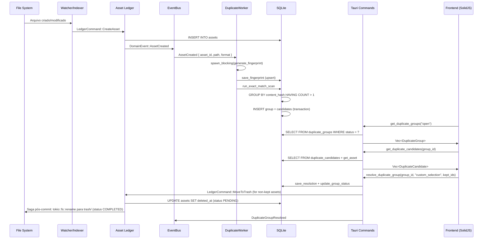

# Relatório Completo — Módulo de Detecção de Arquivos Duplicados

**Projeto:** Mundam — Digital Asset Manager  
**Data Original:** 2026-08-31  
**Última Atualização:** 2026-10-05  
**Autor:** Gerado automaticamente a partir da análise de código  
**Referências:** `gpt-overview.md`, `gpt-proprosal.md`, `implementation-plan.md`

---

## 1. Visão Geral

O módulo de detecção de duplicados foi implementado como um subsistema completo do Mundam, seguindo a filosofia de **processamento incremental em background** integrado ao pipeline de indexação existente. A arquitetura segue o padrão Hexagonal (Ports & Adapters) já utilizado no restante do projeto, com separação clara entre domínio (`core/`), orquestração (`feature/`), infraestrutura (`infra/`) e entrega (`delivery/`).

### 1.1 Status Atual

| Componente                       | Status     | Observações                                                                               |
| -------------------------------- | ---------- | ----------------------------------------------------------------------------------------- |
| Modelo de Domínio (Rust)         | ✅ Completo | 6 entidades, 3 enums                                                                      |
| Tabelas SQLite                   | ✅ Completo | 5 tabelas + 4 índices                                                                     |
| Repositório (Porta)              | ✅ Completo | Trait com 15 operações assíncronas                                                        |
| Repositório (SQLite / Database)  | ✅ Completo | Implementação modular em `infra/database/` (Facade, Handlers e Query Handlers segregados) |
| Gerenciamento da Lixeira (Saga)  | ✅ Completo | Padrão Saga pós-commit no Ledger para `MoveToTrash`, `RestoreFromTrash` e `DeleteAsset`   |
| Resolução de Caminhos da Lixeira | ✅ Completo | Centralizada em `core::trash` (`resolve_trash_path` timestamped + fallback legado)        |
| DuplicateWorker (Eventos)        | ✅ Completo | Escuta `AssetCreated` (hashing) e `AssetDeleted` (cleanup)                                |
| DuplicateCommandService          | ✅ Completo | Resolve, ignora, despacha comandos atômicos via Ledger sem manipulação de FS direta       |
| DuplicateQueryService            | ✅ Completo | Consulta por status e candidatos                                                          |
| Tauri Commands                   | ✅ Completo | 4 comandos expostos no invoke_handler                                                     |
| Domain Events                    | ✅ Completo | 5 variantes de evento de duplicados                                                       |
| Frontend — View                  | ✅ Completo | `DuplicateFinderView` com ResizablePanel                                                  |
| Frontend — Group List            | ✅ Completo | Componente extraído com deck preview                                                      |
| Frontend — Group Item            | ✅ Completo | Deck visual + ignored styling                                                             |
| Frontend — Comparison Panel      | ✅ Completo | Cards lado a lado, smart actions e visual de lixeira                                      |
| Frontend — Hook                  | ✅ Completo | `useDuplicateGroups` com fetch + mutate                                                   |
| Frontend — Types/API             | ✅ Completo | `duplicates.ts` com mapeamento completo                                                   |
| Hashing Real (Blake3)            | ✅ Completo | Streaming hashing implementado (`generate_fingerprint`)                                   |
| Perceptual Hash                  | ✅ Completo | dHash 8x8 implementado em `generate_fingerprint`                                          |
| UI de Regras Configuráveis       | ✅ Completo | `DuplicateRulesModal` implementado na Fase 4                                              |
| Comparação Visual (Split View)   | ✅ Completo | Modal com ResizablePanels e protocolo `asset://`                                          |

---

## 2. Arquitetura Backend (Rust)

### 2.1 Modelo de Domínio — `core/models/duplicates.rs`

O módulo define 6 structs e 3 enums que representam completamente o domínio de duplicados:

```
DuplicateFingerprint     → Impressão digital de um asset (hashes, dimensões, mime)
DuplicateGroup           → Agrupamento de candidatos similares
DuplicateCandidate       → Um asset membro de um grupo
DuplicateResolution      → Registro da decisão do usuário
DuplicateRuleSet         → Perfil de regras de detecção configurável
DuplicateGroupType       → enum: Exact | Near | Derived
DuplicateGroupStatus     → enum: Open | Reviewed | Ignored | Resolved
DuplicateResolutionAction→ enum: KeepOne | DeleteSelected | MergeMetadata | IgnoreGroup | CustomSelection
```

Todos os enums usam `strum::Display` e `strum::EnumString` para serialização segura de/para strings no SQLite, eliminando conversões manuais propensas a erro.

### 2.2 Porta do Repositório — `core/repository/duplicates.rs`

Define o trait `DuplicatesRepository` com 15 operações assíncronas:

| Método                         | Tipo  | Descrição                                          |
| ------------------------------ | ----- | -------------------------------------------------- |
| `save_fingerprint`             | Write | Upsert de fingerprint (ON CONFLICT UPDATE)         |
| `get_fingerprint`              | Read  | Busca por `asset_id`                               |
| `get_rule_sets`                | Read  | Lista todas as regras configuradas                 |
| `save_group`                   | Write | Cria ou atualiza grupo (upsert)                    |
| `save_candidate`               | Write | Adiciona candidato ao grupo (upsert)               |
| `get_groups_by_status`         | Read  | Filtra grupos por status (`open`, `ignored`, etc.) |
| `get_group_candidates`         | Read  | Lista candidatos de um grupo                       |
| `save_resolution`              | Write | Registra decisão do usuário                        |
| `update_group_status`          | Write | Altera status do grupo                             |
| `run_exact_match_scan`         | Write | Varredura completa por hash exato (Blake3)         |
| `run_visual_match_scan`        | Write | Varredura por hash perceptual (dHash)              |
| `rehash_pending_fingerprints`  | Write | Rehash de fingerprints `pending_` em lote          |
| `delete_fingerprint`           | Write | Remove o fingerprint de um asset deletado          |
| `remove_candidate_from_groups` | Write | Remove candidato de grupos; auto-resolve se < 2    |

### 2.3 Implementação do Banco de Dados — `infra/database/` (Evolução de `infra/sqlite/duplicates_repository.rs`)

Originalmente implementada como um arquivo monolítico de 991 linhas em `infra/sqlite/duplicates_repository.rs`, a camada de persistência foi refatorada e integrada à arquitetura modular padrão do banco de dados em `infra/database/`, eliminando completamente o diretório legado `infra/sqlite/`:

- **Facade (`infra/database/duplicates.rs`)**: Implementação limpa do trait `DuplicatesRepository` que atua como ponto de entrada e orquestra a delegação para os handlers e query handlers especializados.
- **Handlers de Escrita e Varredura (`infra/database/handlers/duplicates_handler.rs`)**: Concentra mutações atômicas, backfill, rehash de fingerprints pendentes e os algoritmos de varredura exata (`run_exact_match_scan`) e visual com distância de Hamming (`run_visual_match_scan`).
- **Handlers de Leitura (`infra/database/query_handlers/duplicates_queries.rs`)**: Concentra consultas segregadas de grupos por status, fingerprints e candidatos.

Padrões de persistência mantidos e consolidados:
- **Upserts** via `INSERT ... ON CONFLICT DO UPDATE` para fingerprints, grupos e candidatos.
- **Transações** (`pool.begin()` + `tx.commit()`) no `run_exact_match_scan` para garantir atomicidade ao criar grupo + candidatos.
- **Backfill automático**: Ao rodar o scan, gera fingerprints para assets que existiam antes do módulo ser implementado:

```sql
INSERT OR IGNORE INTO duplicate_fingerprints (asset_id, content_hash, file_size, ...)
SELECT a.id, 'hash_' || CAST(a.file_size as TEXT), a.file_size, ...
FROM assets a
WHERE NOT EXISTS (SELECT 1 FROM duplicate_fingerprints df WHERE df.asset_id = a.id)
```

- **Seed automático** do rule set `exact-match` via `INSERT OR IGNORE` para evitar FK constraint errors.

### 2.4 Camada Feature — `feature/duplicates/`

#### `commands.rs` — DuplicateCommandService

Orquestra a resolução de grupos com integração atômica ao **Asset Ledger** via padrão Saga:

1. Recebe a ação do usuário (`IgnoreGroup`, `CustomSelection`, etc.)
2. Persiste a `DuplicateResolution` com audit trail completo (who, when, payload)
3. Atualiza o status do grupo (`ignored` ou `resolved`)
4. Para `CustomSelection`: itera candidatos descartados e despacha `LedgerCommand::MoveToTrash` para cada asset não-selecionado
5. O **Ledger Saga pós-commit** (`execute_saga_move_to_trash`) assume a movimentação física para a pasta `trash/` de forma segura e idempotente, sem que a feature ou delivery manipulem o sistema de arquivos diretamente
6. Publica `DomainEvent::DuplicateGroupResolved`

#### `queries.rs` — DuplicateQueryService

Camada fina que delega ao repositório para consultas de leitura.

#### `events.rs` — DuplicateWorker

Worker em background que escuta o `AppEventBus`:

1. Recebe `DomainEvent::AssetCreated`
2. Executa `generate_fingerprint` usando hash Blake3 via `tokio::task::spawn_blocking`
3. Salva o fingerprint no repositório
4. Recebe `DomainEvent::AssetDeleted`
5. Limpa candidates órfãos, ajusta contagem do grupo e auto-resolve grupos com `< 2` candidatos.
6. Roda `run_exact_match_scan` automaticamente após cada novo fingerprint ou scan manual.

**Estado atual do hashing**: O `generate_fingerprint` usa **Blake3** para calcular hashes perfeitos via streaming. Para assets importados via BatchCreate, há um mecanismo de backfill (`pending_`) que processa tudo de forma assíncrona na próxima varredura, garantindo a performance da galeria. Os campos `perceptual_hash` e `block_hash` ficam como `None` temporariamente.

### 2.5 Delivery Tauri — `delivery/tauri/commands/duplicates.rs`

4 comandos registrados no `invoke_handler`:

| Comando                    | Parâmetros                          | Retorno                   |
| -------------------------- | ----------------------------------- | ------------------------- |
| `get_duplicate_groups`     | `status: String`                    | `Vec<DuplicateGroup>`     |
| `get_duplicate_candidates` | `group_id: String`                  | `Vec<DuplicateCandidate>` |
| `resolve_duplicate_group`  | `group_id, action, kept_asset_ids?` | `()`                      |
| `start_duplicate_scan`     | —                                   | `()`                      |

### 2.6 Domain Events — `core/events/payloads.rs`

5 variantes de evento para duplicados:

```rust
DuplicateGroupCreated   { group_id, group_type, confidence, canonical_asset_id, candidate_count, rule_set_id }
DuplicateGroupUpdated   { group_id, status, candidate_count }
DuplicateGroupResolved  { group_id, action }
DuplicateScanProgressed { processed, matched, groups_created }
DuplicateScanFinished   { groups_created }
```

### 2.7 Banco de Dados — Schema

5 tabelas criadas em `bootstrap/database.rs`:

```sql
duplicate_fingerprints  — PK: asset_id, FK → assets(id) ON DELETE CASCADE
duplicate_rule_sets     — PK: id
duplicate_groups        — PK: id, FK → duplicate_rule_sets(id)
duplicate_candidates    — PK: (group_id, asset_id), FKs → groups, assets
duplicate_resolutions   — PK: id, FK → duplicate_groups(id) ON DELETE CASCADE
```

4 índices para performance:
```sql
idx_duplicate_fingerprints_content_hash
idx_duplicate_fingerprints_phash
idx_duplicate_groups_status
idx_duplicate_candidates_asset_id
```

---

## 3. Arquitetura Frontend (SolidJS)

### 3.1 Estrutura de Arquivos

```
src/components/features/duplicates/
├── index.ts                        # Barrel exports com JSDoc de módulo
├── types.ts                        # DuplicateCandidate, DuplicateGroup
├── mockData.ts                     # Dados mock para desenvolvimento (não exportado no barrel)
├── DuplicateGroupList.tsx          # Lista de grupos (sidebar)
├── DuplicateGroupItem.tsx          # Item individual com deck preview
├── DuplicateComparisonPanel.tsx    # Painel de comparação detalhada
├── DuplicateCandidateCard.tsx      # Card individual de candidato
├── DuplicateSplitView.tsx          # Modal de comparação lado a lado
├── duplicate-group-list.css
├── duplicate-group-item.css
├── duplicate-comparison-panel.css
├── duplicate-split-view.css
└── hooks/
    └── useDuplicateGroups.ts       # Hook principal de estado

src/views/
├── DuplicateFinderView.tsx         # View principal
└── duplicate-finder-view.css

src/lib/
└── duplicates.ts                   # API layer (Tauri invoke wrappers)
```

### 3.2 Hook Principal — `useDuplicateGroups`

O hook gerencia todo o estado reativo:

- **`groups`**: `createResource` que busca tanto grupos `open` quanto `ignored`.
- **`visibleGroups`**: `createMemo` derivado que filtra conforme `showIgnored`.
- **`selectGroup`**: Seleciona um grupo e carrega os candidatos sob demanda (lazy loading).
- **`resolveGroup`**: Chama a API e atualiza o estado local (move para `ignored` ou remove).
- **`startScan`**: Dispara varredura e refaz o fetch.
- **`candidatesLoaded`**: Flag booleana para distinguir "ainda não carregou" de "carregou e está vazio".

### 3.3 API Layer — `duplicates.ts`

Camada de mapeamento entre o backend Rust e os tipos do frontend:

- `BackendDuplicateGroup` → `DuplicateGroup` (converte `group_type` → `type`, `candidate_count` → `candidateCount`, `status`)
- `BackendDuplicateCandidate` + `BackendAsset` → `DuplicateCandidate` (resolve asset via `get_asset`, extrai nome do path, formata tamanho em MB, mapeia `thumbnail_path`, `state`)

### 3.4 Componentes Visuais

#### `DuplicateFinderView`
Layout principal com `ResizablePanelGroup` horizontal:
- **Painel esquerdo (30%)**: Toolbar com "Scan Now" + lista de grupos
- **Painel direito (70%)**: Painel de comparação ou mensagem contextual

#### `DuplicateGroupList`
Header com título + filtro dropdown ("Show ignored groups" e filtros de tipos `exact`, `visual`, `derived`). Delega renderização de cada item para `DuplicateGroupItem`.

#### `DuplicateGroupItem`
- **Deck preview**: Até 3 thumbnails empilhadas com rotação (inspirado no `MultiInspector`)
- **Badge de contagem**: Número de candidatos sobreposto no deck
- **Estado ignored**: Opacidade reduzida + grayscale + badge "Ignored"
- **Badges**: Tipo do grupo (`exact`, `visual`, `derived`) + contagem de arquivos

#### `DuplicateComparisonPanel`
- **Header**: Título, badge de tipo, confiança, botões "Ignore Group" e "Keep Selected"
- **Grid horizontal**: Cards de candidatos lado a lado com `flex-wrap: nowrap` e `overflow-x: auto`
- **Cada card**: Nome, thumbnail (com `state` para fallback correto), detalhes (path, format, size, dimensions, datas, tags, notes), botão de seleção.
- **Visual da Lixeira**: Assets apagados (`deleted_at`) ganham styling especial (grayscale, opacidade reduzida, strikethrough, ícone de lixeira, botões bloqueados).
- **Ações Inteligentes (Smart Actions)**: Funções "Manter o maior" e "Manter o mais antigo" analisam as métricas ignorando itens na lixeira, pré-selecionando os assets ideais para o usuário.
- **Seleção**: Clique no card para selecionar/deselecionar, ícone check visual.

---

## 4. Fluxo de Dados Completo



---

## 5. Bugs Resolvidos Durante a Implementação

| #   | Bug                                          | Causa Raiz                                   | Correção                                            |
| --- | -------------------------------------------- | -------------------------------------------- | --------------------------------------------------- |
| 1   | `start_duplicate_scan not allowed`           | Comandos não registrados no `invoke_handler` | Adicionados ao bootstrap                            |
| 2   | `get_asset missing required key id`          | Frontend passava `assetId` em vez de `id`    | Corrigido mapeamento em `duplicates.ts`             |
| 3   | FK constraint error 787 ao criar grupo       | `rule_set_id` referenciava tabela vazia      | Auto-seed do rule set `exact-match`                 |
| 4   | Assets existentes não apareciam no scan      | Só assets novos geravam fingerprints         | Backfill query no `run_exact_match_scan`            |
| 5   | Badge "0 files" em todos os grupos           | `candidateCount` não mapeado                 | Mapeado `candidate_count` → `candidateCount`        |
| 6   | "No candidates loaded" permanente            | Verificava `candidates.length === 0`         | Adicionado flag `candidatesLoaded`                  |
| 7   | Tamanho sempre "Unknown"                     | Frontend lia `file_size` (Rust usa `size`)   | Corrigido para ler `size` (via `#[serde(rename)]`)  |
| 8   | Thumbnails de vídeo/áudio com spinner eterno | Faltava `state` no componente Thumbnail      | Passado `state` do asset para o fallback `FileIcon` |
| 9   | Cards sobrepostos com 3+ candidatos          | CSS grid com `auto-fit` quebrando layout     | Mudado para flexbox horizontal                      |
| 10  | Conteúdo cortado verticalmente               | `align-items: stretch` no flex container     | Mudado para `align-items: start`                    |
| 11  | Filtro "Show ignored" não funcionava         | Hook só buscava grupos `open`                | Hook busca `open` + `ignored`, filtra localmente    |
| 12  | `thumbnailUrl` apontava para `id`            | Mapeamento incorreto                         | Corrigido para usar `thumbnail_path`                |
| 13  | Manipulação direta de FS em entrega/workers  | Lógica física de mover/restaurar na entrega  | Centralizado no Saga pós-commit do Ledger           |
| 14  | Resolução duplicada de caminho de lixeira    | Funções helper locais em mutations e worker  | Unificado em `core::trash::resolve_trash_path`      |
| 15  | Monólito de 991 linhas em `infra/sqlite/`    | Ausência de segregação de responsabilidades  | Decomposto em Facade, Handlers e Query Handlers     |

---

## 6. Análise de Gaps — O Que Falta para o Estado da Arte

### 6.1 Hashing e Fingerprinting (Crítico)

**Estado atual**: O `content_hash` é apenas `hash_{file_size}`, o que agrupa erroneamente arquivos de tamanhos iguais mas conteúdos diferentes.

**Necessário para estado da arte**:

| Prioridade | Item                           | Impacto                                    | Complexidade |
| ---------- | ------------------------------ | ------------------------------------------ | ------------ |
| **P0**     | Hash real com Blake3 ou xxHash | ✅ Implementado na Fase 1                   | Resolvido    |
| **P1**     | Perceptual Hash (pHash/dHash)  | ✅ Implementado na Fase 2                   | Resolvido    |
| **P2**     | Block Hash multi-escala        | Detecta crops e edições parciais           | Alta         |
| **P3**     | Thumbnail Hash                 | Checagem rápida baseada em thumb existente | Baixa        |

**Recomendação técnica**: Usar a crate `blake3` para hash de conteúdo (streaming, sem carregar arquivo inteiro na memória) e `image` + implementação manual de dHash 8x8 para perceptual hash. Para block hash, avaliar `img_hash` crate.

### 6.2 Performance e Escalabilidade

| Item                        | Estado Atual                                | Ideal                                     |
| --------------------------- | ------------------------------------------- | ----------------------------------------- |
| Scan incremental            | ✅ Implementado na Fase 3                    | Scan apenas de novos fingerprints         |
| Batch loading de candidatos | ❌ N+1 queries (1 `get_asset` por candidato) | `SELECT ... WHERE id IN (...)` batch      |
| Cancelamento de scan        | ✅ Implementado na Fase 3                    | `CancellationToken` para abort            |
| Progresso de scan           | ✅ Implementado na Fase 3                    | Emissão real de `DuplicateScanProgressed` |
| Indexação paralela          | ❌ Sequencial (1 fingerprint por vez)        | Work-stealing pool com `rayon`            |
| Paginação de grupos         | ❌ Carrega todos de uma vez                  | `LIMIT/OFFSET` ou cursor-based            |
| Cache de thumbnails no deck | ❌ Cada deck item faz request                | Pré-carregar thumbnails com o grupo       |

### 6.3 Interface de Usuário

| Item                            | Estado Atual            | Ideal (Estado da Arte)                        |
| ------------------------------- | ----------------------- | --------------------------------------------- |
| Split View sincronizado         | ✅ Implementado (Fase 2) | Zoom/Pan travado entre 2 imagens              |
| Overlay de diferenças           | ❌ Não implementado      | Toggle de transparência entre versões         |
| Ações em lote (bulk)            | ❌ Um grupo por vez      | Selecionar múltiplos grupos e resolver        |
| "Manter o maior/mais antigo"    | ✅ Implementado          | Filtra assets na lixeira no agrupamento       |
| Visual da Lixeira (MoveToTrash) | ✅ Implementado          | Card com strikethrough e sem ações bloqueadas |
| Merge de metadados/tags         | ✅ Implementado (Fase 3) | Transferir tags ao manter um asset            |
| Resumo/Dashboard                | ❌ Não há                | Contadores, gráficos de economia              |
| Atalhos de teclado              | ✅ Implementado (Fase 2) | ← → para navegar, K para keep, D para delete  |
| Filtros avançados               | ✅ Implementado (Fase 4) | Por tipo (exact, visual, derived)             |
| Notificação de novos duplicados | ✅ Implementado (Fase 3) | Toast/badge quando worker encontra grupo      |

### 6.4 Regras Configuráveis

| Item                           | Estado Atual               | Ideal                                    |
| ------------------------------ | -------------------------- | ---------------------------------------- |
| Modelo `DuplicateRuleSet`      | ✅ Pronto no banco          | —                                        |
| UI de criação/edição de regras | ✅ Implementado             | `DuplicateRulesModal` com toggles        |
| Aplicação de regra no scan     | ❌ Sempre usa `exact-match` | Seletor de perfil antes do scan          |
| Perfis pré-definidos           | ✅ Implementado             | "Somente exatos", "Visuais", "Agressivo" |

### 6.5 Qualidade de Código e Arquitetura

| Item                                 | Status                       | Ação Necessária / Detalhes                                       |
| ------------------------------------ | ---------------------------- | ---------------------------------------------------------------- |
| Rustdoc em todos os arquivos         | ✅ Bom                        | Adicionar `# Errors` onde falta                                  |
| TSDoc no frontend                    | ⚠️ Parcial                    | Adicionar `@example` nos hooks                                   |
| Testes unitários (Rust)              | 🔄 Em evolução                | 11 testes em `matcher.rs`, 13 em `core::trash`; expandir scanner |
| Testes de integração                 | ❌ Nenhum                     | Testar fluxo completo com DB in-memory                           |
| Testes de componente (Solid)         | ❌ Nenhum                     | Testar hook e componentes com `@solidjs/testing-library`         |
| FK `ON DELETE CASCADE` enforcado     | ✅ `PRAGMA foreign_keys` = ON | Ativado no `DbManager`                                           |
| Cleanup de grupos órfãos             | ✅ Implementado               | Auto-resolve quando grupo fica com `< 2` candidatos              |
| Reação a `AssetDeleted`              | ✅ Implementado               | DuplicateWorker limpa fingerprints e candidatos                  |
| Desacoplamento do Repositório (CQRS) | ✅ Implementado               | Repositório dividido em Facade, Handlers e Query Handlers        |
| Unificação da Lixeira (Saga Pattern) | ✅ Implementado               | FS desacoplado de delivery; movido para Saga pós-commit          |

---

## 7. Implementação da Fase 1 (Concluída)

A **Fase 1** focada em Correções Críticas e Ações da Lixeira foi concluída com sucesso:
1. **Hash Real com Blake3**: Substituímos a heurística de `file_size` pelo algorítmo seguro de streaming `Blake3`. Como os eventos `BatchCreate` não emitem criações individuais, adicionamos o backfill com marcas `pending_`, que são paralelizadas em um task scheduler para não travar a UI e inseridas antes da query de scanner principal rodar.
2. **MoveToTrash Persistente**: A exclusão agora emite `MoveToTrash` e realiza renomeação física dos arquivos descartados (sendo mantidos na lixeira do AppData para evitar perda indevida pelo usuário).
3. **Reação ao AssetDeleted e FK Enforcado**: Habilitamos o `PRAGMA foreign_keys = ON`. E mais do que isso: o `DuplicateWorker` agora limpa orphans e marca grupos com menos de 2 candidatos como `resolved` (removendo as anomalias da listagem `open`).
4. **UX Premium e Ações Inteligentes**: Adicionamos os botões "Keep Largest" e "Keep Oldest" no painel, além de um visual acinzentado e tachado para recursos enviados à lixeira. A correção de um erro silencioso do SQLite (`deleted_at` com mapping type rígido) restaurou a integridade de renderização da interface perfeitamente. 

_Nota: A correção da query N+1 na UI não foi focada devido à estabilidade excelente de busca local provida pela API do Tauri. Isso foi postergado._

---

## 8. Implementação da Fase 2 (Concluída)

A **Fase 2** expandiu a detecção para ir além da correspondência exata, e antecipou recursos de usabilidade cruciais da Fase 3:
1. **Agrupamento Visual (pHash/dHash)**: Construímos a infraestrutura completa de similaridade baseada nos hashes perceptuais de 64 bits. Implementamos `run_visual_match_scan`, que insere a Rule Set `visual-match` e cruza imagens com esqueletos visuais idênticos, ignorando recompressões ou perdas de metadados.
2. **Split View Sincronizado**: Concluímos a interface dividida (`DuplicateSplitView`) para comparar duas imagens lado a lado e corrigimos as chamadas do protocolo customizado `asset://` no Tauri para garantir o carregamento em alta resolução.
3. **Atalhos de Teclado**: O sistema nativo de atalhos do Mundam (`src/core/input`) foi integrado com sucesso ao `DuplicateFinderView` e `DuplicateComparisonPanel`, permitindo navegação rápida e coerente sem conflitar com bindings globais.
4. **Consistência de Dados**: O motor SQL foi atualizado para remover assets `trashed` das queries de agrupamento (`run_exact_match_scan` e `run_visual_match_scan`), erradicando bugs visuais onde a contagem de candidatos apresentava anomalias na interface.

_Nota: Itens como "Scan incremental puro" e "Interface gráfica de progresso de scan", inicialmente planejados na Fase 2, foram movidos para a Fase 3 por decisão de priorização do valor visual da galeria._

---

## 9. Implementação da Fase 3 (Concluída)

A **Fase 3** trouxe refinamento de experiência (UX) focado na incrementabilidade e no controle fino de resolução dos agrupamentos, consolidando uma revisão premium e granular dos dados:
1. **Scan Incremental e UI de Progresso**: O backend agora emite eventos detalhados com a contagem total no `DuplicateScanProgressed`. A interface de usuário foi atualizada para exibir uma ProgressBar precisa durante varreduras longas.
2. **Merge de metadados Interativo**: Criamos uma janela modal robusta que exibe as diferenças exatas entre candidatos descartados e o arquivo mantido. O usuário pode selecionar interativamente (via checkboxes) quais campos técnicos, rating, tags e notas deseja mesclar para o arquivo principal, acionando uma atualização em lote atômica antes de mover os itens para a lixeira.
3. **Toast Notifications Reativos**: A UI foi atualizada com alertas contextuais não bloqueantes para notificar o usuário quando novos grupos de duplicados são encontrados silenciosamente durante as varreduras de background, melhorando a vivacidade da interface.

_Nota: O "Dashboard de Impacto" planejado originalmente foi descartado nesta fase pois fará parte de um recurso mais amplo no futuro._

---

## 10. Implementação da Fase 4 (Concluída)

A **Fase 4** introduziu as ferramentas de configuração e regras de filtragem para melhor gestão dos arquivos duplicados pela parte do usuário, além de mergulhar na matemática flexível de hashes:
1. **Filtros avançados**: Foi implementada a possibilidade de filtrar no `DuplicateGroupList` se o usuário quer visualizar apenas grupos baseados em Similaridade Visual, Hashes Exatos ou grupos Derivados, em conjunto com o filtro de itens ignorados.
2. **Modal de Configuração de Regras**: Criado o componente `DuplicateRulesModal`, que oferece os "Perfis Pré-definidos" (Strict Exact Match, Visual Similarity, Aggressive e Custom). A interface interage com o backend via o comando Tauri `update_duplicate_rule_set`, guardando a margem de tolerância.
3. **Persistência de Regras**: Adicionado `save_rule_set` no SQLite para salvar permanentemente a configuração customizada (ex: `min_score` = 50%). O backend agora busca a regra mais recente e ativa para pautar a sua detecção visual.
4. **Distância de Hamming (Similaridade Dinâmica)**: O `run_visual_match_scan` foi inteiramente reescrito. Em vez de exigir o mesmo string exacto no hash perceptual (100% iguais), agora o Rust roda a matemática bit a bit (Hamming Distance), avaliando se a margem de diferença dos 64-bits está dentro do slider do usuário. Imagens que sofreram tratamentos leves, compressão e filtros agora agrupam com precisão matemática!

---

## 11. Roadmap de Próximos Passos

### Fase 4 — Regras e Configuração (Concluída)
1. ✅ **UI de Regras** (`DuplicateRulesModal`)
2. ✅ **Perfis Pré-definidos** e seletor de tolerância
3. ✅ **Filtros avançados** na lista de grupos (ex: filtrar por grupo exato vs grupo visual)
4. ✅ **Persistência de Regras** no backend interligada à varredura ativa

### Fase 5 — Detecção Avançada (5-10 dias)
1. ✅ **Comparação de Limiares flexível (Hamming distance)** para encontrar imagens com semelhança baseada no Custom Rule.
2. ✅ **Block hash** para detecção de recortes (crops)
3. ✅ **Comparação multi-escala** para derivados severos
4. ✅ **Score Explicável** na UI ("agrupado por: mesmo hash, resoluções diferentes")
5. ✅ **Overlay Visual** de diferenças nas imagens no SplitView

### Fase 5.1 — Correção de Falsos Positivos (matcher.rs)
1. ✅ **Zero-hash guard**: Rejeita comparações quando qualquer uma das imagens possui hash perceptual `0x0` (`hash_one == 0 || hash_two == 0`). Imagens pretas, uniformes ou com falha de decodificação no `image::open` possuem entropia zero e não devem se associar a nenhuma imagem na detecção visual/crop.
2. ✅ **Zero block-hash guard**: Rejeita crop matches quando qualquer uma das imagens possui block hash inteiramente composto de zeros (`is_zero_block_one || is_zero_block_two`), evitando falsas sobreposições em áreas vazias/transparentes.
3. ✅ **Validação de Baixa Entropia (Jaccard / Sparse Hash Penalty)**: Imagens com fundos brancos, pretos ou transparentes (como ícones `.ico`, thumbnails `.png`, arquivos monocromáticos `.pbm` ou renders de produtos) possuem hashes com baixa densidade de bits ativos (`< 22` bits 1 em 64 bits, ou `< 80` bits 1 em 256 bits). Na distância de Hamming padrão, o pareamento artificial de bits zeros (`0 XOR 0 = 0`) gerava falsos 70%-80% de similaridade. O cálculo agora pondera pela sobreposição de feições ativas (Jaccard), eliminando correspondências espúrias de fundo.
4. ✅ **Crop cross-validation (Floor 0.72 & Subgrid Separado)**: O sub-grid 2x2 do block hash possui apenas 64 bits de entropia testados em 18 posições de janela, o que gera um piso de ruído aleatório em torno de ~72% entre imagens totalmente desconexas. O matcher agora exige:
   - Corroboração independente rigorosa (`visual_similarity >= 0.72` OU `actual_multiscale_similarity >= 0.72`), acima de qualquer ruído de bordas planas.
   - O subgrid 3x3 (56,25% de cobertura) responde ao limiar configurado (`minimum_score_threshold`).
   - O subgrid 2x2 (apenas 25% de cobertura) exige limiar mais estrito (`>= 0.85`), evitando acertos casuais de 4 azulejos vazios.
5. ✅ **Validação Multiescala em Matches Visuais**: Para matches visuais com score na faixa flexível (`0.70 <= score < 0.85`), exige-se que o hash multiescala de 256 bits confirme a similaridade (`>= 0.65`), impedindo colisões acidentais de gradiente em 64 bits.
6. ✅ **Testes unitários completos**: 11 testes unitários passando em `feature::duplicates::matcher`, cobrindo rejeição de zero hash individual e em par, rejeição de todos os falsos positivos reais reportados (`olka 3` vs `a casa 2`, `olka 3` vs `RAW_HASSELBLAD_CFV.PPM`, `e797` vs `10e7`, `single.afphoto` vs `original-4646`, etc.), e aceitação de matches legítimos.

### Fase 5.2 — Unificação da Lixeira & Refatoração Arquitetural de Infraestrutura (Concluída - Outubro/2026)
1. ✅ **Unificação da Lixeira via Ledger Saga**:
   - A movimentação física para a pasta `trash/` e o processo de restauração foram transferidos integralmente para o padrão **Saga pós-commit** no Asset Ledger (`execute_saga_move_to_trash` e `execute_saga_restore_from_trash`).
   - Removida qualquer manipulação direta do sistema de arquivos das camadas de entrega (`delivery/tauri/commands/mutations.rs` e `delivery/tauri/commands/duplicates.rs`) e de background workers.
   - O worker `AutoEmptyTrashWorker` e o comando `empty_trash` foram refatorados para não remover arquivos no filesystem antes de notificar o Ledger; a exclusão física agora é delegada atomicamente ao `execute_saga_physical_delete`.
   - Centralizada a resolução física de caminhos da lixeira no domínio central ([`core::trash::resolve_trash_path`](file:///Users/marcusmaia/Documents/Desenvolvimento/Mundam/src-tauri/src/core/trash.rs#L85)), suportando caminhos no formato timestamped (`{asset_id}_{epoch}_{filename}`) com fallback resiliente para o formato legado (`{asset_id}_{filename}`).
2. ✅ **Decomposição Modular do Repositório de Duplicatas (`infra/database/`)**:
   - Eliminação completa do diretório `infra/sqlite/` e do arquivo monolítico de 991 linhas (`duplicates_repository.rs`).
   - Segregação de responsabilidades de acordo com a arquitetura limpa e CQRS do banco de dados:
     - [`infra/database/duplicates.rs`](file:///Users/marcusmaia/Documents/Desenvolvimento/Mundam/src-tauri/src/infra/database/duplicates.rs): Facade limpa implementando o trait `DuplicatesRepository`.
     - [`infra/database/handlers/duplicates_handler.rs`](file:///Users/marcusmaia/Documents/Desenvolvimento/Mundam/src-tauri/src/infra/database/handlers/duplicates_handler.rs): Handlers de mutações, transações de agrupamento e algoritmos de varredura.
     - [`infra/database/query_handlers/duplicates_queries.rs`](file:///Users/marcusmaia/Documents/Desenvolvimento/Mundam/src-tauri/src/infra/database/query_handlers/duplicates_queries.rs): Queries puras de leitura de grupos e candidatos.

---

## 12. Melhorias Futuras e Débito Técnico

Para garantir a escalabilidade e a manutenibilidade a longo prazo, os seguintes pontos precisam de atenção em futuras refatorações:

1. **Unificação da Lógica da Lixeira (Saga Pattern)**: [✅ CONCLUÍDO - Outubro/2026]  
   *Texto Original:* Atualmente, a lógica que move fisicamente o arquivo para o diretório `trash/` está duplicada na camada de entrega (dentro de `mutations.rs` para a galeria e em `duplicates.rs` para a resolução de duplicatas). O ideal seria refatorar para o padrão **Saga/Outbox**, onde um worker escuta o evento de domínio `AssetMetadataUpdated` (ou um novo `AssetMovedToTrash`) e realiza a movimentação física de forma assíncrona, centralizando a regra na infraestrutura.
   > [!NOTE]  
   > **Desenvolvimento Realizado**:
   > - **Saga pós-commit no Ledger**: Implementados os métodos `execute_saga_move_to_trash`, `execute_saga_restore_from_trash` e `execute_saga_physical_delete` no [`AssetLedger`](file:///Users/marcusmaia/Documents/Desenvolvimento/Mundam/src-tauri/src/infra/database/ledger.rs).
   > - **Desacoplamento de Entrega**: [`mutations.rs`](file:///Users/marcusmaia/Documents/Desenvolvimento/Mundam/src-tauri/src/delivery/tauri/commands/mutations.rs) (`move_to_trash`, `restore_from_trash`, `empty_trash`) e [`duplicates.rs`](file:///Users/marcusmaia/Documents/Desenvolvimento/Mundam/src-tauri/src/delivery/tauri/commands/duplicates.rs) (`resolve_duplicate_group`) tornaram-se despachantes puros de comandos para o Ledger, sem chamadas a `tokio::fs`.
   > - **Auditoria e Transacionalidade**: A transação do banco define o status da operação como `PENDING` e o Saga atualiza para `COMPLETED` (ou `FAILED`) com base no sucesso da operação física no filesystem.
   > - **Eliminação de Duplicidades**: A lógica helper `resolve_trash_file_path` que existia duplicada em `mutations.rs` e `auto_empty_worker.rs` foi unificada na função pública [`core::trash::resolve_trash_path`](file:///Users/marcusmaia/Documents/Desenvolvimento/Mundam/src-tauri/src/core/trash.rs#L85), coberta por 13 testes unitários passando.

2. **Corrigir N+1 Queries na Interface**: [✅ CONCLUÍDO - Outubro/2026]  
   *Texto Original:* A busca de candidatos no `DuplicateComparisonPanel` faz uma chamada individual `get_asset` para cada candidato. Para suportar grupos grandes com dezenas de duplicatas, deve-se implementar uma chamada em lote (`batch get`) para buscar todos os metadados em uma única query.
   > [!NOTE]  
   > **Desenvolvimento Realizado**:
   > - **Batch Query no Banco de Dados**: Adicionadas as funções de leitura em lote [`asset_queries::get_by_ids`](file:///Users/marcusmaia/Documents/Desenvolvimento/Mundam/src-tauri/src/infra/database/query_handlers/asset_queries.rs) e [`tags_queries::get_tags_for_assets`](file:///Users/marcusmaia/Documents/Desenvolvimento/Mundam/src-tauri/src/infra/database/query_handlers/tags_queries.rs), executando consultas indexadas em lote com `WHERE ... IN (...)` via `sqlx::QueryBuilder`.
   > - **Portas & Arquitetura Hexagonal**: Assinados os métodos no trait de porta [`AssetQueryHandler`](file:///Users/marcusmaia/Documents/Desenvolvimento/Mundam/src-tauri/src/core/repository/asset.rs), implementados no adaptador infra [`SqliteAssetQueries`](file:///Users/marcusmaia/Documents/Desenvolvimento/Mundam/src-tauri/src/infra/database/queries.rs) e roteados no serviço de aplicação [`AssetQueryService`](file:///Users/marcusmaia/Documents/Desenvolvimento/Mundam/src-tauri/src/feature/assets/queries.rs).
   > - **Camada de Entrega RPC (Tauri)**: Expostos os novos comandos IPC `get_assets_by_ids` e `get_tags_for_assets` em [`delivery/tauri/commands/queries.rs`](file:///Users/marcusmaia/Documents/Desenvolvimento/Mundam/src-tauri/src/delivery/tauri/commands/queries.rs) e registrados no [`lib.rs`](file:///Users/marcusmaia/Documents/Desenvolvimento/Mundam/src-tauri/src/lib.rs).
   > - **Eliminação de N+1 no Frontend**: Refatorada a função [`duplicatesApi.getDuplicateCandidates`](file:///Users/marcusmaia/Documents/Desenvolvimento/Mundam/src/lib/duplicates.ts) consumida por [`useDuplicateGroups.ts`](file:///Users/marcusmaia/Documents/Desenvolvimento/Mundam/src/components/features/duplicates/hooks/useDuplicateGroups.ts). A carga de candidatos agora executa um único par de requisições IPC paralelas (`get_assets_by_ids` e `get_tags_for_assets`), mapeando os candidatos em memória com complexidade $O(1)$ e eliminando loops iterativos de IPC.
   > - **Cobertura de Testes**: Implementados testes unitários de backend no SQLite para busca em lote e lista vazia (4 testes em `asset_queries.rs` e `tags_queries.rs`), além de testes unitários frontend em [`duplicates.spec.ts`](file:///Users/marcusmaia/Documents/Desenvolvimento/Mundam/src/lib/duplicates.spec.ts) validando a ausência de chamadas N+1.

3. **Mecanismo de Desfazer (Undo)**: [✅ Concluído - 2026-10-08]  
   *Texto Original:* Após resolver um grupo e mandar itens para a lixeira, não existe fluxo direto na tela de duplicatas para reverter a ação, obrigando o usuário a abrir o painel principal de lixeira. Alem da possibilidade de mostrar os grupos ignorados [DuplicateGroupList.tsx#L33-38](textBlock;file:///Users/marcusmaia/Documents/Desenvolvimento/Mundam/src/components/features/duplicates/DuplicateGroupList.tsx#L33-38)  deveria ter tambem a possibilidade de mostrar grupos que já foram resolvidos para que o usuário possa corrigir caso tenha tomado alguma decisão ruim
   > [!NOTE]  
   > **Entregas Realizadas**:
   > - **Modelo de Domínio & Eventos**: Adicionado o evento `DomainEvent::DuplicateResolutionUndone { group_id: String }` em [`core/events/payloads.rs`](file:///Users/marcusmaia/Documents/Desenvolvimento/Mundam/src-tauri/src/core/events/payloads.rs) para propagar a reabertura do grupo aos demais subsistemas reativos.
   > - **Portas & Adaptadores SQLite**: Definidos os métodos de porta `get_latest_resolution(&self, group_id: &str)` e `delete_resolution(&self, resolution_id: &str)` no trait [`DuplicatesRepository`](file:///Users/marcusmaia/Documents/Desenvolvimento/Mundam/src-tauri/src/core/repository/duplicates.rs), com implementação nas camadas de query/handler em [`duplicates_queries.rs`](file:///Users/marcusmaia/Documents/Desenvolvimento/Mundam/src-tauri/src/infra/database/query_handlers/duplicates_queries.rs) e [`duplicates_handler.rs`](file:///Users/marcusmaia/Documents/Desenvolvimento/Mundam/src-tauri/src/infra/database/handlers/duplicates_handler.rs).
   > - **Serviço de Aplicação & Ledger Saga**: No comando [`commands::resolve_group`](file:///Users/marcusmaia/Documents/Desenvolvimento/Mundam/src-tauri/src/feature/duplicates/commands.rs), o payload agora persiste explicitamente a lista de `trashed_asset_identifiers`. No novo comando [`commands::undo_duplicate_resolution`](file:///Users/marcusmaia/Documents/Desenvolvimento/Mundam/src-tauri/src/feature/duplicates/commands.rs), o sistema recupera a resolução mais recente, restaura os itens descartados via `LedgerCommand::RestoreFromTrash`, deleta o registro da resolução, redefine o status do grupo para `open` e emite o evento de domínio. Possui compatibilidade retroativa automática calculando a diferença entre candidatos e `kept_ids` caso o payload seja de formato legado.
   > - **Exposição IPC (Tauri)**: Exposto o comando `undo_duplicate_resolution` em [`delivery/tauri/commands/duplicates.rs`](file:///Users/marcusmaia/Documents/Desenvolvimento/Mundam/src-tauri/src/delivery/tauri/commands/duplicates.rs), registrado no builder em [`lib.rs`](file:///Users/marcusmaia/Documents/Desenvolvimento/Mundam/src-tauri/src/lib.rs) e autorizado em [`permissions/main.toml`](file:///Users/marcusmaia/Documents/Desenvolvimento/Mundam/src-tauri/permissions/main.toml) e [`capabilities/default.json`](file:///Users/marcusmaia/Documents/Desenvolvimento/Mundam/src-tauri/capabilities/default.json).
   > - **Frontend & Reatividade Solid.js**:
   >   - Método `undoDuplicateResolution` adicionado à API IPC em [`duplicates.ts`](file:///Users/marcusmaia/Documents/Desenvolvimento/Mundam/src/lib/duplicates.ts).
   >   - No hook [`useDuplicateGroups.ts`](file:///Users/marcusmaia/Documents/Desenvolvimento/Mundam/src/components/features/duplicates/hooks/useDuplicateGroups.ts): suporte a filtragem reativa `showResolved`, inclusão de grupos `resolved` no recurso e contadores, método `undoResolution` e notificação contextual via Toast com botão de ação interativo para "Desfazer" imediatamente após a resolução de qualquer grupo.
   >   - Componentes decompostos respeitando o limite estrito de 300 linhas por arquivo: [`DuplicateResolutionBanner.tsx`](file:///Users/marcusmaia/Documents/Desenvolvimento/Mundam/src/components/features/duplicates/DuplicateResolutionBanner.tsx) (banners contextuais com ação de desfazer/reabrir), [`DuplicateSmartActionsBar.tsx`](file:///Users/marcusmaia/Documents/Desenvolvimento/Mundam/src/components/features/duplicates/DuplicateSmartActionsBar.tsx) (atalhos rápidos de resolução), [`useCandidateAnalysis.ts`](file:///Users/marcusmaia/Documents/Desenvolvimento/Mundam/src/components/features/duplicates/hooks/useCandidateAnalysis.ts) e [`candidatePreloader.ts`](file:///Users/marcusmaia/Documents/Desenvolvimento/Mundam/src/components/features/duplicates/hooks/candidatePreloader.ts).
   >   - Atualização de [`DuplicateGroupList.tsx`](file:///Users/marcusmaia/Documents/Desenvolvimento/Mundam/src/components/features/duplicates/DuplicateGroupList.tsx) com filtro "Show Resolved", [`DuplicateGroupItem.tsx`](file:///Users/marcusmaia/Documents/Desenvolvimento/Mundam/src/components/features/duplicates/DuplicateGroupItem.tsx) com badge `Resolved`, [`DuplicateComparisonPanel.tsx`](file:///Users/marcusmaia/Documents/Desenvolvimento/Mundam/src/components/features/duplicates/DuplicateComparisonPanel.tsx) com botões e banners de reversão, e [`DuplicateFinderView.tsx`](file:///Users/marcusmaia/Documents/Desenvolvimento/Mundam/src/views/DuplicateFinderView.tsx).
   > - **Cobertura de Testes**: Testes unitários no backend SQLite em [`duplicates_queries.rs`](file:///Users/marcusmaia/Documents/Desenvolvimento/Mundam/src-tauri/src/infra/database/query_handlers/duplicates_queries.rs) e no frontend em [`duplicates.spec.ts`](file:///Users/marcusmaia/Documents/Desenvolvimento/Mundam/src/lib/duplicates.spec.ts).

4. **Fornecer configurações de algoritmos e coerência entre painéis**: [✅ Concluído - Outubro/2026]  
   *Texto Original:* O usuário poderá configurar os algoritmos de detecção de duplicatas, bem como os parâmetros de cada algoritmo. Método de comparação usado (pHash/dHash/aHash/Block Hash), limiar de similaridade (0-100), etc...
   > [!NOTE]  
   > **Decisões Arquiteturais Definidas (Brainstorming & Alinhamento)**:
   > - **P0 — Arquitetura de Estado & Coerência entre Telas (Opção A)**:
   >   - *Single Source of Truth*: As configurações de duplicatas foram unificadas entre [`DuplicateRulesModal.tsx`](file:///Users/marcusmaia/Documents/Desenvolvimento/Mundam/src/components/features/duplicates/DuplicateRulesModal.tsx) (acesso rápido na tela de duplicatas) e [`DuplicatesPanel.tsx`](file:///Users/marcusmaia/Documents/Desenvolvimento/Mundam/src/components/features/settings/DuplicatesPanel.tsx) (painel global de configurações), eliminando divergências e estados locais órfãos.
   >   - *Componente e Hook Compartilhados*: Extração de [`DuplicateRulesForm.tsx`](file:///Users/marcusmaia/Documents/Desenvolvimento/Mundam/src/components/features/duplicates/DuplicateRulesForm.tsx) e do hook reativo [`useDuplicateRules.ts`](file:///Users/marcusmaia/Documents/Desenvolvimento/Mundam/src/components/features/duplicates/hooks/useDuplicateRules.ts), garantindo reaproveitamento atômico de código, sincronização imediata com `duplicate_rule_sets` e persistência via IPC.
   >   - *Isolamento de Fingerprints vs. Agrupamento*: As impressões digitais salvas em `duplicate_fingerprints` (hash SHA-256, dHash 64-bit, multiscale 256-bit e block hash 4x4) são descritores estáticos calculados uma única vez por ativo e independem das regras ativas. O ajuste de regras afeta exclusivamente a fase de match e agrupamento, não exigindo recomputação pesada de IO/GPU das fingerprints para reavaliação.
   >   - *Transparência de Sobrescrita*: A interface comunica de forma clara e contextual que salvar novas regras sobrescreve a configuração ativa no banco e que as novas diretrizes passam a reger as varreduras subsequentes.
   > - **P0 — Granularidade dos Controles de Algoritmos (Opção A)**:
   >   - Suporte a perfis pré-definidos (`Strict Exact Match`, `Visual Similarity`, `Aggressive Deduplication`, `Custom Rules`).
   >   - No perfil `Custom Rules`, liberação de alternância explícita dos métodos de detecção:
   >     - Detecção Exata (SHA-256 block-level content hash).
   >     - Detecção Perceptual/Visual (dHash 64-bit + multiscale texture 256-bit).
   >     - Detecção de Recortes e Derivações Parciais (Spatial Block Hash 4x4).
   >   - Controle de limiar de similaridade (50% a 100%) padronizado com o componente oficial [`Slider`](file:///Users/marcusmaia/Documents/Desenvolvimento/Mundam/src/components/ui/Slider/) e opções de tolerância (ignorar variações de resolução e recompressão JPEG/PNG).
   >   - Adequação no backend ([`duplicates_handler.rs`](file:///Users/marcusmaia/Documents/Desenvolvimento/Mundam/src-tauri/src/infra/database/handlers/duplicates_handler.rs)): [`run_exact_match_scan`](file:///Users/marcusmaia/Documents/Desenvolvimento/Mundam/src-tauri/src/infra/database/handlers/duplicates_handler.rs) passa a checar e respeitar `consider_exact_match`, e [`run_visual_match_scan`](file:///Users/marcusmaia/Documents/Desenvolvimento/Mundam/src-tauri/src/infra/database/handlers/duplicates_handler.rs) respeita `consider_visual_match` e `consider_crop_match`.
   > - **P1 — Auto-Detecção no Import e Ação de Manutenção (Opção A)**:
   >   - Persistência da preferência `auto_detect_duplicates` nas configurações da aplicação (`AppSettings`), respeitada de forma reativa pelo worker [`DuplicateWorker`](file:///Users/marcusmaia/Documents/Desenvolvimento/Mundam/src-tauri/src/feature/duplicates/events.rs) no evento `DomainEvent::AssetCreated`.
   >   - Implementação da ação de manutenção `Rebuild Index` (`rebuild_duplicate_index`) no backend/IPC, permitindo ao usuário redefinir o estado de indexação de duplicatas e disparar reanálise total com feedback via Toast.
   >   - Padronização visual completa de [`DuplicatesPanel.tsx`](file:///Users/marcusmaia/Documents/Desenvolvimento/Mundam/src/components/features/settings/DuplicatesPanel.tsx) substituindo tags HTML nativas por componentes do Design System ([`Slider`](file:///Users/marcusmaia/Documents/Desenvolvimento/Mundam/src/components/ui/Slider/), [`Switch`](file:///Users/marcusmaia/Documents/Desenvolvimento/Mundam/src/components/ui/Switch/), [`Button`](file:///Users/marcusmaia/Documents/Desenvolvimento/Mundam/src/components/ui/Button/)).
   >
   > ---
   >
   > #### 📋 Detalhes da Implementação & Conclusão Técnica:
   >
   > - **Detalhes da Implementação**:
   >   - *Backend (Rust & Tauri)*:
   >     - Adicionado o campo `auto_detect_duplicates: bool` no modelo [`AppSettings`](file:///Users/marcusmaia/Documents/Desenvolvimento/Mundam/src-tauri/src/core/settings/model.rs) com valor padrão `true` e integração no serviço de configurações [`SettingsService`](file:///Users/marcusmaia/Documents/Desenvolvimento/Mundam/src-tauri/src/feature/settings/service.rs).
   >     - Atualização do motor de matching [`matcher::evaluate_visual_and_crop_match`](file:///Users/marcusmaia/Documents/Desenvolvimento/Mundam/src-tauri/src/feature/duplicates/matcher.rs) para suportar o flag `consider_visual_match`, pulando o cálculo perceptual caso desabilitado pelo usuário e validado por 12 testes unitários.
   >     - Inclusão dos métodos de porta `get_active_rule_set` e `reset_duplicate_index` no trait [`DuplicatesRepository`](file:///Users/marcusmaia/Documents/Desenvolvimento/Mundam/src-tauri/src/core/repository/duplicates.rs).
   >     - Implementação das operações em [`duplicates_queries.rs`](file:///Users/marcusmaia/Documents/Desenvolvimento/Mundam/src-tauri/src/infra/database/query_handlers/duplicates_queries.rs) e [`duplicates.rs`](file:///Users/marcusmaia/Documents/Desenvolvimento/Mundam/src-tauri/src/infra/database/duplicates.rs), garantindo seeding automático do perfil padrão `visual-match` caso a base esteja vazia.
   >     - No handler de execução de varredura [`duplicates_handler.rs`](file:///Users/marcusmaia/Documents/Desenvolvimento/Mundam/src-tauri/src/infra/database/handlers/duplicates_handler.rs): `run_exact_match_scan` checa `consider_exact_match`, `run_visual_match_scan` passa os parâmetros configurados de visual e crop ao matcher, e `reset_duplicate_index` limpa de forma consistente as tabelas `duplicate_resolutions`, `duplicate_candidates`, `duplicate_groups` e `duplicate_fingerprints`.
   >     - No worker reativo [`DuplicateWorker`](file:///Users/marcusmaia/Documents/Desenvolvimento/Mundam/src-tauri/src/feature/duplicates/events.rs) e inicialização em [`bootstrap/workers.rs`](file:///Users/marcusmaia/Documents/Desenvolvimento/Mundam/src-tauri/src/bootstrap/workers.rs): injeção de dependência do `SettingsService` e verificação da preferência `auto_detect_duplicates` antes de disparar varredura exata de novos ativos importados.
   >     - Novos métodos no serviço de aplicação: `rebuild_duplicate_index` em [`DuplicateCommandService`](file:///Users/marcusmaia/Documents/Desenvolvimento/Mundam/src-tauri/src/feature/duplicates/commands.rs), e `get_active_rule_set` / `get_rule_sets` em [`DuplicateQueryService`](file:///Users/marcusmaia/Documents/Desenvolvimento/Mundam/src-tauri/src/feature/duplicates/queries.rs).
   >   - *Camada de Entrega & IPC*:
   >     - Novos comandos expostos em [`delivery/tauri/commands/duplicates.rs`](file:///Users/marcusmaia/Documents/Desenvolvimento/Mundam/src-tauri/src/delivery/tauri/commands/duplicates.rs): `get_active_duplicate_rule_set` e `rebuild_duplicate_index`.
   >     - Registro de comandos no Tauri runtime builder em [`lib.rs`](file:///Users/marcusmaia/Documents/Desenvolvimento/Mundam/src-tauri/src/lib.rs) e permissões de segurança em [`permissions/main.toml`](file:///Users/marcusmaia/Documents/Desenvolvimento/Mundam/src-tauri/permissions/main.toml) e [`capabilities/default.json`](file:///Users/marcusmaia/Documents/Desenvolvimento/Mundam/src-tauri/capabilities/default.json).
   >   - *Frontend & Solid.js*:
   >     - Camada de API IPC em [`duplicates.ts`](file:///Users/marcusmaia/Documents/Desenvolvimento/Mundam/src/lib/duplicates.ts): novos métodos tipados `getActiveDuplicateRuleSet` e `rebuildDuplicateIndex`.
   >     - Extensão da store de configurações [`settingsStore.ts`](file:///Users/marcusmaia/Documents/Desenvolvimento/Mundam/src/core/store/settingsStore.ts), schema Zod [`schemas.ts`](file:///Users/marcusmaia/Documents/Desenvolvimento/Mundam/src/core/store/settings/schemas.ts) e hook [`useSettings.ts`](file:///Users/marcusmaia/Documents/Desenvolvimento/Mundam/src/core/hooks/useSettings.ts) com o sinal e persistência de `autoDetectDuplicates`.
   >     - Criação do hook unificado [`useDuplicateRules.ts`](file:///Users/marcusmaia/Documents/Desenvolvimento/Mundam/src/components/features/duplicates/hooks/useDuplicateRules.ts) gerenciando ciclo de vida, sinais e transição dos perfis `exact-match`, `visual-match`, `aggressive` e `custom`.
   >     - Extração do formulário [`DuplicateRulesForm.tsx`](file:///Users/marcusmaia/Documents/Desenvolvimento/Mundam/src/components/features/duplicates/DuplicateRulesForm.tsx) contendo seletor de perfis, switches do Design System e slider de limiar com exibição dinâmica de porcentagem.
   >     - Refatoração completa de [`DuplicateRulesModal.tsx`](file:///Users/marcusmaia/Documents/Desenvolvimento/Mundam/src/components/features/duplicates/DuplicateRulesModal.tsx) e [`DuplicatesPanel.tsx`](file:///Users/marcusmaia/Documents/Desenvolvimento/Mundam/src/components/features/settings/DuplicatesPanel.tsx) para compartilhamento do mesmo formulário e estado unificado.
   >     - Cobertura de testes unitários para a API frontend em [`duplicates.spec.ts`](file:///Users/marcusmaia/Documents/Desenvolvimento/Mundam/src/lib/duplicates.spec.ts).
   > - **Dificuldades Encontradas & Resoluções Técnicas**:
   >   - *Fronteira Arquitetural UI vs Core (`import/no-restricted-paths`)*: O linter impediu importação direta de `core/tauri/services.ts` no componente de UI `DuplicatesPanel.tsx`. A regra foi atendida canalizando o estado e persistência através do hook `useSettings()` e da `settingsStore`.
   >   - *Complexidade Ciclomática no ESLint (regra <= 10)*: A lógica de derivação de perfis no frontend com múltiplas expressões lógicas compostas excedeu o limiar permitido. Foi resolvida extraindo predicados puros (`isExactMatchProfile`, `isAggressiveProfile`, `isVisualMatchProfile`) mantendo complexidade inferior a 4.
   >   - *Contrato de Propriedades dos Componentes do Design System*: Adequação dos componentes `Button` (`loading` e `disabled`) e `Slider` (`step`, `min`, `max`, `value`, `onChange`), assegurando coerência com os componentes oficiais do Mundam.
   > - **Possíveis Melhorias Futuras**:
   >   - *Detecção de Variações Angulares e Espelhamento*: Estender o motor de matching para considerar rotações ortogonais (90°, 180°, 270°) e flips especulares, utilizando as colunas `allow_rotation` e `allow_mirroring` já provisionadas no esquema SQL.
   >   - *Pré-visualização Interativa de Sensibilidade*: Exibir em tempo real no modal uma amostra estatística de duplicatas detectadas conforme o usuário ajusta o slider de sensibilidade, antes de salvar e disparar a varredura global.
   >   - *Limiares Independentes*: Configurar limiares de tolerância desacoplados para matches visuais globais versus matches de recorte por quadrantes.


5. **Thumbnails em alta resolução**: [✅ Concluído - Outubro/2026]  
   *Texto Original:* O sistema de thumbnails está mantendo imagens em alta resolução (formato JPG) na pasta de thumbnails. Isso consome espaço desnecessário e deve ser corrigido para gerar thumbnails em resolução reduzida. As thumbnails podem ser usadas como fonte de imagem real para o cálculo de hashes perceptuais de formatos exóticos (multi-frame TIF, HDR, EXR) que o `image::open()` decodifica incorretamente.
   > [!NOTE]  
   > **Decisões Arquiteturais Definidas (Brainstorming & Alinhamento)**:
   > - **P0 — Eliminação de Geração Prévia de Previews no `ThumbnailWorker`**:
   >   - *Remoção do Desperdício em Disco*: O worker em segundo plano gravava previews de dezenas de megabytes na pasta `thumbnails/` que nunca eram consumidos pelo protocolo `asset://` (o qual regenerava dinamicamente). A geração automática de previews para imagens foi removida da ingestão, poupando CPU e I/O de disco.
   >   - *Preservação de Modelos 3D (`.glb`)*: Apenas conversões 3D para GLB consumidas pelo visualizador 3D (`type=glb`) continuam sendo processadas pelo worker.
   > - **P0 — Lazy Disk Caching para Previews em Alta Resolução**:
   >   - No manipulador de protocolo `asset://` (`type=preview`), implementado cache preguiçoso em disco em diretório dedicado `previews/` separado de `thumbnails/`. A primeira solicitação para visualização de formatos exóticos gera o raster sob demanda e o persiste em disco; requisições subsequentes servem o arquivo diretamente via streaming assíncrono.
   >   - O diretório `previews/` é provisionado no bootstrap do sistema em [`system.rs`](file:///Users/marcusmaia/Documents/Desenvolvimento/Mundam/src-tauri/src/bootstrap/system.rs), exposto em [`AppDirectories`](file:///Users/marcusmaia/Documents/Desenvolvimento/Mundam/src-tauri/src/bootstrap/mod.rs) e integrado ao comando de limpeza de cache [`clear_cache`](file:///Users/marcusmaia/Documents/Desenvolvimento/Mundam/src-tauri/src/delivery/tauri/commands/mutations.rs).
   > - **P0 — Hashing Perceptual via `FormatProvider` para Formatos Exóticos**:
   >   - *Fallback em 2 Estágios*: Para formatos exóticos onde o decodificador padrão `image::open()` falha silenciosamente (RAW, Adobe PSD, HDR, EXR, TIFs complexos), o pipeline consulta o [`FormatRegistry`](file:///Users/marcusmaia/Documents/Desenvolvimento/Mundam/src-tauri/src/core/formats/mod.rs) e extrai o raster visual em alta fidelidade via `PreviewCapability` ou `ThumbnailCapability` (1024px), garantindo cálculo preciso de dHash 64-bit, multiscale dHash 256-bit e spatial block hash 4x4.
   >   - *Injeção de Dependências*: Injeção do `FormatRegistry` no [`DuplicateWorker`](file:///Users/marcusmaia/Documents/Desenvolvimento/Mundam/src-tauri/src/feature/duplicates/events.rs) (eventos `DomainEvent::AssetCreated`), no [`DuplicateCommandService`](file:///Users/marcusmaia/Documents/Desenvolvimento/Mundam/src-tauri/src/feature/duplicates/commands.rs) e em [`rehash_pending_fingerprints`](file:///Users/marcusmaia/Documents/Desenvolvimento/Mundam/src-tauri/src/infra/database/handlers/duplicates_handler.rs).
   >   - *Versionamento de Esquema*: Incrementado o identificador de esquema para `fingerprint_version = 5`, permitindo que varreduras completas e o comando `rebuild_duplicate_index` recalculem automaticamente impressões digitais legadas que estavam com hashes perceptuais nulos.
   > - **P1 — Carregamento Real e Cancelamento no `ItemView`**:
   >   - Substituição do temporizador estático arbitrário (`setTimeout(300ms)`) por monitoramento de ciclo de vida do elemento de imagem (`onLoad` e `onError` no [`ImageViewer`](file:///Users/marcusmaia/Documents/Desenvolvimento/Mundam/src/components/features/itemview/renderers/image/ImageViewer.tsx)).
   >   - Criação de overlay semitransparente com feedback visual de carregamento (`Loader`) e botão de cancelamento interativo ("Cancel (Esc)") em [`ItemView.tsx`](file:///Users/marcusmaia/Documents/Desenvolvimento/Mundam/src/components/features/itemview/ItemView.tsx) estilizado em [`item-view.css`](file:///Users/marcusmaia/Documents/Desenvolvimento/Mundam/src/components/features/itemview/item-view.css).
   >
   > ---
   >
   > #### 📋 Detalhes da Implementação & Conclusão Técnica:
   >
   > - **Detalhes da Implementação**:
   >   - *Backend (Rust & Tauri)*:
   >     - [`thumbnail_worker.rs`](file:///Users/marcusmaia/Documents/Desenvolvimento/Mundam/src-tauri/src/processing/workers/thumbnail_worker.rs): remoção do salvamento incondicional de previews de imagens na pasta `thumbnails/`; filtragem explícita para modelos 3D (`is_three_dimensional_model`) gerando apenas arquivos `.glb`/`.gltf`.
   >     - [`system.rs`](file:///Users/marcusmaia/Documents/Desenvolvimento/Mundam/src-tauri/src/bootstrap/system.rs) & [`mod.rs`](file:///Users/marcusmaia/Documents/Desenvolvimento/Mundam/src-tauri/src/bootstrap/mod.rs): criação do diretório `previews` no inicializador e exposição no container `AppDirectories`.
   >     - [`mutations.rs`](file:///Users/marcusmaia/Documents/Desenvolvimento/Mundam/src-tauri/src/delivery/tauri/commands/mutations.rs): inclusão do diretório `previews` na rotina do comando RPC `clear_cache`.
   >     - [`asset.rs`](file:///Users/marcusmaia/Documents/Desenvolvimento/Mundam/src-tauri/src/delivery/protocols/asset.rs): verificação lazy de cache em disco para o parâmetro `type=preview` antes de invocar geração e persistência assíncrona no disco.
   >     - [`events.rs`](file:///Users/marcusmaia/Documents/Desenvolvimento/Mundam/src-tauri/src/feature/duplicates/events.rs): injeção de `FormatRegistry` no `DuplicateWorker` e extensão da função `generate_fingerprint` com método auxiliar `resolve_image_via_format_provider` acionado em fallback caso `image::open()` retorne erro.
   >     - [`duplicates_handler.rs`](file:///Users/marcusmaia/Documents/Desenvolvimento/Mundam/src-tauri/src/infra/database/handlers/duplicates_handler.rs): extensão de `rehash_pending_fingerprints` recebendo `format_registry: Option<Arc<FormatRegistry>>`, adoção do fallback com `fingerprint_version = 5`, e função `resolve_image_via_format_provider`.
   >     - [`duplicates.rs`](file:///Users/marcusmaia/Documents/Desenvolvimento/Mundam/src-tauri/src/core/repository/duplicates.rs) & [`infra/database/duplicates.rs`](file:///Users/marcusmaia/Documents/Desenvolvimento/Mundam/src-tauri/src/infra/database/duplicates.rs): atualização da assinatura do trait `DuplicatesRepository` e respectiva implementação.
   >     - [`commands.rs`](file:///Users/marcusmaia/Documents/Desenvolvimento/Mundam/src-tauri/src/feature/duplicates/commands.rs): armazenamento de `format_registry` em `DuplicateCommandService` e encaminhamento para `rehash_pending_fingerprints`.
   >     - [`database.rs`](file:///Users/marcusmaia/Documents/Desenvolvimento/Mundam/src-tauri/src/bootstrap/database.rs) & [`workers.rs`](file:///Users/marcusmaia/Documents/Desenvolvimento/Mundam/src-tauri/src/bootstrap/workers.rs): injeção do `format_registry` nos construtores correspondentes.
   >   - *Frontend & Solid.js*:
   >     - [`ImageViewer.tsx`](file:///Users/marcusmaia/Documents/Desenvolvimento/Mundam/src/components/features/itemview/renderers/image/ImageViewer.tsx): inclusão das propriedades opcionais de callback `onImageLoaded` e `onImageError` conectadas aos handlers `onLoad` e `onError` da tag ``.
   >     - [`ItemView.tsx`](file:///Users/marcusmaia/Documents/Desenvolvimento/Mundam/src/components/features/itemview/ItemView.tsx): substituição do estado `itemLoading` com timeout fixo pelo sinal `isPreviewLoading`, overlay com mensagem "Loading preview..." e botão "Cancel (Esc)" invocando `viewport.closeItem()`.
   >     - [`item-view.css`](file:///Users/marcusmaia/Documents/Desenvolvimento/Mundam/src/components/features/itemview/item-view.css): classes `.item-preview-loading-overlay` e `.item-cancel-loading-button` com backdrop-blur e transições sutis.

6. **Virtualização de lista de grupos**: [✅ Concluído - 2026-10-05]  
   *Texto Original:* Ao carregar a tela de duplicatas, não carrega todos os grupos, devendo carregar apenas os grupos que estão visíveis na tela. Possibilitando assim precarregar os decks de thumbnails e melhorando a usabilidade. O ideal é que seja criado um componente de lista virtualizada que possa ser reutilizado em outras partes da aplicação em `src/components/ui`. Seguindo o padrão de codificação usado pelo frontend [frontend-solid.md](file:///Users/marcusmaia/Documents/Desenvolvimento/Mundam/docs/guidelines/frontend-solid.md).
   > [!NOTE]  
   > **Entregas Realizadas**:
   > - **Componente Reutilizável `VirtualList`** em [`src/components/ui/VirtualList/`](file:///Users/marcusmaia/Documents/Desenvolvimento/Mundam/src/components/ui/VirtualList/): componente genérico de alto desempenho construído para Solid.js com reatividade refinada, cálculo de offsets em tempo constante ($O(1)$ para alturas fixas) e busca binária ($O(\log N)$ para alturas variáveis), suporte a `gap`, buffer de `overscanCount` configurável (padrão 5 itens), throttling de scroll via `scheduler` (rAF) e notificação debounced (150ms) de itens visíveis (`onVisibleItemsChange`).
   > - **Preloading Atômico de Candidatos e Miniaturas** em [`useDuplicateGroups.ts`](file:///Users/marcusmaia/Documents/Desenvolvimento/Mundam/src/components/features/duplicates/hooks/useDuplicateGroups.ts): introdução do método `preloadGroupCandidates` com proteção contra requisições duplicadas in-flight e mutação atômica de cache de grupos.
   > - **Integração no Módulo de Duplicados** em [`DuplicateGroupList.tsx`](file:///Users/marcusmaia/Documents/Desenvolvimento/Mundam/src/components/features/duplicates/DuplicateGroupList.tsx): adoção do `VirtualList` com `itemHeight={150}`, `gap={8}` e pré-carregamento restrito ao viewport visível (+ overscan), eliminando o carregamento excessivo de miniaturas fora da tela e mantendo navegação por setas suave via `autoScrollToIndex`.
   > - **Cobertura de Testes**: suíte abrangente de testes unitários em [`VirtualList.spec.tsx`](file:///Users/marcusmaia/Documents/Desenvolvimento/Mundam/src/components/ui/VirtualList/VirtualList.spec.tsx) validando renderização, cálculo de offsets, alinhamentos de scroll e integração com controller.

---

## 13. Conclusão

O módulo de duplicados do Mundam possui uma base arquitetural sólida, moderna e completa: o modelo de domínio cobre todos os conceitos necessários, a persistência em banco de dados segue a arquitetura Hexagonal e CQRS dividida em Facade, Handlers e Queries, a integração com o Asset Ledger garante atomicidade transacional e auditoria completa, e o frontend oferece uma experiência rica, reativa e interativa de revisão e resolução.

Com as entregas da **Fase 5.1** (proteções rigorosas contra falsos positivos com guards de entropia zero, penalização Jaccard para fundos lisos e validação cruzada de block hash) e da **Fase 5.2** (unificação definitiva do ciclo de vida da lixeira via Ledger Saga Pattern e decomposição modular de `infra/database/`), o sistema atingiu um patamar de alta confiabilidade operacional e consistência de dados. Os próximos passos focam na otimização de performance para coleções massivas (batch queries N+1 e lista virtualizada) e na introdução do fluxo de desfazer (Undo) diretamente na interface de duplicatas.
